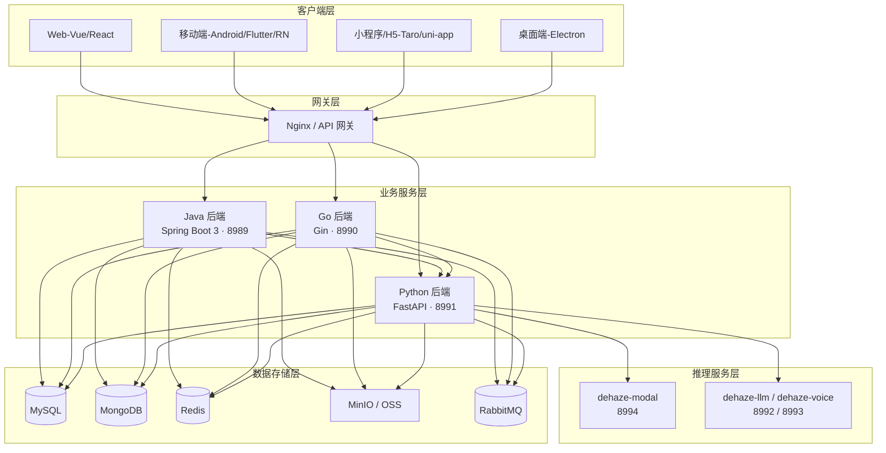

# AI 图像处理平台 (Dehaze System)

<p align="center">
  
</p>

<p align="center">
  <a href="https://gitee.com/earthy-zinc/dehaze-system">
    
  </a>
  <a href="https://gitee.com/earthy-zinc/dehaze-system/stargazers">
    
  </a>
  <a href="https://gitee.com/earthy-zinc/dehaze-system/network">
    
  </a>
</p>

---

## 📋 项目简介

**AI 图像处理平台**（Dehaze System）起源于图像去雾，现已扩展为支持去雾、去雨、去雪、低光增强、超分辨率、去噪、图像修复等多种图像处理任务的端到端平台。

平台采用一套 API 契约、多端多后端架构：契约由 Java / Go / Python 三端后端共同实现，配 Vue / React / Taro / uni-app / Flutter / React Native / Android / Electron 多端前端。

### 核心特性

- **多任务图像处理**：去雾、去雨、去雪、低光增强、超分辨率、去噪、图像修复
- **多模型支持**：集成 30+ 种主流去雾算法，树形模型结构 + 智能推荐
- **实时处理**：WebSocket 实时推送处理进度，支持单张与批量处理
- **专业级对比与评估**：并排 / 重叠 / 放大镜 / 滤镜 / 指标 5 种对比模式，输出 PSNR、SSIM 量化指标
- **多端覆盖**：Web、小程序、H5、Android、iOS、桌面端
- **安全与商业化**：Session + RBAC 权限模型、Redis 分布式锁；VIP 会员 / 套餐 / 订单 / AI 计费闭环

---

## 🏗️ 系统架构



## 🧱 技术栈

| 类别             | 目录                                                         | 技术栈                                                   | 端口            |
| ---------------- | ------------------------------------------------------------ | -------------------------------------------------------- | --------------- |
| 主后端           | `dehaze-java`                                                | Spring Boot 3.5 / MyBatis-Plus / JDK 17 字节码            | 8989            |
| 主后端           | `dehaze-go`                                                  | Gin + GORM / Go 1.25+                                    | 8990            |
| 算法 / AI 编排   | `dehaze-python`                                              | FastAPI + SQLAlchemy 2 / Python 3.11+                    | 8991            |
| MCP 网关         | `dehaze-mcp-gateway`                                         | Python                                                   | 8082            |
| 图像推理         | `dehaze-service/dehaze-modal`                                | 去雾 / 图像质量算法服务                                   | 8994            |
| 文本 / 语音推理  | `dehaze-service/dehaze-llm` · `dehaze-voice`                 | chat / embedding / rerank · asr / tts                    | 8992 / 8993     |
| Web 前端         | `dehaze-front-react` / `dehaze-front-vue`                    | React 19 + Ant Design / Vue 3 + Element Plus + Vite 7     | 5173 / 5174     |
| 小程序 / H5      | `dehaze-taro` / `dehaze-uniapp`                              | Taro / uni-app                                           | 5175 / 5176     |
| 跨平台 / 原生    | `dehaze_flutter` / `dehaze-react-native` / `dehaze-android`  | Flutter / React Native / Android 原生                     | 5177 / 8081 / - |
| SDK              | `dehaze-sdk-js` / `dehaze-android` SDK                       | TypeScript / Android                                     | -               |
| 基础设施         | `docker-compose.yml`                                         | MySQL · Redis · MongoDB · MinIO · RabbitMQ · ES · 监控栈  | -               |

## 📁 目录结构

| 目录                                                                                                                                     | 职责                                       |
| ---------------------------------------------------------------------------------------------------------------------------------------- | ------------------------------------------ |
| `dehaze-java` / `dehaze-go` / `dehaze-python`                                                                                            | 三端后端，同契约三实现                     |
| `dehaze-sdk-js`                                                                                                                          | 前端统一 SDK + API 契约集成测试             |
| `dehaze-front-react` / `dehaze-front-vue` / `dehaze_flutter` / `dehaze-react-native` / `dehaze-android` / `dehaze-uniapp` / `dehaze-taro` | 多端前端                                   |
| `dehaze-service/{dehaze-llm,dehaze-voice,dehaze-modal}`                                                                                   | 外置推理服务                               |
| `dehaze-mcp-gateway`                                                                                                                     | MCP 能力网关                               |
| `dehaze-algorithm` / `dehaze-paper`                                                                                                       | 算法训练与论文                              |
| `config/`                                                                                                                                | 共享 SQL 建表 / 种子、监控与中间件配置       |
| `scripts/`                                                                                                                               | `run.py` 生命周期、数据与安全初始化脚本      |
| `dehaze-doc/docs/`                                                                                                                       | 设计文档                                   |
| `dehaze-test/`                                                                                                                           | 开发工作台（人工联调 / 评估）               |

---

## 🚀 快速开始

```bash
cp .env.example .env                                                                   # 1. 环境变量
pnpm install -r                                                                        # 2. 前端依赖
docker compose up -d mysql redis mongodb minio rabbitmq xxl-job-admin nginx-dataset    # 3. 基础设施
bash scripts/init-security.sh                                                          # 4. 安全初始化（首次）
python scripts/run.py run all                                                          # 5. 启动全部后端
```

前端：`cd dehaze-front-react && pnpm run dev`（5173）或 `cd dehaze-front-vue && pnpm run dev`（5174）。

三端后端统一由 `scripts/run.py` 管理（`run` / `stop` / `restart` / `ps` / `logs`）。完整的环境要求、数据库初始化、各前端启动与监控访问说明见[部署架构](dehaze-doc/docs/02-系统架构/06-部署架构.md)。

---

## 📚 文档

设计与接口文档位于 [`dehaze-doc/docs/`](dehaze-doc/docs/)（VitePress），本地预览：

```bash
cd dehaze-doc && pnpm docs:dev
```
