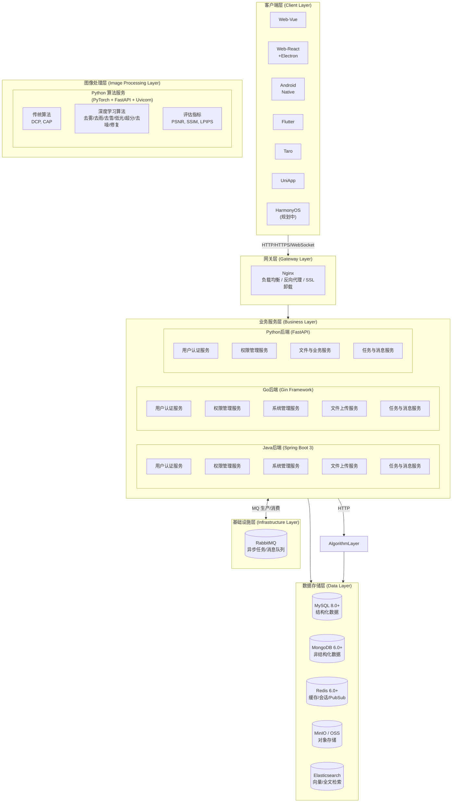
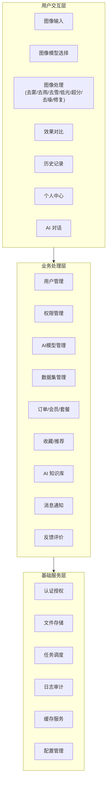
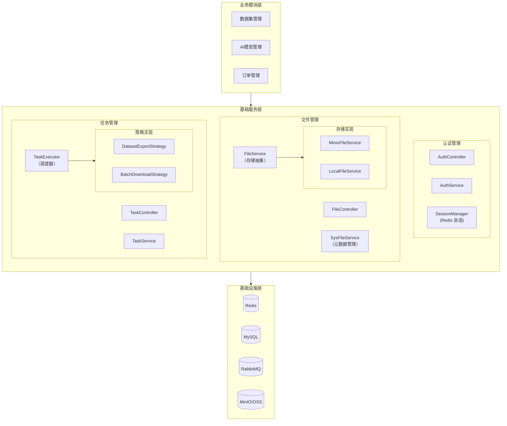
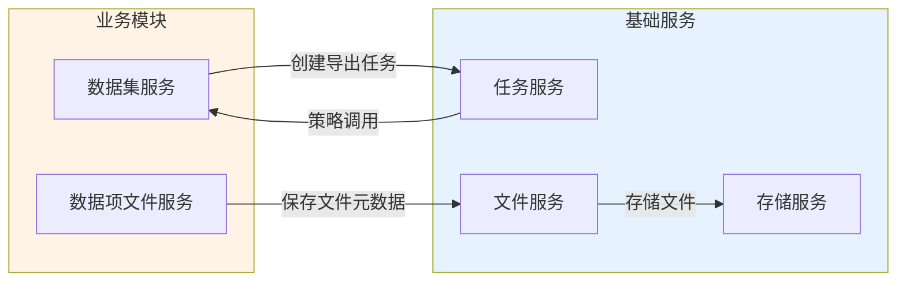
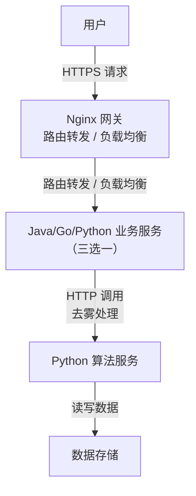
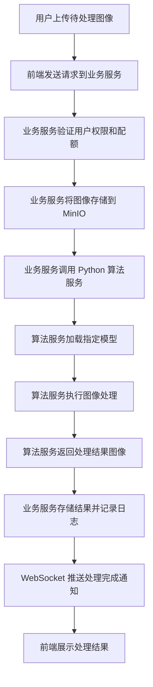

# 澄莹智能图像处理平台 - 总体架构设计

AI 图像处理平台支持去雾、去雨、去雪、低光增强、超分辨率、去噪、图像修复等多种图像处理任务类型。

## 架构设计原则

| 原则       | 说明                                                             |
| ---------- | ---------------------------------------------------------------- |
| 分层架构   | 客户端、网关、业务服务、算法服务、数据存储五层分离，各层职责清晰 |
| 前后端分离 | 前端多端覆盖，后端提供统一 RESTful API                           |
| 微服务化   | 业务服务与算法服务独立部署，支持独立扩缩容                       |
| 多语言支持 | Java/Go/Python 三端后端提供完全一致的 API，Python 兼任算法服务   |
| 安全优先   | Session + RBAC 权限控制，HTTPS 加密传输                          |

## 整体架构设计

### 系统架构图

### 技术架构分层说明

| 层级       | 职责说明                                                                                       | 关键技术                                   | 详细文档                                                             |
| ---------- | ---------------------------------------------------------------------------------------------- | ------------------------------------------ | -------------------------------------------------------------------- |
| 客户端层   | 用户界面交互，多平台覆盖                                                                       | Vue3/React, TypeScript, Vite               | [Vue 架构文档](../04-项目实现/前端/01-Vue架构文档.md) 等各端架构文档 |
| 网关层     | 请求路由、负载均衡、SSL 卸载                                                                   | Nginx                                      | [部署架构](./06-部署架构.md#服务组件)                                |
| 业务服务层 | 用户认证、权限管理、业务逻辑                                                                   | Spring Boot 3 / Gin / FastAPI              | [后端架构文档](../04-项目实现/后端/01-Java架构文档.md)               |
| 图像处理层 | 图像预处理、推理（`clarity-modal`）、后处理、质量评估；图像模型按 `sys_ai_model.task_tags` 归类 | PyTorch + `clarity-modal` 独立服务（8994）  | [Python架构文档](../04-项目实现/后端/03-Python算法服务架构文档.md)   |
| 数据存储层 | 数据持久化、缓存、消息、检索                                                                   | MySQL, MongoDB, Redis, MinIO, RabbitMQ, ES | [数据库设计](./03-数据库设计.md)                                     |

### 业务架构

## 分层架构详细设计

### 前端架构

前端采用组件化架构设计：

| 层次       | 职责                 | 典型目录                |
| ---------- | -------------------- | ----------------------- |
| 页面组件层 | 页面级组件，对应路由 | `views/*.vue`           |
| 业务组件层 | 业务相关可复用组件   | `components/business/*` |
| 基础组件层 | 通用 UI 组件         | `components/common/*`   |
| 状态管理层 | Pinia/Redux 状态管理 | `stores/*.ts`           |
| API 调用层 | 后端 API 封装        | `api/*.ts`              |
| 工具函数层 | 通用工具函数         | `utils/*.ts`            |

目录结构详见 [Vue 架构文档](../04-项目实现/前端/01-Vue架构文档.md) 等前端各端架构文档。

### 后端架构

后端采用经典分层架构，三端（Java/Go/Python）提供完全一致的 API 与统一响应格式（见 [API 规范](./04-API规范.md)），分层职责对齐：

| 层次       | 职责                         | Java                        | Go                | Python            |
| ---------- | ---------------------------- | --------------------------- | ----------------- | ----------------- |
| 接口层     | 接收请求、参数校验、返回响应 | `*Controller.java`          | `handler/*.go`    | `router/*.py`     |
| 服务层     | 业务逻辑处理、事务管理       | `*Service.java`             | `service/*.go`    | `service/*.py`    |
| 数据访问层 | 数据库操作、SQL 映射         | `*Mapper.java`              | `repository/*.go` | `repository/*.py` |
| 模型层     | Entity 实体、DTO、VO         | `entity/*`, `dto/*`, `vo/*` | `model/*.go`      | `model/*.py`      |

目录结构详见 [Java 架构文档](../04-项目实现/后端/01-Java架构文档.md) 等后端各端架构文档。

### 算法服务架构

算法服务采用微服务架构设计，按任务类型路由分发：

| 层次       | 职责                                                                         |
| ---------- | ---------------------------------------------------------------------------- |
| API 接口层 | FastAPI 路由、请求解析、响应封装                                             |
| 任务路由层 | 按模型任务标签（去雾、去雨、去雪、低光、超分、去噪、修复）路由到对应图像模型 |
| 模型调度层 | 图像模型选择、参数配置、任务队列                                             |
| 模型调用层 | 统一模型路由、协议适配、供应商/Key 调度（本地服务与云厂商同构）              |
| 图像处理层 | 图像预处理、推理（clarity-modal）、后处理、质量评估                           |
| 结果返回层 | 结果图像存储、指标计算、响应构建                                             |

### 基础服务层架构

基础服务层为业务模块提供通用能力支撑，采用分层解耦设计：

#### 基础服务模块清单

| 模块        | 职责                                                                                              | 核心组件                                                 | 详细文档                                                              |
| ----------- | ------------------------------------------------------------------------------------------------- | -------------------------------------------------------- | --------------------------------------------------------------------- |
| 认证管理    | 用户身份认证（Session）、验证码、API Key                                                          | AuthService, SessionManager                              | [认证管理/后端实现](../03-模块设计/基础模块/认证管理/后端实现.md)     |
| 文件管理    | 文件上传、下载、MD5 去重、存储抽象                                                                | FileService, SysFileService                              | [文件管理/后端实现](../03-模块设计/基础模块/文件管理/后端实现.md)     |
| 任务管理    | 异步任务调度、进度跟踪、结果管理                                                                  | TaskService, TaskExecutor                                | [任务管理/后端实现](../03-模块设计/基础模块/任务管理/后端实现.md)     |
| 缓存服务    | 多级缓存（L1 本地缓存 + L2 Redis）、防穿透防护（布隆/SingleFlight/空值缓存）                      | MultiLevelCacheManager, CacheService                     | [Java架构文档](../04-项目实现/后端/01-Java架构文档.md)                |
| 日志审计    | 登录审计（MongoDB）、业务操作审计（白名单驱动）、日志契约                                         | 三端 Logger + 后端接收 API                               | [日志架构设计](./07-日志架构设计.md)                                  |
| AI 模型管理 | 模型供应商配置（API Key 加密、负载均衡、健康容错）、模型注册表（chat/embedding/rerank）与生命周期 | AiProviderService, AiModelService, ProviderHealthService | [AI模型管理/后端实现](../03-模块设计/基础模块/AI模型管理/后端实现.md) |

#### 设计原则

| 原则     | 说明                   | 示例                                   |
| -------- | ---------------------- | -------------------------------------- |
| 单一职责 | 每个服务只负责一类功能 | FileService 只负责存储，不处理业务逻辑 |
| 依赖倒置 | 依赖抽象而非具体实现   | TaskExecutor 依赖 TaskStrategy 接口    |
| 开闭原则 | 扩展开放，修改关闭     | 新增存储后端只需实现 FileService 接口  |
| 事件驱动 | 模块间通过事件解耦     | 文件创建发布事件，统计模块监听更新     |

#### 模块间依赖关系

**依赖规则**：

- 业务模块 → 基础服务：允许直接依赖
- 基础服务 → 基础服务：允许（如 SysFileService → FileService）
- 基础服务 → 业务模块：不直接依赖，通过策略模式或事件驱动解耦
- 循环依赖：禁止，使用事件或策略模式打破

## 数据流设计

### 用户请求处理流程

### 图像处理完整流程

### 数据存储策略

表结构与 ER 关系见 [数据库设计](./03-数据库设计.md)。

| 数据类型   | 存储位置      | 说明                                                                              |
| ---------- | ------------- | --------------------------------------------------------------------------------- |
| 业务数据   | MySQL         | 用户信息、权限配置、订单数据、业务任务记录（预测/评估日志）、商业化数据、消息通知 |
| 审计日志   | MongoDB       | 登录审计日志（login\_log）、业务操作审计日志（audit\_log，含变更前后快照）        |
| 缓存与会话 | Redis         | 业务缓存、Session 存储、分布式锁、限流计数器、Pub/Sub 消息中继                    |
| 消息与任务 | RabbitMQ      | 异步任务生产消费、死信重试、消息通知分发                                          |
| 向量与检索 | Elasticsearch | 知识库向量索引（`kb_chunks_{id}`）、RAG 检索                                      |
| 文件数据   | MinIO/OSS     | 原始图像、去雾结果、模型文件                                                      |

**存储分层原则**：
是否需要和业务表做 JOIN 查询？

- 需要 → MySQL
- 不需要，且为只追加审计 → MongoDB；
- 需要向量/全文检索 → Elasticsearch；
- 纯内存临时数据 → Redis；
- 文件二进制 → MinIO；
- 异步解耦 → RabbitMQ。

RabbitMQ 消费失败时按消息头 `x-retry-count` 投递到对应级别的 TTL 重试队列，超阈值后 reject 入死信队列。

### 实时通信机制

系统使用 WebSocket 实现实时消息推送，由 **消息通知模块** 统一承载：

| 场景         | 说明                     |
| ------------ | ------------------------ |
| 处理进度推送 | 异步任务处理进度实时反馈 |
| 结果通知     | 处理完成/失败通知        |
| 系统消息     | 维护通知、权限变更通知   |

**技术方案**：Java 端使用 STOMP/SockJS + Redis Pub/Sub，Python/Go 端使用原生 WebSocket，三端消息格式一致（`new_message` 事件）；WebSocket 用于在线用户实时 UI 更新，外部渠道（APP 推送、邮件、短信）由推送分发器异步执行。详见 [消息通知/后端实现](../03-模块设计/基础模块/消息通知/后端实现.md)

## 安全架构设计

### 认证授权机制

| 机制         | 说明                                                      |
| ------------ | --------------------------------------------------------- |
| Session 认证 | Redis 存储会话状态，客户端通过 `X-Session-Id` Cookie 传递 |
| RBAC 权限    | 用户 → 角色 → 权限 三级权限模型                           |
| 权限标识     | 格式：`模块:功能:操作`，如 `sys:user:add`                 |

### 数据安全

| 安全措施     | 实现方式                                                 |
| ------------ | -------------------------------------------------------- |
| 传输加密     | HTTPS/TLS 1.3 加密传输                                   |
| 存储加密     | 敏感数据（密码）BCrypt 加密存储                          |
| 访问控制     | 基于角色的数据访问控制（数据权限）                       |
| 行级数据权限 | 基于角色 `data_scope` 的行级过滤，三端实现一致（见下表） |
| Token 安全   | Session 由 Redis 管理，TTL 7 天，剩余 < 24h 自动续期     |

#### 行级数据权限（DataScope）

基于角色 `data_scope` 字段实现行级数据可见性控制，三端 API 契约一致、过滤语义一致，实现方式因 ORM 差异各不相同：

| 端     | 实现方式                                                                       | 生效位置                |
| ------ | ------------------------------------------------------------------------------ | ----------------------- |
| Java   | MyBatis-Plus `DataPermissionInterceptor` + `@DataPermission` 注解              | Mapper 查询自动追加条件 |
| Go     | GORM Plugin `dataScopeCallback`（`Before("gorm:query")`/`Before("gorm:row")`） | Repository 查询自动过滤 |
| Python | 显式调用 `apply_data_scope(stmt, user, db, dept_field, creator_field)`         | Repository 查询显式过滤 |

**data_scope 取值**（`sys_role.data_scope`）：

|     取值     | 含义         | 过滤条件                           |
| :----------: | ------------ | ---------------------------------- |
| `NULL` / `0` | 全部数据     | 不过滤（ROOT 用户始终跳过）        |
|     `1`      | 部门及子部门 | `dept_field IN (本部门及子部门ID)` |
|     `2`      | 本部门       | `dept_field == user.dept_id`       |
|     `3`      | 本人         | `creator_field == user.id`         |

Python 端因异步 ORM 下 ContextVar 在 event 回调中不可靠，采用显式过滤而非自动 SQL 改写；需数据权限的 Repository 查询方法新增 `current_user` 参数，由 Service 层透传。详见 [Python 后端架构文档](../04-项目实现/后端/03-Python算法服务架构文档.md#行级数据权限datascope)。

### 应用安全

| 安全措施   | 说明                              |
| ---------- | --------------------------------- |
| 输入验证   | 参数校验，防止 SQL 注入、XSS 攻击 |
| 防重复提交 | Token 机制防止表单重复提交        |
| 速率限制   | 接口限流，防止恶意请求和 DDoS     |
| 日志审计   | 关键操作记录审计日志              |
| 文件校验   | 上传文件类型、大小、内容校验      |

## 扩展性设计

### 水平扩展能力

| 扩展维度   | 实现方式                       |
| ---------- | ------------------------------ |
| 服务扩展   | 无状态服务设计，支持水平扩缩容 |
| 数据库扩展 | 读写分离、分库分表             |
| 缓存扩展   | Redis Cluster 动态扩容         |
| 存储扩展   | MinIO 分布式存储               |

### 算法扩展机制

新增图像处理算法只需在 `algorithm/<name>/run.py` 中实现统一入口函数并声明任务类型：

| 函数签名                         | 说明                                                       |
| -------------------------------- | ---------------------------------------------------------- |
| `dehaze(haze_image, model_path)` | 执行图像处理，接收图像字节流与模型路径，返回处理结果字节流 |

**扩展流程**：新建 `algorithm/<name>/run.py`（实现 `dehaze` 函数）→ 上传模型权重 → 管理后台注册算法（声明 `task_type`）→ 算法服务按任务类型自动路由加载

**任务类型**：`dehaze`（去雾）/ `derain`（去雨）/ `desnow`（去雪）/ `lowlight`（低光增强）/ `super_resolution`（超分辨率）/ `denoise`（去噪）/ `inpaint`（图像修复）

算法目录维持平铺结构（`algorithm/<name>/run.py`）；模型统一由 `model_loader.py` 加载，接口规范详见 `clarity-service/clarity-modal/algorithm/` 实现（算法执行已外置为独立服务，clarity-python 仅经 `/v1/inference` 调用）。

### 功能扩展

| 扩展能力     | 说明                                    |
| ------------ | --------------------------------------- |
| 插件化架构   | 支持功能模块插件化接入                  |
| API 版本管理 | URL 路径版本控制 `/api/v1/`, `/api/v2/` |

## 关键技术决策

### 三后端统一方案

系统提供 Java、Go、Python 三套后端实现，**API 契约完全一致**（Java 为 spec 唯一权威来源，Go/Python 对齐），可按部署环境选择其一承载业务：

| 方案               | 优势                             | 适用场景              |
| ------------------ | -------------------------------- | --------------------- |
| Java (Spring Boot) | 生态完善、企业级特性丰富         | 传统企业、大型团队    |
| Go (Gin)           | 高性能、低资源占用               | 云原生环境、追求性能  |
| Python (FastAPI)   | 与算法服务同语言栈，兼任算法服务 | 算法密集、AI 业务为主 |

**但实现归属不同**：AI 域（`sys_ai_*`）端点**按端点**分两类，接口变更时据此判断同步范围（分类含义仅限 AI 域端点，与 [API 规范](./04-API规范.md) 中错误码的 `A0`/`B0` 段位无关）：

| 类别               | 实现归属                              | 判定与覆盖范围                                                                                                                                                                                                                                                                                                           |
| ------------------ | ------------------------------------- | ------------------------------------------------------------------------------------------------------------------------------------------------------------------------------------------------------------------------------------------------------------------------------------------------------------------------ |
| AI 域 A 类（原生） | Java / Go / Python 各自原生实现       | 同套 `sys_ai_*` 契约的配置、CRUD 与查询——会话与消息 CRUD、模型、供应商、密钥、计费、账单与余额、用户偏好、可观测查询、评测中心、记忆与用量统计等；接口变更须三端同步实现（含各自单测）                                                                                                                                   |
| AI 域 B 类（转发） | 仅 Python 实现，Java / Go 转发至 8991 | 强依赖 deepagents / LLM / 向量检索或 Python 进程内资源的运行时端点——对话推理 SSE、Agent、Skill、模型、供应商试运行与发布门禁、MCP 探测、评测派发、定时任务手动触发、知识库索引生命周期与文档处理、检索、语音 ASR、TTS、A2A JSON-RPC 入口、OpenAI、Claude 兼容协议；变更只在 `clarity-python` 落地，Java / Go 只维护转发项 |

同一模块可同时含两类端点（如知识库：库列表查询为 A 类，库创建/删除、文档处理与向量检索为 B 类；A2A：Agent Card 为 A 类，JSON-RPC 入口为 B 类），故 **B 类清单以各端转发白名单为唯一口径**，不按模块整体判断。

转发白名单是转发面的唯一入口（Java `service/client/AiProxyRoutes.java`、Go `router/ai_proxy.go` 与 `voice_proxy.go`，共用 `pkg/aiclient` 通道）：行为事实源为 Python，白名单**未登记的路径一律 404，不按客户端传入路径盲转发**（防 SSRF）；增删 B 类端点时白名单须与 `clarity-python/app/router` 逐条对齐。

### 算法服务独立部署

算法服务使用 Python 独立部署的原因：

- 深度学习生态以 Python 为主（PyTorch、TensorFlow）
- GPU 资源独立管理，不影响业务服务
- 支持算法热更新，业务服务无需重启

### 前端多端统一方案

| 方案          | 原因                           |
| ------------- | ------------------------------ |
| Vue/React Web | 主流 Web 技术，生态完善        |
| Flutter/RN    | 跨平台移动端，一套代码多端运行 |
| UniApp/Taro   | 小程序生态覆盖                 |
