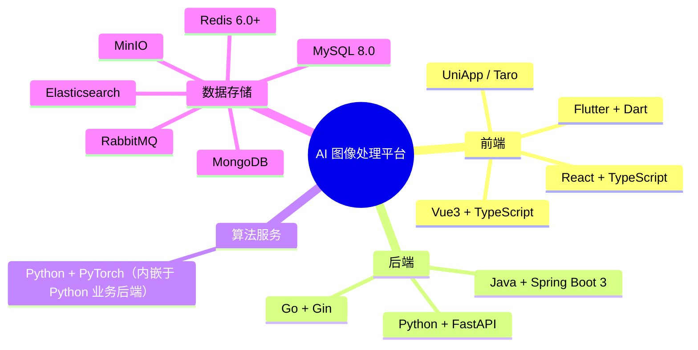

# 澄莹智能图像处理平台 - 环境与兼容性要求

## 技术栈全景

## 硬件环境要求

### 开发环境

| 组件 | 最低配置   | 推荐配置                 |
| ---- | ---------- | ------------------------ |
| CPU  | 4 核       | 8 核+                    |
| 内存 | 8 GB       | 16 GB+                   |
| 存储 | 100 GB SSD | 256 GB SSD               |
| GPU  | -          | NVIDIA GPU（开发算法时） |

本项目采用 dev / pre（preview）双环境：dev 用于开发自测与热更新，pre 只测不开发。两环境对硬件的需求一致（均复用同一组中间件实例），数据层隔离与环境变量差异见 [10-多环境部署实践](./10-多环境部署实践.md)。

### 算法服务生产环境

| 项目       | 要求                                    |
| ---------- | --------------------------------------- |
| 操作系统   | Ubuntu 18.04+ / Windows 10+ / CentOS 7+ |
| CPU        | 8 核+                                   |
| 内存       | ≥ 16 GB（推荐 32 GB）                   |
| GPU        | NVIDIA GPU，显存 ≥ 8 GB（推荐 16 GB+）  |
| GPU Driver | 450+                                    |
| CUDA       | 10.1+ / 11.x / 12.x                     |

### 业务服务生产环境

| 服务类型   | CPU   | 内存  | 存储       |
| ---------- | ----- | ----- | ---------- |
| 业务服务   | 4 核+ | 8 GB+ | 50 GB SSD  |
| 数据库服务 | 4 核+ | 8 GB+ | 200 GB SSD |
| Redis 服务 | 2 核+ | 4 GB+ | 20 GB SSD  |
| MinIO 存储 | 2 核+ | 4 GB+ | 500 GB+    |

## 中间件版本

### 数据库

| 中间件  | 版本要求 | 说明       |
| ------- | -------- | ---------- |
| MySQL   | 8.0+     | 主数据库   |
| MongoDB | 6.0+     | 文档数据库 |
| Redis   | 6.0+     | 缓存/消息  |

### 存储与网关

| 中间件 | 版本要求 | 说明              |
| ------ | -------- | ----------------- |
| MinIO  | 最新     | 对象存储          |
| Nginx  | 1.20+    | 反向代理/负载均衡 |

### 容器化

| 中间件         | 版本要求 | 说明             |
| -------------- | -------- | ---------------- |
| Docker         | 20.10+   | 容器运行时       |
| Docker Compose | 2.x      | 容器编排         |
| Kubernetes     | 1.24+    | 集群编排（可选） |

## 版本兼容性矩阵

### 前端兼容性

| 浏览器  | 最低版本 | 说明 |
| ------- | -------- | ---- |
| Chrome  | 90+      | 推荐 |
| Firefox | 88+      | 支持 |
| Safari  | 14+      | 支持 |
| Edge    | 90+      | 支持 |

### 移动端兼容性

| 平台      | 最低版本     |
| --------- | ------------ |
| Android   | 7.0 (API 24) |
| iOS       | 12.0         |
| HarmonyOS | 3.0          |

### Node.js 兼容性

| 项目               | Node.js 版本 |
| ------------------ | ------------ |
| clarity-front-vue   | ≥ 18.0.0     |
| clarity-front-react | ≥ 18.0.0     |
| clarity-taro        | ≥ 16.0.0     |

### 运行时版本

| 运行时 | 版本要求                |
| ------ | ----------------------- |
| JDK    | 17+                     |
| Go     | 1.20+                   |
| Python | 3.8 - 3.11（推荐 3.10） |
