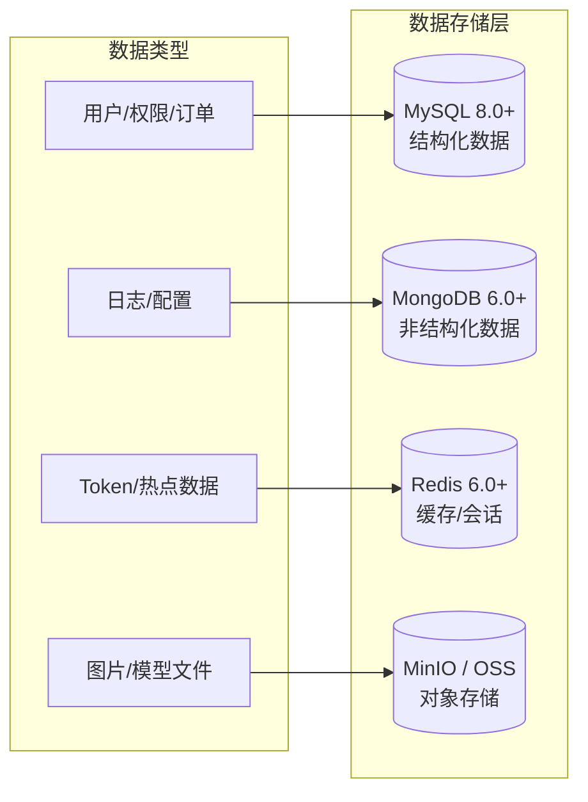
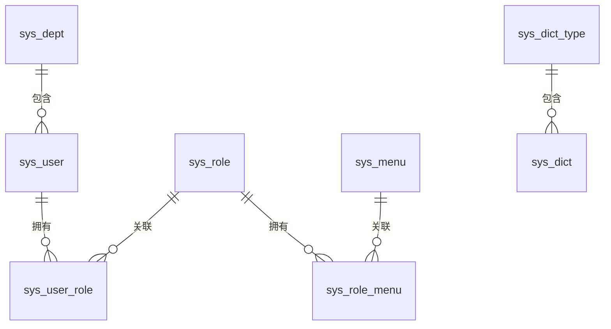
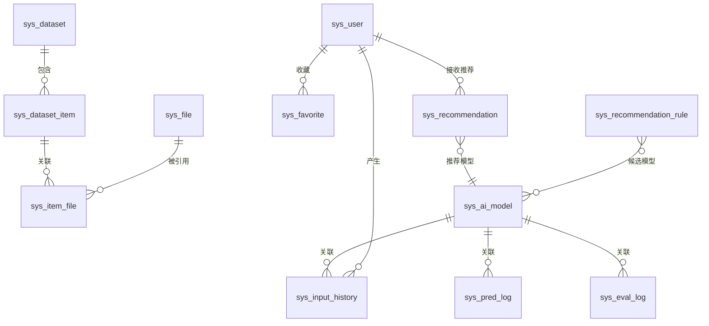
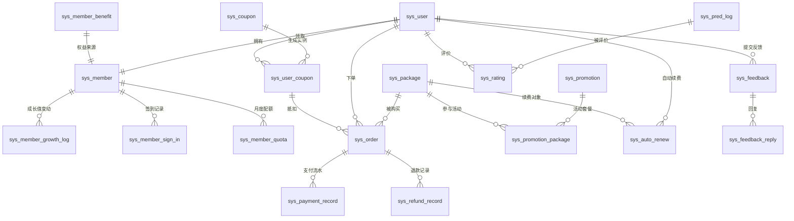
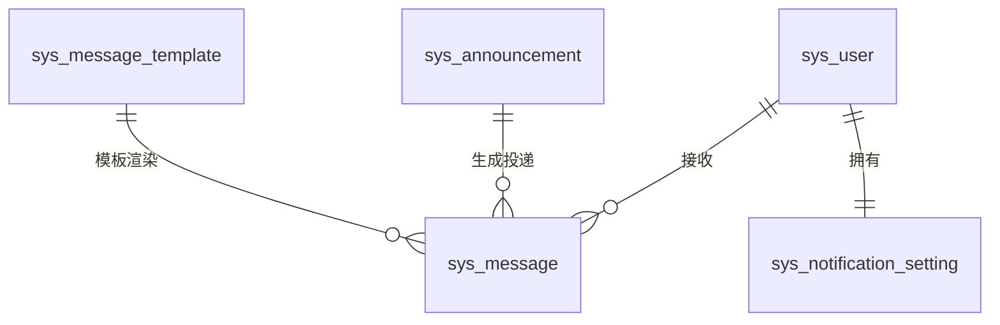
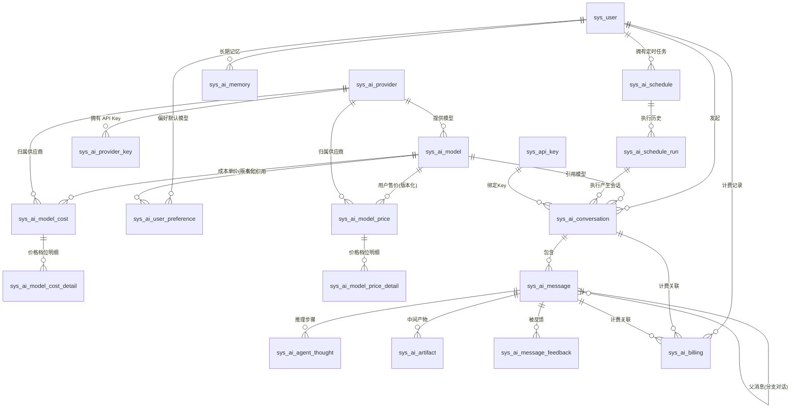
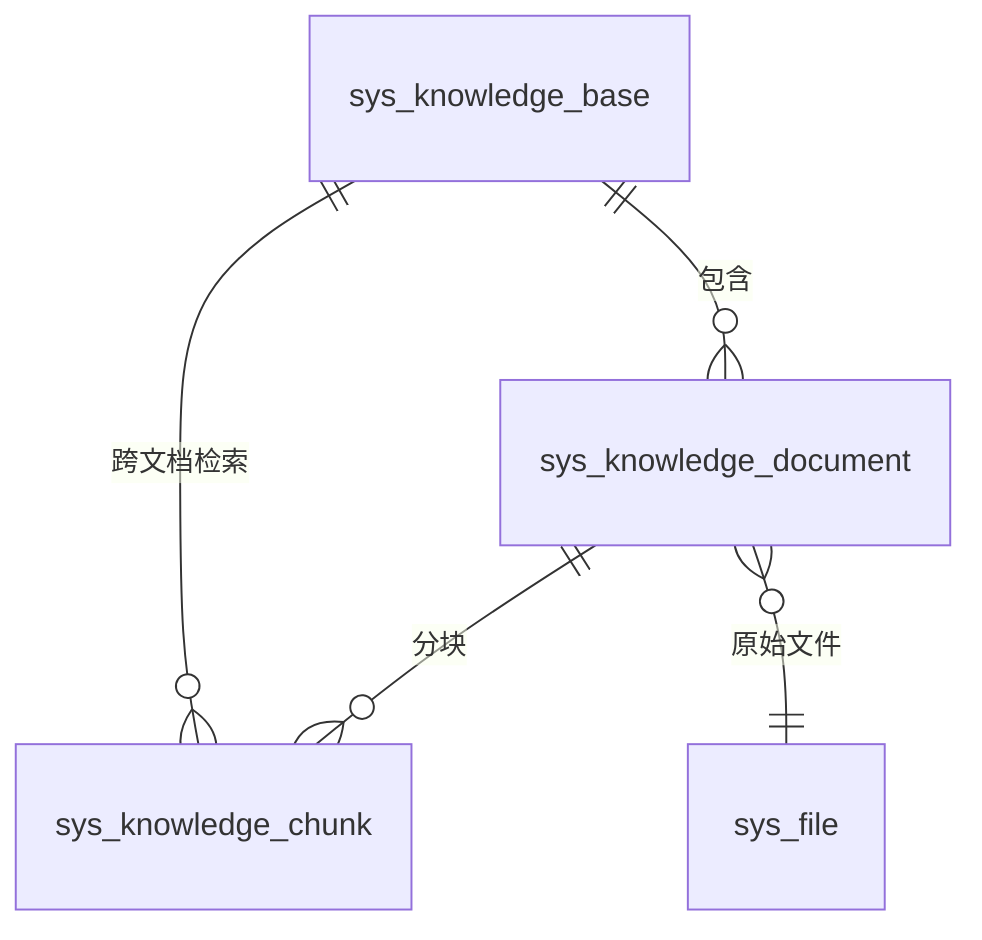

# 澄莹智能图像处理平台 - 数据库设计

## SQL 文件位置

数据库脚本存放在项目根目录 `config/sql/` 下，三个后端（clarity-java / clarity-go / clarity-python）共享同一套 schema。表结构、字段定义与索引的权威定义在 `config/sql/schema/` 下，此处只写选型、ER 关系与跨表设计决策，不重复 DDL 细节。文件组织如下：

- `schema/` 目录按表名拆分，每个 `.sql` 文件对应一张表，文件头部以注释形式记录该表的设计思路、关键字段语义和枚举值。修改表结构时只需编辑对应文件。
- `data/` 目录同样按表名拆分，每个 `.sql` 文件存放对应表的 `INSERT` 初始化数据（菜单、角色、字典、部门等），文件名与 `schema/` 一一对应。
- `load-data.sh` 是 Docker 初始化辅助脚本，在所有 schema 建表完成后按序执行 `data/` 下的数据文件。

Docker 初始化：MySQL 容器通过 `MYSQL_DATABASE=dehaze` 自动建库，`schema/` 目录挂载到 `docker-entrypoint-initdb.d/` 按文件名排序先执行建表，`load-data.sh` 脚本（命名前缀 `zz_` 保证排在最后）随后执行 `data/` 目录下所有数据文件。

## 数据库选型

### 多数据库架构

系统采用多种数据库技术来满足不同的数据存储需求：

### 数据库职责划分

| 数据库    | 版本 | 用途             | 存储内容                                                                                                                                                            |
| --------- | ---- | ---------------- | ------------------------------------------------------------------------------------------------------------------------------------------------------------------- |
| MySQL     | 8.0+ | 业务数据库       | 用户、角色、菜单、部门、字典、数据集、AI 模型（图像、语音、文本统一注册）、文件元数据、业务任务记录（图像任务、评估日志）、商业化数据（会员、订单、套餐）、消息通知 |
| MongoDB   | 6.0+ | 审计日志数据库   | 登录审计日志（login\_log）、业务操作审计日志（audit\_log，含变更前后快照）                                                                                          |
| Redis     | 6.0+ | 缓存与会话数据库 | 业务缓存、Session 存储、分布式锁、限流计数器、Pub/Sub 消息中继                                                                                                      |
| MinIO/OSS | -    | 对象存储         | 图片文件、模型权重文件、导出文件                                                                                                                                    |

存储分层原则：是否需要和业务表做 JOIN 查询？需要 → MySQL；不需要 → MongoDB。

## ER 关系图

### 系统管理模块 ER 图

### 业务模块 ER 图

### 商业化模块 ER 图

### 消息通知模块 ER 图

### AI 对话模块 ER 图

### AI 知识库模块 ER 图

## 模块数据设计总览

### 系统管理模块

系统管理模块采用经典 RBAC 模型，通过 `sys_user`、`sys_role`、`sys_menu` 三张主表及 `sys_user_role`、`sys_role_menu` 两张多对多关联表实现权限分配。

部门表和菜单表采用树形结构，通过 `parent_id` + `tree_path` 实现层级与子树加速查询。角色的 `data_scope` 控制数据权限粒度（全部、部门及子部门、本部门、本人），由后端查询时动态拼接条件。

`sys_menu.is_preset` 标记随种子数据发布的预置菜单：预置菜单不可删除、不可修改 `type` 与 `perm`（防止权限体系与导航骨架被破坏），展示类属性可正常修改；接口不提供修改该标识的入口，业务侧新增的菜单一律为 0。保护规则详见 [菜单管理/需求规格.md](../03-模块设计/基础模块/菜单管理/需求规格.md)。

字典（`sys_dict_type` / `sys_dict`）采用类型-数据项两级结构，通过 `type_code` 关联，集中管理可枚举配置项，避免代码硬编码。

### 核心业务模块

业务模块围绕数据集、图像模型、文件三个核心实体展开：

- **数据集**：`sys_dataset` 树形嵌套组织，挂载数据项 `sys_dataset_item`，经 `sys_item_file` 与文件表 `sys_file` 多对多关联；`sys_item_file` 同时承载图片类型与场景标注元数据，使一条数据项可同时关联雾图与清晰图（GT）。
- **图像模型**：图像模型（去雾、去雨、超分等）作为 `sys_ai_model` 中 `model_type=image_edit` 的行统一注册（供应商 `local-modal` 或云厂商），任务标签 `task_tags` 承载原算法任务类型；模型清单的技术事实源为 clarity-modal `/v1/models` 目录扫描，DB 行只承载启停、展示、计费、归因。
- **文件**：`sys_file` 以 MD5 唯一索引去重，只存与环境无关的稳定标识（`object_name` + `storage`），完整访问 URL 一律运行时拼接、不落库；`sys_input_history` 记录用户图像处理操作，冗余模型名避免频繁 JOIN。

#### 收藏管理模块

`sys_favorite` 统一收藏表，以 `target_type` + `target_id` 多态收藏任意业务实体（模型、处理结果、数据集等），唯一索引防同一用户重复收藏，`is_invalid` 标记收藏对象失效（源对象删除时置位），取消后重收藏通过 upsert 复活原行。

#### 推荐管理模块

`sys_recommendation` 记录每次推荐请求（图像特征向量与 Top 3 推荐列表以 `json` 存储，用户反馈与采纳模型用于效果度量，只追加不逻辑删除）；`sys_recommendation_rule` 配置"场景 → 候选模型"规则（`model_ids` 存候选图像模型标识，权重控制优先级，支持启停灰度）。

### 业务任务记录模块

`sys_pred_log` / `sys_eval_log` 分别记录图像任务与评估操作的完整任务记录。**这两张表是业务任务记录而非"日志"，存储在 MySQL**——有状态机、外键关联、索引查询和分页 API。

两张表通过 `model_id` + 原图/结果图 MD5 实现缓存查询（相同模型处理相同图片直接返回历史结果）；配合异步处理引入 `status` 追踪任务状态，失败时记录错误信息。`sys_pred_log` 另含 `provider_id`（归因）、`vendor_task_id`（异步厂商任务号）、`actual_model`（降级对齐 chat）列。评估日志的指标结果（PSNR/SSIM/LPIPS 等）以 `json` 存储。`sys_pred_log.recommended_by` 记录推荐来源（推荐记录 ID，请求接收 `recommendedBy` 落库），供推荐效果报表统计采纳率；`sys_eval_log.task_type` 区分同表存储的效果评估（evaluation）与对比报告（report）任务，`GET /evaluation/metrics` 仅返回 `task_type='evaluation'` 行。日志表为只追加记录，不使用逻辑删除。

异步任务调度由 `sys_task` 表配合 RabbitMQ 实现生产消费分离，统一承载导入导出与图像处理任务：`task_type` 区分任务类型，`task_id`/`idempotency_key` 唯一索引保证可查询与幂等，`status` 使用 5 状态机，任务参数与结果以 `json` 存储（导出结果只存对象键，下载 URL 运行时拼接）。只追加记录，不使用逻辑删除。

### 审计日志模块（MongoDB）

审计日志采用 MongoDB 存储，与业务 MySQL 分离，遵循"只追加、无 JOIN、schema 可演化"原则，包含两个集合：

- **login_log（登录审计）**：记录用户登录成功/失败信息（用户、IP、终端、结果、时间），三端在 AuthService 中异步写入，写入失败不影响登录主流程。
- **audit_log（业务操作审计）**：白名单驱动，仅审计会员、订单、数据集、角色、用户的核心写操作，`before_value`/`after_value` 为变更前后 JSON 快照——不同业务快照结构不同，正是 schema-free 的典型场景。
- **ai_api_call_log（AI 兼容 API 调用审计）**：记录每次第三方兼容 API 调用（含 401/403/429 被拒绝、限流的调用）

### 商业化模块

商业化模块围绕会员体系、套餐交易、优惠券、评价反馈四条主线展开：

- **会员**：`sys_member` 与用户一对一，注册时自动初始化，记录等级、成长值；成长值变动（`sys_member_growth_log`）、签到（`sys_member_sign_in`）明细化记录；各等级默认权益配置在 `sys_member_benefit`（含月度积分赠送 `vip_gift_credits`、批量上限 `batch_limit`、历史保留 `history_retention`、AI 限额与同时在线设备数上限 `max_devices`，默认梯度 1/3/5/10）；会员权益为**月度积分赠送**（月度任务 `grantVipMonthlyGift`，写 `sys_ai_credit_log` 的 `vip_gift` 流水）+ 折扣；图像处理与评估不校验/扣减任务配额，消耗与计费统一以积分为口径（`sys_member.monthly_*_quota/used` 等为保留字段，仅供管理端「权益使用」展示）。
- **套餐交易（商品中心）**：`sys_package` 是"商品打包售卖"的抽象，`package_type` 区分会员卡（vip，履约会员身份权益）与积分卡（credit，履约积分余额，AI 加量包）；会员卡等级权益覆盖项以 `benefit_overrides`（JSON）存储；`sys_promotion` + `sys_promotion_package` 支撑活动与商品多对多（关联表承载折扣参数为唯一权威，活动表不冗余适用范围）；优惠券采用模板-实例两级（`sys_coupon` → `sys_user_coupon`）；`sys_order`/`sys_payment_record`/`sys_refund_record` 记录完整交易链路，订单冗余商品类型与可得积分（`package_type`/`credit_amount`），退款记录含售后原因类型与按类型折算依据（`reason_type`/`used_days`/`used_credits`），渠道流水号唯一约束保证支付回调幂等；`sys_balance`/`sys_balance_log` 为人民币余额账户与流水（交易媒介，乐观锁防超卖）；`sys_recharge` 为余额充值订单（微信/支付宝渠道下单，渠道流水号唯一约束保证回调幂等，支付成功入账并写 recharge 流水）；`sys_reconciliation` 为渠道对账差异记录（每日对账任务产出：system_only 系统多单 / channel_only 渠道多单 / amount_mismatch 金额不符，`recon_date+flow_no` 唯一，重跑全量重写）；`sys_auto_renew` 由定时任务扫描续费（仅会员卡）。
- **评价反馈**：`sys_rating` 通过 `pred_log_id` 唯一约束保证每条处理记录仅可评价一次；`sys_feedback` + `sys_feedback_reply` 记录反馈与处理过程；低分评价由后端逻辑触发告警，不单独建表。

### 消息通知模块

消息通知模块是统一消息分发与触达中心，由四张表构成：`sys_message` 存储投递消息（`type` 区分消息类型，`biz_module`+`biz_id` 幂等去重，已读、软删、过期清理）；`sys_message_template` 存储通知模板（`{varName}` 变量占位，JSON 存渠道与变量定义）；`sys_notification_setting` 每用户一行存储推送偏好（JSON）；`sys_announcement` 管理公告定义，发送时按 `target_scope` 批量生成 `sys_message`，实现内容管理与投递分离。

### AI 对话模块

AI 对话模块是 AI 工作平台的交互中枢，以通用大语言模型为底座，通过对话式统一入口调度图像处理、指标评估、图像模型选择等系统能力。数据模型参考 OpenAI Assistants API（Thread/Run/RunStep）、Dify（Conversation/Message/MessageAgentThought）、LangGraph（checkpoint 持久化）等主流实现，由业务表（其中 `sys_ai_billing`/`sys_ai_credit_log`/`sys_ai_refund`/`sys_ai_model_cost`/`sys_ai_model_cost_detail` 归 AI 计费管理模块；`sys_ai_provider`/`sys_ai_provider_key`/`sys_ai_model`/`sys_ai_model_price`/`sys_ai_model_price_detail`/`sys_ai_user_preference` 归 AI 模型管理模块）+ LangGraph 框架管理的检查点表构成：

| 表                          | 职责                     | 关键设计决策                                                                                                                                                                                                                                                                                                                                                                                                                                                                                                                                          |
| --------------------------- | ------------------------ | ----------------------------------------------------------------------------------------------------------------------------------------------------------------------------------------------------------------------------------------------------------------------------------------------------------------------------------------------------------------------------------------------------------------------------------------------------------------------------------------------------------------------------------------------------- |
| `sys_ai_agent`              | 智能体配置               | Agent 主表（系统提示词、模型、推理范式、配置 JSON、类型标识、权限规则、护栏配置、`tags` 分类标签 JSON 数组），`agent_code` 唯一（唯一键含 deleted，软删后可重建），`is_exposed` 控制对外 A2A 暴露                                                                                                                                                                                                                                                                                                                                             |
| `sys_ai_agent_skill`        | Agent-Skill 关联         | 关联表，覆盖式更新，不使用逻辑删除                                                                                                                                                                                                                                                                                                                                                                                                                                                                                                                    |
| `sys_ai_agent_mcp`          | Agent-MCP 命名空间关联   | 关联表，覆盖式更新，不使用逻辑删除                                                                                                                                                                                                                                                                                                                                                                                                                                                                                                                    |
| `sys_ai_agent_subagent`     | Agent-Subagent 关联      | 自引用关联（含优先级），Team 团队关系复用此表；`endpoint_id` 区分本地/远程子 Agent；关联表，覆盖式更新                                                                                                                                                                                                                                                                                                                                                                                                                                                |
| `sys_ai_agent_version`      | Agent 版本快照           | 草稿、已发布状态、不可变配置快照、变更说明，`(agent_id, version_no)` 唯一；只追加不逻辑删除，支撑发布、回滚、差异对比                                                                                                                                                                                                                                                                                                                                                                                                                                 |
| `sys_ai_agent_eval_dataset` | 评测集                   | `dataset_type`（`dev`/`regression`/`heldout`）+ `agent_id`，开发集日常调试、回归集发布门禁、保留集阶段验收；逻辑删除（唯一键含 deleted，软删后可重建）；归 Agent 评测（F-M08-014）                                                                                                                                                                                                                                                                                                                                                            |
| `sys_ai_agent_eval_sample`  | 评测样本                 | 任务目标、期望工具调用（有序 `tools`，每项 `{"name","args"}`）/期望过程、结果、禁止行为、风险等级，每条含可审计的通过失败条件；随数据集管理，不逻辑删除；归 Agent 评测（F-M08-014）                                                                                                                                                                                                                                                                                                                                                                   |
| `sys_ai_agent_eval_run`     | 评测执行记录             | 触发方式、状态、四维评分摘要、样本明细 JSON；发布审计轨迹，只追加不逻辑删除；归 Agent 评测（F-M08-014）                                                                                                                                                                                                                                                                                                                                                                                                                                               |
| `sys_ai_eval_review`        | 评测人工复核             | 判分结果抽样（失败样本全量 + 通过样本按 `ai_eval.judge_review_ratio` 确定性抽样）+ 人工判定回填（一致/不一致），`uk_run_sample` 幂等去重；复核一致率供判分漂移检测；已复核项不可重复回填；归 Agent 评测（F-M08-014）                                                                                                                                                                                                                                                                                                                                  |
| `sys_ai_agent_endpoint`     | 外部 A2A 端点            | 外部 Agent 注册（Agent Card 地址、端点、认证凭证密文）；逻辑删除（唯一键含 deleted，软删后可重建）                                                                                                                                                                                                                                                                                                                                                                                                                                            |
| `sys_ai_mcp_server`         | 外部 MCP Server 注册     | 任意符合 MCP 规范的 URL 型外部服务接入中心（名称、传输协议、端点、鉴权方式、凭据密文 JSON）；`protocol_type` 仅支持 streamable-http/sse（stdio 无网络端点，拉取、装载、探测均不支持）；`name` 唯一（唯一键含 deleted，软删后可重建），凭据 AES 加密存储（不落明文、不暴露 LLM），`last_check_time` 记录最近一次探测时间（手动探测与后台巡检共用），健康状态（online/offline）探测降级标记不落运行日志                                                                                                                                         |
| `sys_ai_mcp_tool`           | 外部 MCP Server 工具清单 | 注册/拉取时覆盖式重建（工具随 Server 生命周期管理），`input_schema` 存参数 schema 概要（JSON），不逻辑删除                                                                                                                                                                                                                                                                                                                                                                                                                                            |
| `sys_ai_mcp_namespace`      | 外部 MCP Server 命名空间 | 工具分组配置，`tool_names` 存组内工具名数组（JSON）便于覆盖式更新；对齐 SDK `McpNamespaceVO{name,toolNames}`（`namespace` 列即 VO.name）                                                                                                                                                                                                                                                                                                                                                                                                              |
| `sys_ai_mcp_call`           | 外部 MCP 工具调用审计    | 谁、何时、调用了什么工具、结果、耗时，`server_name` 冗余快照避免关联软删 Server；只追加不逻辑删除                                                                                                                                                                                                                                                                                                                                                                                                                                                     |
| `sys_ai_provider`           | 模型供应商               | 供应商配置（API 地址、协议类型、认证方式、健康检查开关、超时、用户身份透传配置、备注），`provider_code` 唯一不可复用（白名单，应用层查全表判重）；健康状态（健康、可疑、熔断）为运行时聚合，熔断标记走 Redis 不落库                                                                                                                                                                                                                                                                                                                            |
| `sys_ai_provider_key`       | 供应商 API Key           | 加密存储（哈希查重+密文解密），优先级+权重选取，日额度/频率限额，失败冷却走 Redis 不落库，不逻辑删除（状态控制）                                                                                                                                                                                                                                                                                                                                                                                                                                      |
| `sys_ai_model`              | 模型配置                 | 全模态唯一注册表：`model_id` + `provider_id` 联合唯一（同一模型可切换供应商）；`model_type`（chat/embedding/rerank/image_gen/image_edit/video_gen/asr/tts 及预留 music_gen/3d_gen）；`task_tags`（JSON，任务归类标签：图像 dehaze/super_resolution 等、asr stream/offline、embedding text/image）；embedding 模型含 `dimension`（向量维度，知识库 ES 索引映射依赖，创建后不可修改）；`fallback_model_id` 引用主键降级；能力标识、图片换算上限、并发限制参考；唯一键含 deleted，软删后可重建（跨表设计决策见本节"逻辑删除规范"）                                                 |
| `sys_ai_model_price`        | 模型用户售价（版本主表） | 绝对单价（`billing_unit` 维度化：million_tokens/image/second/ten_thousand_chars/frame），价格版本化，`(model_id, provider_id, price_version)` 唯一                                                                                                                                                                                                                                                                                                                                                                                                    |
| `sys_ai_model_price_detail` | 用户售价档位明细         | token 模型每行 = token 类型（input/cached/output）× 上下文分段（min~max tokens）× 时段档位（peak/idle）；非 token 模型单行 `unit` 档（`usage_kind='unit'`，不设峰谷），随价格版本整体管理                                                                                                                                                                                                                                                                                                                                                             |
| `sys_ai_model_cost`         | 模型成本单价（版本主表） | 供应商采购价（元/百万 token），价格版本化，`(model_id, provider_id, price_version)` 唯一；归 AI 计费管理模块，模型管理侧只读引用                                                                                                                                                                                                                                                                                                                                                                                                                      |
| `sys_ai_model_cost_detail`  | 成本单价档位明细         | 每行 = token 类型 × 上下文分段 × 时段档位 的采购价，随价格版本整体管理                                                                                                                                                                                                                                                                                                                                                                                                                                                                                |
| `sys_ai_user_preference`    | 用户 AI 偏好设置         | 每用户一行（`uk_user_id(user_id, deleted)`）：`default_model` 存 `sys_ai_model.model_id`，NULL = 未设置（解析时回落平台默认模型）；只承载用户显式发起的对话推理，后台派生推理不读；解析时读库、写入即时生效                                                                                                                                                                                                                                                                                                                                           |
| `sys_ai_conversation`       | 对话会话                 | 会话级模型、系统提示词、模型参数（JSON），agent_code 绑定智能体，摘要压缩支撑长对话，分支指针支撑多端同步，`suggestions_enabled` 类似问题推荐开关                                                                                                                                                                                                                                                                                                                                                                                                     |
| `sys_ai_message`            | 对话消息                 | 消息树（`parent_message_id`）支撑分支对话，工具调用（JSON）与角色体系对齐 OpenAI/Claude                                                                                                                                                                                                                                                                                                                                                                                                                                                               |
| `sys_ai_agent_thought`      | 推理过程                 | 对齐 Dify/OpenAI RunStep，推理步骤独立成表而非塞入消息正文；agent_code 标识步骤来源（主 Agent/子 Agent），支撑子 Agent 调用链路嵌套展示；只追加不逻辑删除                                                                                                                                                                                                                                                                                                                                                                                             |
| `sys_ai_trace`              | 过程链记录               | 每次助手回复一条（成功、失败、中断、超时），`trace_id` 复用日志链路唯一；`trace_type` 区分主对话与旁路过程链（summary 摘要/memory_extraction 记忆提取/suggestion 建议/step_summary 步骤摘要，旁路独立 trace_id、message_id 为 null 经会话归属）；`context_snapshot` JSON 存上下文构成快照（含用户信息、压缩、截断、护栏、计划、恢复事件）；`error_detail` JSON 存失败、中断轮异常详情（message/stack 截断）；含首 Token 延迟、缓存命中汇总、LLM 调用次数；推理明细复用 thought 不复制；只追加不逻辑删除，保留 180 天物理清理；归可观测性（F-M08-013） |
| `sys_ai_llm_call`           | 每次 LLM 调用明细        | span 级：每次模型调用一条（多步推理逐轮记录），经 `(trace_id, seq)` 串联调用链路、`step_position` 关联推理步骤；记录本轮输入构成、输出摘要、缓存命中 token/首 Token 延迟、耗时；`attempts` JSON 还原供应商物理调用尝试（逐 Key 重试、路由降级、熔断跳过）；只追加不逻辑删除，保留 180 天物理清理；归可观测性（F-M08-013）                                                                                                                                                                                                                             |
| `sys_ai_artifact`           | 中间产物                 | 大体积产物（图像结果/指标）绝不入 LLM 上下文，以多态引用 + 业务摘要存储；URL 永不落库；只追加不逻辑删除                                                                                                                                                                                                                                                                                                                                                                                                                                               |
| `sys_ai_memory`             | 长期记忆                 | 按认知心理学分类（情景、语义、程序），重要性评分 + 遗忘曲线衰减，写入后同步 ES 向量检索                                                                                                                                                                                                                                                                                                                                                                                                                                                               |
| `sys_ai_message_feedback`   | 消息反馈                 | 点赞、点踩 + 预设标签，冗余会话、模型、来源字段支撑按维度统计与归因，`processed` 状态位支撑 XXL-Job 闭环处理；唯一索引保证每用户每消息仅一次（撤销后再次反馈复活原行）                                                                                                                                                                                                                                                                                                                                                                        |
| `sys_ai_billing`            | 计费记录                 | 记录 Token 消耗明细（token 模型）或 `quantity` + `quantity_unit` 非 token 计量（image/asr/tts）、积分扣减与估算成本（cost，成本线异步回填），只追加不逻辑删除（财务记录不可删）                                                                                                                                                                                                                                                                                                                                                                       |
| `sys_ai_credit_log`         | 余额变动流水             | 积分到账、扣减、回退、赠送的余额变动记录（source：recharge 关联积分卡订单 / vip_gift / trial / admin_adjust / refund / consume），只追加不逻辑删除                                                                                                                                                                                                                                                                                                                                                                                                    |
| `sys_ai_refund`             | 退款申请                 | 退款申请记录（`status`：1=待审核/2=已通过/3=已驳回），只追加不逻辑删除                                                                                                                                                                                                                                                                                                                                                                                                                                                                   |
| `sys_ai_schedule`           | 定时任务配置             | 对话流程固化为 Cron 定时任务（触发规则、输入输出、用户启停、熔断状态）；`timezone` 默认 Asia/Shanghai；标准逻辑删除（无业务唯一键）                                                                                                                                                                                                                                                                                                                                                                                                                   |
| `sys_ai_schedule_run`       | 定时任务执行历史         | 每次触发、跳过、执行记一行，`uk_schedule_window`（`schedule_id`+`window_start`）唯一约束实现幂等防重入；只追加不逻辑删除，保留 30 天物理清理                                                                                                                                                                                                                                                                                                                                                                                                          |

**用户 AI 偏好**（`sys_ai_user_preference`，归 AI 模型管理）：每用户一行，`uk_user_id(user_id, deleted)`；`default_model` 引用 `sys_ai_model.model_id`，NULL = 未设置（解析时回落平台默认）。字段定义与默认模型解析链（请求、会话指定 > 用户偏好 > Agent 配置模型 > 平台默认 `sys_dict` `ai_model.default_model`）见 [AI模型管理/后端实现.md](../03-模块设计/基础模块/AI模型管理/后端实现.md)。

LangGraph 检查点只落 Redis 运行时层（clarity 自定义 `RedisSaver`，三类键 TTL 30 天），不落 MySQL、无 `langgraph_*` 表，业务层仅通过 Checkpointer API 交互。详见 [AI 对话模块后端实现-架构与公共](../03-模块设计/核心模块/AI对话/后端实现-架构与公共.md)。

### AI 知识库模块

AI 知识库模块管理专业知识（模型文档、用户手册、最佳实践、用户上传文档），构建向量索引，为 AI 对话提供 RAG 支持。参考 Dify/RAGFlow 架构，由 3 张 MySQL 表 + ES 向量索引构成：

| 表                       | 职责       | 关键设计决策                                                                                                                      |
| ------------------------ | ---------- | --------------------------------------------------------------------------------------------------------------------------------- |
| `sys_knowledge_base`     | 知识库配置 | embedding/分块、检索策略创建后不可修改（已有向量不兼容）；冗余统计字段避免 JOIN；`visibility` 控制公开、私有                        |
| `sys_knowledge_document` | 文档记录   | 关联 `sys_file` 原始文件（URL/自定义文本无关联文件，`file_id` 可为空）；异步解析状态机；`source`/`version` 支撑来源识别与版本回溯 |
| `sys_knowledge_chunk`    | 分块记录   | 分块序号支撑引用溯源，`metadata`（JSON）支撑检索过滤与知识图谱关系检索；只追加（更新时删旧分块重分块）                            |

向量索引存 Elasticsearch（索引名 `kb_chunks_{knowledgeBaseId}` 按知识库隔离，`dense_vector` 维度由 embedding 模型决定），MySQL `sys_knowledge_chunk` 为源头数据，向量仅存 ES、MySQL 不冗余存储。

三张表（`sys_knowledge_base` / `sys_knowledge_document` / `sys_knowledge_chunk`）的字段、类型、默认值与索引以 `config/sql/schema/` 下同名 SQL 文件的表头注释与列 COMMENT 为准。

#### `sys_knowledge_chunk.metadata` 实体/关系字段

知识图谱阶段 1 的结构化关系数据底座，详见 [AI知识库/后端实现-文档管理.md](../03-模块设计/基础模块/AI知识库/后端实现-文档管理.md)。

- `entities`：实体列表，`{type, name, ref_id, value}`，type 取值 Algorithm/Paper/Task/Scene/Metric/Dataset/CodeModule/Experience
- `relations`：关系列表，`{type, from, to}`，type 取值 SUITABLE_FOR/ACHIEVES/REQUIRES/CITES/COMPARES/EVALUATED_ON/IMPLEMENTS/DEPENDS_ON/RECOMMENDS
- 检索时通过 `metadata.entities` / `metadata.relations` 按关系维度过滤，支撑"只看夜景场景的算法""只看关联 RIDCP 的分块"等关系查询

### 扩展模块

- **`sys_wpx_file`**：记录原始文件与 WPX 格式文件的映射关系，`origin_md5` + `new_md5` 双唯一约束保证映射唯一；只追加不逻辑删除。
- **`sys_api_key`**：三端（Java/Go/Python）共享的长期鉴权密钥表，仅存 SHA-256 哈希（明文创建时返回一次），`key_prefix` 用于列表识别；吊销通过 `revoked_at` 标记而非删除——`key_hash` 必须永久保留以拒绝已泄露旧密钥。接入治理扩展字段：`daily_quota`/`monthly_quota`/`rpm_limit` Key 级调用配额（NULL 或 0 表示不限制，计数走 Redis，与用户积分配额双轨控制）；`model_whitelist` 模型白名单（NULL 或空数组 = 继承用户可见模型）。

### 语音交互模块

`sys_voice_hotword` 单表支撑 ASR 领域热词管理（F-VS-004）：`scope` 区分作用域（`global` 全局热词管理员维护、所有用户生效；`user` 用户级热词仅本人生效），`user_id` 仅用户级热词填写、global 时为 NULL。热词内容存储前经 XSS 转义（防热词注入，安全要求见 [语音交互/后端实现.md](../03-模块设计/基础模块/语音交互/后端实现.md)）；单用户热词上限 100 由应用层校验。ASR 会话创建时合并全局+用户级热词，随会话下发给默认 ASR 引擎。使用逻辑删除。

热词表字段、枚举与索引以 `config/sql/schema/sys_voice_hotword.sql` 为准。

**语音模型与供应商**：ASR/TTS 模型与供应商无独立表，统一登记在 AI 模型管理的 `sys_ai_model`（`model_type=asr`/`tts`）/ `sys_ai_provider` / `sys_ai_provider_key`。ASR 模型以任务标签区分 `stream`/`offline`，TTS 音色即模型；运行时工件（onnx 路径、下载镜像、语速映射）不落库，由 clarity-voice `/v1/models` 按 `model_id` 服务端解析。默认语音模型由 `sys_dict` 组 `ai_model` 的 `default_model.asr`/`.tts` 承载（解析链：请求显式 `model` > 平台默认）。

语音模型健康（模型加载/在线状态）为运行时探测结果，不落库；计费单价由 `sys_ai_model_price`（`billing_unit=second`/`ten_thousand_chars`）承载。

模块其余数据不落 MySQL：ASR 音频流式处理不落盘（安全要求）；TTS 缓存音频经 AES-256-GCM 加密存文件管理（`sys_file`），缓存索引（key = SHA256(text+model+speed)）与 ASR 会话状态存 Redis（详见 [语音交互/后端实现.md](../03-模块设计/基础模块/语音交互/后端实现.md)）。

## 数据存储规范

### 命名规范

| 类型     | 规范                       | 示例                          |
| -------- | -------------------------- | ----------------------------- |
| 表名     | 小写 + 下划线，`sys_` 前缀 | `sys_user`, `sys_dataset`     |
| 字段名   | 小写 + 下划线              | `create_time`, `parent_id`    |
| 索引名   | `idx_` 前缀 + 字段名       | `idx_parent_id`, `idx_status` |
| 唯一索引 | `uk_` 前缀 + 字段名        | `uk_model_provider`           |

### 通用字段规范

所有核心业务表统一包含以下审计字段，由各端审计填充器自动注入：

- `create_time` / `update_time`：datetime，默认 `CURRENT_TIMESTAMP`，`update_time` 带 `ON UPDATE CURRENT_TIMESTAMP`
- `create_by` / `update_by`：bigint，记录创建/修改人 ID

审计字段取舍按数据性质划分（不以"日志、流水、历史"命名归类）：由用户、管理员操作产生的业务、账务与配置数据一律落 `create_by`/`update_by`——`sys_payment_record`、`sys_ai_credit_log`、`sys_ai_model_price`/`sys_ai_model_price_detail`、`sys_ai_model_cost`/`sys_ai_model_cost_detail` 均含该两列；仅由系统自动产出的日志、观测数据不落该两列，操作人、归属语义改由业务字段表达（`user_id`、`operator_id`、`trace_id`、会话、消息外键）。不含 `create_by`/`update_by` 的日志、观测表：`sys_ai_billing`、`sys_ai_billing_anomaly`、`sys_ai_llm_call`、`sys_ai_mcp_call`、`sys_ai_trace`、`sys_ai_agent_thought`、`sys_ai_agent_version`、`sys_ai_schedule_run`；不含审计语义的纯关联表（`sys_user_role`、`sys_role_menu`、`sys_ai_agent_mcp`、`sys_ai_agent_skill`、`sys_ai_agent_subagent`）同理。Python 端由 `AppendOnlyModel` 基类承载，Java/Go 端按相同约定设计。

常用数据类型约定：主键使用 `bigint` 自增；状态字段使用 `tinyint`；时间字段统一 `datetime`；MD5 值使用 `char(32)`；结构化数据使用 MySQL 8.0 原生 `json` 类型；长文本使用 `TEXT`。所有表统一使用 `utf8mb4_0900_ai_ci` 排序规则；唯一索引统一 `uk_` 前缀。

跨端共享表的字段长度必须三端对齐，具体列宽以 `config/sql/schema/*.sql` 为准。

### 逻辑删除规范

**核心业务表**使用逻辑删除：

| 模块        | 表名                                                                                      |
| ----------- | ----------------------------------------------------------------------------------------- |
| 系统管理    | 用户、角色、部门、菜单、字典、字典类型                                                    |
| 数据管理    | 数据集、数据集项、数据项文件关联、文件                                                    |
| 推荐管理    | 推荐规则配置                                                                              |
| AI 对话     | AI 对话会话、AI 对话消息、AI 智能体配置、AI 长期记忆、AI 消息反馈、AI 评测集、AI A2A 端点 |
| AI 模型管理 | AI 模型配置、AI 模型供应商、AI 供应商 API Key、AI 模型用户售价、AI 用户偏好               |
| AI 知识库   | AI 知识库、AI 知识库文档                                                                  |
| 商业化      | 会员、会员权益、会员配额、成长值流水、套餐、优惠券、用户优惠券、促销、促销套餐、自动续费  |
| 订单交易    | 订单、支付流水、退款记录                                                                  |
| 消息通知    | 消息、消息模板、通知设置、公告                                                            |
| 反馈评价    | 统一收藏、反馈、反馈回复、评价                                                            |
| 语音交互    | 语音热词                                                                                  |

- 字段名：`deleted`
- 类型：`bigint`
- 默认值：`0`
- 取值：`0` = 未删除，非 `0` = 软删除（值为删除时的行 id）
- 各端自动软删除机制：Java 端由 MyBatis-Plus 全局 `logic-delete-field: deleted` + `@TableLogic(value = "0", delval = "id")` 自动过滤与删除（生成 `SET deleted = id`）；Go 端由 `RegisterSoftDeleteCallback` GORM 回调自动过滤，删除写 `gorm.Expr("id")`；Python 端由全局 `do_orm_execute` 事件自动追加 `deleted == 0` 过滤，删除统一走 `BaseRepository.soft_delete_by_ids`（`SET deleted = id`）

**不使用逻辑删除的表**：

- 关联表（`sys_user_role`、`sys_role_menu`、`sys_ai_agent_skill`、`sys_ai_agent_mcp`、`sys_ai_agent_subagent`）：关联变更直接覆盖
- 日志/历史表（`sys_pred_log`、`sys_eval_log`、`sys_task`、`sys_input_history`、`sys_wpx_file`、`sys_recommendation`、`sys_member_sign_in`、`sys_ai_agent_thought`、`sys_ai_artifact`、`sys_ai_billing`、`sys_ai_agent_version`、`sys_ai_agent_eval_run`、`sys_knowledge_chunk`）：只追加记录，不删除；过期数据通过定时任务物理清理
- `sys_ai_agent_eval_sample`：评测样本随所属评测集管理（评测集软删时样本一并失效），不单独使用逻辑删除
- `sys_api_key`：API Key 唯一的"移除"即吊销，吊销后 hash 必须永久保留以拒绝已泄露旧密钥，故用 `revoked_at` 标记而非删除（属不可复用白名单）
- `sys_preset`：参数预设直接物理删除（系统预设仅管理员可删，用户预设仅本人可删）

#### 软删除与唯一索引：deleted 参与唯一键（统一口径）

软删除（`deleted` 字段）使物理行在删除后仍占用数据库唯一索引槽位。本库统一采用 **`deleted` 参与唯一键**方案：

- `deleted` 为 `bigint`：`0` = 未删除；非 `0` = 软删除（值为删除时的行 id）
- 所有唯一键统一追加 `deleted` 列，索引名保持不变（如 `uk_name` → `UNIQUE(name, deleted)`）
- 删除时写入 `SET deleted = id`（每行 id 全局唯一），软删行在唯一键 `(业务列..., deleted)` 下各占独立键位，业务键位随删除即刻释放，**删除后重建同键天然可行**，DB 约束自洽
- 所有既有 `deleted = 0` 读过滤不变；三端软删写点统一写行 id；物理清理等查已删行的读条件用 `deleted != 0`

**白名单分层（业务语义保留"不可复用"的两处）**：历史关联记录按行 id 引用不受删后重建影响，因此除以下两处外，所有唯一键表的"删除后不可复用"限制全部放开：

| 表                | 唯一键                            | 不可复用理由                                                | 实现机制                                 |
| ----------------- | --------------------------------- | ----------------------------------------------------------- | ---------------------------------------- |
| `sys_user`        | `uk_username(username)`           | 复活重建会导致新账号继承旧账号的关联数据（越权 + 泄露风险） | 应用层查全表判重（含软删行），命中即拒绝 |
| `sys_ai_provider` | `uk_provider_code(provider_code)` | 同上，供应商为跨模块引用锚点                                | 应用层查全表判重（含软删行），命中即拒绝 |

除白名单外：新建/改名查重只查活跃行（`deleted = 0`）即可，**禁止**再写"绕过软删过滤查全表判重"的兜底（约束已自洽，兜底是历史烂逻辑）；也无需 upsert 复活（直接插入新行，键位不再冲突）。`sys_dept`/`sys_menu` 同级名称查重为应用层防重（无数据库唯一索引），保留现状口径。

### 状态字段编码规范

系统中所有 `status` 字段统一使用 `tinyint` 类型。各表 `status` 字段语义如下：

| 表名                                                                                                                                         | 字段语义         | 取值                                                                                                                 |
| -------------------------------------------------------------------------------------------------------------------------------------------- | ---------------- | -------------------------------------------------------------------------------------------------------------------- |
| `sys_user` / `sys_role` / `sys_dept` / `sys_dict` / `sys_dict_type` / `sys_dataset` / `sys_api_key` / `sys_menu` / `sys_recommendation_rule` | 启用/禁用        | `1=正常`，`0=禁用`（默认 1）                                                                                         |
| `sys_input_history`                                                                                                                          | 处理状态         | `1=成功`，`2=失败`，`3=处理中`（默认 3）                                                                             |
| `sys_pred_log` / `sys_eval_log`                                                                                                              | 异步任务状态     | `1=处理中`，`2=已完成`（默认 2），`3=失败`，`4=已取消`（图像任务）                                                   |
| `sys_task`                                                                                                                                   | 任务状态机       | `1=待处理`（默认 1），`2=处理中`，`3=已完成`，`4=失败`，`5=已取消`                                                   |
| `sys_favorite`                                                                                                                               | 收藏对象失效标识 | `is_invalid` 字段：`0=正常`，`1=已失效`（默认 0）                                                                    |
| `sys_recommendation`                                                                                                                         | 推荐反馈         | `feedback` 字段：`0=未反馈`，`1=有用`，`2=无用`（默认 0）                                                            |
| `sys_ai_model`                                                                                                                               | 模型启停         | `1=启用`，`0=禁用`（默认 1）                                                                                         |
| `sys_ai_agent`                                                                                                                               | 智能体启停       | `1=启用`，`0=禁用`（默认 1）                                                                                         |
| `sys_ai_agent_version`                                                                                                                       | Agent 版本状态   | `1=草稿`（默认 1），`2=已发布`                                                                                       |
| `sys_ai_agent_eval_run`                                                                                                                      | 评测执行状态     | `1=执行中`（默认 1），`2=通过`，`3=失败`                                                                             |
| `sys_ai_refund`                                                                                                                              | 退款状态         | `1=待审核`（默认 1），`2=已通过`，`3=已驳回`                                                                         |
| `sys_ai_schedule`                                                                                                                            | 用户启停         | `enabled`：`1=启用`（默认 1），`0=停用`                                                                              |
| `sys_ai_schedule`                                                                                                                            | 任务状态         | `status`：`1=正常`（默认 1），`2=熔断停用`（连续失败自动停用）                                                       |
| `sys_ai_schedule_run`                                                                                                                        | 执行结果         | `status`：`1=成功`（默认 1），`2=失败`，`3=跳过`（`skip_reason`：`overlap`/`quota`/`circuit`/`idempotent`）          |
| `sys_ai_provider`                                                                                                                            | 供应商启停       | `1=启用`，`0=禁用`（默认 1）                                                                                         |
| `sys_ai_provider_key`                                                                                                                        | Key 启停         | `1=启用`，`0=禁用`（默认 1）                                                                                         |
| `sys_ai_conversation`                                                                                                                        | 会话状态         | `1=活跃`（默认 1），`2=已归档`                                                                                       |
| `sys_ai_message`                                                                                                                             | 消息状态         | `1=流式输出中`（默认 1），`2=已完成`，`3=失败`，`4=已取消`                                                           |
| `sys_ai_agent_thought`                                                                                                                       | 推理步骤状态     | `1=成功`（默认 1），`2=失败`，`3=跳过`                                                                               |
| `sys_ai_memory`                                                                                                                              | 记忆启停/归档    | `status`：`1=启用`，`0=禁用`（默认 1）；`archived`：`0=未归档`，`1=已归档`（默认 0）；`importance`：0-100 重要性评分 |
| `sys_ai_skill`                                                                                                                               | Skill 启停       | `status`：`1=启用`（默认 1），`0=禁用`；`market_shared`：`0=未共享`，`1=已共享至市场`（默认 0）                      |
| `sys_ai_message_feedback`                                                                                                                    | 反馈评分         | `rating` 字段：`1=点赞`，`-1=点踩`                                                                                   |
| `sys_knowledge_base`                                                                                                                         | 知识库启停       | `1=启用`，`2=处理中`（默认 1），`0=禁用`                                                                             |
| `sys_knowledge_document`                                                                                                                     | 文档处理状态     | `processing_status` 字段：`pending`/`processing`/`completed`/`failed`（默认 `pending`）                              |

各端通过枚举类统一管理上述状态值（Java 端 `*Enum`、Python/Go 端 `*Status`），**禁止在业务代码中使用字符串字面量表示状态**。

### 缓存键与 TTL（三端共享 Redis）

三端共享缓存必须跨端互认，内容一律为裸 JSON 或纯标量（不用序列化器自带的类型包装）：

| 键                                                 | 内容格式                             | TTL            |
| -------------------------------------------------- | ------------------------------------ | -------------- |
| `dict:data:{typeCode}`                             | 裸 JSON `[{value,label}]`            | 随字典变更失效 |
| `menu:routes` / `menu:options`                     | camelCase JSON                       | 1h             |
| `role:options`                                     | camelCase JSON                       | 1h             |
| `role:perms:*`                                     | 权限串                               | 随角色变更失效 |
| `user:level:{id}`                                  | 纯整数                               | 1800s          |
| `ai:model:list`                                    | snake_case JSON                      | 3600s          |
| `ai:provider:list`                                 | snake_case JSON                      | 3600s          |
| `ai:provider:{id}:health*`                         | 健康快照                             | 随探测刷新     |
| `ai:balance:{uid}`                                 | 纯整数                               | 3600s          |
| `ai:arrears:{uid}`                                 | 标记字符串                           | 随余额变更失效 |
| `ai:quota:daily\|monthly:{uid}:{日期}`             | 计数                                 | 跨期自然过期   |
| `ai:bill:{uid}:{yyyy-MM}`                          | 计费快照                             | 90d            |
| `kb:list:{uid}` / `kb:list:admin`                  | camelCase JSON                       | 600s           |
| `kb:detail:{id}`                                   | camelCase JSON                       | 1800s          |
| `ai:agent:{id}:published`                          | 发布态                               | 1800s          |
| `package:onsale:{type\|all}`                       | camelCase JSON（在售列表必须带维度） | 随上下架失效   |
| `ai:price:{modelId}:{providerId}`                  | snake_case JSON                      | 随价格变更失效 |
| `ai:rate:{model_id}`                               | 倍率                                 | 随价格变更失效 |
| `pending:{stream_session_id}`                      | 流式会话挂起态                       | 1800s          |
| `ai:eval:task:{id}`                                | 任务进度 JSON                        | 24h            |
| `voice:engine:{asr\|tts}`                          | 引擎配置                             | 60s            |
| `ai:config:guardrail_defaults`                     | 护栏默认配置                         | 随配置变更失效 |
| `anti_repeat:{user_id}:{method}:{uri}:{body_hash}` | 防重标记                             | 5s             |

两条硬约束：

- **对外契约与缓存内容解耦**：改对外 camelCase 契约结构体时禁止复用同一结构体写缓存，须另定 snake_case DTO。
- **失效必走 `CacheService`**：凡经 `CacheService` 写入的键，失效一律走 `CacheService.delete`（清 L2 + 本进程 L1 + Pub/Sub 广播其他实例清 L1）；裸 `redis.delete` 只清 L2，本进程 L1 会滞留为脏数据。

### `tree_path` 格式

`sys_dept` / `sys_menu` 用 `parent_id` + `tree_path`（`varchar(255)`）加速子树查询，但两端 `tree_path` 的编码算法不同，**同一算法不可互搬**：

| 端     | 格式示例  | 说明                                             |
| ------ | --------- | ------------------------------------------------ |
| Java   | `"0,1,2"` | root 记为 `"0"`，层级 = 逗号分段数               |
| Python | `",1,2,"` | 首尾带分隔符且含自身 id，层级 = 段数（算法不同） |
