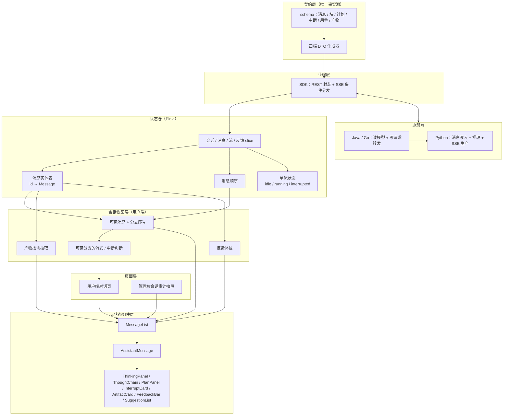
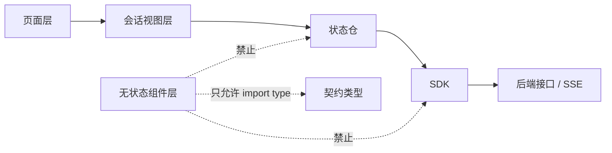
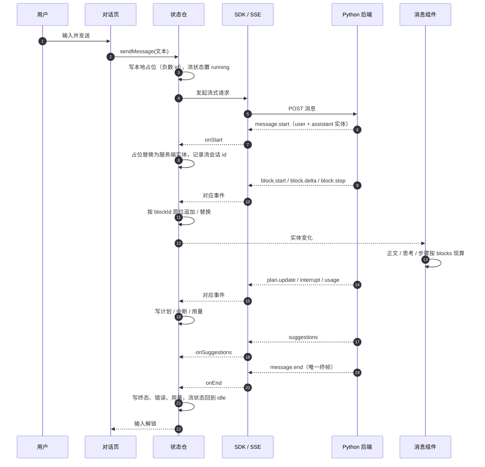
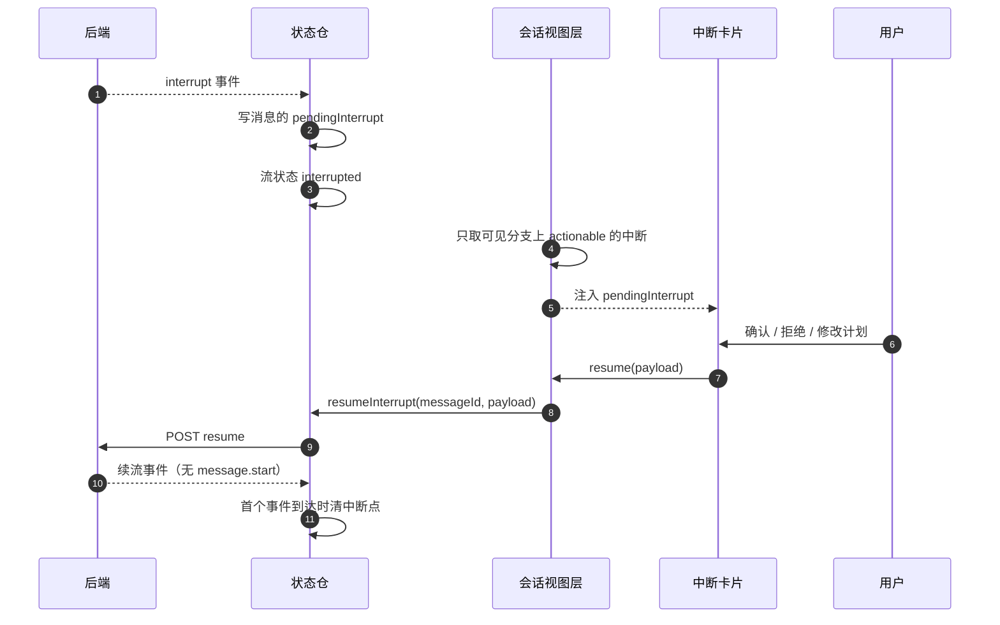
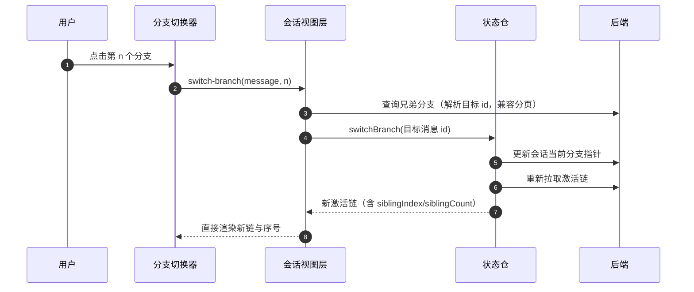

# AI 对话前端架构设计

从跨层视角描述 AI 对话模块前端的分层、依赖方向、关键流程与设计取舍，并列出当前架构中已确认的不足、判断依据与修改方案。

本文只写"为什么这样分层、层与层如何协作、哪里还不够好"。接口字段与事件载荷见 [API接口.md](../03-模块设计/核心模块/AI对话/API接口.md)，页面与交互见 [前端实现-公共.md](../03-模块设计/核心模块/AI对话/页面设计/前端实现-公共.md)，可观测性见 [可观测性/前端实现.md](../03-模块设计/核心模块/AI对话/可观测性/前端实现.md)。

## 设计目标与约束

| 目标           | 约束来源                                    | 落地方式                                                                   |
| -------------- | ------------------------------------------- | -------------------------------------------------------------------------- |
| 契约唯一       | 三端后端 + SDK + 多端前端共享同一套消息形状 | `config/schema/ai-conversation.schema.json` 生成四端 DTO，禁止手写镜像类型 |
| 内容唯一       | 正文、思考、工具调用必须只有一个事实源      | 消息内容统一为 `blocks`，正文/思考/步骤全部现算，不存第二份副本            |
| 历史与流式同形 | 刷新前后必须一致，避免"流式正常、刷新变形"  | SSE 事件直接写契约消息实体，历史接口返回同一形状                           |
| 组件零依赖     | 组件要能在用户端/管理端复用，且可单测       | 组件只收 props、只发 emit；不读 store、不 import SDK 运行时                |
| 流式逐帧可控   | 长会话逐 token 渲染不能整表重算             | 实体按 id 存储、组件按块引用计算；只重渲染内容变化的那一条                 |
| 单一终态       | 重连、重放、停止、失败都可能重复收尾        | `message.end` 是唯一终态；SDK 终态后只放行 `suggestions`                   |

## 分层架构

### 依赖方向（红线）

组件层只能依赖"契约类型 + 纯派生函数"，不能反向依赖状态仓或接口。这条红线由 ESLint 的 `no-restricted-imports` 锁定（允许 `import type`，禁止运行时值），目的是让消息渲染可以被独立测试、也可以整体移植到其他端。

## 各层职责与设计思路

### 契约层：先把"一条消息长什么样"钉死

三端后端、JS SDK、Web/React/Flutter 多端前端都消费同一份消息。如果每端各写一份类型，字段改名、可空性、枚举扩展就会各说各话。因此把消息、块、计划、中断、用量、产物全部写进一份 JSON Schema，由生成器产出 TypeScript / Python / Java / Go 四套 DTO，并配一个"重跑生成器产物逐字节一致"的校验。

### 传输层：只负责把事件送到，不解释业务

SDK 做两件事：REST 调用封装；把 SSE 帧解析成强类型回调（`message.start`、`block.start/delta/stop`、`plan.update`、`interrupt`、`usage`、`suggestions`、`message.end`、`error`）。

关键设计是**终态唯一**：`message.end` 到达后，后续帧一律丢弃，只放行 `suggestions`（推荐问题是终态后异步生成的，不能丢）。这样重连重放、迟到心跳、重复终帧都不会把同一条消息二次收尾。代价是终态之后新增的任何事件类型都要显式加白名单，否则会被静默丢弃。

### 状态仓：消息实体表 + 一套全局流状态

状态仓只保存三类东西：

| 状态       | 形状                                                     | 说明                                                |
| ---------- | -------------------------------------------------------- | --------------------------------------------------- |
| 消息实体   | `id → Message`                                           | 唯一内容源；历史与流式写同一张表                    |
| 消息顺序   | `id[]`                                                   | 服务端消息按 id 升序，本地占位用负数追加在末尾      |
| 全局流状态 | `idle / running / interrupted` + 当前消息 id + 流会话 id | 同一时刻只允许一条活跃流，UI 需要知道往哪条消息追加 |

为什么是"实体表"而不是"视图模型列表"：流式增量只需要替换一条消息的引用或字段，视图模型列表会导致整表重建；历史接口与流式事件形状一致，也不需要翻译。代价是顺序要单独维护（见不足 G5）。

为什么全局只保留一套流状态：服务端对同一会话加了流锁，同一时刻只有一条流；前端如果按会话保存多套流状态，就需要处理切会话、后台流、重连归属等一整套并发问题，收益不足以抵消复杂度。

### 会话视图层：回答"哪些消息该显示"

后端 self 消息列表已经只返回**当前激活链**，前端不再做"每个分叉选一条"的算法。视图层做四件事：

1. **可见消息**：直接消费后端返回的链，同引用不复制；不再按 `parentMessageId` 分组、不再隐藏后代。
2. **分支序号**：只读消息自带的 `siblingIndex` / `siblingCount`，交给分支切换器显示"第几条 / 共几条"；切换目标由 `getBranches` 解析后调后端切换，展示完全由重新拉取的链决定。
3. **宿主数据**：进入会话后按会话批量拉取产物与反馈（各一次，产物按 `total` 翻页），以 map 形式注入组件；流式新消息终态后只补拉该条产物。
4. **可见口径的流式/中断**：激活链上的可恢复中断阻塞输入；不在链上的兄弟消息不参与。

这一层存在的理由不是"再包一层"，而是把"可见性"这个视图语义从状态仓里隔离出去：管理端审计需要看全部分支、也不该继承用户端的流式状态，状态仓只负责存事实，不负责决定给谁看。

### 组件层：只做展示与派生

组件只接收契约消息与少量宿主数据，内部用三个纯函数现算：

| 派生     | 输入                    | 规则                                        |
| -------- | ----------------------- | ------------------------------------------- |
| 正文     | `blocks` 的 text 块     | 按 `seq` 升序，块间空行衔接                 |
| 思考     | `blocks` 的 thinking 块 | 按 `seq` 分段，`durationMs` 决定闭合与计时  |
| 工具步骤 | `blocks` 的 tool_use 块 | 状态直接用契约 `ToolStatus`，不另设状态枚举 |

分支序号不再由前端计算：后端在每条 assistant 消息上给出 `siblingIndex` / `siblingCount`，组件直接消费。

组件层不 import SDK 运行时，避免组件与接口耦合，也避免把网络错误处理散进展示层。代价是宿主必须把产物、反馈、分支这些"消息之外的数据"逐层传进来。

### 页面层：只放端内副作用

剪贴板、编辑弹窗、删除二次确认、路由跳转、产物详情对话框、草稿与"上次会话"记忆都在页面层。页面把组件的单一动作事件分成两路：复制/编辑就地处理，其余动作交给会话视图层转状态仓。

这样区分的原因：复制和编辑是纯端内行为（剪贴板、弹窗），不需要落库或改状态；其余动作（重新生成、删除、反馈、恢复中断）都要改服务端或全局状态，必须经过状态仓。

## 运行时流程

### 发送与流式归约

关键点：

- 本地占位用负数 id，与服务端 id 空间隔离；`message.start` 到达后原位替换，不产生第二条气泡。
- 块增量按 `blockId` 定位，不按位置覆盖；工具参数以 `block.stop` 的完整载荷为准，避免"流式参数"和"终态参数"两份。
- `error` 只记录原因，不自行收尾；终态一律等 `message.end`。

### 中断与恢复

设计要点：

- 中断挂在消息实体上，不建全局中断表；刷新后从历史读回的 `pendingInterrupt` 与流内中断同形。
- 恢复没有 `message.start`，所以"清中断点"挂在首个续流事件上；恢复失败则保留中断点，允许重试。
- 过期判定以 `actionable=false` 为准，组件只禁用操作，不自行推导。

### 分支切换

展示完全由后端指针 + 激活链决定，刷新前后一致；前端不再保存本地分支选择。

## 设计取舍

| 决策                    | 选择                                    | 理由                                         | 代价                                    |
| ----------------------- | --------------------------------------- | -------------------------------------------- | --------------------------------------- |
| 是否保留适配层/视图模型 | 不保留，组件直连契约消息                | 避免逐字段复制和两套类型；字段变更只改一处   | 后端契约变更会直接冲击组件，没有缓冲层  |
| 流式事件写在哪          | 直接写消息实体                          | 历史与流式同形，刷新无需二次转换             | 实体是就地修改，写入来源不唯一（G4）    |
| 可见性放哪              | 后端返回激活链，前端只读序号            | 单一真相；刷新前后一致                       | 需要契约字段与三端同改                  |
| 分支默认值              | 由后端 `current_branch_message_id` 决定 | 与模型上下文选取同一口径                     | 切换分支需一次服务端往返                |
| 附加数据加载            | 产物与反馈按会话批量、一次拉取          | 避免长会话逐条请求                           | 需要会话级批量接口                      |
| 长列表                  | 超过 100 条按估算高度分片               | 消息高度不固定，固定高度虚拟滚动不适用       | 占位高度非精确，快速滚动定位略偏（G11） |
| 流式终态                | 只认 `message.end`                      | 重连/重放/停止都可能重复收尾，必须有唯一终态 | 终态后新增事件类型要显式放行            |

## 不足与改进

实施状态（2026-10-21，当前工作区）：

| 编号 | 问题                             | 状态         | 落点                                                                 |
| ---- | -------------------------------- | ------------ | -------------------------------------------------------------------- |
| G1   | 流式状态机职责过载               | 已修复       | `stream.ts` 295 行 + transport / events / effects / resume 四个文件  |
| G2   | 分支只认前端选择，不读服务端指针 | 已修复       | 契约 `siblingIndex/siblingCount` + 三端激活链 + 前端删除本地选择     |
| G3   | 流式期间允许切分支               | 已修复       | `branchDisabled = branchSwitching \|\| streamStatus !== "idle"`      |
| G4   | 消息实体就地修改                 | 未做（保留） | 见「仍未处理」                                                       |
| G5   | 内容与顺序是两张表               | 不做         | 见「仍未处理」                                                       |
| G6   | 附加数据逐条拉取                 | 已修复       | 会话级产物批量 + `GET /conversations/{id}/feedback`                  |
| G7   | 历史加载没有失败态与重试         | 已修复       | `messagesError` / `retryMessages` + 行内错误条                       |
| G8   | 中断卡单体过大                   | 已修复       | 壳 174 行 + `PlanApproveCard` / `ConfirmCard` / `model/interrupt.ts` |
| G9   | 动作路由规则分散                 | 已修复       | 单一 action 联合 + 处理表 + `assertNever`                            |
| G10  | 缺少真实 wire 对拍               | 已修复       | `wireReplay.spec.ts` + 三份 SSE fixture                              |
| G11  | 窗口化使用估算高度               | 未做（保留） | 见「仍未处理」                                                       |

### G1 流式状态机已拆分

拆分后职责：

| 文件                  | 行数 | 职责                                                              |
| --------------------- | ---- | ----------------------------------------------------------------- |
| `stream.ts`           | 295  | 公开动作编排（send/regenerate/edit/resume/stop 等）+ 会话生命周期 |
| `stream-transport.ts` | 128  | 错误映射、发起流、重连、超时、中止；不依赖 store                  |
| `stream-events.ts`    | 113  | SSE 回调 → 归约 → effects 调度；不持有定时器                      |
| `stream-effects.ts`   | 134  | 失败收口、自动朗读、async 轮询、中断后连接关闭收束                |
| `stream-resume.ts`    | 40   | 中断子类型 → resume 载荷的纯函数                                  |

`createStreamSlice` 返回的 9 个方法、签名与顺序完全不变，页面与其它 slice 无需改动；事件顺序、终态幂等、重连、超时、停止、恢复语义逐行搬移。

重连修复：SDK `reconnectStream` 返回新连接的 `AbortController`，transport 用它替换 `session.controller`，停止与超时能真正 abort 当前连接；事件分派在终态后丢弃迟到帧（`suggestions` 是唯一例外，契约允许它在 `message.end` 后到达）。

### G2 激活链与兄弟元数据已落地

契约 `Message` 新增可选 `siblingIndex`（1 起）与 `siblingCount`（未删兄弟总数），仅 self 视角激活链上的 assistant 且 `parentMessageId` 非空时填充；root 级、非 assistant、admin 视角为 null。

- **self**：列表以 `current_branch_message_id` 为链尾回溯；指针为空/悬空/指向已删消息时回退到会话最大 id 未删消息；分页在链上切（before 之前的最后 limit 条，id 倒序），`hasMore` 看链上是否还有更早，`total` 为链长。
- **admin**：保持全量分支分页与 `total`，兄弟字段为 null，审计仍能看到所有分叉。
- **三端**：Python/Go/Java 各自复用既有链回溯，兄弟序号一次 IN 查询批量计算；Java/Go 的写请求仍转发 Python，指针始终由 Python 维护。
- **前端**：删除 `model/branches.ts` 与本地 selection；`messages` 直接是 store 的激活链，`branches` 只读消息字段；`onSwitchBranch` 只用 `getBranches` 解析目标 id，展示由重拉的链决定。
- **删除**：只允许删除叶子消息。删除链尾时指针回退到 `parentMessageId`（可为 null）；删除非叶子返回 A0502“请先删除该回复之后的对话”，消息与指针都不动；删除旧分支叶子不影响当前指针。三端同口径，避免链在已删节点断裂导致历史与模型上下文丢失。
- **流式响应**：`message.start` 的新 assistant、`stop` 返回的实体、消息详情都带 `siblingIndex/siblingCount`（创建/查询后计算，包含自身），所以重新生成或停止后分支切换器不会消失。
- **乐观消息**：`message.start` 写入服务端实体后，本地删除同 parent 的旧 assistant 兄弟，并裁掉 id 大于新 assistant parent 的后续轮次（它们已不在新链上）；服务端链在下次拉取时为准。

### G3 流式中禁止切分支

`branchDisabled = branchSwitching || streamStatus !== "idle" || pending !== null`：running、当场中断、以及刷新后从历史读回的持久化中断都禁用（后两者后端仍持有流锁/中断句柄）。页面传入禁用态，`onSwitchBranch` 入口同样守卫；流式中点击切换器不会发起 `getBranches` / `switchBranch`。三端 `switch_branch` 也补了 Redis 中断校验（A0500），不依赖前端单点防护。

### G6 附加数据改为会话级批量

- **产物**：进入会话后调用一次 `getArtifacts(conversationId, {pageNum:1,pageSize:100})`，按 `total` 翻页，按 `messageId` 归组；流式新消息终态后只用 `getMessageArtifacts` 补该条。
- **反馈**：新增 `GET /api/v1/ai/conversations/{convId}/feedback`，返回当前用户在该会话下的全部反馈（不分页、只本人）；前端进入会话一次回填，删除逐条 `fetchFeedback`。
- **请求数**：50 条助手消息的会话打开时附加请求为 2（产物 1 + 反馈 1），逐条产物请求为 0；切换会话有竞态校验，回包前确认仍是当前会话。

### G7 历史加载失败态与重试

- `messagesError` 区分 `initial` / `more`，行内错误条展示原因与重试按钮；空态不再吞掉失败。
- 切会话在请求前清空旧消息，失败时不会把 A 会话消息留在 B 会话下；上翻失败保留 `hasMore` 原值，不会被误判为到底。
- `switchBranch` 的刷新失败与指针失败分层：只有指针失败才是"切换分支失败"。

### G8 中断卡已按类型拆分

| 文件                             | 行数 | 职责                                          |
| -------------------------------- | ---- | --------------------------------------------- |
| `InterruptCard.vue`              | 174  | 壳层：路由、过期/不可用判定、统一 emit resume |
| `interrupts/PlanApproveCard.vue` | 133  | 计划编辑（上移/下移/移除/新增/批准/拒绝）     |
| `interrupts/ConfirmCard.vue`     | 108  | 四种 confirm 由描述表驱动                     |
| `model/interrupt.ts`             | 202  | 计划编辑、过期、标题等纯函数                  |
| `utils/interruptKind.ts`         | 59   | 唯一的子类型校验与归一，组件与 store 共用     |

未知 `confirmKind` 与缺失同路：显示"确认类型缺失，无法继续"，按钮全部禁用，点击不发起 resume；这是有意收紧，已有用例覆盖。

### G9 动作路由单一来源

`shared.ts` 的 `MessageAction` 改为 `Exclude<ChatMessageActionVM, copy | edit>`，删除第二份 8 变体清单；store 分发加 `assertNever`，页面改为 `Record<type, handler>` 处理表。新增动作时，处理表缺键与 switch 未覆盖都会在 `vue-tsc` 阶段报错。

### G10 真实报文回放

新增 `wireReplay.spec.ts` 与三份 SSE fixture（完整一轮、中断一轮、历史事件+坏 JSON）。测试只替换传输层（`fetchImpl` 返回按 7 字节分片的 `ReadableStream`），从 `sendMessage` 入口跑到 DOM：真实 dispatcher 的白名单/终态闸门、SSE 跨 chunk 解码、store 归约、组件渲染全部在生产路径上；终态后的迟到 delta/usage/error 被丢弃、suggestions 放行均有断言。

### 已知边界

删除与发送的并发窗口：删除会锁定会话行并在锁内检查子消息、软删、CAS 回退指针；发送在插入消息后才更新会话行。若发送已插入子消息但尚未提交，删除可能先拿到锁而看不到该子消息，形成极窄的竞态窗口。彻底消除需发送在插入前也锁会话行；当前按“删除只允许叶子 + 会话行锁 + 指针 CAS”收敛到可接受范围，后续可与发送链路一起加锁。

### 仍未处理

#### G4 消息实体就地修改

没有用户可见缺陷，暂不做不可变改造。原因：块增量依赖 `blocks` 数组引用做 WeakMap 索引，逐 token 换新数组会每帧重建索引；`awaiting_input` 实体必须可写才能 resume。若将来要做，必须先改造块索引与 resume 写入，再统一走浅拷贝 + 终态冻结。

#### G5 内容与顺序是两张表

不做。改成 `array + index` 仍需在每次 splice 后重建索引，风险横跨 rekey、分页前插、本地占位与删除；属于同类不同步风险换名，不是净收益。若出现真实错位 bug，再与 G4 合并成一次"写入与结构收敛"。

#### G11 窗口化使用估算高度

不做估算微调（属于临时手段）。真实修复需要测量已渲染高度并做锚点补偿，或换支持动态高度的虚拟列表，并配 Playwright 布局验证；当前触发条件仅限单会话 >100 条且快速拖动，先保留现状。

## 演进路线

| 阶段 | 内容                                      | 状态   |
| ---- | ----------------------------------------- | ------ |
| P0   | G3 流式中禁止切分支                       | 已完成 |
| P1   | G2 激活链 + 兄弟元数据；G6 会话级批量     | 已完成 |
| P1   | G1 流式状态机拆分；G7 历史失败态          | 已完成 |
| P2   | G8 中断卡拆分；G9 动作路由；G10 wire 对拍 | 已完成 |
| P2   | G4 写入收敛；G11 动态高度                 | 保留   |

## 验证基线

当前工作区（2026-10-21）：

| 项目     | 结果                                                              |
| -------- | ----------------------------------------------------------------- |
| 前端类型 | `vue-tsc --noEmit` 0 错误                                         |
| 前端单测 | 41 个文件 / 600 条用例通过                                        |
| 前端静态 | ESLint 0 error                                                    |
| SDK      | 构建通过；15 文件 / 123 用例通过                                  |
| Go       | `go build ./...`、`go vet ./...`、api/service/repository 测试通过 |
| Java     | 编译通过；全量 1023 用例通过（agent 执行）                        |
| Python   | 定向 51 用例通过；全量 3125 passed / 4 个既有基线失败             |
| 契约     | 生成器重跑，四端产物逐字节一致                                    |

新增或修改架构相关代码后，至少重跑类型检查、`src/views/chat`、`src/components/ai-chat`、`src/composables`、`src/store/modules/chat.spec.ts`，并同步跑对应后端的定向测试。
