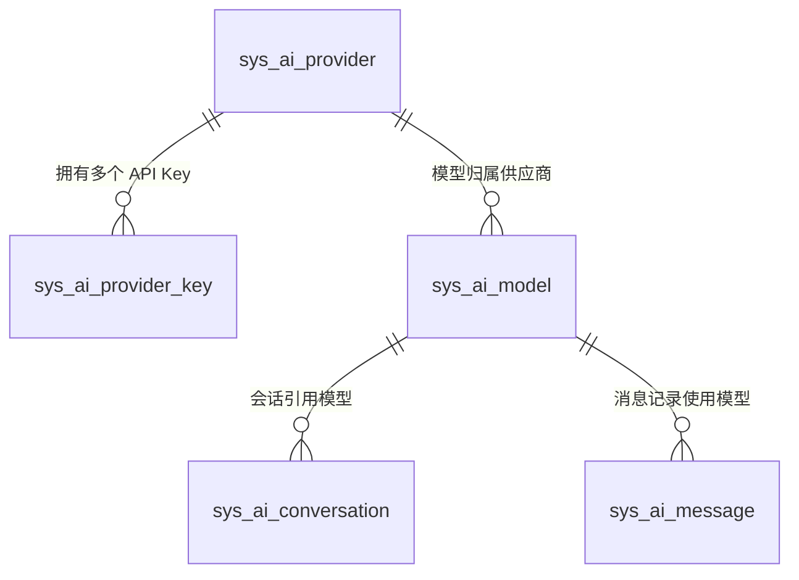
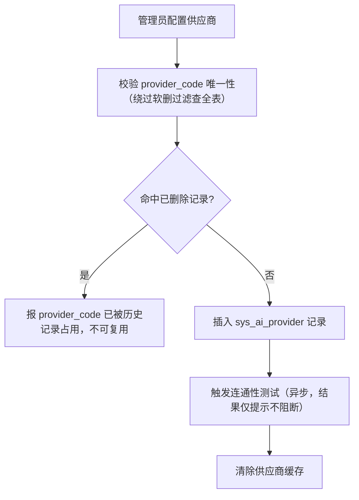
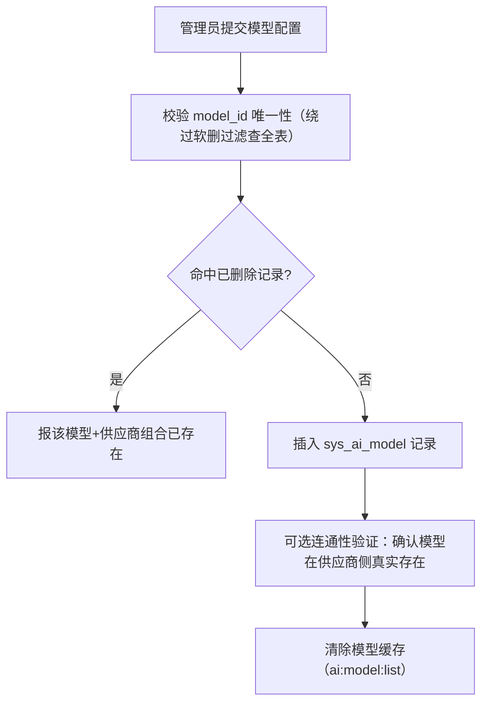
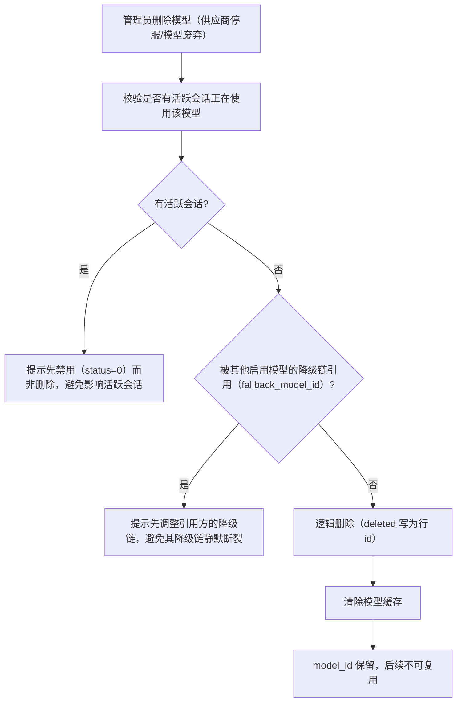

# AI 模型管理模块 - 后端实现设计

## 文档概述

模块后端实现覆盖模型供应商配置管理、API Key 管理、供应商健康与容错、模型配置与生命周期、模型注册表与全模态路由、用量与成本分析。本模块承载平台**全部模态**的 AI 模型（chat/embedding/rerank/image_gen/image_edit/video_gen/asr/tts 及预留 music_gen/3d_gen）与供应商的统一管理，消费方 AI 对话、AI 知识库、去雾处理、语音交互按模型类型接入。

模型选择与切换、推理调度与降级、Prompt Caching、结构化输出、计费集成描述本模块向消费方推理链路提供的调度与计费换算能力；接口契约见 [API接口.md](./API接口.md)，表结构见 [02-系统架构/03-数据库设计.md](../../../02-系统架构/03-数据库设计.md)。

**统一表承载**：语音引擎与图像算法的供应商、密钥与模型（`model_type=asr/tts/image_edit`）统一登记在本模块的 `sys_ai_provider` / `sys_ai_provider_key` / `sys_ai_model`。

### 设计思想

#### 设计动机

本模块的根本矛盾是供应商外部服务的不可控性（限流 429、宕机 5xx、涨价、停服）与平台可用性、成本要求之间的张力；同时模型成本与积分定价直接挂钩，定价错误会让平台亏损或让用户不满。设计目标是：把不可控的供应商抽象为可控的配置层，用多级降级保证可用性，用显式价格档位保证成本透明。

#### 核心设计原则

| 原则         | 说明                                                                                                                                |
| ------------ | ----------------------------------------------------------------------------------------------------------------------------------- |
| 配置驱动     | 供应商、模型、API Key 全部数据库管理：协议差异、价格档位、VIP 门槛、降级链、能力标识均可配置，接入新供应商 = 插入一条配置，不改代码 |
| 降级容错     | 主模型不可用时自动沿降级链切换（A→B→C），用主键引用避免同模型多供应商歧义，降级模型必须能力匹配。用"配置冗余"换"服务可用"           |
| 健康感知     | Key 级失败冷却 + 供应商级熔断两级容错：单 Key 故障不影响供应商，供应商整体故障自动切到备用供应商或降级模型，对用户无感              |
| 成本显性化   | 价格档位挂在模型上，积分换算完全可审计；Prompt Caching 让高频稳定前缀按折扣计费，降低用户成本也提升平台吞吐                         |
| 密钥最小暴露 | API Key 明文不落库（SHA256 哈希查重 + AES 密文），不进入日志与上下文，多 Key 轮换与失败自动切换                                     |

#### 关键架构取舍

| 取舍点         | 方案对比                                     | 选择与理由                                                                                                                                                   |
| -------------- | -------------------------------------------- | ------------------------------------------------------------------------------------------------------------------------------------------------------------ |
| 供应商配置存储 | 环境变量硬编码 vs 数据库配置                 | 选数据库。环境变量只能静态配置、变更需重启；数据库配置可运行时调整、可区分协议差异、可支撑管理界面。加密密钥（`AI_PROVIDER_KEY_ENCRYPTION_KEY`）仍走环境变量 |
| API Key 组织   | 单 Key vs 多 Key（优先级+权重+失败切换）     | 选多 Key。单 Key 遇限流即整个供应商不可用；多 Key 支持负载均衡、轮换、失败自动切换                                                                           |
| 供应商绑定     | 模型硬绑供应商 vs 同模型多供应商可切换       | 选后者。`(model_id, provider_id)` 联合唯一，同一模型可配多行，配合降级链实现"主备供应商"                                                                     |
| 健康状态存储   | 落库持久化 vs 运行时聚合（Redis + 调用日志） | 选运行时聚合。健康指标是短时效信息，落库只会引入过期脏数据；熔断标记走 Redis TTL，不新增库表                                                                 |

#### 总体规划

模型是"地基层"，推理、会话、上下文等功能域都建立在其上：

```
供应商/Key（基础设施，含健康监控）→ 模型（价格档位 + 能力 + 降级链）→ LlmClient 调用
                                                                            ↓
                                  推理/会话/上下文（消费模型能力，按档位计费）
```


## 模型供应商管理 (F-M08-007)

服务层落位（Python 端）：`ai_provider_service`（供应商 CRUD 与连通性测试）、`ai_provider_key_service`（Key CRUD 与选取冷却）、`provider_health_service`（健康聚合与熔断）、`ai_model_service`（模型 CRUD、路由、能力校验）、`ai_usage_stats_service`（运营统计），路由 `app/router/ai_provider.py`、`app/router/ai_model.py`。

### 数据模型

模型供应商管理涉及三张业务表（+ 售价表与只读引用的成本单价表）：

| 实体                                               | 职责                                                                                                    | 服务层关键用途                                              |
| -------------------------------------------------- | ------------------------------------------------------------------------------------------------------- | ----------------------------------------------------------- |
| `sys_ai_provider`                                  | 供应商配置（API 地址、协议类型、认证方式、健康检查开关、用户身份透传配置、备注）                        | 供应商 CRUD、协议适配、连通性测试                           |
| `sys_ai_provider_key`                              | 供应商 API Key（加密存储、优先级+权重选取、日额度、分钟频率限额）                                        | Key CRUD、Key 选取与轮换、失败冷却                          |
| `sys_ai_model`                                     | 模型配置（`model_type`、embedding `dimension`、能力标识、降级链、VIP 门槛、图片换算上限、并发限制参考） | 模型 CRUD、能力校验、降级路由、VIP 过滤、生命周期、类型筛选 |
| `sys_ai_model_price` + `sys_ai_model_price_detail` | 用户售价（积分/百万 token，价格版本 + 档位明细：token 类型 × 上下文分段 × 时段）                        | 售价版本、档位维护、售价展示、计费换算读取                   |
| `sys_ai_model_cost` + `sys_ai_model_cost_detail`   | 成本单价（供应商采购价，元/百万 token；表归 AI 计费管理模块）                                       | 本模块只读引用：调价评估、毛利测算                      |

**ER 关系**：



`sys_ai_provider.provider_code` 为业务引用键，白名单语义：逻辑删除后不可复用，查重必须绕过软删过滤查全表；`sys_ai_model` 的 `(model_id, provider_id)` 唯一键含 `deleted`，软删后可重建，查重只查活跃行。`sys_ai_provider_key` 不使用逻辑删除（Key 管理为状态控制：启用、禁用、过期 + 物理删除）。同一 `model_id` 可通过不同 `provider_id` 配置多行，联合唯一索引 `(model_id, provider_id)` 保证不重复。

**`token_type` 取值口径**：`sys_ai_model_price_detail.token_type` 不扩 `unit`——`usage_kind='unit'` 的档位行复用 `'input'`。该列参与唯一键 `uk_price_token_time_range`，扩值域即改变唯一性语义；确需引入 `unit` 档须作契约变更单独裁决，并同步 py schema / DB 注释 / SDK / Java / Go。

**API Key 安全**：明文不存储，只存哈希（SHA256，查重用）+ 密文（AES-256-CBC 后 base64 编码，运行时解密）；明文绝不进入日志与 LLM 上下文。加密密钥由环境变量 `AI_PROVIDER_KEY_ENCRYPTION_KEY` 注入，支持密钥轮换。日调用计数走 Redis（`ai:provider_key:{key_id}:daily:{date}`）不落库；`last_used_at` / `last_used_by` 走 Redis 缓冲 + 定时批量刷库，避免高并发频繁写库。

健康状态（健康、可疑、熔断）为运行时聚合信息，不落库：指标来自调用日志聚合，熔断标记走 Redis（`ai:provider:{provider_id}:circuit_open`），与 Key 冷却标记（`ai:provider_key:{key_id}:unavailable`）同机制。

### 供应商 CRUD

#### 新增供应商



供应商核心字段：

| 字段                      | 说明                                                         | 示例                                                                                                          |
| ------------------------- | ------------------------------------------------------------ | ------------------------------------------------------------------------------------------------------------- |
| `provider_code`           | 供应商编码（唯一，不可复用）                                 | `openai`、`anthropic`、`deepseek`                                                                             |
| `api_base_url`            | API 基础地址                                                 | `https://api.openai.com/v1`                                                                                   |
| `protocol_type`           | 协议类型                                                     | `openai_compat`（OpenAI 兼容）、`anthropic`（Claude 原生）等 8 个协议族           |
| `auth_type`               | 认证方式                                                     | `bearer`、`x-api-key`、`custom`（头名在 `default_headers` 配置）                                              |
| `default_headers`         | 默认请求头（JSON）                                           | `{"anthropic-version": "2023-06-01"}`；`auth_type=custom` 时保留键 `auth_header` 指定认证头名，其余键原样合并 |
| `sort_order`              | 排序序号                                                     | 数字越小越靠前                                                                                                |
| `health_check_enabled`    | 健康检查开关，`0` 时不参与熔断判定                           | `1`（默认）                                                                                                   |
| `request_timeout_seconds` | 请求超时（秒），NULL 取调用方默认（chat 120 / embedding 30） | 本地 CPU 推理等慢供应商显式配置（如 `300`）                                                                   |
| `user_identity_forward`   | 用户身份透传配置（JSON），NULL 不启用                        | `{"enabled":true,"field":"user_id","prefix":"u_","max_len":512}`                                              |
| `remark`                  | 运维备注（账号归属、合同号），不参与逻辑                     | —                                                                                                             |

#### 连通性测试

按 `protocol_type` + `auth_type` + `default_headers` 组装最小探测请求（如 OpenAI 兼容协议 `GET /models`），超时 5s，记录连通状态、状态码、延迟、错误信息：

- 测试请求不携带用户上下文，不产生 Token 消耗与计费
- 保存供应商后由后台任务异步触发，结果仅提示，不阻断保存
- 常见失败原因：地址不可达、凭据无效（401/403）、协议不匹配，错误信息直接展示便于定位

#### 用户身份透传

`user_identity_forward` 配置（enabled/field/prefix/max_len）随供应商 CRUD 持久化，运行时注入已落地：

- **注入点**：`LlmClient.stream_chat` 接收显式 `user_id` 参数（发起调用的用户），在候选路由内读取该供应商实体的透传配置（随路由查询取出，零新增查询），经 `build_user_identity`（`app/infrastructure/llm/common.py`）生成后传给协议客户端注入请求体
- **用户上下文来源**：图路径 `DehazeChatModel` 从请求上下文 ContextVar 读取（与 Key 成功标记的计费归因同源；图按 agent+版本+模型跨用户缓存，实例无法携带用户标识）；直连调用方（推荐问题、记忆提取、复杂度评估、标题生成、图片解读等）沿调用链显式传参；无用户上下文的后台调用（摘要压缩、步骤摘要等）传 `None` 不注入
- **取值规则**：`prefix + sha256(userId)` 十六进制，按 `max_len` 截断，**不含任何用户隐私信息**（合规要求）；是否注入完全由供应商行 `user_identity_forward` 决定——未启用、无配置、无用户上下文均不注入，内置供应商该列为 NULL（天然不注入）
- **协议落位**：`openai_compat` 按配置的 `field` 注入请求体顶层，与 `extra_request_params` 同受核心键保护（字段已存在不覆盖）；`anthropic` 按 `field` 嵌套路径注入（如 `metadata.user_id`，中间层不存在时初始化空对象），首段字段已存在（核心键）时不覆盖
- 供应商按透传标识做并发限制，超限返回 429 时走 Key 失败冷却与降级容错

#### 删除供应商

校验是否有模型引用该供应商（含禁用模型，防禁用模型悬挂引用）：有则提示先删除或转移关联模型；无则逻辑删除（deleted 写为行 id）并清除供应商缓存，`provider_code` 白名单不可复用。

### API Key 管理

#### 新增 API Key

录入明文 → SHA256 哈希查重 → AES-256 加密为 `key_cipher` → 取前 8 位 + `...` 作为展示用 `key_prefix` → 插入记录（可选配置 `priority`/`weight`/`daily_quota`/`rpm_limit`）→ 仅返回 Key ID，不返回明文。

**key_hash 唯一口径**：`sys_ai_provider_key` 唯一键为 `uk_provider_key(provider_id, key_hash)`（`config/sql/schema/sys_ai_provider_key.sql`）；local / local-voice / local-modal 共用一把 `INTERNAL_SERVICE_KEY` 依赖此口径。三端按 hash 定位密钥必须带 provider 维度（py `ai_provider_key_repository.get_by_provider_and_hash`、go `GetByProviderAndHash`、java `.eq(providerId).eq(keyHash)`）。注意 `sys_api_key.uk_key_hash` 是另一张表，勿混淆。

#### Key 选取策略

`LlmClient` 调用 LLM 时从 `sys_ai_provider_key` 选取可用 Key：

选取流程：按 provider_id 查 status=1 且未过期的 Key，排除带 Redis 冷却标记（`ai:provider_key:{key_id}:unavailable`）的；按候选顺序原子预留额度（Lua：INCR 后判定、超限回滚；日额度 `ai:provider_key:{key_id}:daily:{date}` vs `daily_quota`，分钟频率 `ai:provider_key:{key_id}:minute:{yyyyMMddHHmm}` vs `rpm_limit`；预留失败换下一个候选，全部失败视为无可用 Key）；按 priority 升序取最高优先级组，组内按 weight 加权随机选取；解密 `key_cipher` 获取明文并记录 `last_used_at` / `last_used_by`（Redis 缓冲后批量刷库）；调用失败（401/429）标记该 Key 冷却，切下一个 Key 重试。

#### 失败冷却与冷却升级

调用失败（401/403/429/5xx/超时）后写 Redis 冷却标记 `ai:provider_key:{key_id}:unavailable`，TTL 随连续失败次数升级（连续失败计数 `ai:provider_key:{key_id}:fail_streak`，成功调用清零）：

| 连续失败次数 | 冷却时长        |
| ------------ | --------------- |
| 1 次         | 5 分钟          |
| ≥ 3 次       | 15 分钟         |
| ≥ 5 次       | 30 分钟（上限） |

冷却仅在供应商下存在其它可用候选 Key 时生效——单 Key 供应商冷却会锁死其全部请求，故不冷却，改由供应商级熔断兜底。

**两级容错关系**：Key 冷却解决单 Key 故障；Key 全部不可用或供应商熔断时，`LlmClient` 放弃当前供应商，转同模型备用供应商或模型降级链。Key 轮换为纯配置操作（新增新 Key 自动参与选取 → 禁用旧 Key → 确认无流量后删除），进行中的推理不受影响。

### 供应商健康与容错

#### 健康指标聚合

供应商健康指标由调用日志聚合得出，无独立采集任务：

| 指标       | 数据来源                  | 聚合口径                 |
| ---------- | ------------------------- | ------------------------ |
| 成功率     | 消息、计费记录中的调用结果 | 近 24h 成功调用 / 总调用 |
| 429 限流率 | 调用错误码                | 近 24h 429 次数 / 总调用 |
| P95 延迟   | 调用耗时                  | 近 24h P95               |
| 熔断状态   | Redis 标记                | 当前是否熔断             |

指标为只读聚合（定时计算缓存到 Redis `ai:provider:{provider_id}:health`），不进入调用链路热点。

**无调用即无样本**：近 24h 窗口内无调用（`total_calls_24h=0`）时，快照的 `success_rate` / `error_rate` / `limit_rate` / `p95_latency_ms` 一律为 `null`，只有调用量与健康状态是确定值；延迟列表不按窗口裁剪，窗口无调用时其中的残留样本不算当前 P95。三端写同一快照键时同口径（java 写缓存时关闭 hutool 的忽略 null，保证 null 键存在，避免按契约严格取值的端读到缺键）。看板与模型速度档位据此显示「无数据」（`-` / `unknown`），不得回落成 1.0 / 0ms 伪值。

#### 健康状态机

| 状态 | 触发条件（参考阈值，可配置）                                      | 调度行为                                                                                                                                                                                |
| ---- | ----------------------------------------------------------------- | --------------------------------------------------------------------------------------------------------------------------------------------------------------------------------------- |
| 健康 | 错误率 < 10%                                                      | 正常参与选取                                                                                                                                                                            |
| 可疑 | 10% ≤ 错误率 < 30%                                                | 降低选取权重，仍参与调用；触发运维告警                                                                                                                                                  |
| 熔断 | 错误率 ≥ 30% 持续 1 分钟，或连续失败 ≥ 5 次                       | 写 Redis `ai:provider:{provider_id}:circuit_open`（默认 TTL 60s）+ `circuit_recovery`（TTL 2×冷却，覆盖冷却与探测全程）；该供应商下模型走降级链或同模型备用供应商；进行中的推理不受影响 |
| 半开 | 冷却期结束（`circuit_open` 过期）但仍在 `circuit_recovery` 周期内 | 抢占 `half_open_probe` 租约（SETNX，TTL=冷却时长）只放行一个探测请求，未抢到继续阻断                                                                                                    |
| 恢复 | 探测成功（成功调用清除熔断、恢复、探测三键）或管理员手动解除        | 探测失败重新熔断，避免冷却一过全量流量打向未恢复的供应商                                                                                                                                |

`LlmClient` 选取 Key 前先检查供应商健康状态：健康、可疑进入 Key 选取；熔断则跳过该供应商——优先用同 `model_id` 其他 `provider_id` 行重试，无备用供应商则走模型降级链，全部不可用才报错并推送 error 事件。

**熔断阈值配置**：错误率阈值、持续时长、冷却时长、连续失败次数存 `sys_dict`（类型 `ai_provider_health`），管理员可调无需改代码；读取后缓存到 Redis（TTL 5 分钟），未命中回落种子同源默认。

**ProviderHealthService 实现要点**：

- 指标运行时聚合不新增库表。Redis Key 约定：`circuit_open`（熔断标记，TTL=冷却）、`circuit_recovery`（恢复周期标记，TTL=2×冷却）、`half_open_probe`（半开探测租约，SETNX）、`fail_streak`（连续失败计数）、`window`（近 24h 调用窗口，小时分桶 HASH 字段 `{bucket}:t|f|l`，判定时一次 HMGET 读 24 个桶，开销与调用量无关）、`latency`（延迟列表取 P95）、`health`（聚合快照缓存）
- `record_call` 内联判定：连续失败 ≥5，或窗口 ≥20 次调用且错误率 ≥30% → 写 `circuit_open`；成功调用清零连续失败计数，并清除熔断、恢复、探测三键（半开探测成功即全量恢复）
- 健康开关为调用链路高频查询，`get_status` 只读 Redis 标记 `ai:provider:{id}:health_enabled`（供应商 CRUD 时写入，缺省视为开启）不读库；`health_check_enabled=0` 的供应商恒返回健康且不参与聚合判定

服务启动时以 DB 的 `health_check_enabled` 为权威同步一次该缓存（`warmup_provider_health_cache`），避免缓存与库漂移。

- 供应商列表逐项返回健康快照供看板展示；熔断可由管理员手动解除

### 模型配置管理

模型配置表 `sys_ai_model` 通过 `provider_id` 关联供应商，`model_type` 标识模型类型：

| model_type             | 说明                                     | 特有配置                                                                                             |
| ---------------------- | ---------------------------------------- | ---------------------------------------------------------------------------------------------------- |
| `chat`                 | 文本生成（含多模态理解、代码、深度思考） | 能力标识、价格档位、VIP 门槛、降级链                                                        |
| `embedding`            | 向量（文本、图像）                        | `dimension`（向量维度，知识库建立向量索引时读取，创建后不可修改）                                    |
| `rerank`               | 重排序                                   | 知识库检索可选启用                                                                                   |
| `image_gen`            | 文生图                                   | 任务标签、参数模板与默认值（分辨率、格式）；接入位就绪，默认不接模型                                  |
| `image_edit`           | 图像编辑（去雾、去雨、超分等）             | 任务标签（`["dehaze"]` 等）、参数模板；provider 通常为 `local-modal` 或百炼万相（`dashscope_async`） |
| `video_gen`            | 视频生成（异步任务）                     | 预留（仅枚举与协议位）                                                                               |
| `asr`                  | 语音识别                                 | 任务标签（`["stream"]`/`["offline"]`）                                                               |
| `tts`                  | 语音合成（音色即模型）                   | 任务标签、音色                                                                                       |
| `music_gen` / `3d_gen` | 音乐生成 / 3D 生成                       | 预留                                                                                                 |

**`task_tags`（JSON，可空）**：任务归类标签，产品侧按 `model_type + task_tags` 过滤——图像模型 `["dehaze"]`/`["super_resolution"]`（承接原 `sys_algorithm.task_type` 与万相 `function` 枚举语义）、asr 模型 `["stream"]`/`["offline"]`、embedding 模型 `["text"]`/`["image"]`。

**`billing_unit`（价格表列）**：`sys_ai_model_price.billing_unit` 维度化计量单位——`million_tokens`（chat/embedding/rerank）/ `image`（张）/ `second`（asr）/ `ten_thousand_chars`（tts）/ `frame`（video 预留）；非 token 模型在 detail 表单行 `unit` 档（`usage_kind='unit'`），不设峰谷。

**计量单位按 `model_type` 派生，不新增必填校验层**：新增价格行未显式传 `billing_unit`/`usage_kind` 时按 `image_gen`/`image_edit` → `image`、`asr` → `second`、`tts` → `ten_thousand_chars`、`video_gen` → `frame`、其余 → `million_tokens` 派生；只有设计明确要求的适配器路由校验（如 `(protocol_type, model_type)`）才保留显式拒绝。**涉及钱的字段例外**：禁止把非 token 模型静默落成 token 计量。

**运行时工件不落模型行**：`extra_request_params` 保持「随请求体透传合并」的纯语义——chat 存厂商私有请求参数（`enable_thinking` 等）、image 模型存参数模板与默认值（分辨率、格式）；本地模型路径（modal 权重）、音色 onnx 等运行时工件由本地服务目录（`/v1/models`）按 `model_id` 服务端解析，不落库（消除「DB 与目录双事实源」）。

**`model_type` 取值校验（三端口径）**：合法集 `{chat, embedding, rerank, image_gen, image_edit, video_gen, asr, tts, music_gen, 3d_gen}`，缺省 `chat`。python 由 pydantic `Literal` 在请求校验阶段拒绝非法字面量（A0400）；java/go 无该层，分别在 `AiModelServiceImpl.createModel/updateModel`、`ModelService.CreateModel/UpdateModel` 的 service 层白名单拦截 A0400（白名单保持 service 层单一信息源，不搬 `@Pattern` 到 DTO）。校验必须先于"模型类型、向量维度创建后不可修改"的业务拒绝（A0502）——否则拼错的类型会被误报成"不可修改"，掩盖真实错误。`GET /ai/models` 的 `modelType` 筛选同为 `Literal`，非法筛选值在 python 是 A0400（而非"过滤后空列表"），java `AiModelServiceImpl.listModels` / go `ModelService.ListModels` 已按同码拦截（空串在 java/python 被拒，go 侧显式空串与不传不可区分、按不筛选放行，沿用既有空串差异登记口径）。

`vip_level` 标识模型的最低可用 VIP 等级（`0`=所有用户、`1`=VIP1 及以上、`2`=VIP2 及以上），模型列表按当前用户等级过滤（`model.vip_level <= user_level`）。

`extra_request_params`（JSON）为**厂商私有请求参数**（如阿里云 `enable_thinking`、OpenAI `reasoning_effort`），随推理请求体透传：

- 绑定模型（删模型即删参数），由管理员在模型配置上显式声明，不开放给用户请求级透传（避免厂商差异上抛给用户、无 schema 校验、请求体污染）
- 采用**核心键保护**：仅补充 `model`/`messages`/`stream`/`stream_options`/`temperature`/`max_tokens`/`tools` 等核心键之外的键，调用方控制的参数不可被配置覆盖
- 厂商对未知参数容忍度不一，接入新厂商时按厂商文档核对参数名；配置错误由厂商 4xx 暴露。供应商级共有请求头走 `sys_ai_provider.default_headers`

**模型生命周期状态**：

| 状态   | 字段表达              | 行为                                                                 |
| ------ | --------------------- | -------------------------------------------------------------------- |
| 启用   | `status=1, deleted=0` | 可选择、可路由、可计费                                               |
| 禁用   | `status=0, deleted=0` | 新会话不可选择、现有会话切换时不可再选；进行中的推理不受影响；可逆   |
| `已下线` | 软删除（写为行 id）   | 不可逆；软删后可重建同 (model_id, provider_id)；需无活跃会话方可删除 |

模型可用性测试结果存于 `last_test_status`（0 未测试/1 可用/2 不可用）、`last_test_at`、`last_test_error` 三列，与 `status` 管理开关正交：测试不可用的模型不自动禁用，由管理员决策处置（修复供应商配置、禁用、下线）。

### 模型 CRUD

#### 新增模型



更新与禁用模型均在写库后清除模型缓存：更新不影响历史会话与消息记录（消息记录实际使用的模型）；禁用后新会话与会话内切换均不可选，使用中的会话提示用户重新选择，进行中的推理不受影响。

#### 下线模型（替换迁移）

**标记"即将下线" = 禁用 + 通知**：供应商发布模型停服公告后，管理员禁用模型（`status=0`），服务端查出使用该模型的活跃会话用户（去重），取 `fallback_model_id` 指向的启用模型作为替换推荐，经 `MessageService.send` 推送站内信（去重键 `bizModule=ai_model, bizId=model_id`）；无替换模型则提示"暂未配置替代模型，请及时更换"。通知失败仅记日志，不阻断禁用流程。

**物理下线（逻辑删除）**：



逻辑删除要求无活跃会话，故无需再通知（通知发生在"禁用"阶段）；迁移窗口期内供应商不可用由降级链、同模型备用供应商自动兜底。

### 模型列表查询

启用模型列表（`list_enabled_models`）查询未删除且启用的模型，按供应商与显示名称排序，按当前用户 VIP 等级过滤，返回模型标识、显示名称、供应商信息、能力标识、积分单价档位、上下文、输出上限，并附以下派生字段：

| 字段                          | 数据来源                                            | 说明                                                                                                                                                                          |
| ----------------------------- | --------------------------------------------------- | ----------------------------------------------------------------------------------------------------------------------------------------------------------------------------- |
| 速度档位 `speed_tier`         | 供应商健康快照的 `p95_latency_ms`                   | `fast`（P95 < 2s）/ `medium`（< 8s）/ `slow`（其余）/ `unknown`（无健康数据：近 24h 无调用或快照缺失）；阈值走配置 `AI_SPEED_TIER_FAST_P95_MS`、`AI_SPEED_TIER_MEDIUM_P95_MS` |
| 模型标签                      | 显示名称 + 能力标识推导                             | 供前端按能力、成本、场景筛选                                                                                                                                                    |
| 降级标识 `is_fallback_target` | 该模型是否被其他启用模型的 `fallback_model_id` 引用 | 减少用户对"模型变化"的困惑                                                                                                                                                    |

列表结果缓存于 Redis（`ai:model:list`，TTL 1h），健康快照仅在缓存重建时逐供应商读取，读取失败的模型档位降为 `unknown`，不影响列表返回。

**管理端分页列表**（`list_models`）额外聚合两类可用性信息（对应需求规格生命周期"运行、可用性测试"行）：

| 字段                                                    | 数据来源                | 说明                                                                                                                                                                                 |
| ------------------------------------------------------- | ----------------------- | ------------------------------------------------------------------------------------------------------------------------------------------------------------------------------------ |
| `last_test_status` / `last_test_at` / `last_test_error` | `sys_ai_model` 实体直出 | 最近一次可用性测试结果                                                                          |
| `calls_24h` / `success_rate_24h` / `last_call_at`       | 近 24h 真实调用聚合     | chat 模型查 `sys_ai_llm_call`（含失败、超时，成功率真实反映）；embedding/rerank 查 `sys_ai_billing`（bill_type=embedding/rerank，成功调用才落账故恒为 100%）；无调用的模型字段为 null |

### 模型可用性测试（`model_test_service.test_model`）

管理员对单个模型发**最小真实推理请求**，验证模型在供应商侧真实开通——供应商连通性测试只验证供应商可访问与凭据有效，验证不了具体模型标识开通（模型 ID 不存在、无权限、未开通只有在真实推理时才暴露）。入口 `POST /api/v1/ai/models/test?modelId=`（`ai:model:manage`）。

| 模型类型                            | 探测请求                                                                                                    | 说明                                                                                      |
| ----------------------------------- | ----------------------------------------------------------------------------------------------------------- | ----------------------------------------------------------------------------------------- |
| chat（openai_compat 及其他）        | `POST {base}/chat/completions`，`max_tokens=1` 单条消息，`stream=false`                                     | 非流式最小补全                                                                            |
| chat（anthropic）                   | `POST {base}/v1/messages`，`max_tokens=1` 单条消息                                                          | 协议原生格式                                                                              |
| embedding                           | `POST {base}/embeddings`，单词向量化                                                                        | 协议族 `cohere` 走 `/v1/embed`（body 加 `input_type`）                                    |
| rerank                              | `POST {base}/rerank`，单文档重排                                                                            | OpenAI 兼容，同知识库 rerank_service 口径                                                 |
| image_edit / image_gen              | 最小图像推理（`POST {base}/v1/images/edits` 或 `/v1/images/generations`）或 `GET {base}/v1/models` 目录探测 | 本地 modal 走 `/v1/models` 目录探测即可；云厂商走最小生成校验开通                         |
| tts                                 | `POST {base}/v1/audio/speech`，合成 1 个字符                                                                | 最小合成                                                                                  |
| asr                                 | `POST {base}/v1/audio/transcriptions`，短音频探针文件                                                       | 最小转写                                                                                  |
| dashscope_async（万相图像、视频/3D） | 创建最小异步任务并校验返回 `task_id`（不发轮询等待完成）                                                    | 校验模型在供应商侧可创建任务                                                              |
| asr/tts（实时语音协议族）           | 不发探测（`dashscope_realtime`/`volc_realtime` 为 WS 私有帧协议，无 OpenAI 兼容 HTTP 端点）                 | 占位返回「暂不支持连通性测试」，`last_test_*` 保持原值（同 `video_gen` 等无适配器位类型） |

- 认证头复用 `build_auth_headers`（与 LLM 客户端、连通性测试单一实现），API Key 经 `provider_key_selector` 选取
- 本地供应商（`local`/`local-voice`/`local-modal`）复用同一探测逻辑（`api_base_url` 指向对应本地服务端点）；chat/embedding/rerank/image/asr/tts 模型均已播种，探测无需任何拉起动作，服务未就绪时按 503 语义计入"不可用"
- 结果落 `sys_ai_model.last_test_status`（0 未测/1 可用/2 不可用）、`last_test_at`、`last_test_error`（含 HTTP 状态与响应体摘要，截断 500）；测试后失效 `ai:model:list` 缓存保证消费方列表可见
- 失败语义：HTTP 错误、超时、网络异常**不抛异常**（结果本身就是"不可用"，返回 `{success, latencyMs, error}`）；仅模型不存在、供应商不存在或禁用（A0401）、无可用启用 Key（A0503）抛业务异常
- 不产生业务计费（与供应商连通性测试同口径）；外部 API 侧真实成本为最小请求的极少 token

### 模型选择与切换

**会话级模型绑定**：用户在会话设置中选择模型即更新 `sys_ai_conversation.model`，下一条消息使用新模型并按新模型档位计费，历史消息保持原 `model` 记录。

**模型能力校验**（`AiMessageService.send_message` → `AiModelService.validate_model_caps`）：

- 消息含文件附件时校验 `supports_multimodal=1`，且附件模态需与模型能力匹配（图片需视觉能力，文档、音视频需对应模态理解）
- 需要工具调用时校验 `supports_tool_call=1`
- 任一不满足返回 `A0601`（模型不可用）

**need_tools 判定**：主 Agent 恒定装载业务工具，除 `reasoning_mode=direct` 直连路径外几乎所有推理都要求 `supports_tool_call`，故默认按 `True` 校验（宁可对 direct 误拦，也不放行后在 tool_call 阶段中途失败）。优先级：`model_config.needTools` 显式值 > Agent `reasoning_mode` 判断 > 默认 `True`；会话锚定 Agent 固定为 `direct` 且未显式声明时跳过工具能力校验。

**上下文校验**：发送前估算输入上下文（会话历史 + 注入记忆 + 工具定义），超过 `max_context_tokens` 时先由上下文管理模块压缩后重新估算，仍超限则拒绝发送并提示用户拆分消息或更换更长上下文的模型。压缩逻辑由 [上下文管理](../../核心模块/AI对话/上下文管理/后端实现.md) 承载，本模块只做上限校验与超限提示。

**默认模型解析链**（单一实现：`service/ai/service/model_defaults.py#resolve_default_chat_model`）：

**请求显式指定模型（或会话已存 `sys_ai_conversation.model`） > 用户偏好默认模型 > Agent 配置模型 > 平台默认模型**；均未配置则拒绝调用并报错（A0500），不回退代码常量。

Agent 级取会话锚定 Agent 的**已发布版本快照 `model_id`**（无已发布版本回退主表可编辑态），排在用户偏好之后——用户显式偏好优先于系统预置的 Agent 配置；Agent 显式配置的模型不可用时不静默回落，由消息入口按统一口径报错。

| 层级        | 来源                                                                                                                            | 规则                                                                                             |
| ----------- | ------------------------------------------------------------------------------------------------------------------------------- | ------------------------------------------------------------------------------------------------ |
| 请求 / 会话 | 请求 `model` / `sys_ai_conversation.model`                                                                                      | 显式指定优先，不被偏好覆盖                                                                       |
| 用户偏好    | `sys_ai_user_preference.default_model`（每用户一行，`uk_user_id(user_id, deleted)`；存 `sys_ai_model.model_id`，NULL = 未设置） | 须存在、启用且 `model_type=chat`；不满足则静默跳过回落平台默认，**不清理偏好数据、不报错**       |
| 平台默认    | `sys_dict` 类型 `ai_model`、键 `default_model`（管理端字典管理可改，须为已启用模型）                                            | 取 **`status=1`** 的启用字典项；字典项缺项、值为空或被停用（`status=0`）均视同未配置，报错 A0500 |

**作用范围**：用户偏好只作用于用户显式发起的对话推理（新建会话、发送消息、编辑重发、重新生成、OpenAI/Claude 兼容入口未指定模型）；后台派生推理（会话标题生成、记忆抽取、建议生成、Agent/Skill 试运行）取平台默认，不读偏好。

**读写与校验**：偏好读写端点为 `GET|PUT /api/v1/ai/user-preference`（登录用户本人，无权限码；契约见 [API接口.md](./API接口.md)）。写入按 `GET /api/v1/ai/models/enabled?modelType=chat` 同一可见性规则校验（模型存在 + 启用 + `model_type=chat` + `vip_level` 不高于用户等级），不满足抛 A0601「模型不存在、未启用或当前等级不可用」；`defaultModel` 传 null 即清除。解析时直接读库，写入即时生效。

### 模型路由与降级

主模型不可用（429、5xx、超时、供应商熔断）时自动切换，保证可用性：

主模型不可用（429、5xx、超时、供应商熔断）时依次尝试：① 同模型备用供应商（同 model_id 的其他 provider_id 行）；② 降级链，按 `sys_ai_model.fallback_model_id`（引用主键）逐级尝试，校验降级模型 status=1 且能力匹配、不匹配则跳过继续下一级，消息记录实际使用的降级模型、积分按降级模型档位扣减；③ 全部失败则推送 error 事件，消息 status=3，error 记录"主模型和降级模型均不可用"。

降级链用主键引用而非 `model_id`，避免同一 `model_id` 在多供应商下降级指向歧义。能力匹配校验要求降级模型满足原模型的能力要求（多模态、工具调用、流式输出）。与熔断联动：熔断时优先切同模型备用供应商（模型不变，用户无感）；无备用供应商才走降级链（模型变化，前端提示"已切换到备用模型"）。

#### LlmClient 调用调度实现

`LlmClient.stream_chat` 按「候选路由序列 + 逐 Key 重试」调度。候选序列由 `AiModelService.get_call_routes` 返回（当前启用行 → 同模型备用供应商 → 降级链各级，含能力匹配过滤与防环）；每个候选路由内先判供应商熔断（熔断即跳过），再取 `list_usable_keys`（启用 + 未过期 + 非冷却 + 未超限额，priority 升序、同优先级 weight 降序，与 `select_key` 共享同一资格过滤）按序尝试：

- 调用失败 → `mark_call_failed`（冷却升级）+ `record_call(失败)` → 切下一个 Key；Key 耗尽 → 切下一候选路由
- 调用成功 → `mark_call_success`（清零连续失败 + `last_used` 缓冲）+ 日计数 INCR + `record_call(成功)`
- 全部候选失败 → 抛业务异常"主模型和降级模型均不可用"（含最后错误详情）

**流式失败两段处理**：连接建立、首字节前失败属可切换失败，标记 Key 失败后切换 Key 或候选路由；**流中断**（已下发部分内容）属不可重放失败，标记 Key 失败后直接抛出业务异常，不切换、不降级重试。

**实际路由归因透出**：调用成功后经 `on_route_result` 回调透出实际使用的 `model_id/model_pk/provider_id/key_id/latency_ms/error_code/request_id`，由 `DehazeChatModel` 写入 `AIMessage.response_metadata.call_meta`，经 `DehazeHooksMiddleware` 透传至 `after_agent` 计费结算钩子（降级计费 + 成本归因）。

**单次调用状态的并发隔离**：模型实例按 `(agent_id, version_no, model_id)` 缓存跨会话复用，
单次调用的 `usage`/`call_meta`/绑定工具（`bind_tools`）按 asyncio 任务隔离（ContextVar），
不落实例字段——否则并发 run 互相覆盖，计费与成本归因会串到其他用户。`_last_usage`/
`_last_call_meta` 保留为等价访问器（`direct` 路径流结束后直接读 `model._last_usage`）。

### Prompt Caching 优化

利用 OpenAI/Anthropic 的 Prompt Caching 降低成本与延迟：`cached_input_tokens` 记录缓存命中的 token 数，按缓存档位单价计费。

组装 prompt 时按"稳定前缀 + 动态后缀"分层，长度参考 `sys_ai_model.prompt_cache_prefix_len`：

- **稳定前缀**（放头部，可缓存）：系统提示词、长期记忆注入、工具定义 schema
- **动态后缀**（放尾部，不可缓存）：会话摘要、最近 N 轮消息、当前用户消息

`supports_prompt_cache=1` 时启用缓存（`openai_compat` 自动缓存；`anthropic` 需对稳定前缀注入 `cache_control: {"type": "ephemeral"}`），响应返回 `cached_input_tokens`；为 `0` 时正常调用且 `cached_input_tokens=0`。

### 结构化输出校验

工具调用参数与推理结果通过 JSON Schema 校验，防止 LLM 输出格式错误：`supports_structured_output=1` 时调用 API 传入 JSON Schema 由 API 保证格式；为 `0` 时服务端解析后自行校验，校验失败则记录错误并由 LLM 重试或降级处理。应用场景：工具调用参数、结构化推理结果（如图像模型推荐结果）、批量处理摘要。

### 计费比例应用（用户售价）

推理完成后按 token 用量换算积分：

从 `sys_ai_model_price` 读取生效价格版本（`effective_from ≤ t < effective_to`），按三维匹配 `sys_ai_model_price_detail` 档位单价：时段档位（按调用时刻 + 高峰时段规则 `ai.billing.peak-hours` → peak/idle）、上下文分段（按本次输入总长度匹配 `min ≤ len < max`）、token 类型（input/cached/output 各取档位行单价，积分 / 百万 token）；`credits = (inputTokens − cachedInputTokens) × input单价/1M + cachedInputTokens × cached单价/1M + outputTokens × output单价/1M`，Decimal 精确计算后四舍五入取整（单次至少 1 积分）。

**售价与成本价分离（对称结构）**：用户售价存 `sys_ai_model_price` + `sys_ai_model_price_detail`（积分 / 百万 token），供应商采购价存 `sys_ai_model_cost` + `sys_ai_model_cost_detail`（元 / 百万 token，归 AI 计费模块）。两表结构对称，共用价格版本选择、时段判定与分段匹配逻辑；调价生成新版本，历史消息按调用时刻对应版本计费（消息已记 credits，版本变更不影响历史）。积分换算按售价、成本核算按成本价，供应商调价只影响成本侧，用户售价由管理员基于毛利目标决策。

### 内置本地 provider（clarity-llm / clarity-voice / clarity-modal）

本地推理服务以普通供应商身份纳入统一管理，`protocol_type` 对齐主流厂商协议，编排侧用与云厂商相同的适配器调用，无本地特判：

| provider_code         | display_name | api_base_url      | protocol_type   | 端点                                                                                        |
| --------------------- | ------------ | ----------------- | --------------- | ------------------------------------------------------------------------------------------- |
| `local`（既有）       | 内置本地模型 | clarity-llm 8992   | `openai_compat` | `/chat/completions`、`/embeddings`、`/rerank`                                               |
| `local-voice`（新增） | 内置语音引擎 | clarity-voice 8993 | `openai_audio`  | `/v1/audio/transcriptions`、`/v1/audio/speech`（流式 ASR 经协议族扩展 WS `/v1/asr/stream`） |
| `local-modal`（新增） | 内置图像引擎 | clarity-modal 8994 | `openai_image`  | `/v1/images/edits`（同步 b64_json）、`/v1/metrics`（领域扩展）                              |

内置三供应商种子 `health_check_enabled=0`（不参与熔断判定）；`local` 显式 `request_timeout_seconds=300` 覆盖默认超时（CPU 推理慢），`local-voice`/`local-modal` 取调用方默认。

内置本地 LLM（供应商 `local`）作为本地部署的默认对话能力（`LOCAL_LLM_REQUIRED=false`，非必选依赖），推理由独立服务 `clarity-service/clarity-llm` 承担（OpenAI 兼容，默认 `http://127.0.0.1:8992`，chat / embeddings / rerank 三类端点，见 [AI 能力链路协作设计](../../../02-系统架构/09-AI能力链路协作设计.md)）。编排侧只保留注册表与调用链路：`llm_client` / `embedding_client` / `rerank_service` 按 `sys_ai_provider.api_base_url` 取 Key 直连该服务（多 Worker 下只有一个模型服务实例，业务进程 reload/重启不影响推理）。

**内置数据初始化（`init-builtin`，显式、幂等）**：权威源为 DB 种子数据（`config/sql/data/sys_ai_provider.sql`、`sys_ai_model.sql` 及非 token 价格），由显式命令 `clarity-python/.venv/bin/python -m app.cli init-builtin` 补齐 local provider、服务密钥、三个内置模型记录与非 token 价格；进程启动不写库（`lifecycle.py` 不注册内置供应商）。命令只补缺失、绝不覆盖已有行（含 `api_base_url`）。免费价格（全 0 价，input/cached/output × idle/peak）对每个内置模型独立幂等补齐——价格补齐不依赖模型创建分支（存量环境模型已存在但缺价时同样补种），否则计费结算抛"未配置用户售价"、direct 轮次整条 trace 丢失。`effective_from` 落地前截掉微秒：MySQL `DATETIME(0)` 对微秒四舍五入，xx.7s 进位成下一秒会使紧随其后的生效判定查不到刚插入的行，幂等检查落空触发重复插入。

**三模型**：对话 `qwen3-0.6b`（Qwen3-0.6B-Q4_K_M）、向量 `qwen3-embedding-0.6b`（Qwen3-Embedding-0.6B-Q8_0，1024 维）、重排 `qwen3-reranker-0.6b`（Qwen3-Reranker-0.6B-q8_0，可选）；三者均已播种为模型目录记录（embedding / rerank 状态停用，仅登记目录），服务侧 `/v1/models` 声明其运行时可用性与限制。

**鉴权与 Key 来源**：服务密钥明文即 `INTERNAL_SERVICE_KEY`（部署级静态密钥，代表服务身份，与用户 API Key 不混用），`clarity-llm` 以同一密钥校验入站 `Authorization: Bearer`。`init-builtin` 按 `key_hash` 幂等写入，且**更换 `INTERNAL_SERVICE_KEY` 后重跑 `init-builtin` 即自愈**：检测到新密钥未登记时，自动停用该内置供应商下的旧密钥行（停用留痕、不物理删除，避免 Key 轮换命中旧行收到 401），无需手动清理 `sys_ai_provider_key`。

**就绪语义**：编排侧 `/ready` 始终只读探测并展示 `clarity-llm` 的 `/ready`（超时 2s）；`LOCAL_LLM_REQUIRED`（默认 `false`，本地 LLM 为非必选依赖）为 `true` 时其 DOWN 才使整体 503。探测不触发任何下载或进程拉起——模型下载与加载由服务自身在启动后异步预热完成（预热期间 `/ready` 503）。

**推理资源**：服务侧 `NGPU_LAYERS` 未显式配置时自动检测，llama-cpp-python 为 CUDA 构建则全量卸载至 GPU，纯 CPU 构建回退 CPU；对话、向量、重排共用一把异步锁，同一时刻仅一个推理执行、其余排队（排队可取消，断连即停）。安装侧以 PyPI sdist 为基线按本机指令集本地编译，Linux + NVIDIA GPU 环境需源码编译 CUDA 版覆盖安装（官方预编译 wheel 在部分消费级 CPU 上会触发非法指令崩溃）。

### 统一模型路由与协议适配器

`model_registry.get_call_routes(model_id)` 从 chat 泛化为**全类型调用前置**：按模型标识返回候选路由序列（当前启用行 → 同模型备用供应商 → 降级链各级，含能力匹配过滤与防环），Key 选取、冷却、额度与供应商健康熔断沿用单实例 `ProviderKeySelector`（AI/语音、图像共用）。

适配器按 `(provider.protocol_type, model.model_type)` 二元组路由到唯一适配器；协议取值域即下表 8 个协议族，声明处为 `sys_ai_provider.protocol_type` 列注释与管理端「协议类型」下拉，新增协议族须同步：列注释、管理端下拉、适配器分派（python `create_chat_client` / `get_audio_client` / `get_embedding_adapter` / `get_rerank_adapter` 等）：

| 适配器                                        | 协议               | 覆盖模型类型                      | 端点                                                                                                                                                                                                                                       |
| --------------------------------------------- | ------------------ | --------------------------------- | ------------------------------------------------------------------------------------------------------------------------------------------------------------------------------------------------------------------------------------------ |
| `OpenAiCompatChatAdapter`（既有 client 泛化） | openai_compat      | chat/embedding/rerank             | `/chat/completions`、`/embeddings`、`/rerank`                                                                                                                                                                                              |
| `AnthropicAdapter`（既有）                    | anthropic          | chat                              | `/v1/messages`                                                                                                                                                                                                                             |
| `OpenAiImageAdapter`                          | openai_image       | image_gen/image_edit              | `/v1/images/generations`、`/v1/images/edits`（同步 b64_json；本地 modal 与方舟 SeedEdit 同构）                                                                                                                                             |
| `OpenAiAudioAdapter`                          | openai_audio       | tts/asr（含流式）                 | `/v1/audio/speech`、`/v1/audio/transcriptions`；ASR 流式经协议族扩展 WS 通道（`local-voice` 专用）                                                                                                                                         |
| `dashscope_audio_client`                      | dashscope_realtime | asr/tts（含流式 WS）              | 百炼实时语音 WS（`/api-ws/v1/inference`）：run-task/continue-task/finish-task 指令框架 + 二进制音频帧                                                                                                                                      |
| `volc_audio_client`                           | volc_realtime      | asr/tts（含流式 WS）              | 火山实时语音 WS（4 字节位域头二进制帧）；ASR `/api/v3/sauc/bigmodel`；TTS 单密钥用 v3 `/api/v3/tts/unidirectional/stream`、经典用 v1 `/api/v1/tts/ws_binary`；鉴权两套口径由 `default_headers.auth_header` 驱动（无 `provider_code` 分支） |
| `DashscopeAsyncAdapter`                       | dashscope_async    | image_edit(万相)/video_gen/3d_gen | 创建任务（`X-DashScope-Async: enable`）+ `GET /api/v1/tasks/{task_id}` 轮询，状态机映射到图像任务状态机                                                                                                                                    |
| `embedding_dispatch`（`_cohere_embed`）       | cohere             | embedding                         | `POST {base}/v1/embed` → `embeddings[]`（历史 `provider_code=='cohere'` 特判并入协议族）                                                                                                                                                   |

embedding / rerank 的分派层（`infrastructure/embedding/embedding_dispatch.py`、`service/kb/rerank_dispatch.py`）与语音 `audio_dispatch` 同构：按 `protocol_type` 选适配器、未知协议回落 `openai_compat`，鉴权头统一走 `build_auth_headers`（字段驱动，无 `provider_code` 分支）。

**模型清单事实源**：图像模型清单收敛为 clarity-modal `/v1/models` 目录扫描，语音模型（含音色）收敛为 clarity-voice `/v1/models`，DB 行只承载启停、展示、计费、归因。本地服务新增模型时无需改编排代码与 DB 结构。

### 图像 / 语音消费链路（消费方视角）

- **图像（去雾处理）**：`model_type=image_edit` 模型经 `OpenAiImageAdapter` 调用 `/v1/images/edits`（同步 b64_json，本地即刻完成）或 `DashscopeAsyncAdapter` 创建异步任务；编排侧维护图像任务状态机（1 处理中/2 已完成/3 失败/4 已取消）与缓存（`image:{model}:{originMd5}`）；按张计费（`bill_type='image'`，缓存、拦截器命中与失败、取消不计费，评估免费）。
- **语音（语音交互）**：`resolve_voice_model('asr'|'tts')` 解析模型 → `OpenAiAudioAdapter` 调用 `/v1/audio/speech`（TTS）、`/v1/audio/transcriptions`（离线 ASR）或协议族扩展 WS `/v1/asr/stream`（流式 ASR）；计费按模型价格表 `billing_unit=second`（asr）/`ten_thousand_chars`（tts）。
- **默认模型解析**：`model_defaults` 泛化为 per-type 默认（`sys_dict` 组 `ai_model` 的 `default_model`（chat）与 `default_model.asr/.tts/.image_edit` 等增键），解析次序为请求显式 `model` > 平台默认（须 `status=1`）> A0500。
- **平台默认标记（`isDefault`）**：`GET /api/v1/ai/models/enabled` 每项返回 `isDefault`，供消费方（图像、语音、向量选择页）在无历史记录时直接预选后端默认模型，替代"启用列表首项"猜值。计算口径＝按 `model_type` 分键读字典（`chat`→`default_model`，其余→`default_model.{model_type}`；`status=0` 视同未配置），值等于 `model_id` 的行标记 `true`，其余 `false`；**读取时计算、不写入跨端共享缓存快照 `ai:model:list`**（不叠加列表缓存 TTL 带来的滞后；亦不改动缓存格式与列表排序、过滤）。三端实现同口径：python `AiModelService._mark_platform_defaults` + `model_defaults.resolve_platform_default_model_id`、java `AiModelServiceImpl.markPlatformDefaults` + `AiDefaultModelResolver.resolvePlatformDefaultModelId/dictKeyFor`、go `ModelService.markPlatformDefaults` + `platformDefaultModelID`（键名 camelCase `isDefault`，缺省不返回）。

### 供应商与模型种子

供应商、模型与非 token 售价的权威源为 `config/sql/data/`（`sys_ai_provider.sql` / `sys_ai_model.sql` / `sys_ai_model_price.sql`），随 DB 初始化导入；密钥由 `init-builtin` 写入。内置供应商种子（`local` / `local-voice` / `local-modal`）见上文内置本地 provider 一节；接入的第三方供应商种子：

| provider_code | protocol_type   | 承载模型类型                | request_timeout_seconds |
| ------------- | --------------- | --------------------------- | ----------------------- |
| `volc-ark`    | `openai_compat` | chat / embedding / rerank   | 120                     |
| `volc-voice`  | `volc_realtime` | asr / tts（一行服务双链路） | 60                      |
| `siliconflow` | `openai_compat` | chat / embedding / rerank   | 30                      |

第三方种子模型：`volc-ark` 的 `doubao-seed-2-0-mini-260428`（chat）；`siliconflow` 的 `Qwen/Qwen3-8B`（chat）、`BAAI/bge-m3`（embedding，`dimension=1024`、`task_tags=["text"]`）、`BAAI/bge-reranker-v2-m3`（rerank）；`volc-voice` 的 `bigmodel`（asr，`task_tags=["stream"]`）、`volc-tts-2-0`（tts）。

`volc-voice` 的 `default_headers` 按能力分列资源 ID（`asr_resource_id` / `tts_resource_id`），`auth_header` 区分单密钥（`X-Api-Key`）与经典（APP ID + Access Token）鉴权口径；非 token 售价按 `billing_unit` 登记（asr `second`、tts `ten_thousand_chars`）。种子只登记供应商与模型并置 `status=1`，平台默认模型由 `sys_dict` 的 `default_model.*` 单独决定，不随种子切换。


## 计费集成

### 计费流程

消息推理完成后：`LlmClient` 透出实际路由归因 `call_meta`（model_id/provider_id/key_id/latency_ms/request_id），经 `DehazeChatModel.response_metadata` → `DehazeHooksMiddleware` → `after_agent` 结算钩子；`MessageService` 统计 token 用量（input_tokens / output_tokens / cached_input_tokens），按售价换算积分（降级时取 `call_meta` 中实际使用模型的档位）；更新 `sys_ai_message.credits` 后由 `BillingService.settle()` 做差额退补、更新 `sys_ai_billing` 并透传成本归因字段；最后推送 `message.end` 事件（含 token 统计、积分消耗）。

**成本归因字段**：`sys_ai_billing` 记录 `request_id`（串联日志与计费）、`provider_id`（实际供应商）、`error_code`、`latency_ms`、`actual_model`（用户原选模型，非空表示发生降级）、`model`（实际使用模型），支撑供应商健康聚合与成本对账。`settle` 仅写入非空值，历史记录不受影响；字段定义以 [02-系统架构/03-数据库设计.md](../../../02-系统架构/03-数据库设计.md) 为准。

### 配额校验

推理前的配额预校验、配额不足的 interrupt 与恢复、工具调用配额扣减均由 [AI 计费管理模块](../AI计费管理/后端实现.md) 承载，本模块只负责提供计费换算所需的模型档位与实际路由归因。


## 用量与成本分析（运营视角）

面向管理员的运营视图，数据同源调用日志（`sys_ai_billing` 等）：

| 分析维度       | 数据来源                                                                                                  | 实现说明                                                                                               |
| -------------- | --------------------------------------------------------------------------------------------------------- | ------------------------------------------------------------------------------------------------------ |
| 供应商健康看板 | Redis 健康快照                                                                                            | 成功率、429 率、P95 延迟、熔断次数与持续时间（即供应商健康聚合指标）                                       |
| 模型用量分布   | `sys_ai_billing`                                                                                          | 按模型、供应商统计 Token 消耗、调用次数、积分开销，识别高成本与热销模型                                 |
| 降级与故障统计 | 降级频率取 `sys_ai_billing`（`actual_model` 非空，按原选模型聚合）；Key 失败切换取 Redis 冷却标记当前快照 | 驱动供应商与 Key 轮换决策                                                                              |
| 成本归因       | `sys_ai_billing`                                                                                          | 供应商、模型、Token 明细、售价与成本单价版本、是否降级、错误码、延迟，支撑成本核算与供应商实际账单对账 |
