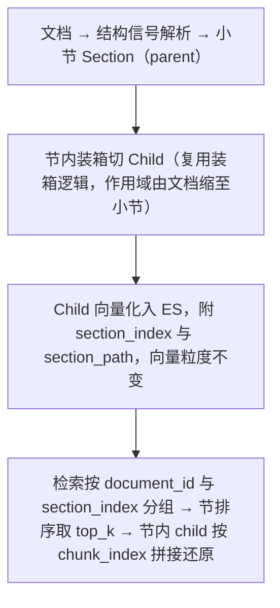

# AI 知识库模块 - 后端实现设计（文档管理）

## 文档概述

F-KB-001 知识库管理、F-KB-002 文档管理、F-KB-003 分块与索引的后端实现。整体架构、缓存、配置与权限见 [后端实现-架构与公共](./后端实现-架构与公共.md)。

## 知识库管理

### 创建知识库

1. 校验权限：公开库需管理员角色，私有库校验会员配额（私有库数上限，按会员等级）
2. 校验 embedding 模型可用：从 [AI模型管理模块](../AI模型管理/后端实现.md) 注册表校验 `model_type=embedding` 且启用，走 `ai:model:list` 缓存；ES 索引维度取注册表 `dimension`；embedding_provider 由注册表模型所属供应商行推导写入，不接受前端指定，保证向量化路由正确
3. 校验知识库名称在同一用户下不重复
4. 写入 `sys_knowledge_base` 记录
5. 初始化 ES 索引 `kb_chunks_{kbId}`：创建索引 mapping（dense_vector + text + keyword + date），dense_vector 维度取 embedding 模型维度
6. 返回知识库 ID

### 知识库编辑

可编辑项：名称、描述、检索策略（search_strategy/hybrid_weight/top_k/score_threshold/enable_rerank）
不可编辑：分块策略、embedding 模型（创建后不可修改，否则已有向量不兼容）

`chunking_strategy` 取值校验（三端口径）：合法集 `{fixed, semantic, recursive, qa, table}`。python 由 pydantic `Literal` 在请求校验阶段拒绝非法字面量（A0400）；java 在 `KbUpdateForm` 字段级 `@Pattern` 拦 A0400、go 在 `validateUpdateForm` service 层白名单拦 A0400。非法字面量必须先于"创建后不可修改"的业务拒绝（否则拼错的策略会被误报成 A0500/`BUSINESS_ERROR`，把"值非法"伪装成"字段不可改"）。知识库创建与 `POST /kb/documents/chunks/preview` 的分块策略校验由 python 承接（java/go 转发）。

### 删除知识库

1. 软删除 `sys_knowledge_base`（deleted 写为行 id）
2. 软删除关联的所有 `sys_knowledge_document`（deleted 写为行 id）
3. 物理删除关联的所有 `sys_knowledge_chunk` 记录
4. 删除整个 ES 索引 `kb_chunks_{kbId}`

导入网页 SSRF 防护：域名经 `getaddrinfo` 解析后逐一校验 IP，命中私网、环回、链路本地、保留段（127/8、10/8、172.16/12、192.168/16、169.254/16、::1、fc00::/7 等）即拒绝；HTTP 客户端关闭自动重定向跟随，对 30x 重定向目标逐跳重复校验，防止跳转绕过。

## 文档管理

### 文档上传

前置：调用文件管理模块上传文件并获取 fileId。

1. 校验知识库存在且 status != 0
2. 校验权限：私有库校验 owner_id = 当前用户
3. 校验文件归属：非管理员仅可关联本人上传的文件（管理员全量放行，与文件管理 B0407 口径一致）
4. 校验配额：单库文档数上限（按会员等级）
5. 校验文件类型支持（PDF、Word、Excel、PPT、Markdown、TXT、图片）与大小（默认不超过 100MB）
6. 创建 `sys_knowledge_document`：knowledge_base_id、file_id、title（文件名或用户手动指定）、parsing_strategy=auto、processing_status=pending
7. 提交异步处理任务（见异步处理流水线）
8. 返回文档 ID 与 processing_status

### 批量上传与自定义创建

除单文件上传外，支持批量上传、导入网页、自定义文本三种创建方式，均复用文档上传的校验与异步处理流水线，差异仅在文档来源与初始内容获取：

| 创建方式   | source 标识 | 内容获取                                                           | 说明                                                                                                                                                   |
| ---------- | ----------- | ------------------------------------------------------------------ | ------------------------------------------------------------------------------------------------------------------------------------------------------ |
| 批量上传   | upload      | 多文件分别调用文件管理上传，逐个创建文档记录                       | 基于 `file_id` 去重，同一知识库下已存在相同 `file_id` 的文档拒绝重复创建（幂等）                                                                       |
| 导入网页   | url         | 根据 URL 抓取网页正文（去除导航、广告等噪声），清洗后存为 `content` | 抓取失败时返回错误，不创建文档记录                                                                                                                     |
| 自定义文本 | manual      | 直接将用户粘贴的文本作为 `content`                                 | 无需文件上传，跳过解析步骤，直接进入分块与向量化；入口校验：空内容（仅空白）拒绝、字符数超过 `KB_MAX_TEXT_CHARS`(1,000,000) 上限拒绝，正常文档不受影响 |

### 文档解析

根据文档格式自动选择解析策略：

| 文件格式         | 解析策略           | 解析工具                                                                                                |
| ---------------- | ------------------ | ------------------------------------------------------------------------------------------------------- |
| .pdf（扫描件）   | OCR                | Tesseract/PaddleOCR → 文字 + 表格区域检测                                                               |
| .pdf（电子档）   | 文本提取           | PyMuPDF/PDFPlumber → 文字 + 表格                                                                        |
| .pdf（复杂文档） | 版面感知（hi_res） | 版面检测 + 阅读顺序恢复 + 区域级解析                                                                    |
| .docx            | 文档解析           | python-docx → 段落 + 表格；Heading 1-9 样式段落转 `"#"*level + 文本` 的 Markdown 标记（分块层结构信号） |
| .xlsx            | 表格感知           | openpyxl → 单元格矩阵 → 结构化文本                                                                      |
| .pptx            | 幻灯片解析         | python-pptx → 文字 + 备注                                                                               |
| .md              | 纯文本             | 直接读取                                                                                                |
| .txt             | 纯文本             | 直接读取                                                                                                |
| .jpg/.png        | OCR                | Tesseract/PaddleOCR → 文字                                                                              |

解析策略分级：`parsing_strategy` 支持 `fast`、`hi_res`、`ocr_only` 三档，按文档复杂度自动选择：

| 策略       | 说明                       | 选择逻辑                                                   |
| ---------- | -------------------------- | ---------------------------------------------------------- |
| `fast`     | 快速文本提取，不做版面分析 | 纯文本为主、无复杂表格的文档（默认）                       |
| `hi_res`   | 版面感知解析               | 算法论文、技术手册、含表格、公式、图片的复杂文档（推荐优先） |
| `ocr_only` | 纯 OCR 识别                | 扫描件、图片型 PDF（兜底）                                 |

OCR 策略：

- 优先尝试直接文本提取（fast path），提取为空时回退到 OCR
- OCR 结果包含文字和位置信息，支撑引用溯源时的页码与段落定位

### 表格提取

Excel 和 PDF 表格提取为结构化文本，保留行列语义：每行输出为"列名：值"形式的文本行，并携带 `metadata.table_rows`、`table_cols` 记录行列数。

表格双态入库：hi_res 解析下表格同时输出 Markdown 文本（供文本检索）与原图（供视觉检索），原图通过文件管理模块存储并记录 `file_id` 到 chunk 的 `metadata.image_file_id`，支撑"以文搜表"与引用跳转原文。

### 版面感知解析（hi_res）

对复杂 PDF 执行"版面检测 → 阅读顺序恢复 → 区域级解析"链路（对齐 RAGFlow DeepDoc 思路）：PDF 逐页转图像后做版面检测（text、table、figure、formula 区域 + bbox），按多栏检测恢复阅读顺序（left→right、top→bottom 排序），再按区域类型分别解析，输出结构化 blocks（每块携带 page、order、type、bbox 元数据）：

| 区域类型 | 解析方式                  | 输出                             |
| -------- | ------------------------- | -------------------------------- |
| 文本     | 直接抽取                  | 文本                             |
| 表格     | 表格结构识别 + 单元格 OCR | Markdown 表格 + 原图（双态入库） |
| 公式     | 公式 OCR                  | LaTeX 文本（`$$...$$`）          |
| 图片     | 图片描述模型              | `[Image: caption]` 文本 + 原图   |

## 分块引擎

### 分块策略实现

父子分块（Small-to-Big）：child（装箱块）作检索单元、parent（小节）作上下文注入单元，解耦单层结构下"小块向量区分度高但上下文不足、大块上下文完整但检索钝"的固有矛盾。除 qa 外各策略在小节（Section）内执行——`parse_sections` 按结构信号四级降级切节，节内装箱切 child；`_chunk_fixed` 作用域改为节内执行（`_scan_atomic_segments` / `_take_budget_text` / `_atomic_chunks` 原样复用，仅外层套节循环），`chunk_index` 改为节内序号，`_postprocess` 不变；chunk 携带 `section_index`（节内 parent 分组键，文档内递增，0 表示无标题文档整篇）与 `section_path`（注入锚点，如 `4 核心设计 > 4.2 检索引擎`），随 MySQL `sys_knowledge_chunk` 与 ES chunk 索引冗余存储，ES mapping 侧 `section_index` 为 keyword（聚合分组）。检索侧按节重组，见 [后端实现-检索引擎](./后端实现-检索引擎.md)。

| 策略                 | 切分逻辑                                                                                                                                                                                                                                                                                                                                                                                   | 写入的元数据                  |
| -------------------- | ------------------------------------------------------------------------------------------------------------------------------------------------------------------------------------------------------------------------------------------------------------------------------------------------------------------------------------------------------------------------------------------ | ----------------------------- |
| 固定长度 (fixed)     | 结构感知装箱：代码围栏与表格识别为不可分割原子，与相邻文本在 chunk_size 预算内贪心装箱（块结构完整与块大小同时保证——独立原子块信息量小，检索实测"高分不命中"；装箱模式相邻块不重叠，原子边界为天然锚点）；文本截取句边界优先、token 窗口经字符边界对齐（tiktoken 字节级 BPE 的 token 可跨多字节字符字节边界，直接 decode 半个字符会产生 U+FFFD 乱码，边界借用相邻 token 对齐后零乱码）；超预算原子按行贪心切分（行完整性优先）。装箱参数经 kb_eval 评估基线三轮迭代验证 | —                             |
| 语义分块 (semantic)  | 先按双换行分段；段落 token > chunk_size 时在最近句子边界切分；段落 token < min_tokens 时与下一段合并；overlap 只在切分边界添加                                                                                                                                                                                                                                                              | —                             |
| 递归分块 (recursive) | 按分隔符优先级 "\n\n" → "\n" → "。" → "，" → " " 递归切分，chunk 过大则降级到下一级分隔符；overlap 在切分边界添加                                                                                                                                                                                                                                                                          | —                             |
| 问答对 (qa)          | 识别 Q: / A: 标记，Q 与 A 各自独立为 chunk 且 chunk_index 相邻；检索时问题 chunk 优先匹配，答案 chunk 作为上下文注入                                                                                                                                                                                                                                                                        | `type: question / answer`     |
| 表格感知 (table)     | 检测 `<table>` / `\|表头\|` 模式，整个表格作为单个 chunk 不切分                                                                                                                                                                                                                                                                                                                             | `type: table`、`rows`、`cols` |

### 节划分：结构信号与降级

结构信号按知识源格式分两层提供，新增知识源格式只改解析层，分块与检索层不感知：

| 知识源          | 结构信号来源                          | 说明                   |
| --------------- | ------------------------------------- | ---------------------- |
| md / txt        | 文本内 `#`~`####` 标题标记            | 直接支持               |
| docx            | 解析层提取 Heading 样式 → 转 `#` 标记 | 分块层零改动           |
| xlsx / pptx     | 无节语义（表格、页为天然单元）        | 节=表格组，表格已原子化 |
| pdf（fast/ocr） | 无结构信号                            | 走语义分段 fallback    |
| pdf（hi_res）   | 字号、加粗启发式标题检测              | 未支持（业界公认难题） |

`parse_sections(text) -> list[Section]` 按结构信号切节，节标题路径随层级累积；无结构信号时按剩余信号逐级降级，每级复用已有逻辑：

| 级别 | 剩余信号                       | 节边界来源                                                                                     |
| ---- | ------------------------------ | ---------------------------------------------------------------------------------------------- |
| 1    | `#` 标题                       | 标题树                                                                                         |
| 2    | 双换行段落                     | 段落聚类节（`_merge_small_paragraphs` 复用，小段合并到目标节大小）                             |
| 3    | 仅句末标点（连续长文本无空行） | 句子贪心聚类节：`_split_at_sentences` 切句后按目标节大小（约 1500 token）聚合切节，边界取句边界 |
| 4    | 无任何信号                     | 单节 + 超预算截断兜底（child 走 token 硬切含字符对齐，检索可用，节扩展收益归零）               |

### 父子分块取舍

- parent 虚拟化，不物化存储：parent 是 `(document_id, section_index)` 的逻辑分组，内容为该组 child 按序拼接；相比 LangChain ParentDocumentRetriever 的物化 parent 省去双份存储与 reprocess 双写一致性维护，代价是读取时一次分组查询
- parent 取语义结构单元（Markdown 小节），不取任意窗口：节是作者组织的语义完整单元，与召回测试集的期望命中单元天然对齐；无结构信号格式 fallback 为语义分段节，不降级为单节
- `section_index` 取稳定序号而非标题文本（标题可重复、可改动）作分组键；`section_path` 随 child 冗余存 ES 与 MySQL，命中即得、读取单跳
- child 不跨节：装箱边界被节边界约束，短节单 child、长节多 child；qa 的 Q/A 与 table 的表格原子归属所在节的 child
- 不引入 LangChain 检索框架：分块质量依赖字符对齐、围栏原子与装箱，LangChain 分块器为字符级且无这些能力，引入即质量回退；ParentDocumentRetriever 无分组去重、节代表分与截断逻辑，集成成本大于自建增量

存量库迁移：全局切换、不做兼容层，存量文档 reprocess 全量重建（`section_index` / `section_path` 重算）；embedding 计费口径不变。

### 分块后处理

| 处理步骤     | 说明                                                                |
| ------------ | ------------------------------------------------------------------- |
| 最小长度过滤 | chunk token < 50 的片段丢弃或与相邻 chunk 合并                      |
| 最大长度限制 | chunk token > 2000 的强制切分                                       |
| 空白清理     | 去除多余空格和空行                                                  |
| 元数据附加   | 每条 chunk 附加 `{document_id, chunk_index, page, paragraph, type}` |

### 分块元数据

分块的 `metadata` 承载检索过滤与引用溯源所需的维度：

| 字段                                          | 说明                                                                                                                                                                                                        |
| --------------------------------------------- | ----------------------------------------------------------------------------------------------------------------------------------------------------------------------------------------------------------- |
| `page` / `paragraph`                          | 原始文档页码与段落，支撑引用溯源定位                                                                                                                                                                        |
| `type`                                        | 分块类型（text / table / question / answer）                                                                                                                                                                |
| `model_id` / `tags`                           | 关联模型与标签，支撑元数据过滤                                                                                                                                                                              |
| `image_file_id` / `table_rows` / `table_cols` | 版面解析产出的原图与表格行列结构                                                                                                                                                                            |
| `entities` / `relations`                      | 知识图谱关系底座：`entities` 为 `{type, name, ref_id, value}`，`relations` 为 `{type, from, to}`；检索时按 `metadata.entities`、`metadata.relations` 按关系维度过滤，支撑"只看关联 RIDCP 的分块"等关系查询 |

`entities.type` 取值：Algorithm、Paper、Task、Scene、Metric、Dataset、CodeModule、Experience；`relations.type` 取值：SUITABLE_FOR、ACHIEVES、REQUIRES、CITES、COMPARES、EVALUATED_ON、IMPLEMENTS、DEPENDS_ON、RECOMMENDS。

### 分块预览确认

上传文档时支持在入库前预览分块效果，用户确认后再提交异步处理：

- 调用分块预览接口，输入 `fileId` + 分块配置（chunking_strategy/chunk_size/chunk_overlap），输出分块预览列表（每块 content + token_count + 序号）
- 前端展示分块效果，用户可调整分块配置后重新预览，确认后携带配置提交文档创建
- 分块预览仅做解析 + 分块，不向量化、不写索引，成本可控
- 未确认时按知识库默认分块配置直接入库（不阻塞上传流程）
- 预览接口复用文档解析与分块引擎，与正式处理链路一致，保证预览即所得

## 异步处理流水线

### 处理流程

异步任务非阻塞提交并持有 task 引用防止被提前回收。

1. 文档状态更新为 `processing`，WebSocket 向知识库 owner 推送
2. 获取文件内容：`fileId` → `sys_file` → `object_name`（URL 不落库，访问时运行时拼接）；调用文件存储下载文件（manual、url 来源直接用 content，跳过）
3. 文档解析：按文件格式与 parsing_strategy 选择解析器，提取纯文本 content 与结构化 raw_content（含表格、代码块），更新 `sys_knowledge_document.content` 与 `raw_content`
4. 文本清洗：去除噪声（HTML 标签、多余空白、不可见字符含 BOM 与零宽字符，避免脏字符进入分块与向量索引），统一编码与换行符
5. 分块：按知识库 chunking_strategy 选择分块器，生成 `List<Chunk>`（每条含 content + metadata），批量写入 `sys_knowledge_chunk`
6. 向量化：批量调用 Embedding 模型 API（batch-size = 100，可配置），更新 `sys_knowledge_chunk.token_count`（向量仅写 ES，不落 MySQL）；计费见 [AI计费管理后端实现](../AI计费管理/后端实现.md)——分块完成后按分块精确 token 总量预校验（欠费、配额、余额 fail-closed，不满足则文档标记 failed 不再向量化），向量索引成功后按实际 token 实扣（bill_type=embedding，计费主体=知识库 owner，local 模型不计费）
7. ES 索引：批量写入 `kb_chunks_{kbId}`，含 dense_vector、content、metadata、tags（含 create_time 支撑时间过滤）
8. 统计更新：`sys_knowledge_document` 置 `processing_status=completed` 并写 chunk_count、total_tokens；`sys_knowledge_base` 累加 document_count、chunk_count、total_tokens（CAS 原子累加）并置 `status=1`

### 失败处理

| 失败步骤              | 处理                                                                                     |
| --------------------- | ---------------------------------------------------------------------------------------- |
| Step 3 解析失败       | 标记 document.processing_status=failed, error="文档解析失败：{原因}"                     |
| Step 5 分块失败       | 标记 document.processing_status=failed, error="分块失败：{原因}"                         |
| Step 6 计费预校验拒绝 | owner 欠费、配额、余额不足（fail-closed）：标记 failed, error 含拒绝原因；充值后可重新处理 |
| Step 6 向量化失败     | 重试 3 次后标记 failed                                                                   |
| Step 7 ES 索引失败    | 回滚 sys_knowledge_chunk 记录 + 重试索引写入                                             |

### 重新处理

1. 重置 `document.processing_status = pending`
2. 删除该文档旧的 `sys_knowledge_chunk` 记录
3. 删除 ES 中该文档旧的 chunk 索引（by document_id）
4. 重新提交异步处理任务

## 模块间协作

| 协作模块   | 集成点                                                                                                                                                                                                                                                       |
| ---------- | ------------------------------------------------------------------------------------------------------------------------------------------------------------------------------------------------------------------------------------------------------------ |
| 文件管理   | 上传前经文件管理获取 `fileId`；处理时由 `fileId` 取 `object_name` 下载文件；URL 不落库，经 `FileService.getUrl(fileId)` 运行时拼接                                                                                                                           |
| AI模型管理 | 模型新增或更新时由 AI 模型管理模块主动调用文档创建 API 入库（`source=algorithm_sync`），本模块不监听模型变更；入库边界为新增文档（非重建现有文档），同一模型的多次变更产生多个文档或由 AI 模型管理模块自行管理版本；模型知识通过 `metadata.model_id` 关联模型 |

模型文档入库流程（由 AI 模型管理模块驱动）：AI 模型管理模块将模型名称、适用场景、参数说明、典型指标、优劣对比组织为文本描述，调用 `POST /api/v1/kb/{id}/documents/text`（`source=algorithm_sync` + `metadata.model_id`）；本模块创建文档记录后触发异步处理流水线。

## 文档版本管理

编辑文档（重新上传文件或更新自定义文本）时 `version` +1，旧分块记录与 ES 索引同步清除，仅最新版本参与检索。

更新校验与上传同口径：重新上传文件时校验文件归属（非管理员仅可关联本人上传的文件，越权 B0407）与格式白名单（PDF、Word、Excel、PPT、Markdown、TXT、图片，非白名单 A0701）；校验先于旧分块清除，被拒绝的请求不破坏现有分块与索引。

历史版本归档、版本保留与版本回溯当前未实现：更新即清除旧版本分块，不做归档留存。
