# AI 知识库模块 - 后端实现设计（架构与公共）

## 文档概述

模块分层架构、数据模型组织、异步处理与文本清洗、缓存策略、配置项、权限与可见性、容量配额、并发与事务、跨模块协作、部署要求。分块引擎与检索实现见 [后端实现-文档管理](./后端实现-文档管理.md) 与 [后端实现-检索引擎](./后端实现-检索引擎.md)。

## 架构设计

### 模块分层架构

```mermaid
flowchart LR
    Caller["被调用方 AlgorithmService（AI模型管理）<br/>模型文档变更时调用知识库 API 入库"]
    subgraph Ctrl["Controller 层"]
        direction TB
        KC["KnowledgeBaseController：知识库 CRUD、配置管理"]
        DC["DocumentController：文档上传、列表、删除、重新处理"]
        SC["SearchController：检索接口（内部与 API）"]
    end
    subgraph Svc["Service 层"]
        direction TB
        S1["KnowledgeBaseService：知识库生命周期管理"]
        S2["DocumentService：文档上传、解析编排、状态管理"]
        S3["ChunkingEngine：分块引擎（多策略）"]
        S4["EmbeddingService：向量化服务（多模型切换）"]
        S5["IndexService：ES 索引管理（创建、更新、删除）"]
        S6["SearchService：检索编排（混合检索、重排序、过滤）"]
    end
    subgraph Dep["依赖模块"]
        direction TB
        F["FileService：文件上传、下载、URL 拼接"]
        E["Elasticsearch：向量检索、全文检索"]
    end
    Caller --> Ctrl
    Ctrl --> Svc
    Svc --> Dep
```

### 核心组件职责

| 组件                 | 职责                                                                                                                              |
| -------------------- | --------------------------------------------------------------------------------------------------------------------------------- |
| KnowledgeBaseService | 知识库 CRUD、分块与检索策略配置、统计信息维护                                                                                      |
| DocumentService      | 文档上传、解析编排（文档→纯文本）、异步处理状态管理                                                                               |
| ChunkingEngine       | 多策略分块（固定、语义、递归、问答对、表格感知）、chunk 重叠管理                                                                   |
| EmbeddingService     | 文本向量化、多 embedding 模型切换、批量向量化                                                                                     |
| IndexService         | ES 索引管理：dense_vector 字段 + 全文检索字段 + 元数据字段的索引 CRUD、索引状态统计（大小、文档数、阈值告警，支撑管理端索引状态区） |
| SearchService        | 混合检索编排（向量 + 关键词）、Rerank 重排序、MMR 去重、元数据过滤                                                                |

## 数据模型

表结构与索引定义见 [02-系统架构/03-数据库设计.md](../../../02-系统架构/03-数据库设计.md)（AI 知识库相关表），此处仅说明数据组织决策：

- 知识库、文档、分块由三张表构成（知识库配置、文档记录、分块记录），分块记录只追加、文档更新时整批替换
- 向量索引按知识库分索引隔离（`kb_chunks_{knowledgeBaseId}`），与分块记录同步写入，供混合检索使用
- 知识库状态（启用、处理中、禁用）与文档处理状态（待处理、处理中、已完成、失败）驱动异步处理流水线

## 异步处理流程

文档上传后，解析、分块、向量化、索引写入全部异步处理，任务以非阻塞方式提交并持有引用防止被提前回收。完整流水线步骤与失败处理见 [后端实现-文档管理](./后端实现-文档管理.md)。

### 文本清洗

解析得到纯文本后、分块前经 `_clean_text` 统一清洗，避免脏字符进入分块与向量索引：

| 处理       | 覆盖                                                                                                           |
| ---------- | -------------------------------------------------------------------------------------------------------------- |
| 去 HTML    | `<...>` 标签剥离                                                                                               |
| 去不可见符 | 控制字符（`\x00-\x08`、`\x0b`、`\x0c`、`\x0e-\x1f`、`\x7f`）、零宽字符（U+200B–U+200D、U+2060）、BOM（U+FEFF） |
| 空白归一   | NBSP（`\xa0`）转普通空格；连续空格与制表符压为单空格；3 个及以上连续换行压为 2 个；CRLF、CR 统一为 LF          |

## 缓存策略

| 缓存对象           | 缓存 Key                                                                                                  | TTL          | 更新策略                                                                                                                     |
| ------------------ | --------------------------------------------------------------------------------------------------------- | ------------ | ---------------------------------------------------------------------------------------------------------------------------- |
| 知识库配置         | `kb:config:{kbId}`                                                                                        | 10 min       | 知识库更新时失效                                                                                                             |
| 检索结果           | `kb:search:{库集合哈希}:{queryHash}`；库集合哈希含库 ID 与检索配置（策略、阈值、权重、rerank、embedding） | 5 min        | 库配置变更即键变化即时生效（无需清缓存）；库内文档变更未接入跨模块失效钩子，由 TTL 自然过期兜底；检索降级产生的空结果不写缓存 |
| embedding 模型实例 | 本地内存                                                                                                  | 应用生命周期 | 启动时加载                                                                                                                   |
| 知识库列表         | `kb:list:{userId}`                                                                                        | 10 分钟      | 知识库创建、删除时失效                                                                                                       |
| 知识库详情         | `kb:detail:{kbId}`                                                                                        | 30 分钟      | 知识库更新时失效                                                                                                             |
| 向量索引           | 持久化存储（ES）                                                                                          | 不缓存       | ES 索引为持久化存储，非缓存层                                                                                                |

## 配置项

本模块的分块与检索参数全局默认值为应用配置（`clarity-python/app/config.py` 的 `KB_CHUNK_*`、`KB_SEARCH_*`、`KB_INDEX_*`、`KB_ASYNC_*` 环境变量字段，部署时可覆盖），非 `sys_dict` 字典项。其中标注"库级可覆盖"的参数为知识库实体字段（`sys_knowledge_base`），每个知识库可在创建或编辑时单独配置，未配置时取全局默认：

| 配置项                           | 说明                          | 库级可覆盖 | 默认值 |
| -------------------------------- | ----------------------------- | :--------: | ------ |
| `kb.chunk.default-size`          | 默认分块大小（token）         |     是     | 800    |
| `kb.chunk.default-overlap`       | 默认分块重叠（token）         |     是     | 80     |
| `kb.chunk.max-tokens`            | 最大分块 token 数             |     否     | 2000   |
| `kb.chunk.min-tokens`            | 最小分块 token 数             |     否     | 50     |
| `kb.search.default-top-k`        | 默认检索 Top-K                |     是     | 5      |
| `kb.search.max-top-k`            | 最大检索 Top-K                |     否     | 50     |
| `kb.search.default-threshold`    | 默认相似度阈值                |     是     | 0.5    |
| `kb.search.hybrid-rank-constant` | RRF 混合检索 rank_constant    |     否     | 60     |
| `kb.search.hybrid-rank-window`   | RRF 混合检索 rank_window_size |     否     | 20     |
| `kb.index.batch-size`            | ES 批量索引条数               |     否     | 100    |
| `kb.async.max-retry`             | 异步处理最大重试次数          |     否     | 3      |

## 权限与可见性控制

| 可见性          | 访问控制                                                          | 校验范围                                                                          |
| --------------- | ----------------------------------------------------------------- | --------------------------------------------------------------------------------- |
| 公开（public）  | 全员可检索（只读）；仅管理员可创建、编辑、删除                    | 检索不限制用户；写操作校验管理员角色                                              |
| 私有（private） | 仅 owner 可读写；其他用户不可见、不可检索；管理员可见（只读监控） | 文档管理与检索接口校验 `owner_id = 当前用户`；管理员列表与索引状态接口豁免（只读） |

- 所有权校验贯穿全流程：知识库详情，文档上传、列表、删除、重新处理，检索接口均校验当前用户对私有库的所有权
- 检索过滤：检索接口按当前用户身份过滤可见知识库——私有库仅返回 owner 自己的库，公共库对所有登录用户可见
- 管理端监控例外：管理员视角（`view=admin`）可查看全部知识库（含用户私有库）列表与索引状态（只读监控），私有库内容管理权限仍属创建者
- 权限标识与接口绑定见 [API接口](./API接口.md)

## 容量配额管理

按会员等级校验容量上限，权益配置复用会员管理模块。配额取值（可建私有库数、单库文档数、单库分块数）见 [需求规格](./需求规格.md)。

| 配额项           | 校验时机         | 超出处理               |
| ---------------- | ---------------- | ---------------------- |
| 可建私有知识库数 | 创建私有知识库时 | 拒绝创建并提示升级会员 |
| 单库文档数上限   | 文档上传时       | 拒绝上传               |
| 单库分块数上限   | 索引构建时       | 拒绝构建并告警         |

- 权益查询：校验时调用会员管理模块查询当前用户会员等级对应的配额字段
- 公共库豁免：公共知识库不受个人配额限制，由管理员独立管理

硬上限常量（代码常量，随代码发布，非环境配置；单库文档数、分块数受会员等级配额约束，此处为不可超越的硬上限）：

| 常量                | 值        | 作用                         | 触发时机与超限处理                           |
| ------------------- | --------- | ---------------------------- | -------------------------------------------- |
| `KB_MAX_DOCUMENTS`  | 500       | 单库文档数硬上限             | 文档上传时拒绝                               |
| `KB_MAX_CHUNKS`     | 10000     | 单库分块数硬上限，防单库爆炸 | 索引构建（分块后）拒绝并告警                 |
| `KB_MAX_TEXT_CHARS` | 1,000,000 | 自定义文本字符数上限         | `create_text` 内容为空（仅空白）或超长时拒绝 |

## 并发与事务设计

### 统计字段原子更新

知识库的 `document_count`、`chunk_count`、`total_tokens` 在文档处理完成时并发更新，采用乐观锁 CAS（compare-and-set）方式原子递增，避免并发覆盖：

- 更新语句携带原值快照，仅当快照与当前值一致时更新；冲突时重试
- 文档处理完成时一次性累加三个字段，不分多次更新

### 并发重处理与批量上传幂等

| 场景             | 幂等设计                                                                                                              |
| ---------------- | --------------------------------------------------------------------------------------------------------------------- |
| 同文档并发重处理 | 文档状态锁——仅 `processing_status=failed` 的文档允许重处理，进入处理时先置为 `processing`，处理中再次触发重处理则拒绝 |
| 批量上传重复文件 | 基于 `file_id` 去重，同一知识库下已存在相同 `file_id` 的文档拒绝重复创建                                              |

### 跨存储一致性（MySQL 与 ES）

分块记录写入 MySQL 与 ES 索引跨存储，采用"先写 MySQL 再写 ES + 失败补偿"策略：

1. 分块记录先批量写入 `sys_knowledge_chunk`（MySQL）
2. 再批量写入 ES 索引 `kb_chunks_{kbId}`
3. ES 写入失败时记录补偿任务，由对账任务周期性扫描并重试 ES 索引写入
4. 对账任务以 `document_id` 为单位比对 MySQL 分块记录与 ES 索引文档数，差异项补偿

## 跨模块协作

| 协作模块     | 集成方式                                                                                                     |
| ------------ | ------------------------------------------------------------------------------------------------------------ |
| 会员管理     | 创建私有知识库、上传文档、索引构建时查询当前用户会员等级配额并校验上限                                       |
| AI 计费管理  | RAG 检索注入的 Top-K 片段 Token 上报计费，`bill_type=kb_inject`，随对话输入 Token 计量；知识库管理操作不计费 |
| MCP 能力网关 | 检索注册为 MCP tool `kb_search`，AI 对话及第三方 Agent 经网关认证后调用                                      |
| 语音交互模块 | 语音问答链路注入检索结果（ASR → 检索 → 注入 LLM prompt → TTS）                                               |
| AI 对话模块  | 对话调用检索注入接口，结果按 LLM prompt 格式注入并附带引用溯源                                               |
| 文件管理     | 上传前经文件管理获取 `file_id`；处理时由 `file_id` 取存储路径下载；URL 不落库，运行时拼接                    |
| AI模型管理   | 模型文档变更由 AI 模型管理调用文档创建 API 入库（`source=algorithm_sync`），本模块不监听模型变更             |

## 非功能需求达成设计

指标与要求见 [需求规格](./需求规格.md)，达成设计如下：

| 指标                        | 达成设计                                                                                                          |
| --------------------------- | ----------------------------------------------------------------------------------------------------------------- |
| 检索延迟 P99 ≤ 500ms        | ES 索引优化（dense_vector + 全文检索字段合理 mapping）+ 检索结果缓存（5min）+ Rerank 仅对 Top-K×2 候选执行        |
| 索引构建吞吐 ≥ 100 chunks/s | 异步流水线（解析、分块、向量化、索引写入各阶段解耦）+ ES 批量写入（batch-size=100）+ Embedding 批量向量化         |
| 并发检索 ≥ 50 QPS           | 检索线程池隔离 + ES 客户端连接池配置 + 检索缓存命中直接返回                                                       |
| 异步处理可靠性（重试 3 次） | 解析、分块、向量化、索引任一步骤失败重试，耗尽后标记 failed 并保留错误信息                                        |

## 三端一致性约束

Java/Go/Python 三后端 API 契约完全一致，Java 为权威实现，Go/Python 对齐：

- 检索注入接口（内部 `SearchService.search` 与对外 `/api/v1/kb/search`）三端请求与响应结构一致
- ES 索引 mapping、分块策略实现、RRF 混合检索参数（rank_constant、rank_window）三端一致
- 异步处理流水线状态机（pending/processing/completed/failed）三端一致
- 权限与可见性过滤逻辑三端一致（私有库仅创建者可见，公共库全员只读）

## Embedding 模型下线迁移

embedding 模型生命周期（标注下线、替换迁移）由 [AI模型管理模块](../AI模型管理/后端实现.md) 统一管理。管理员将 embedding 模型标记禁用后，知识库创建时校验模型启用状态（`model_type=embedding` 且启用，读注册表快照 `ai:model:list` 缓存，无代码白名单；embedding_provider 由注册表模型所属供应商推导，维度取注册表 `dimension`），禁止用该模型新建知识库。

存量知识库切换至新 embedding 模型的迁移接口当前未实现：需批量重新向量化所有分块并重建 ES 索引 mapping（dense_vector 维度更新），复用文档处理 pipeline 逐文档重跑，进度经文档 `processing_status` 可见。当前替代路径是删库重建（文档源文件在对象存储不丢，重新导入即可）。

## 安全设计

### 文档安全

| 防护项       | 说明                                                                                                        |
| ------------ | ----------------------------------------------------------------------------------------------------------- |
| 上传格式校验 | 支持 PDF、Word、Excel、PPT、Markdown、TXT、图片，非白名单格式拒绝上传                                       |
| 文件大小限制 | 单文档大小上限由文件管理模块统一控制                                                                        |
| 文档来源校验 | `source` 字段标识文档来源（manual/upload/url/algorithm_sync/experience），URL 导入时校验 URL 合法性与可达性 |

### 向量数据安全

| 防护项       | 说明                                                                           |
| ------------ | ------------------------------------------------------------------------------ |
| ES 索引隔离  | 向量索引按知识库分索引隔离（`kb_chunks_{kbId}`），不同知识库的向量数据物理隔离 |
| 索引访问控制 | ES 索引的读写通过知识库 Service 层统一控制，不暴露直接的 ES 访问接口           |

## 部署要求

知识库向量检索（`kb_chunks_{kbId}` 索引）与 RRF 混合检索依赖 ES retriever API，需 ES ≥ 8.14（retriever/RRF API GA 版本）。

中文全文检索采用 analysis-ik 插件，`content` 与 `doc_title` 字段使用 ik 推荐组合：索引侧 `ik_max_word`（最大粒度切分，提高召回），查询侧 `ik_smart`（粗粒度切分，减少噪声）。检索查询无需显式指定 analyzer，`multi_match` 自动使用字段定义的 `search_analyzer`。向量检索（kNN）与 RRF 融合不受 analyzer 影响，analyzer 仅作用于关键词检索质量。
