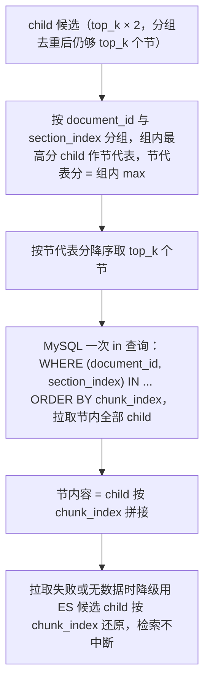

# AI 知识库模块 - 后端实现设计（检索引擎）

## 文档概述

F-KB-004 检索引擎的后端实现。对外 HTTP 契约见 [API接口](./API接口.md)。

## 检索接口

### 内部检索接口

AI 对话模块通过内部接口调用检索（同步调用，不直接暴露 HTTP）：`SearchService.search(knowledgeBaseId, query, options)`，参数为指定知识库（可为空，检索所有知识库）、用户查询文本（或 AI 对话自动提取的关键词）与选项 `{ topK, threshold, filters, enableRerank, enableMMR }`；返回 `List<SearchResult>`，每项为"节"粒度（父子分块），含 `chunkId`、`chunkIds`、`content`、`metadata`、`score`、`documentTitle`、`chunkIndex`、`sectionPath`（可选）。

### 检索重组（父子分块）

检索单元（child）与上下文单元（parent=小节）解耦：向量、BM25、RRF 候选仍为 child 粒度，检索结果在 `_retrieve_kb` 内重组为节：



- hybrid 的 keyword 分支候选同样参与分组（RRF 融合后统一分组）；
- 节代表分取组内最高分 child，可由组内命中数加权（参数由召回测试集评估定）；
- rerank 输入由 child 换为节代表文本；
- MMR 多样性使用节代表 child 的向量；
- 结果项 `chunkIds` 为节内全部 child id（召回测试按节判定命中），`sectionPath`
  为小节标题路径（仅标题节返回）；
- 命中节全文超上下文预算时按组内 child 分数降序保留、超出截断并标记。

### 检索计费

用户显式检索（`/kb/search`、`retrieve/test`）按实际模型调用后扣费（`KbBillingService`，语音链路同款"调用前校验 + 调用后实扣"）：

- 查询向量化：bill_type=embedding，token = query 近似 token（与 chat 预扣 `_approx_tokens` 同口径）
- Rerank：bill_type=rerank，token = query + 全部候选文档近似 token 求和
- 不计费：search_internal（对话内部注入，消耗随主消息 chat 计费覆盖，防双扣）、检索缓存命中（无模型调用）、测试集回归评估（内部工具，search 传 bill=False）、provider=local 本地模型（零边际成本不落记录，权益预校验照常）
- 预校验 fail-closed（欠费熔断 → 配额 → 余额），不满足抛 QUOTA_INSUFFICIENT；该错误码经检索超时降级链路透传拒绝（不降级为空结果）；实扣不足扣至 0 标欠费（与 chat 实扣一致）
- 单价读 sys_ai_model_price 用户售价（与 chat 同源）；未配置售价 warn 回退 0（免费）不拒绝

## 混合检索

### 混合检索编排

采用应用层 RRF 融合：vector_search（kNN）与 keyword_search（BM25）分别取候选后，在 Python 层（`kb_chunk_index._rrf_fuse`）做 Reciprocal Rank Fusion 融合：

1. `SearchService.hybridSearch(knowledgeBaseId, query, weight)` 调用 `EmbeddingService.embed(query)` 得 queryVector
2. 两个子检索并发执行（Basic license 均可用）：vector_search 取顶层 kNN(content_vector, queryVector) 的 rank_window_size 条候选；keyword_search 取 multi_match(content, doc_title) BM25 的 rank_window_size 条候选
3. 应用层 RRF 融合：score = Σ weight / (rank_constant + rank)，rank 为文档在该检索器结果中的排名（从 1 起），vector_weight 与 keyword_weight 为各检索器权重
4. 按融合分数降序取 Top-K，relevance 字段为融合分数

不用 ES 内置 `retriever` RRF API：该能力需白金 license，Basic license 请求返回 403 导致检索降级空结果。RRF 只取排名不取原始分，天然规避 kNN 与 BM25 分数不可比问题；`rank_constant`（默认 60）与 `rank_window_size`（默认 20）语义与 ES RRF 一致。融合分数（约 0~0.03 量级）不再是 cosine 相似度，故对融合结果本身不能套 cosine 阈值；hybrid 的相关度门禁改为在融合前过滤向量候选。

### 落地说明（多库 embedding 分组、阈值口径）

检索编排（SearchService）的工程落地要点：

- 多库 embedding 分组 + 并发检索：多库检索时各库可能使用不同 embedding 模型（provider+model），向量维度不兼容。实现按 `(embedding_provider, embedding_model)` 分组，同组库共享一次 `embed_text` 的 query 向量；再按各库 `search_strategy`（vector/keyword/hybrid）分派底层原语。同组内多库用 `asyncio.gather` 并发检索，避免多库延迟线性叠加（单库检索内部已降级返回列表，不会抛异常）。keyword 策略无需 query 向量。
- 阈值过滤口径（`_search_one_kb`）：
  - vector：分数为原始 cosine 相似度（0-1），低于库 `score_threshold` 的结果丢弃。ES mapping `similarity=cosine` 时 `_score = (1 + cos) / 2`（落在 [0.5,1]），检索层统一用 `_score_to_cosine` 还原为 cosine 后再比较或返回——不还原会把阈值整体抬到 [0.5,1] 区间（阈值 0.5 等价于 cos≈0，等于不过滤）；
  - keyword：BM25 分数无界，不适用 cosine 阈值；
  - hybrid：门禁作用在融合前的向量候选上——先按库 `score_threshold` 过滤低相关向量候选，再与 BM25 候选做 RRF 融合（`score_threshold=0` 表示不过滤）；仅关键词命中的文档不受该阈值影响。融合分数本身不可比，不外层再套阈值。
  - 标定须知：cosine 量纲下，实测域内查询约 0.58~0.84、无词面重叠的域外查询约 0.4~0.5、与库主题词面接近的"伪相关"可达 0.7+，故默认 0.5 能切掉明显无关但难以精确切分，精细阈值须按当前 embedding 用召回测试集标定（`/api/v1/kb/{id}/retrieve/test-sets`）；跨编码器 rerank（`enable_rerank`）才是更强的相关性判别手段。
- 内部注入接口：`search_internal`（无用户上下文，仅检索公共库）复用同一编排与缓存逻辑。

## 检索后处理

### Rerank 重排序

知识库启用 `enable_rerank=1` 时，检索后进行二次排序：

1. 混合检索返回 Top-K × 2 结果
2. `RerankService.rerank(query, results)` 调用 Rerank 模型（Cross-Encoder，如 bge-reranker-v2-m3），输入为 `(query, result.content)` 对（父子分块下 result 为节，content 为节内容），输出精细相关性分数
3. 按 Rerank 分数重新排序，取 Top-K 最终结果

适用条件：知识库 `enable_rerank=1` 且 `rerank_model` 已配置。

计费：rerank 调用成功后按 query + 候选文档 token 实扣（bill_type=rerank，调用前预校验、失败降级不扣费）。

### MMR 多样性优化

候选结果按分数排序后迭代选取 MMR 值最高的候选加入结果集，直至选满 Top-K：

- `MMR = λ × relevance(candidate) - (1-λ) × max(cosine(candidate, selected))`，λ 默认 0.5
- relevance 取候选自身检索分数（候选集内归一化）——跨库 embedding 模型异构，单一 query 向量对不同模型的候选分数不可比
- 多样性项使用候选与已选集的 embedding 向量余弦相似度

### 元数据过滤

检索前通过检索条件过滤缩小范围（过滤不参与分数计算）：按知识库、文档类型、标签、时间范围、关联模型等元数据维度过滤，仅保留满足条件的候选片段。

## 检索注入格式

### 检索结果结构

检索结果包含：查询文本、知识库 ID、结果列表。父子分块后每项为"节"粒度：内容为节内 child 拼接、分数为节代表（组内最高分 child）分数、含分块 ID 与节内全部 child ID（chunkIds）、节路径（sectionPath，仅标题节）、来源文档标题与 ID、代表 child 序号、元数据。`chunkIds` 与 `sectionPath` 为新增字段（API 只增不删，无破坏性变更）。

### LLM Prompt 注入格式

命中节以 `【{文档名} > {节路径}】` 锚点 + 节全文注入 LLM prompt。注入格式为前置说明语 → 逐条片段块 → 结尾引导语，每个片段块为：

```
[来源: {documentTitle}, 第{page}页, 段落{paragraph}]
{content}
```

### 引用溯源展示

助手回复中标注引用编号 [1][2]，回复末尾展示引用列表（文档标题 + 页码、段落）。引用编号支持点击跳转，前端根据检索结果的 `documentId + metadata.page + metadata.paragraph` 定位到来源文档原文对应位置并高亮展示。跳转依赖解析层保留的页码与段落元数据（见 [后端实现-文档管理](./后端实现-文档管理.md)）。

## 检索超时降级

| 场景                                                       | 处理                                                                                                                                               |
| ---------------------------------------------------------- | -------------------------------------------------------------------------------------------------------------------------------------------------- |
| 对话注入链路检索超时（`KB_SEARCH_TIMEOUT_MS`，默认 10s）   | AI 对话降级为无知识回复（不注入知识片段，仅基于模型自身能力回答）                                                                                  |
| 显式检索链路超时（`KB_SEARCH_QUERY_TIMEOUT_MS`，默认 30s） | 适用于 `/kb/search`、`/kb/{id}/retrieve/test`、召回测试集执行：调用方（用户、管理员）正等待真实结果，超时预算取更大值——这些链路返回空结果会被误读为"库内无匹配" |
| ES 不可用                                                  | 同对话注入链路：降级返回空结果                                                                                                                     |
| 计费预校验拒绝（QUOTA_INSUFFICIENT）                       | 不降级：业务异常透传给调用方（用户显式检索场景返回拒绝提示，防欠费用户误判库无内容；对话注入场景不计费故不会触发）                                   |
| 降级告警                                                   | 记录告警日志；降级产生的空结果不写缓存，避免临时降级被缓存放大                                                                                     |
| 主流程影响                                                 | 降级不影响对话主流程，仅丢失知识增强能力                                                                                                           |

预算覆盖完整检索链路（查询向量化 + ES 检索与 RRF 融合 + 节内容回填 + rerank），非仅 ES 检索：`provider=local` 时查询向量化走与对话推理共用的 CPU 子进程，单次约 0.4~3s（冷启动或被对话占用时更久），叠加 ES 检索约 0.4s。预算过小会把健康检索误判为超时并静默降级为空结果。

## 召回测试工具与反馈闭环

### 召回测试工具

召回测试的能力定义（单次召回、测试集管理、版本对比）见 [需求规格](./需求规格.md)，接口契约见 [API接口](./API接口.md)。

#### 后端实现（召回测试集）

数据模型（`config/sql/schema/sys_knowledge_test_set.sql`，三端共享）：单个测试集 = 一个用例，一条 `question` + 一个 `expected_chunk_ids`（JSON 数组，期望命中分块 ID），关联 `sys_knowledge_base.id`。不拆分 item 表，避免过度设计。软删除 + BaseModel 审计字段。

计算口径：执行测试集复用检索引擎（`SearchService.search`，按 `question` 在该库内检索，`topK` 可调），返回 `RecallTestResultVO{testSetId, recallAtK, hitRate, totalCases, hitCases}`：

- `recallAtK = 命中的期望 chunk 数 / 期望 chunk 总数`（0-1）
- `hitRate = 至少命中一条期望 chunk 的用例数 / 用例总数`（单测试集即单用例 → 0 或 1）
- `totalCases = 1`、`hitCases ∈ {0,1}`
- 期望 chunk 缺失（已被删除或迁移）或检索异常（检索引擎降级为空结果）按未命中处理，不阻断执行

服务实现：`app/service/kb/test_set_service.py`（`create_test_set` / `list_test_sets` / `run_test_set`），仓储 `app/repository/knowledge_test_set_repository.py`。知识库归属与权限由路由层校验。

### 反馈闭环落地

用户点赞或点踩数据关联到具体检索片段（`chunk_id`）而非仅关联回复，写入分块元数据与点踩计数，沉淀为"低质量片段"标记；被点踩片段通过低质量片段列表接口暴露，供管理端查看并处置（清理、重新分块）。能力定义见 [需求规格](./需求规格.md)。
