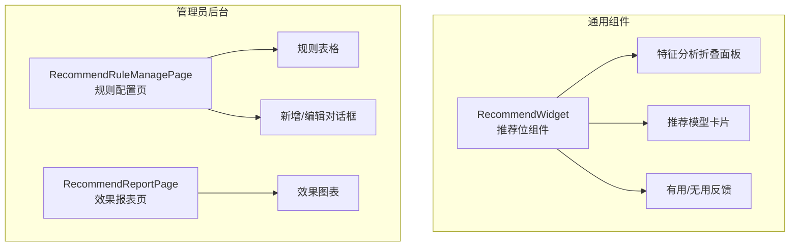
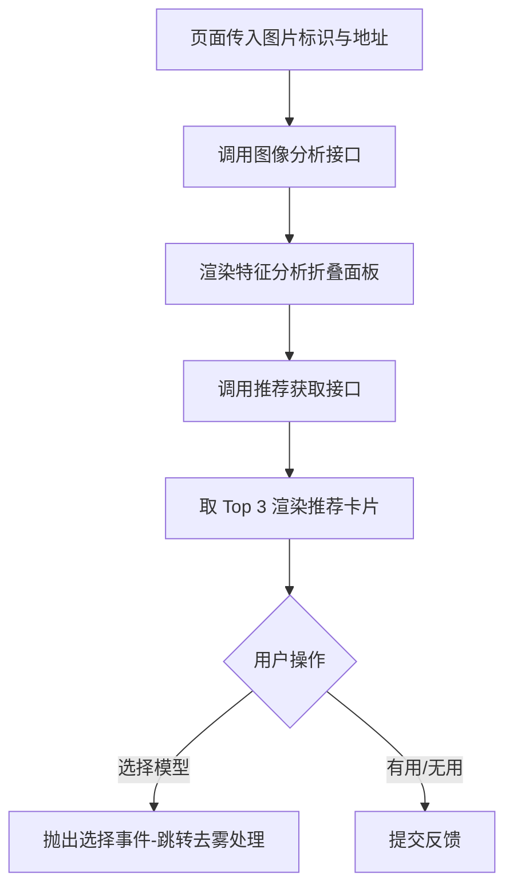
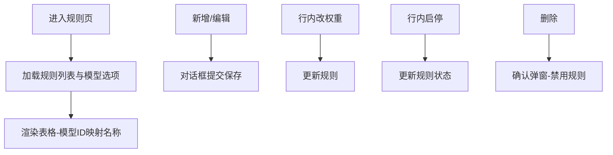

# 推荐管理模块 - 前端实现设计

## 文档概述

前端提供可嵌入业务页面的推荐位组件与管理员规则配置、效果报表页面。

## 组件树设计

| 组件                    | 职责                                                               | 复用性                                 |
| ----------------------- | ------------------------------------------------------------------ | -------------------------------------- |
| RecommendWidget         | 推荐位组件：接收图片标识 -> 特征分析 -> Top 推荐模型列表 -> 反馈   | 可复用（嵌入图像模型选择页等业务页面） |
| RecommendRuleManagePage | 管理员规则配置：规则列表、行内改权重、启停、新增、编辑、删除（禁用） | 管理员页面                             |
| RecommendReportPage     | 管理员效果报表：推荐总量、覆盖率、采纳率、满意度、趋势图表         | 管理员页面                             |

推荐位采用 RecommendWidget 单组件承载推荐全流程（特征分析 + 推荐列表 + 反馈）。推荐功能仅在图像模型选择页接入。

## 状态管理

推荐状态由组件内局部状态（`ref` / `reactive`）承载，未抽离 Pinia Store：RecommendWidget 持有特征分析结果、推荐列表与加载错误状态；规则配置页与效果报表页各自持有页面级状态。

## 路由设计

| 路径         | 组件                    | 权限                                          | 守卫                    |
| ------------ | ----------------------- | --------------------------------------------- | ----------------------- |
| 后台动态菜单 | RecommendRuleManagePage | 管理员（`sys:recommendation:rule:view/edit`） | 登录守卫 + 动态菜单加载 |
| 后台动态菜单 | RecommendReportPage     | 管理员（`sys:recommendation:report`）         | 登录守卫 + 动态菜单加载 |
| 无独立路由   | RecommendWidget         | 登录用户                                      | 组件嵌入（无路由守卫）  |

规则管理与效果报表为管理员后台页面，通过动态菜单按权限加载；RecommendWidget 作为可复用组件嵌入图像模型选择页，不单独配置路由。推荐查询与反馈无会员等级差异，所有用户获得相同推荐结果。

## 数据流

### 推荐流程

### 规则管理流程

### 缓存与更新策略

| 策略     | 说明                                                     |
| -------- | -------------------------------------------------------- |
| 推荐结果 | 组件内内存管理，页面级生命周期，不跨页面缓存             |
| 规则列表 | 规则页加载时完成模型标识到名称的映射，页面内不重复请求   |
| 规则更新 | 规则增删改后刷新规则列表，后端规则缓存由后端自行失效     |

### 模块间数据交互

| 交互方向                 | 数据             | 说明                     |
| ------------------------ | ---------------- | ------------------------ |
| 图像模型选择 -> 推荐管理 | imageId/imageUrl | 传入推荐位组件           |
| 推荐管理 -> 图像模型选择 | select 事件      | 选择推荐模型跳转处理     |
| 推荐管理 -> AI模型管理   | 模型选项         | 规则页模型多选与名称映射 |

## 交互设计决策

| 决策点             | 实现方式                                                                    | 理由                                                   |
| ------------------ | --------------------------------------------------------------------------- | ------------------------------------------------------ |
| 推荐结果个性化展示 | 卡片列表展示 Top 3：排名序号 + 模型名 + 匹配度进度条 + 推荐理由             | Top 3 平衡推荐覆盖与选择负担；匹配度可视化帮助用户决策 |
| 匹配度可视化       | 进度条颜色分级（≥80 绿 / ≥60 橙 / 其他灰）                                  | 颜色分级直观传达匹配程度，比纯数字更易感知             |
| 规则配置可视化     | 场景类型下拉、关联模型多选（可搜索）、权重滑块（0-100）、启用开关           | 可视化配置降低管理员操作门槛，滑块比输入框更直观       |
| 效果报表图表展示   | 覆盖率、采纳率、满意度统计卡片 + 按日采纳率趋势图表                         | 统计卡片快速概览，趋势图展示推荐效果演变               |
| 特征分析展示       | 折叠面板（默认展开）展示 7 项特征网格，所有登录用户可见，无角色分级         | 特征分析为推荐依据，透明展示增强推荐可信度             |
| 反馈交互           | "有用/无用"按钮在卡片底部，按 recommendationId 独立 loading，不阻塞其他卡片 | 独立 loading 避免一个反馈操作阻塞整个推荐列表          |
| 分析、推荐分离     | analyze 完成后才请求推荐，避免串行等待                                      | 特征分析是推荐的前置条件，分离调用便于错误定位与重试   |
| 推荐列表截取       | 前端防御性截取 Top 3 展示                                                   | 后端已截取 TOP_N=3，前端截取为兜底防御                 |
| 图像分析失败处理   | 错误提示（可关闭），不影响页面其他功能；保留已完成的特征分析结果            | 分析失败不应阻塞用户手动选择模型                       |
| 推荐获取失败处理   | 警告提示，反馈提交失败时按钮恢复可点击                                      | 失败后允许重试，不永久禁用交互                         |
| 规则保存失败处理   | 错误提示，保留对话框编辑状态供重试                                          | 避免用户填写的表单数据丢失                             |
| 未传入图片         | 空状态引导提示                                                              | 明确告知用户需要先上传图片才能获取推荐                 |
