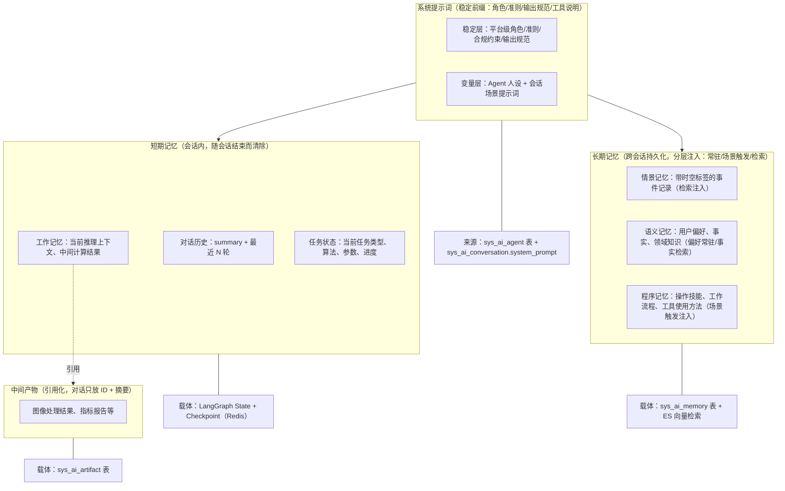

# AI 对话模块 - 后端实现设计（上下文管理）

## 设计思想

### 设计动机

上下文管理是 AI 对话的"记忆层"，本功能域的根本矛盾是：LLM 上下文窗口的有限性与对话信息的无限增长之间的张力。

对话会无限增长（消息越来越多）、产物会越来越大（图像结果、指标报告）、用户偏好会持续积累（跨会话的记忆）。若全量塞进上下文，轻则 Token 成本失控，重则超出模型窗口直接报错。但信息也不能随意丢弃——用户刚说"再亮一点"这种增量指令被摘要压掉，体验会严重退化。

本功能域的设计目标：让 Agent 在有限的上下文窗口内，始终保持"足够且相关"的信息——该有的信息（最近原文、当前任务）绝不丢，不该有的信息（旧消息、大体积产物）绝不进上下文。

### 核心设计原则

| 原则         | 说明                                                                                                                                                                                                                                            |
| ------------ | ----------------------------------------------------------------------------------------------------------------------------------------------------------------------------------------------------------------------------------------------- |
| 提示词工程   | 系统提示词内部再分"稳定层"（平台级角色、准则、合规约束、输出规范）与"变量层"（Agent 人设 + 会话场景提示词），稳定层构成 Prompt Caching 的稳定前缀，变量层随 Agent 与会话注入                                                            |
| 分层记忆     | 短期记忆（对话历史、任务状态、工作记忆）随会话结束清除；长期记忆（跨会话）分层注入；中间产物引用化。三层边界清晰，各自管理                                                                                                             |
| 引用化       | 大体积产物绝不进入 LLM 上下文，只传引用 ID + 业务摘要。这是"上下文不爆炸"的第一道防线                                                                                                                                                |
| 分层注入     | 长期记忆不是统一检索注入，而是按类型分层：用户偏好常驻（每轮生效）、历史事件检索（语义相关才召回）、操作习惯场景触发（任务出现才注入）。工具定义按命名空间预筛选（见 [后端实现-能力扩展](../能力扩展/后端实现.md)）。信息按需供给，而非全量供给 |
| 摘要保底     | 超出窗口阈值时对旧消息摘要压缩，但保留最近 N 轮原文与任务状态，守住"增量指令不被压掉"的底线                                                                                                                                        |
| 认知模型启发 | 长期记忆参考认知心理学：三类记忆（情景、语义、程序）、遗忘曲线（Ebbinghaus）、检索重激活（类似人类复习巩固）、反思整合（从具体事件抽象出规律）                                                                                         |

### 关键架构取舍

| 取舍点        | 方案对比                                                         | 选择与理由                                                                                                                                                                              |
| ------------- | ---------------------------------------------------------------- | --------------------------------------------------------------------------------------------------------------------------------------------------------------------------------------- |
| 上下文组织    | 全部消息平铺 vs 分层结构（系统、摘要、最近原文、任务状态、产物引用） | 选分层。分层让"哪些信息必须保留、哪些可压缩"显式化，也为 Prompt Caching 优化提供"稳定前缀 + 动态后缀"的组装基础（见 [AI模型管理/后端实现.md](../../../基础模块/AI模型管理/后端实现.md)） |
| 产物 URL 存储 | URL 落库 vs 引用 ID 运行时拼接                                   | 选引用拼接。URL 有有效期且属敏感资源，落库会导致过期失效与安全问题；存引用 ID（sys_file），运行时调 FileService 拼接，符合平台"URL 永不落库"的文件管理规范                 |
| 记忆检索      | 仅 MySQL LIKE vs ES 向量语义检索                                 | 选 ES 向量。对话语义匹配不是关键词匹配，向量检索才能命中"用户之前说喜欢简洁风格"这类语义相关记忆；ES 不可用时降级 MySQL LIKE 保底                                                       |
| 记忆管理策略  | 永久保留所有记忆 vs 遗忘曲线 + 归档 + 合并去重                   | 选后者。记忆无限累积会稀释检索质量，也会撑爆注入预算；遗忘曲线模拟自然衰退、反思整合提炼高层洞察、合并去重消除冗余，让记忆系统"越用越聪明"                                 |

### 总体规划

上下文管理是"记忆层"，为推理层提供组装好的输入：对话历史（`sys_ai_message`）按最近 N 轮原文加摘要压缩处理，长期记忆（`sys_ai_memory`）按分层注入（常驻偏好、场景触发、语义检索），中间产物（`sys_ai_artifact`）只放引用 ID 与摘要、绝不原文，三者组装为 LLM 消息序列；任务状态（checkpoint）独立维护、由 LLM 工具查询，不进入对话流。

本功能域是推理前的统一入口：所有功能域的"喂给 LLM 什么"都由本层决定，保证信息供给的一致性。


## 数据模型

本功能域涉及两张表，表结构详见 [数据库设计](../../../../02-系统架构/03-数据库设计.md)：

| 实体              | 职责                                                      | 服务层关键用途                   |
| ----------------- | --------------------------------------------------------- | -------------------------------- |
| `sys_ai_artifact` | 中间产物（引用化，多态引用业务表 + 业务摘要元数据）       | 产物注册、摘要展示、失效标记     |
| `sys_ai_memory`   | 长期记忆（情景、语义、程序三子类型，重要性评分 + 遗忘曲线） | 记忆检索注入、整理巩固、遗忘归档 |

**URL 不落库**：`sys_ai_artifact.summary` 只存业务摘要（指标数值、模型信息、处理参数），绝不存储 URL。图片 URL 通过 `ref_type=sys_file` + `ref_id=file_id` 引用 `sys_file`，运行时调 `FileService.getUrl()` 拼接，遵循文件管理规范"URL 永远运行时拼接、永不落库"。

**失效标记**：`sys_ai_artifact.is_invalid` 对齐 `sys_favorite.is_invalid` 设计。`sys_file` 被删除时，关联的 artifact 置失效标记，前端展示时标记"文件已失效"。产物记录为只追加，不使用逻辑删除（关联业务记录删除时标记失效，保留引用痕迹）。

记忆子类型（参考认知心理学 Tulving 记忆分类模型）：情景记忆（episodic，带时空标签的事件记录）、语义记忆（semantic，抽象知识与事实与用户偏好）、程序记忆（procedural，操作技能与工作流程与工具使用方法）。

**记忆归档与删除的区分**：`archived` 是遗忘策略归档（系统自动，不再注入但保留记录）；`deleted` 是用户主动删除（软删除后不再注入对话）。


## 上下文与记忆分层结构

### 分层结构总览

**设计依据**：分层记忆与"按需换入换出"的思想参考业界 LLM 记忆框架（MemGPT/Letta：上下文类比主存，历史对话换出到外部存储、需要时换入；LangGraph Memory）。本系统只借鉴该思想，按平台数据模型落地为"摘要压缩 + 分层注入 + 产物引用化"三层机制，不引入额外运行时。



### 上下文组装流程

每次推理前，`ContextManager` 组装发送给 LLM 的消息列表。组装为单点：由 `reasoning_service.run` 内部调用 `build_context` 一次性完成，调用方无需传 messages 与 system_prompt，避免重复执行导致记忆 touch 副作用翻倍。组装顺序如下：

1. 系统消息层（系统提示词 = 稳定层 + 变量层）：稳定层为平台级角色、运行环境、行为准则、合规约束、输出规范（固定前缀，支撑 Prompt Caching），其中运行环境声明"内存虚拟工作区 ≠ 宿主磁盘"（工具 schema 无法表达的全局事实），且不列举工具清单——原生方言经 `tools` 字段传递、文本方言经提示词注入清单，同一模型只出现一次，"何时用某工具"归入各工具 `description`（见 [后端实现-架构与公共](../后端实现-架构与公共.md)）；变量层为 Agent 人设（`sys_ai_agent` 表）与会话场景提示词（`sys_ai_conversation.system_prompt`）；另注入长期记忆（MemoryService 三层注入：常驻偏好、场景触发程序记忆、语义检索相关记忆）与可用知识库提示（独立 system 消息，注入当前账号可见知识库的 id、名称、简介，上限 20 条，让模型知道可检索范围并主动调用 `knowledge_base_search`，无可见库则不注入）；`build_context` 返回 `injected_list`，推理落库时写 `sys_ai_message.used_memory_ids`（resume 从 checkpoint state 续读），供前端展示每条回复引用了哪些记忆。记忆块与知识库提示块以独立 system 消息注入、不参与历史裁剪，其 token 先从窗口预算扣除。
2. 对话历史层（token 预算窗口）：沿 `current_branch_message_id` 的分支链回溯加载（单次查询边界 200 条链上消息），过滤 `deleted != 0` 的消息，工具调用结果（`role=tool`）折叠进前一条 assistant 消息；产物引用行在裁剪前追加（见第 5 层），使其 token 计入预算，裁剪后再追加会让引用行整体撑出窗口。历史 token 预算为 `max_context − max_output − 系统提示 − 摘要 − 记忆块 − 知识库提示块 − 组装余量(2000)`；模型级预算（`input_budget_tokens`，与消息入口校验同源，见 [后端实现-架构与公共](../后端实现-架构与公共.md)）为单条消息与上下文的总上限，本层在其中再扣 system_prompt、摘要、记忆等实际占用，属更细的会话级预算；模型未在注册表登记时按保守窗口 32k 推算并打 warning（此时放弃裁剪会把整条链原文送入，必然超窗）。从最早消息起裁剪至预算内（至少保留最后一条），最近消息原文优先保留；裁剪发生时写 truncate 事件（前后 token 与条数）进过程链（F-M08-013）。窗口按 token 而非固定条数划定：固定条数截断在大窗口模型下会让超出窗口的旧消息既不进上下文、也永远达不到摘要触发阈值，被静默丢弃。
3. 摘要层：`summary` 非空时作为 system 消息注入（位于记忆块之后），内容为"之前的对话摘要：{summary}"。
4. 任务状态层：当前任务状态从 checkpoint state 读取，不进入对话流，但 LLM 可通过工具查询。
5. 产物引用层：对关联产物（按 `message_id` 查询）在对应消息后附加引用行 `[[产物 #{id}] {类型}：{摘要关键字段}]`（摘要截断 200 字），绝不注入 URL 与全文，LLM 需要详情时通过工具获取。

### 提示词工程

提示词工程解决"系统如何稳定、高效地组织发送给 LLM 的指令"，是上下文的稳定前缀（第一层）。核心目标：以最小上下文开销换取最稳定的 Agent 行为，参考 Anthropic 上下文工程（Context Engineering）的"注意力预算"理念——上下文是有限资源，每一层注入都应有明确价值。

#### 系统提示词分层设计

系统提示词内部再分"稳定层"与"变量层"，稳定内容长期复用、动态内容随 Agent/会话注入，两者共同构成 Prompt Caching 的"稳定前缀 + 动态后缀"组装基础（见 [AI模型管理/后端实现.md](../../../基础模块/AI模型管理/后端实现.md)）：

| 层     | 内容                                                     | 实现落点                                                                                                                       | 变更频率               |
| ------ | -------------------------------------------------------- | ------------------------------------------------------------------------------------------------------------------------------ | ---------------------- |
| 稳定层 | 平台级角色定位、通用行为准则、安全合规约束、输出格式规范 | 平台统一维护（固定前缀）；合规约束同时由 `GuardrailMiddleware` 独立拦截（见 [后端实现-智能体管理](../智能体管理/后端实现.md)） | 极低                   |
| 变量层 | Agent 人设与专属指令、会话场景提示词                     | `sys_ai_agent` 表 + `sys_ai_conversation.system_prompt`                                                                        | 随 Agent 配置/会话场景 |

**组装方式**（`prompt_composer.compose_system_prompt` 三层拼接）：稳定层位于最前，随后是 Agent 人设、会话场景提示词，保证缓存前缀不变。

- **图构建**（`DeepAgentBuilder`）：`create_deep_agent` 的 `system_prompt` 仅含"稳定层 + Agent 人设"（随快照稳定，可安全进入图缓存键）。
- **会话场景提示词**（`sys_ai_conversation.system_prompt`）随会话变化，**不进图缓存键**：经 `initial_state.conversation_prompt` 运行时注入，由 `DehazeHooksMiddleware.awrap_model_call` 在调用模型前并入 system 消息（追加于稳定层+Agent 人设之后）。
- **`ContextManager.build_context` 返回的 `system_prompt`** 为完整组装结果（三层全量），与图运行时实际发送的系统消息一致。

#### 场景化提示词模板

针对通用对话、图像处理调度、多步推理、图像模型推荐、定时任务等场景预设提示词模板。会话创建时根据场景选择对应默认提示词写入 `sys_ai_conversation.system_prompt`（见 [后端实现-会话与消息](../会话与消息/后端实现.md)），保证同类任务行为一致、可预期。

#### 结构化提示规范

| 规范                 | 说明                                                       |
| -------------------- | ---------------------------------------------------------- |
| 角色-任务-格式三要素 | 每个提示词明确"扮演什么角色、完成什么任务、以什么格式输出" |
| 分节组织             | 指令、约束、示例、输入分区清晰，降低 LLM 理解歧义          |

#### 提示词优化闭环

结合消息反馈（F-M08-008）的点赞与点踩数据驱动提示词迭代，采用"建议 + 人工审批"流程（不自动修改）：非安全类负反馈标签累计超阈值（如 `tags=["too_long"]` 出现 10 次）时异步生成优化建议（LLM 产出差异说明，不直接改模板），再由平台管理员人工审批三态——确认则应用至提示词模板（新会话生效），经评测门禁；编辑后应用则管理员修改差异后应用（支持部分采纳，如仅采纳"回复保持简洁"、剔除不合适的其余建议）；拒绝则丢弃建议并记录。

安全红线：`harmful`（有害、不安全）等安全类反馈不进入自动优化，直接触发安全告警并人工介入——防止恶意点踩诱导削弱安全护栏（如对"拒绝生成有害内容"点踩）。优化不修改进行中会话的 `sys_ai_conversation.system_prompt`（避免中途行为突变）。

提示词优化是"数据驱动生成建议 + 人工把关"的闭环（Reflexion 范式的受控触发版）：LLM 负责产出优化方向，管理员负责把关落地，安全约束不交由反馈自动改写。同一反馈还会经记忆提取沉淀用户偏好。

#### 提示词模板库（可运维）

场景化提示词模板与稳定层提示词纳入模板库管理：版本化（草稿、已发布、回滚）、变更发布经 Agent 评测回归门禁（见 [Agent评测/后端实现.md](../Agent评测/后端实现.md)）、支持灰度验证后全量生效，平台管理员可运维。


## 对话历史管理

### 上下文压缩（token 预算窗口 + 溢出摘要保底）

压缩在组装上下文后、推理前触发：组装时对话历史按 token 预算窗口裁剪，凡存在"被窗口裁剪掉、且尚未摘要"的消息即触发增量压缩（对齐 Working Memory 管理的 Salience Scoring、Eviction Policy、Token Budget、Pinned Context 实践）。具体为：`ContextManager` 组装上下文时按 token 预算窗口裁剪对话历史；若存在"摘要水位之后、当前窗口之外"的未摘要消息，则推理前同步触发增量摘要压缩（`SummaryService.maybe_compress`）；压缩后的 summary 下轮生效（当前轮上下文已在触发前组装完成）。

显著性分级与预算化摘要（保留清单、分块再压、前序再压缩、覆盖度检查）不变，摘要范围按增量选取：上界为 `summary_upto_message_id`（上次摘要水位），下界为当前组装窗口的最早消息（token 预算动态计算，非固定条数）。

输出空间预留已并入窗口预算计算（历史预算 = max_context − max_output − 系统提示 − 摘要 − 组装余量）；直接路径（`_run_direct`）内置同口径的输入预算裁剪。

**显著性分级**（决定保留优先级，规则前置 + LLM 摘要承载背景，不靠 LLM 自由发挥）：

| 级别           | 判定规则                                                                     | 处理                                                                                      |
| -------------- | ---------------------------------------------------------------------------- | ----------------------------------------------------------------------------------------- |
| 豁免（Pinned） | 用户显式约束与偏好、决策（"选择 RIDCP"类）、关键数值与指标、任务状态、增量指令 | 压缩前先转结构化记忆与任务状态（双通道防丢）；摘要 prompt 列入保留清单，摘要中必须覆盖 |
| 可压缩         | 普通问答、过程细节、工具调用结果                                             | 纳入摘要范围                                                                              |
| 可驱逐         | 寒暄、已消费的临时信息、重复陈述                                             | 硬阈值触发时最先驱逐（混合策略：显著性分级内按旧→新驱逐）                                 |

**预算化摘要压缩**（压缩程度可控，对齐 budgeted summarization）：

输出空间预留已并入窗口预算计算（历史预算 = max_context − max_output − 系统提示 − 摘要 − 组装余量）；直接路径（`_run_direct`）内置同口径的输入预算裁剪。

显著性分级（决定保留优先级，规则前置 + LLM 摘要承载背景，不靠 LLM 自由发挥）：

| 级别           | 判定规则                                                                     | 处理                                                                                      |
| -------------- | ---------------------------------------------------------------------------- | ----------------------------------------------------------------------------------------- |
| 豁免（Pinned） | 用户显式约束与偏好、决策（"选择 RIDCP"类）、关键数值与指标、任务状态、增量指令 | 压缩前先转结构化记忆与任务状态（双通道防丢）；摘要 prompt 列入保留清单，摘要中必须覆盖 |
| 可压缩         | 普通问答、过程细节、工具调用结果                                             | 纳入摘要范围                                                                              |
| 可驱逐         | 寒暄、已消费的临时信息、重复陈述                                             | 硬阈值触发时最先驱逐（混合策略：显著性分级内按旧到新驱逐）                                 |

预算化摘要压缩（压缩程度可控，对齐 budgeted summarization）：先按增量选取摘要范围（上界为 `summary_upto_message_id` 上次摘要水位，下界为当前组装窗口的最早消息，按 token 预算动态计算而非固定条数）；再将 Pinned 内容经 `extract_episodic` 等转结构化记忆与任务状态（失败静默记日志）；随后调用 LLM 生成摘要，Prompt 含明确预算与保留清单（目标为压缩后 summary token ≤ `max_context × 15%`，保留清单含用户偏好、决策、关键数值、任务状态、增量指令），输出超预算时分块再压（先压更早段直至达标）；之后更新 `sys_ai_conversation`——`summary` 追加到旧摘要之后（`前序摘要：{旧}\n近期摘要：{新}`，旧摘要超 token 预算时追加前先再压缩以防长会话累积膨胀），`summary_upto_message_id` 推进到本次覆盖的最后一条消息 ID；再做覆盖度检查，抽样核对被压缩消息的关键点是否已入摘要或记忆，缺失则经 `extract_episodic_from_summary` 补录记忆兜底；压缩事件（前后 token、丢弃范围、是否驱逐）写入过程链（消费可观测性 F-M08-013）。后续组装上下文时，被摘要的消息不再发送原文，仅注入 summary 作为 system 消息。

输出空间预留：模型窗口 = 输入 + 输出。窗口预算已扣除 `max_output_tokens`（组装校验时预留输出预算），从源头防止"上一次回复过长撑满窗口后，下一轮输入无空间或长回复被截断"。

### 增量指令保护

增量指令（如"再亮一点"）不被摘要压掉：

| 保护策略           | 说明                                                                         |
| ------------------ | ---------------------------------------------------------------------------- |
| 窗口内原文保留     | token 预算内的最近消息保留原文，不参与摘要（预算随模型窗口伸缩，非固定条数） |
| 任务状态独立维护   | 上一次处理的算法和参数记录在 task 层，LLM 可通过工具查询                     |
| 摘要保留任务上下文 | 摘要 prompt 要求保留"最近一次处理的算法和参数"                               |

### Token 统计

每次推理后统计 token 消耗，更新到消息记录：

每次推理后统计 token 消耗并更新到消息记录：LLM 返回 token 用量（`input_tokens`、`output_tokens`、`cached_input_tokens`）后，更新 `sys_ai_message` 的 `input_tokens`（本次输入 token 数，含缓存命中部分）、`output_tokens`、`cached_input_tokens`（其中缓存命中的输入 token 数）；再按用户售价换算积分（绝对单价，见 AI 模型管理模块）：`credits = (inputTokens − cachedInputTokens) × input档位/1M + cachedInputTokens × cached档位/1M + outputTokens × output档位/1M`，档位从 `sys_ai_model_price` 读取（高峰与空闲双档，按调用时刻取档）；最后更新 `sys_ai_message.credits`。


## 任务状态管理

### 任务状态结构

任务状态存储在 checkpoint 的 state 中，不进入对话流：

| 字段        | 用途                                        |
| ----------- | ------------------------------------------- |
| `task_type` | 当前任务类型（如 dehaze）                   |
| `algorithm` | 当前使用的算法标识                          |
| `params`    | 处理参数（如强度、饱和度）                  |
| `status`    | 任务执行状态（processing/completed/failed） |
| `task_id`   | 关联的异步任务 ID                           |
| `artifacts` | 任务产生的产物引用列表（ID + 类型 + 摘要）  |

### 任务状态更新时机

| 时机             | 更新内容                              |
| ---------------- | ------------------------------------- |
| LLM 决定调用工具 | 设置 task_type、algorithm、params     |
| 工具调用提交     | 设置 task_id、status=processing       |
| 异步任务完成     | 设置 status=completed，添加 artifacts |
| 工具调用失败     | 设置 status=failed，记录 error        |
| 用户修改参数     | 更新 params，重置 status              |

### 任务状态查询

LLM 可通过 MCP 工具查询当前任务状态：

LLM 可通过 MCP 工具查询当前任务状态：调用 `get_task_status` 工具后，`ToolExecutorRegistry` 从 checkpoint state 读取任务状态，返回结构化任务状态（不进入对话流，只供 LLM 理解上下文）。


## 中间产物引用化

### artifacts 引用化策略

图像处理结果体量大，绝不塞入 LLM 对话上下文：

图像处理结果体量大，绝不塞入 LLM 对话上下文。工具调用产生结果（如去雾处理完成）后，MCP 网关返回结果摘要（指标数据 + 模型信息，不含 URL）；`ArtifactService` 注册产物，创建 `sys_ai_artifact` 记录（`type` 为 `image_result`／`metric_report`，`ref_type` 为 `sys_pred_log`／`sys_eval_log` 间接关联 `sys_file`，`ref_id` 为业务记录 ID，`summary` 为 `{psnr, ssim, algorithm, params, ...}` 的 JSON 业务摘要，绝不存 URL）。消息中只展示产物卡片（ID + 摘要），不把图片 URL 或完整指标数据塞入 `content`。前端展示产物卡片需要图片 URL 时，通过 `ref_type`／`ref_id` 链路找到 `sys_file.id`，调用 `FileService.getUrl(fileId)` 运行时拼接 URL，URL 不落库，遵循文件管理规范。LLM 需要理解结果时通过工具获取结构化摘要（工具返回 `artifact.summary` 的内容，业务摘要不含 URL）。若需视觉理解（如"看看去雾效果好不好"），利用多模态模型读取图片 URL，Redis 全局日计数 +1（`ai:multimodal:{userId}:{date}`），超过 VIP 等级日限额则拒绝并提示升级。

### 产物类型

| 类型                  | 说明             | 关联业务表                        | summary 内容（绝不存 URL）         |
| --------------------- | ---------------- | --------------------------------- | ---------------------------------- |
| `image_result`        | 图像处理结果     | sys_pred_log（间接关联 sys_file） | 算法、参数、处理时间               |
| `metric_report`       | 指标评估报告     | sys_eval_log                      | PSNR、SSIM、LPIPS、NIQE 等指标     |
| `algorithm_recommend` | 图像模型推荐结果 | sys_recommendation                | 推荐图像模型列表、推荐理由、匹配度 |

图片 URL 运行时通过 `FileService.getUrl()` 拼接，不落库。产物注册入口是工具执行结果（推荐、批量、评估链路），用户消息附图以 markdown 图片 URL 内联在 `content` 中，不注册产物——无独立附件文件表机制，也没有 `file_ref` 注册点。

### 产物查询

| 查询场景                         | 查询逻辑                                                                              | 接口                                                           |
| -------------------------------- | ------------------------------------------------------------------------------------- | -------------------------------------------------------------- |
| 会话产物列表                     | 按会话 ID 查询，按创建时间倒序排列                                                    | `GET /api/v1/ai/conversations/{convId}/artifacts`              |
| 消息产物                         | 按消息 ID 查询关联产物                                                                | `GET /api/v1/ai/messages/{msgId}/artifacts`                    |
| 业务表反查                       | 按引用类型和引用 ID 反查产物（校验会话归属）                                          | `GET /api/v1/ai/artifacts/by-ref?refType=&refId=`              |
| 产物详情                         | artifact 记录 + 按需查业务表 + 运行时拼图片 URL                                       | `GET /api/v1/ai/artifacts/{id}/detail`                         |
| 批量消息产物（上下文引用层契约） | 批量取消息关联产物，仅 `is_invalid=0`，按 `message_id` 分组为 `[{id, type, summary}]` | `AiArtifactService.get_message_artifact_refs(db, message_ids)` |

**归属鉴权**：产物查询均校验 `artifact.conversation_id` 归属当前用户，他人会话产物返回资源不存在，避免越权访问。

### 产物失效联动

`sys_file` 删除（`FileService.delete_file_with_storage`）时调用 `AiArtifactService.mark_invalid_for_file(db, file_id)`，一次性失效：

- 直接引用：`ref_type=sys_file, ref_id=file_id`
- 间接引用：查 `sys_pred_log`（`pred_file_id`/`origin_file_id`）、`sys_eval_log`（`pred_file_id`/`gt_file_id`）中引用该文件的日志，失效对应的 `sys_pred_log`/`sys_eval_log` 产物。

### metric_report 产物注册

`evaluation_service.evaluate` 支持可选 `conv_id`/`msg_id` 参数（AI 会话场景传入）；`_execute_async` 评估完成后，在会话场景下注册 `metric_report` 产物（`ref_type=sys_eval_log, ref_id=log_id, summary=metrics`）。独立评估（管理端）不传会话上下文则跳过注册，不阻断评估主流程。


## 长期记忆管理

### 记忆子类型

参考认知心理学 Tulving 记忆分类模型，长期记忆分三类：

| 子类型                | 定位                             | 内容               | 示例                                       | metadata 结构                                | 注入方式                       |
| --------------------- | -------------------------------- | ------------------ | ------------------------------------------ | -------------------------------------------- | ------------------------------ |
| 情景记忆 (episodic)   | 带时空标签的事件记录             | 某时某地发生了什么 | "用户上周二用 RIDCP 处理雾图，结果满意"    | `{timestamp, event, outcome, user_feedback}` | 检索注入                       |
| 语义记忆 (semantic)   | 抽象知识、事实、用户偏好         | 知道什么           | "用户偏好简洁回复"、"用户是图像处理研究者" | `{category, fact, is_preference}`            | 偏好类常驻注入；事实类检索注入 |
| 程序记忆 (procedural) | 操作技能、工作流程、工具使用方法 | 会做什么           | "用户习惯先去雾再评估，强度通常设 60-80"   | `{skill, steps, params}`                     | 场景触发注入                   |

`is_preference=1` 标记用户偏好类语义记忆（常驻注入）；`skill` 字段标记程序记忆对应的任务类型（场景触发注入依据）。

### 记忆来源

| 来源                    | 提取方式                                 | 示例                                            |
| ----------------------- | ---------------------------------------- | ----------------------------------------------- |
| 对话提取 (conversation) | LLM 在对话中识别值得记住的信息，异步提取 | "我喜欢简洁的回复" → 语义记忆                   |
| 反馈提取 (feedback)     | 用户点踩时附带的改进建议                 | "太冗长" → 语义记忆（偏好简洁）                 |
| 反思整合 (reflection)   | 定期回顾近期记忆，生成更高层次的抽象洞察 | "连续三周周一要报告" → 程序记忆（每周一需周报） |
| 手动录入 (manual)       | 用户在设置中手动添加                     | "我是图像处理研究者" → 语义记忆                 |

### 记忆提取流程

对话完成（assistant 消息生成完毕）后异步触发记忆提取（图路径经 `after_agent` 钩子、direct 范式在收尾显式调用，统一走 `schedule_memory_extraction`，保证两种范式都不漏抽取）：子 Agent 子图 run 跳过（`is_subagent`），因该子图消息源于任务描述，提取入长期记忆会污染用户画像，记忆口径归属主会话完整对话；随后调用 LLM 分析本次对话（Prompt 为"分析以下对话，提取值得长期记忆的信息，分类为情景记忆、语义记忆、程序记忆"，输入为本次对话消息与已有记忆列表以免重复，输出新记忆列表 `{memory_type, content, metadata}`）。接着计算重要性评分 `importance`：情感权重 0.3（用户情绪强烈的交互更值得记忆）、频率因子 0.25（被多次提及的信息更重要）、时效性 0.2（与当前任务的相关度）、信息增益 0.15（新颖程度，与已有记忆的差异度）、显式标记 0.1（用户主动要求"记住"的内容），`Importance = w1×Emotion + w2×Frequency + w3×Recency + w4×Novelty + w5×ExplicitMark`。最后写入 `sys_ai_memory`（`source=conversation`、`importance` 为计算得分、`status=1`、`archived=0`），并同步到 ES 做向量检索（将记忆内容向量化，写入 ES 索引 `ai_memory`）。

### 记忆注入（三层机制）

设计原则：长期记忆不是统一检索，而是按记忆类型分三种注入方式。这是对齐业界最佳实践（OpenAI ChatGPT：Saved Memories 常驻 + Personal Context Tooling 按需检索）后的核心设计——用户偏好应每轮生效（常驻），历史事件应语义相关时才召回（检索），操作习惯应任务出现时才触发（场景触发）。若全部走统一检索，用户偏好会因当前对话语义不相关而被漏掉，导致"用户明确告诉过的偏好失效"。

推理前组装上下文时（`before_model` 钩子），`MemoryService` 按三层机制组装：① 常驻注入（Always-on）加载语义记忆中的用户偏好、身份、固定习惯（`preference=true` 的语义记忆），全量注入 system prompt（数量少，通常少于 20 条），不检索、不省略；② 场景触发注入（Trigger-based）先做任务类型识别（复杂度评估环节输出的 `task_type`），未传 `task_type` 时兜底按最后用户消息关键词匹配用户已有 skill（`list_skills` 去重），再匹配该任务类型对应的程序记忆（`skill` 字段匹配）并注入对应工作流与处理习惯；③ 检索注入（Retrieval-based）优先从 ES 向量检索（按当前对话内容语义匹配），ES 不可用时降级从 MySQL 查询，过滤 `status = 1 && archived = 0 && deleted = 0`，按当前对话语义检索相关的情景记忆与事实类语义记忆。三维度加权排序仅用于检索注入：`Score = α × Relevance（语义相关性） + β × Recency（近因性，基于 last_accessed_at） + γ × Importance（重要性评分）`，默认权重 α=0.5、β=0.3、γ=0.2；取 Top N 条记忆注入 system 消息；重激活时更新命中记忆的 `access_count + 1`、`last_accessed_at = NOW()`（被检索的记忆重置衰减计时器，类似人类"复习巩固"）。

三层注入的实现要点：

| 注入层       | 数据来源                                                          | 过滤条件                              | 注入位置                                         |
| ------------ | ----------------------------------------------------------------- | ------------------------------------- | ------------------------------------------------ |
| 常驻注入     | `sys_ai_memory` 中 `memory_type=语义` 且 `is_preference=1` 的记录 | `status=1 && archived=0 && deleted=0` | system prompt 的"用户画像"区块，每轮固定         |
| 场景触发注入 | `memory_type=程序` 且 `skill` 与任务类型匹配的记录                | 任务类型识别命中                      | system prompt 的"工作流提示"区块，任务识别后注入 |
| 检索注入     | ES 向量检索（情景 + 事实类语义记忆）                              | 语义相关 Top N                        | system prompt 的"相关记忆"区块                   |

#### 注入内容安全校验

记忆、检索、工具结果等注入内容在进入 prompt 前与用户入口护栏一致过注入检测（对齐需求规格的注入内容安全校验）：

| 校验点       | 实现位置                                          | 说明                                                                                |
| ------------ | ------------------------------------------------- | ----------------------------------------------------------------------------------- |
| 记忆注入校验 | `MemoryService` 组装记忆后、写入 system prompt 前 | 复用入口护栏检测规则（检测"忽略系统指令/改变目标"等模式），命中该条记忆不注入并告警 |
| RAG 结果校验 | 检索结果注入前                                    | 命中注入模式过滤该片段并告警                                                        |
| 工具结果校验 | 工具返回进入上下文前                              | 命中注入模式截断该片段（与能力扩展工具返回校验衔接）                                |

校验不通过仅拦截**命中片段**，不中断整轮推理；告警写入过程链（消费可观测性 F-M08-013）。

#### 组装异常兜底

`before_model` 钩子中任一组装环节异常（记忆检索、摘要加载、工具定义获取）捕获后降级：仅注入系统提示与最近 N 轮原文（跳过记忆、摘要、工具定义），保证推理可发起、用户永远能获得回复；降级事件写入过程链（F-M08-013）。

常驻注入的记忆与对话语义无关也要注入，因为它是用户长期偏好，对任何回复都有价值。为防止常驻注入挤占上下文，限制常驻条数上限（默认 20 条，超出时按重要性替换）。

### 记忆整理与巩固

记忆整理是将短期记忆转化为长期记忆、并对长期记忆进行维护管理的核心过程：

#### 定期摘要巩固

摘要压缩机制见对话历史管理的压缩小节（预算化摘要：窗口溢出即触发，保留窗口为按 token 预算动态计算的条数、无固定"最近 N 轮"口径，summary 注入）。本节的记忆侧作用：被摘要消息中的关键决策、任务状态、用户偏好经 `extract_episodic` 提取为情景记忆存入 `sys_ai_memory`（长期、跨会话），与短期 `sys_ai_conversation.summary` 互补；由摘要巩固定时任务（每日 4 点执行）周期性推进，保证长期记忆随时间沉淀。

#### 遗忘曲线

基于 Ebbinghaus 遗忘曲线，模拟记忆的自然衰退：每日定时任务计算记忆衰减 `priority = importance × exp(-Δt / half_life)`，其中 `Δt = NOW() - last_accessed_at`（天）、`half_life = 30`（半衰期 30 天）；`priority` 低于阈值（默认 10）即归档（`archived = 1`），归档记忆不再注入对话但保留记录，用户可查看历史归档记忆；被检索命中的记忆重激活（`access_count + 1`、`last_accessed_at = NOW()`、衰减计时器重置，类似人类"复习巩固"）。

#### 重要性评分更新

记忆的重要性评分在写入和访问时动态更新：

| 更新时机             | 更新逻辑                                         |
| -------------------- | ------------------------------------------------ |
| 记忆写入时           | 初始评分（综合情感、频率、时效、信息增益、显式标记） |
| 被检索命中时         | importance += 5（最高 100），频率因子提升        |
| 用户显式标记"记住"时 | importance = 100（最高优先级）                   |
| 用户反馈相关时       | importance += 10（如点赞引用该记忆的回复）       |

#### 反思整合

周期性回顾近期记忆，生成更高层次的抽象洞察。每日定时任务触发反思：查询用户近 7 天的情景记忆，调用 LLM 分析规律和模式（Prompt 为"回顾以下近期记忆，提取更高层次的抽象洞察"，输入为近期情景记忆列表，输出抽象洞察，如"用户每周一需要周报"归为程序记忆），随后写入 `sys_ai_memory`（`source=reflection`，`memory_type` 为 `procedural` 或 `semantic`，从情景记忆升级）。反思层级为：Layer 0 原始观察（情景记忆，"用户今天说喜欢简洁风格"）经反思到 Layer 1 一阶抽象（语义记忆，"用户偏好简洁"），再经反思到 Layer 2 二阶抽象（语义记忆，"该用户是效率导向型人格"）。

#### 合并去重

检测语义重复的记忆条目，合并为更完整的单一条目。每日定时任务触发合并：查询用户所有活跃记忆，按 `memory_type` 分组，计算同组内记忆的语义相似度（ES 向量余弦相似度）；相似度大于 0.9 的记忆对调用 LLM 合并为统一表述（示例："用户喜欢深色模式" + "用户偏好暗色主题" → "用户偏好深色或暗色主题"），`importance` 取较高值、`access_count` 累加，旧记忆软删除并保留合并后的新记忆。

### 记忆管理操作

| 操作         | 实现方式                                                                                                                                                                                                                                                                                 |
| ------------ | ---------------------------------------------------------------------------------------------------------------------------------------------------------------------------------------------------------------------------------------------------------------------------------------- |
| 查看记忆列表 | 查询当前用户的未删除记忆，按重要性、更新时间倒序排列（支持按类型/来源筛选）                                                                                                                                                                                                              |
| 删除单条记忆 | 软删除（记录 `delete_time`），不再注入对话，同步清除 ES 索引                                                                                                                                                                                                                             |
| 查看归档记忆 | `GET /api/v1/ai/memories/archived`，查询当前用户被遗忘策略归档的记忆                                                                                                                                                                                                                     |
| 取消归档     | `POST /api/v1/ai/memories/{memoryId}/unarchive`，置 `archived=0` + 刷新 `last_accessed_at`，返回更新后的记忆；未处于归档态返回 A0502。归档是遗忘策略的系统行为，用户侧只提供"取消归档"这一个反向操作，故通用更新接口 `PUT /memories/{id}` 不接收 `archived` 字段，避免暴露手动归档写入口 |
| 批量清空     | `POST /api/v1/ai/memories/clear`，三种粒度（全部、指定类型、指定时间范围），需 `confirm=true` 二次确认，软删并记录 `delete_time`，30 天恢复窗口内可 `POST /restore` 恢复                                                                                                                  |
| 记忆导出     | `GET /api/v1/ai/memories/export?fmt=json` 或 `fmt=markdown`，含类型、来源、重要性、创建时间，StreamingResponse 返回 |
| 物理清理     | 软删超过 30 天（`delete_time < NOW()-30d`）由定时任务 `purgeDeletedMemories` 物理删除                                                                                                                                                                                                    |
| 记忆上限控制 | 超过 200 条时按重要性最低且最久未访问的记忆淘汰（归档而非删除）                                                                                                                                                                                                                          |

**取消归档为何要刷新衰减计时器**：遗忘曲线优先级按 `last_accessed_at`（无则 `create_time`）距今天数计算，若只置 `archived=0`，下次每日归档任务会按旧时点重新判定为低优先级，用户刚恢复的记忆次日即被再次归档，操作形同无效。刷新 `last_accessed_at` 等价于"用户刚刚访问过该记忆"。

**审计**：记忆属敏感个人数据，批量清空（`action=clear`）与批量导出（`action=export`）写入 MongoDB `audit_log`（`target_type=ai_memory`、`target_id=用户ID`，清空记录条数与过滤条件、导出记录格式与条数）。清空为写操作，审计登记在事务提交后回调（回滚不留痕）；导出为读操作，直接 fire-and-forget 写审计。

### ES 向量检索

| 配置     | 说明                                                                                                                                         |
| -------- | -------------------------------------------------------------------------------------------------------------------------------------------- |
| 索引名   | `ai_memory`                                                                                                                                  |
| 字段     | `id`、`user_id`、`memory_type`、`content`、`content_vector`（向量）、`importance`、`status`、`archived`、`deleted`                           |
| 向量模型 | 从 `sys_dict`（`ai_embedding`：provider_code/model/dims 三键种子）读取，经 `ai_provider` 体系取 Key；dims 与 ES mapping 联动                 |
| 检索方式 | 语义相似度检索（cosine similarity），按 user_id 过滤，排除 archived 和 deleted；ES 返回 `relevance` 分数供三维权排序归一化                   |
| 同步策略 | MySQL 写入后异步同步到 ES；ES 不可用时降级为 MySQL LIKE 查询；删除记忆同步调 `delete_doc` 清除向量（索引 `ai_memory`、文档 `_id` 为记忆 id） |

**跨端一致性（删除清向量）**：残留向量文档会让已删记忆仍被向量检索召回，属隐私缺陷，故三端原生删除路径都必须清理：python `delete_memory_doc`、Java `AiKbIndexClient.deleteMemoryDoc`（复用 KB 分块的 ES 连接配置 `ES_URL/ES_USERNAME/ES_PASSWORD`）、Go `deleteMemoryDocFromES`（`config.yaml` 的 `es.*`，同源于根 `.env` 的 `ES_*`）。三端同索引名、同文档 id 规则，并统一对齐 python 的降级行为——ES 不可达或文档不存在（404）只告警，不阻断删除主流程。

**注入可见性**：`inject_memories` 返回 `(system_block_text, injected_list)`，其中 `injected_list` 为
`[{memory_id, memory_type, content, source}]`（source 取值 preference/skill/retrieval）。该清单
由推理层落库展示（写入 `sys_ai_message.used_memory_ids` JSON 列，migration 009），
用户可展开查看本次引用的记忆。


## 多模态视觉读取控制

### 多模态视觉读取计数

视觉读取限额按用户维度全局日计数（Redis `ai:multimodal:{userId}:{date}`），与 AI 计费的日配额模型对齐：LLM 需要视觉理解图片（如"看看去雾效果好不好"）时读取 Redis 当日计数，跨会话共用同一额度、每日 0 点自然过期重置，新会话不重置（用户维度全局计数，避免"开新会话绕过限额"）；校验当日计数小于用户等级日限额（`sys_member_benefit.multimodal_limit`），未超限则 Redis INCR 当日计数 +1、调用多模态模型读取图片 URL 并把视觉理解结果返回给 LLM；超限则拒绝多模态视觉读取，LLM 改为基于指标数据文字描述判断效果，并提示用户"今日多模态视觉读取次数已用尽，升级 VIP 可增加次数"。

**实现落地**（`app/service/ai_artifact_service.py` + `app/service/ai/builders/dehaze_tools_builder.py`）：

- **`visual_read(artifact_id)` 工具**：新增的第 7 个业务工具。入参为上下文产物引用行的 `artifact_id`。流程：查 artifact（未失效）→ 经 `ref_type`/`ref_id` 链路解析图片引用（`sys_file` 直接取 `ref_id`；`sys_pred_log`/`sys_eval_log` 经 `pred_file_id`）→ `FileService.getUrl` 运行时拼 URL → 限额判定 → 调多模态模型读取。工具描述写明"评估图片效果时使用"，与用户主动要求记住的行为无关。
- **`check_visual_quota(db, redis, user_id)`**：纯读当日额度 `(used, limit)`，供前端展示；读 `sys_member.level_code` → `sys_member_benefit.multimodal_limit` + Redis 当日计数 `ai:multimodal:{userId}:{yyyyMMdd}`。无会员记录回退 `level_0`。
- **原子消费 `_consume_visual_quota(redis, user_id, limit)`**：采用「INCR 先行后判断」——INCR 得到 `new_count`，若 `new_count > limit` 则 `DECR` 回退并返回拒绝（该次不消费），避免并发间隙绕过日上限；首次 INCR（`new_count==1`）设 TTL 至次日零点（每日 0 点自然过期重置），实现跨会话全局计数。`visual_read` 实际读取前调用原子消费，不再依赖 GET 判定。
- **模型选择**：优先使用当前会话模型（若 `supports_multimodal=1`），否则从启用模型列表中选任一支持多模态的模型。

### 多模态视觉 Token 计量

多模态视觉读取的 Token 消耗计入对话 Token（作为输入 Token 的一部分），不单独计量：

```
多模态模型返回 token 用量
    ↓
合并到本次推理的 input_tokens 中
    ↓
统一按模型计费比例换算积分
```

**实现落地**：`visual_read` 工具执行多模态调用后，将 usage 的 input_tokens 累加到共享推理 `ctx["multimodal_input_tokens"]`；`DehazeHooksMiddleware.aafter_agent` 结算时将该值并入 `usage` 的 `input_tokens`/`prompt_tokens`（按协议风格），随本次推理统一交给计费结算，不单独计量。`awrap_model_call` 的 Token 预算累计同样纳入该值，避免多模态消耗绕过 Token 预算。
