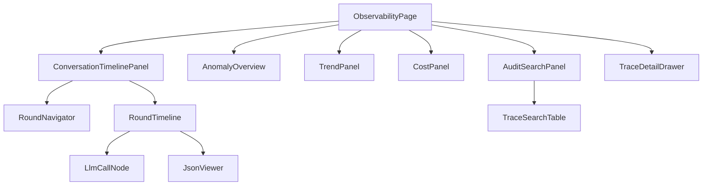

# AI 对话模块 - 前端实现设计（可观测性）

## 文档概述

AI 对话可观测性前端包含用户端过程透明组件与管理端 AI 可观测中心页。页面结构与交互规范见 [需求规格.md](./需求规格.md)，接口契约见 [API接口.md](../API接口.md)。多端（Android、Flutter、Taro 等）参考本 Web 端组件结构与状态管理方案按各自技术栈适配。

可观测性前端解决两类诉求：

| 端     | 页面/组件            | 回答的问题                                      |
| ------ | -------------------- | ----------------------------------------------- |
| 用户端 | 对话页"查看过程"组件 | 这条回复 AI 做了什么、怎么得出的                |
| 管理端 | AI 可观测中心页      | 全平台 AI 行为是否异常、成本/性能趋势、审计检索 |

管理端观测、审计能力集中在 AI 可观测中心；会话管理页链路追踪入口跳转可观测中心，其余结构见 [前端实现-管理端-会话管理.md](../页面设计/前端实现-管理端-会话管理.md)。

## 用户端"查看过程"（已接入运行时）

用户端不引入独立过程面板：工具步骤就是契约 `tool_use` 块的投影，逐条用量就是 `message.usage`。两者由组件层纯函数与契约字段直接消费，宿主不再构造过程视图，也不派生上下文占比（无 wire 数据）。

### 组件与数据来源

| 入口                   | 实现位置                         | 内容                                                                                                                                                            |
| ---------------------- | -------------------------------- | --------------------------------------------------------------------------------------------------------------------------------------------------------------- |
| ThoughtChain           | `components/ThoughtChain.vue`    | "查看过程（N 步）"折叠面板：`stepsOfBlocks` 投影工具步骤，展示工具名、入参、输出/摘要、`status`、耗时与失败原因；有失败步骤时标题给出失败数；子智能体用量由 `SubAgentPanel` 展示 |
| AssistantMessage footer | `components/AssistantMessage.vue` | 终态且 `usage` 非零时展示 `输入 X / 输出 Y tokens（缓存 Z） · 积分 N`；`memoryIds` 非空时展示"引用记忆 N 条"                                                     |

### 明确不做（无数据源）

- 上下文构成（系统提示 / 历史 / 检索 / 记忆的占比与来源）：后端没有 wire 字段，不展示、不虚构。
- 计费不作为时间线步骤：`usage` 不是执行步骤，直接在 footer 展示，避免虚增步数。
- 工具步骤不重复渲染：此前 `ProcessPanel` 与 `ThoughtChain` 消费同一份 `tool_use` 块且前者信息更少，`ProcessPanel`/`StepTimeline`/`TraceSummary`/`ContextChip` 已删除。

### 交互

- 面板默认折叠，展开按 `seq` 展示步骤；失败状态直接由契约 `ToolStatus` 驱动，不另设状态映射。
- raw 报文只在管理端可观测中心可见，用户端不展示。

### 待决/未闭环

| #   | 项               | 现状                 | 说明                                                                                     |
| --- | ---------------- | -------------------- | ---------------------------------------------------------------------------------------- |
| 1   | 上下文构成       | 未实现               | 需后端补上下文构成项、占比与来源字段；在此之前用户端只展示记忆引用条数                   |
| 2   | 过程透明派生落点 | 已收敛到组件层       | 工具步骤与用量由组件 computed 直接派生，宿主不再构造过程视图，也不再有过程 VM 类型        |

## 管理端 AI 可观测中心页

### 页面定位（唯一管理端观测与审计入口）

原管理端两处职责重合入口（会话管理页链路追踪抽屉 ChainTracePanel 与可观测中心）合并为可观测中心一个入口，重组为三 Tab：

| Tab                    | 内容                                                                                                                                         |
| ---------------------- | -------------------------------------------------------------------------------------------------------------------------------------------- |
| 会话审计（默认主 Tab） | AuditFilterBar + AnomalySummaryPanel + ConversationAuditTable（会话维度检索/异常标注）→ 点击进入会话时间线（RoundNavigator + RoundTimeline） |
| 总览                   | AnomalyOverview（异常总览）+ PerformanceTrendPanel（性能趋势）+ CostPanel（资源透视）；异常卡片点击切"检索导出"Tab 收敛状态筛选              |
| 检索导出               | AuditSearchPanel + TraceSearchTable（跨会话 trace 检索，行内"会话时间线"跳转）                                                               |

跨页跳转约定：`/admin/ai-observability?conversationId=N` 自动切会话审计 Tab 并打开该会话时间线；会话管理页（ai-conversations 管理端）的链路查看与审计表格的"时间线"操作均跳转本页。

### 会话时间线视图（审计主路径）

一轮交互内事无巨细按时间序回放：用户输入原文 → 上下文组装（构成项、压缩事件、系统提示全文）→ 每次 LLM 调用（摘要卡 + 完整请求、响应 wire JSON）→ 工具执行（思考、完整入参出参、耗时、子 Agent 归属）→ 系统事件（护栏、计划、中断恢复）→ 计费 → 助手输出；旁路 trace（摘要压缩、记忆提取、建议、步骤摘要）以类型徽标挂轮次尾部次要样式。raw 为空显示中性空态"无原始报文记录"（不区分新旧数据，无兼容降级形态）。

| 组件                                                            | 位置                                                         | 职责                                                                                                                                                        |
| --------------------------------------------------------------- | ------------------------------------------------------------ | ----------------------------------------------------------------------------------------------------------------------------------------------------------- |
| `ConversationTimelinePanel`                                     | `ai-observability/components/`                               | 时间线容器：会话概要 + 双栏布局 + 空态                                                                                                                      |
| `RoundNavigator`                                                | 同上                                                         | 左栏轮次列表：用户消息摘要、状态徽标、耗时/token/调用次数、异常轮标注                                                                                       |
| `RoundTimeline`                                                 | 同上                                                         | 右栏垂直时间轴：六类事件（input/context/llm_call/tool_exec/system_event/billing）分色节点，ts 稳定排序（非 null 单调 + null 沉底），旁路 trace 尾部次要样式 |
| `LlmCallNode`                                                   | 同上                                                         | LLM 调用节点：摘要卡（模型、耗时/TTFT/token/tool_call/attempts）+ 展开"查看完整请求、响应 JSON"（rawRequest/rawResponse wire 原文）+ attempts 物理尝试回放  |
| `JsonViewer`                                                    | `src/components/`（公共）                                    | JSON 递归折叠 + 语法高亮 + 复制/下载；空态"无原始报文记录"                                                                                                  |
| `ConversationAuditTable`/`AuditFilterBar`/`AnomalySummaryPanel` | `ai-observability/components/`（自会话管理页迁入，两页共享） | 会话审计列表、筛选、异常概要                                                                                                                                |

### 可观测中心其余组件

| 组件                                     | 职责                                                                                                      |
| ---------------------------------------- | --------------------------------------------------------------------------------------------------------- |
| ObservabilityPage                        | 三 Tab 容器与路由入口（支持 `?conversationId=`/`?tab=` query 定位）                                       |
| AnomalyOverview / TrendPanel / CostPanel | 总览 Tab：异常计数、性能趋势、资源透视                                                                    |
| TraceSearchTable                         | 检索导出 Tab：跨会话 trace 检索，行内跳转会话时间线                                                       |
| TraceDetailDrawer                        | 过程链详情抽屉：trace 汇总、错误详情、计费、中间产物 + 单轮时间线回放（复用 RoundTimeline，同一数据形状） |

### 状态管理

| 状态                                                      | 说明                                                                           |
| --------------------------------------------------------- | ------------------------------------------------------------------------------ |
| `anomalySummary` / `trendData` / `costData`               | 总览与检索数据（adminObservability store）                                     |
| `auditFilter`                                             | 会话审计检索条件                                                               |
| `timelineData` / `timelineRoundIndex` / `timelineVisible` | 会话时间线（adminAudit store，`openConversationTimeline` 携 include=raw 拉取） |
| `traceDetail`                                             | 过程链下钻详情                                                                 |

### 路由设计

| 路由路径                  | 页面                                              | 权限控制                          |
| ------------------------- | ------------------------------------------------- | --------------------------------- |
| `/admin/ai-observability` | AI 可观测中心（三 Tab：会话审计、总览、检索导出） | 管理员（`ai:conversation:audit`） |

### 数据流

| 区块             | 数据来源                                                        | 获取时机                                    |
| ---------------- | --------------------------------------------------------------- | ------------------------------------------- |
| 会话审计列表     | 会话审计检索接口（adminAudit store）                            | 挂载 + 检索条件变更                         |
| 会话时间线       | `GET /ai/observability/conversations/{id}/timeline?include=raw` | 打开时间线（SDK `getConversationTimeline`） |
| 总览、趋势、资源 | summary/trends/costs 聚合接口                                   | 总览 Tab 挂载（lazy）+ 维度切换             |
| 检索导出         | traces 检索接口                                                 | 检索条件变更                                |
| 过程链详情       | trace 详情接口（llmCalls 含 wire 原文）                         | 下钻触发                                    |

### 交互设计决策

| 交互点           | 决策                                                                                  | 理由                                                                    |
| ---------------- | ------------------------------------------------------------------------------------- | ----------------------------------------------------------------------- |
| 审计主路径       | 会话 → 轮次 → 事件时间线三级下钻                                                      | 对齐业界（Langfuse/LangSmith session 回放），审计以会话为单位而非单消息 |
| raw 报文默认收起 | 摘要卡 + 按需展开"查看完整请求/响应 JSON"                                             | 信息密度分级：先定位再细看，防 JSON 全文淹没时间线                      |
| summary 单形状   | LlmCallNode 摘要卡仅消费计数字段（counts/tokens/tool_count），全文唯一通道 rawRequest | 与后端"防双份传输"口径一致，无降级分支                                  |
| 两页合一         | 会话管理页链路追踪下线，统一跳转可观测中心                                            | 消除职责重合入口，审计能力集中                                          |
| 口径一致         | 资源透视与计费明细同源                                                                | 审计对账口径一致，避免争议                                              |

## 公共组件使用

| 公共组件       | 配置要点                       |
| -------------- | ------------------------------ |
| 图表组件       | 性能、成本趋势（折线、柱状）   |
| 分页表格       | 审计检索结果（含异常状态标注） |
| 抽屉（Drawer） | 过程链详情                     |
| 折叠面板       | 过程面板、上下文构成详情       |
| 状态标签       | 失败、中断、超时、配额拒绝     |
