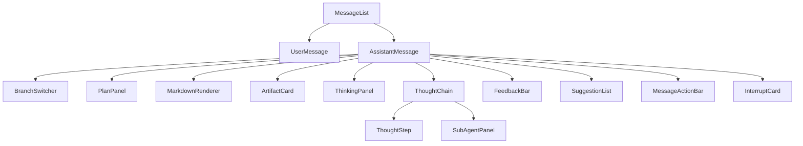
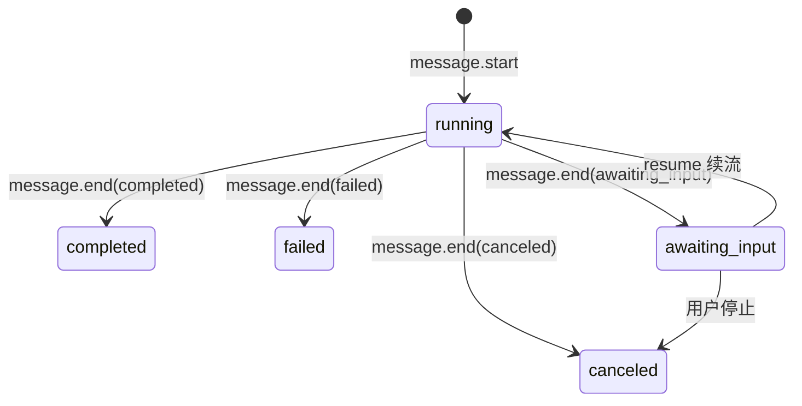

# AI 对话模块 - 前端实现设计（公共）

## 文档概述

用户端与管理端共用一套消息数据视图层与流式基础设施：会话、消息数据视图组件（`scope` 驱动数据范围：用户端 `scope=self` 本人、管理端会话审计 `scope=admin` 全量）、SSE 流式状态机、会话级 Store 与消息操作。核心是视图同构、数据范围可切换——两端渲染同一套消息组件，仅查询参数与操作入口不同。

页面结构与交互规范见 [需求规格.md](../需求规格.md)，接口契约见 [API接口.md](../API接口.md)。用户端对话页见 [前端实现-用户端.md](前端实现-用户端.md)，管理端四页见 [前端实现-管理端-会话管理.md](前端实现-管理端-会话管理.md)/[前端实现-管理端-智能体管理.md](前端实现-管理端-智能体管理.md)/[前端实现-管理端-MCP管理.md](前端实现-管理端-MCP管理.md)/[前端实现-管理端-SKILL管理.md](前端实现-管理端-SKILL管理.md)。

本公共文档仅承载**消息数据视图层与流式基础设施**（会话列表、消息流、消息操作/SSE 状态机）。输入区、会话设置、记忆面板等用户端交互与市场、命名空间、评测等管理端交互为端内特有，见各端文档；Markdown/代码高亮、图表等组件属项目公共组件库。

## 公共组件树设计

| 组件             | 职责                                                                                                                                                                                                                                                                                                                           |
| ---------------- | ------------------------------------------------------------------------------------------------------------------------------------------------------------------------------------------------------------------------------------------------------------------------------------------------------------------------------ |
| MessageList      | 消息列表渲染：props `messages: Message[]` + 宿主补充数据 `artifacts` / `feedback` / `branches`（均按消息 id 索引），按时间正序、role 分流组件，支持流式增量与分支切换；超 100 条启用窗口化；自动滚动跟随，用户上滑时暂停跟随并显示"回到底部"按钮；滚动开关经 `scrollFollowEnabled` prop 输入、`scroll-follow-toggle` emit 上抛 |
| UserMessage      | 用户消息展示，支持编辑重发、复制；`edited=true` 时展示"已编辑"标识                                                                                                                                                                                                                                                             |
| AssistantMessage | 直接消费契约 Message：正文、思考、工具步骤分别由 `model/blocks.ts` 的 `textOfBlocks` / `thinkingOfBlocks` / `stepsOfBlocks` 现算；`plan`、`pendingInterrupt`、`usage`、`suggestions`、`memoryIds` 直接读契约字段；产物、反馈、分支序号由宿主按消息 id 注入。footer 在有数据时展示逐条用量（tokens/积分）与记忆引用条数         |
| MessageActionBar | 消息操作栏（悬停出现）：复制、引用、重新生成、朗读、删除、反馈；复制成功切换完成态，代码块独立复制入口                                                                                                                                                                                                                         |
| FeedbackBar      | 渐进式反馈栏：点赞一键完成；点踩后展开 6 类问题标签单选，文字说明可选；已反馈状态高亮展示，支持撤销、修改                                                                                                                                                                                                                      |
| ThinkingPanel    | 思考过程卡：按 thinking 块分段（seq 升序），折叠头部实时计时，末块 `durationMs` 非空即定格"已深度思考（用时 Ns）"；流式自动吸底（用户上滑暂停跟随）；正文开始输出后自动收起（用户手动操作过则不再干预）                                                                                                                        |
| ThoughtChain     | "查看过程"入口（默认折叠）：工具步骤由 `tool_use` 块派生，展开后按 seq 显示，含子智能体并行执行；有失败步骤时标题给出失败数                                                                                                                                                                                                    |
| ThoughtStep      | 单个工具步骤：序号取块 `seq`，展示工具名、入参、输出/摘要、`status`、耗时与失败原因                                                                                                                                                                                                                                            |
| SubAgentPanel    | 子智能体并行执行面板：读取 `message.usage.subAgents` 展示子 Agent 粒度 Token 与积分，**仅有数据时渲染**（不把主 Agent 汇总用量误标为子智能体消耗）                                                                                                                                                                             |
| InterruptCard    | 中断交互卡片：按 `interrupt.type` 与 `confirmKind` 路由图像模型推荐、工具授权、危险操作、写入冲突、配额不足、异步等待、计划确认；决策经单一 `resume(payload: ChatResumeFormVM)` 事件上抛，`actionable=false` 时只展示不可续                                                                                                    |
| ArtifactCard     | 产物卡片（图片缩略图、指标报告、图像模型推荐、文件引用）                                                                                                                                                                                                                                                                       |
| SuggestionList   | 类似问题推荐：读 `message.suggestions`（与 `suggestions` 事件同源），点击作为新消息发送，可忽略                                                                                                                                                                                                                                |
| BranchSwitcher   | 消息分支切换器（`< 2/3 >`）：由 `AssistantMessage` 在分支视图存在时渲染，总分支 < 2 不渲染、边界禁用；props `total` / `current`，emit `change(index)` → 经 `switch-branch` 上抛宿主，由宿主经 SDK `getBranches`/`switchBranch` 真切换（同步后端会话 `currentBranchMessageId`）                                                 |
| PlanPanel        | 计划面板：由 `AssistantMessage` 在 `message.plan` 存在时渲染，展示阶段、状态、任务清单（状态徽标）、修订说明与待批准提示；props `plan: Plan`                                                                                                                                                                                   |

组件只做展示编排（不取数），是否提供操作入口由宿主页面按 `scope` 决定。`AssistantMessage` 按 `message.plan` / 分支序号是否注入决定渲染；计划与中断直接来自消息契约字段，不另建 store 副本。分支切换经 emit 上抛至页面层。

用户端"查看过程"只有两个真实信息源：`ThoughtChain`（`tool_use` 块派生的工具步骤）与 footer 的逐条用量行。上下文构成（系统提示/历史/检索的占比与来源）当前没有 wire 数据，不实现、不伪造；`memoryIds` 只以"引用记忆 N 条"文本呈现。

**派生数据来源（用户端，不新增接口）**：

| 组件                    | 数据来源                                                              | 说明                                                                                       |
| ----------------------- | --------------------------------------------------------------------- | ------------------------------------------------------------------------------------------ |
| AssistantMessage 正文   | `message.blocks` → `textOfBlocks`                                     | text 块按 seq 拼接，块间以空行衔接                                                         |
| AssistantMessage 思考   | `message.blocks` → `thinkingOfBlocks`                                 | thinking 块按 seq 分段，`durationMs` 决定闭合与计时                                        |
| ThoughtChain / 工具步骤 | `message.blocks` → `stepsOfBlocks`                                    | tool_use 块投影为步骤，状态直接用契约 `ToolStatus`                                         |
| PlanPanel               | `message.plan`                                                        | 计划随消息持久化，刷新后与流式终态同源                                                     |
| BranchSwitcher          | 消息 `siblingIndex`/`siblingCount` + SDK `getBranches`/`switchBranch` | 后端返回激活链与兄弟序号，前端不做分叉选择；切换同步后端 `currentBranchMessageId` 后重拉链 |
| AssistantMessage 用量   | `message.usage` → `hasUsage`                                          | 终态且有用量时 footer 展示输入/输出/缓存 tokens 与积分；全 0 不渲染                        |
| AssistantMessage 记忆   | `message.memoryIds`                                                   | 只报条数（"引用记忆 N 条"）；不伪造上下文构成与占比                                        |

### 前端分层与宿主绑定

前端按"依赖方向单一"分三层，越靠内越纯：

| 层           | 位置                                                                                             | 职责                                                                                                                                                | 依赖                  |
| ------------ | ------------------------------------------------------------------------------------------------ | --------------------------------------------------------------------------------------------------------------------------------------------------- | --------------------- |
| 无状态组件层 | `src/components/ai-chat/`（`types.ts` + `model/` + `components/`）                               | 纯 props 进、事件出的消息视图；直接消费契约 Message，正文/思考/工具步骤由 `model/blocks.ts` 纯函数现算，分支可见性由 `model/branches.ts` 纯函数计算 | 只允许 `import type`  |
| 会话视图层   | `src/composables/useChatSessionView.ts`                                                          | 用户端唯一接线层：激活链与兄弟序号、会话级产物/反馈批量加载、激活链的流式与中断口径、动作回接 store；管理端抽屉直接读审计 store，不复用用户端视图   | store + SDK           |
| 宿主页面层   | `src/views/chat/index.vue`、`src/views/ai-conversations/components/ConversationDetailDrawer.vue` | 页面编排与端内副作用：产物详情对话框、复制（剪贴板 + `ElMessage`）、编辑、删除二次确认、路由与草稿                                                  | 会话视图层/审计 store |

**无状态组件层内部职责**（`src/components/ai-chat/`）：

| 文件 / 目录         | 职责                                                                                                                                                                                     |
| ------------------- | ---------------------------------------------------------------------------------------------------------------------------------------------------------------------------------------- |
| `types.ts`          | 只保留契约没有、渲染确实需要的派生形状：思考分段、工具步骤、分支序号、组件动作与恢复表单；契约类型一律 `import type`，零运行时依赖                                                       |
| `model/blocks.ts`   | 三个纯派生函数：`textOfBlocks`（text 块按 seq 拼接）、`thinkingOfBlocks`（thinking 分段与计时）、`stepsOfBlocks`（tool_use 块 → 工具步骤），另含 `hasUsage` 空用量判定；零副作用、可单测 |
| `model/branches.ts` | `visibleConversation`：按 `parentMessageId` 分叉选一条助手回复，并隐藏未选中分支的全部后代；返回可见消息与分支序号，可单测                                                               |
| `components/`       | 无状态组件（纯 props 进、事件出），只消费契约类型与上述派生函数                                                                                                                          |

**依赖方向（红线）**：宿主（store / 页面）单向依赖 `ai-chat`；`ai-chat` 反向依赖宿主（store / SDK 运行时 / router / ElMessage）为红线，禁止出现。`clarity-sdk-js` 在组件层只允许 `import type`，不得引入运行时能力。

**分层约束**：

- 组件层不得 import store / SDK 运行时 / router / ElMessage；数据一律经 props 注入，交互一律经 emit 上抛。
- 用户端由 `useChatSessionView` 读取 store 的流式、中断、反馈等本地态；管理端抽屉直接消费 `adminAudit` 的只读消息，滚动/流式语义显式固定（`scrollFollowEnabled=true`、不读取用户端流式态、不拉取反馈），避免审计被动依赖用户端状态。
- 助手消息产物不经 store 预取：`AssistantMessage` 在消息进入终态后 emit `load-artifacts(messageId)`，由宿主（用户端会话视图 / 管理端抽屉）调用 SDK 拉取并回填（组件层零 SDK）。
- `InterruptCard` 决策经单一 `resume(payload: ChatResumeFormVM)` 事件上抛；`plan_approve` 计划干预的 `planEdit.add` 为单对象（wire `planEdit.add` 仅接受单条，数组会被后端忽略）。
- `MessageList` 是消息渲染容器，没有额外的视图包装层：不读写任何 store，滚动跟随经 `scrollFollowEnabled` prop 输入、`scroll-follow-toggle` emit 上抛（状态归 store，由绑定层回接）。
- 正文、思考、工具步骤不产生 VM 副本：组件 `computed` 直接调用 `model/blocks.ts` 现算，流式增量只改 `blocks`，不做字段改名复制。
- 计划、中断、推荐、用量、产物 ID、记忆 ID 都是契约字段，组件直接消费；分支由 `parentMessageId` 分叉派生，工具步骤由 `blocks` 派生。
- 会话列表 `ConversationList` 为用户端页面侧组件（`src/views/chat/components/`）；管理端审计用 `ConversationAuditTable`。

用户端 emit 回接：`resume-interrupt→resumeInterrupt`、`reach-top→loadMoreMessages`（以当前列表最早消息 `id` 作 `before` 续拉、`hasMore` 取服务端）、`apply-suggestion→applySuggestion`、`regenerate/retry/edit/delete/speak/quote/feedback/scroll-follow-toggle` → 对应 store 操作；`switch-branch→经 SDK getBranches/switchBranch 真切换（同步后端 currentBranchMessageId）`；`open-artifact`/`copy`/`edit`/`delete` 的弹窗与剪贴板副作用留在页面层。

## 状态管理

### Store 模块划分

| Store 模块                | 职责                                                                                       | 生命周期                                               |
| ------------------------- | ------------------------------------------------------------------------------------------ | ------------------------------------------------------ |
| 会话级 Store（chatStore） | 当前会话 ID、契约 Message 实体表、流式状态、分支选择；数据范围由 `scope`（self/admin）区分 | 宿主页面级，随嵌入的用户端、管理端页面初始化，离开销毁 |

### 核心状态

| 状态                    | 说明                                                                                  |
| ----------------------- | ------------------------------------------------------------------------------------- |
| `scope`                 | 数据范围（`self`=本人 / `admin`=全量含异常标注），由宿主页面注入                      |
| `conversations`         | 会话列表，含未读消息数（`scope=admin` 含用户、消耗、异常标注）                        |
| `currentConversationId` | 当前会话 ID                                                                           |
| `messages`              | 当前会话消息实体表 `Record<messageId, Message>`，是唯一内容源                         |
| `streamingMessageId`    | 正在流式输出的消息 ID（由实体 `status=running` 派生，null 表示空闲）                  |
| `selectionMode`         | 会话列表批量选择模式（勾选集合 + 目标操作：归档、删除；`scope=admin` 不提供内容操作） |
| `scrollFollowEnabled`   | 流式自动滚动跟随开关（用户上滑时置 false，点击"回到底部"恢复）                        |

中断、推荐问题不单列 store 状态：`pendingInterrupt` 与 `suggestions` 直接写在消息实体上，与刷新后的历史读模型同源。Message 完整结构属 API 契约，见 [API接口.md](../API接口.md)；前端关注 `role`（选择渲染组件）、`status`（驱动流式状态机）、`blocks`（正文/思考/工具）、`plan`、`pendingInterrupt`、`usage`、`suggestions`、`parentMessageId`（分支渲染）等字段。

### 核心操作

| 操作                 | 说明                                                                                                          |
| -------------------- | ------------------------------------------------------------------------------------------------------------- |
| `fetchConversations` | 按查询条件拉取会话列表（`scope=self` 默认可见性过滤，`scope=admin` 带 `view=admin`）                          |
| `fetchMessages`      | 进入会话时按 `before` 游标加载最新一页消息（`limit` 默认 50，展示时反转回时间正序）；切换会话时取消未完成请求 |
| `sendMessage`        | 发送消息，建立 SSE 连接，携带 `Idempotency-Key` 防重复；引用预填充内容合并为消息内容后发送                    |
| `stopStreaming`      | 停止流式输出 / 取消当前推理                                                                                   |
| `regenerate`         | 重新生成助手回复，创建分支消息                                                                                |
| `editMessage`        | 编辑用户消息并重新触发回复，创建分支                                                                          |
| `resumeInterrupt`    | 恢复中断的推理（`POST /messages/{id}/resume` 独立流式端点）                                                   |
| `submitFeedback`     | 提交、更新、撤销点赞点踩（渐进式：点赞一键提交；点踩携带问题标签 + 可选文字说明）                             |
| `deleteMessage`      | 删除助手回复消息（软删除，删除后该分支"重新生成"入口不再展示）                                                |
| `quoteMessage`       | 将消息内容填充至输入区（本地操作，发起引用预填充）                                                            |
| `speakMessage`       | 朗读助手回复（调用语音模块 [VoicePlayback](../../../基础模块/语音交互/前端实现.md)，播报中再次点击停止）      |
| `applySuggestion`    | 点击推荐问题，作为新消息发送并清空推荐列表                                                                    |
| `reconnectStream`    | 断线重连，携带 `Last-Event-ID` 从断点恢复                                                                     |

## 数据流

### 数据获取策略

| 场景     | 策略                                                                                                                                                        |
| -------- | ----------------------------------------------------------------------------------------------------------------------------------------------------------- |
| 会话列表 | 分页加载，前端缓存减少重复请求；按最后活跃时间倒序                                                                                                          |
| 消息列表 | 进入会话时按 `before` 游标加载最新一页（`limit` 默认 50，展示反转回时间正序）；向上滚动以本页最早消息 `id` 作 `before` 加载更早页；切换会话时取消未完成请求 |
| 中断点   | 消息列表与详情已带 `pendingInterrupt`，直接渲染 InterruptCard；单条复核走 `GET /api/v1/ai/messages/{id}/interrupt`（`actionable=false` 时只展示不可续）     |

### 流式接收与更新策略

| 阶段     | 处理方式                                                                                                                                                                                      |
| -------- | --------------------------------------------------------------------------------------------------------------------------------------------------------------------------------------------- |
| 发送     | 先渲染本地占位；收到 `message.start` 后用服务端 user/assistant 两条完整 Message 替换占位；建立 SSE 连接                                                                                       |
| 增量更新 | `block.start` 追加块、`block.delta` 按 `blockId` 原位追加、`block.stop` 替换为完整块；经 `requestAnimationFrame` 批量更新；Markdown 增量解析仅重渲染变化段；ThoughtChain 默认折叠降低渲染压力 |
| 中断     | `interrupt` 事件写消息 `pendingInterrupt`，本轮 `message.end` 为 `awaiting_input`，渲染 InterruptCard                                                                                         |
| 完成     | `message.end` 是唯一终态来源，写 `status`/`error`/`usage`；`error` 事件只记录原因，不自行收尾                                                                                                 |
| 推荐问题 | `suggestions` 事件（在 `message.end` 后推送）写 `message.suggestions`，渲染 SuggestionList                                                                                                    |
| 断线重连 | 网络断连后自动重连（携带 `Last-Event-ID` + 流式会话 ID，最大 3 次间隔 3 秒）从断点恢复                                                                                                        |

引用、复制、朗读、删除等消息操作为本地交互或依赖语音模块，不经过 SSE 数据流。SSE 事件类型与 data 结构见 [API接口.md](../API接口.md)。

### 流式输出状态机

状态值来自契约 `MessageStatus`，前端不另设本地枚举。单次流式超 120 秒无新事件判定超时，只关闭连接、不改消息状态；同一会话同一时间仅允许一个流式输出进行中。

## 公共交互设计决策

| 交互点                       | 技术选型                                                            | 理由                                                                                                                                                                                                                                                  |
| ---------------------------- | ------------------------------------------------------------------- | ----------------------------------------------------------------------------------------------------------------------------------------------------------------------------------------------------------------------------------------------------- |
| 视图同构、scope 驱动数据范围 | 组件/Store 统一以 `scope` 决定查询参数与操作入口                    | 用户端=self、管理端审计=admin，同一份实现两端复用，杜绝重复开发                                                                                                                                                                                       |
| 流式接收                     | SSE（自定义事件）                                                   | 单向推送契合 LLM 输出；复用 HTTP 连接与认证；断线重连携带 `Last-Event-ID` 从断点恢复，比 WebSocket 轻；`EventSource` API 零依赖                                                                                                                       |
| 流式增量批量更新             | `requestAnimationFrame` 批量更新                                    | 逐个 delta 更新会触发同一帧多次 DOM 写入；批量更新让写入节奏与渲染帧对齐，渲染成本降一个数量级                                                                                                                                                        |
| 消息分支管理                 | parentMessageId 树 + 分支切换器                                     | 重新生成、编辑重发创建新分支，原消息保留；切换器（< 2/3 >）切换查看，不破坏历史                                                                                                                                                                       |
| 推理中断恢复                 | interrupt 事件 + `POST /messages/{id}/resume` 独立流式端点          | 暂停推理展示确认卡片，用户操作后调用独立 `resume` 端点续流                                                                                                                                                                                            |
| 推理过程展示                 | ThinkingPanel 默认展开跟随、正文出现自动收起；ThoughtChain 默认折叠 | 思考流实时可见满足过程透明，正文出现即收起保证答案直达（collapseOnAnswer，用户手动操作过则不再干预）；工具步骤是"过程信息"，默认折叠避免长思考链压过最终回复。思考段增量经 rAF 批量刷入当前段（段状态由 `block.start`/`block.stop` 驱动，跨帧不切段） |
| 滚动跟随控制                 | 自动跟随 + 上滑暂停 + "回到底部"                                    | 流式中自动滚动跟随最新内容；用户上滑阅读时暂停跟随，避免打断阅读                                                                                                                                                                                      |
| 工具调用可见                 | 工具调用渲染为 `tool_use` 块                                        | 让用户看到"AI 刚才做了什么"，`tool.status` 的 running/success/failed/skipped 实时呈现                                                                                                                                                                 |
| 异步等待挂起                 | async_wait 中断 + 消息状态轮询                                      | `message.end(status=awaiting_input)` 表示本轮通道关闭但消息未完成；轮询消息直至 status 离开 awaiting_input，正文从 `blocks` 读取                                                                                                                      |
| XSS 防护                     | MarkdownRenderer 转义                                               | LLM 输出经 Markdown 渲染自动转义 HTML；产物卡片 URL 校验白名单                                                                                                                                                                                        |
| 渲染性能                     | 虚拟滚动 + 增量渲染                                                 | 消息列表超 100 条虚拟滚动；token 增量批量更新；产物缩略图懒加载                                                                                                                                                                                       |

## 两端差异

| 差异点   | 用户端（scope=self）                   | 管理端会话审计（scope=admin）                            |
| -------- | -------------------------------------- | -------------------------------------------------------- |
| 数据范围 | 本人会话、消息                         | 全量用户会话、消息（含用户、Token 与积分消耗、异常标注） |
| 列表组织 | 按最后活跃倒序 + 置顶 + 未读数         | 全量列表 + 用户、时间、状态、关键词筛选 + 异常会话标注   |
| 会话操作 | 创建、归档、删除、导出、置顶           | 仅只读浏览与链路追踪，无内容操作                         |
| 消息交互 | 发送、停止、重新生成、编辑、反馈、引用 | 只读查看，推理链下钻                                     |
| 端内特有 | 输入区、会话设置、记忆面板/EmptyState  | 链路追踪面板、异常筛选、审计口径展示                     |

流式状态机、中断恢复等为发送侧能力，仅在用户端触发；管理端审计以只读消费消息视图（不发送消息）。
