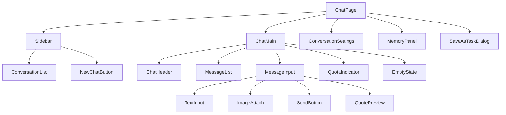

# AI 对话模块 - 前端实现设计（用户端）

## 文档概述

用户端对话页为 Web 端（React）实现，聚焦页面编排、端内状态与流式交互。页面结构与交互规范见 [需求规格.md](../需求规格.md)，接口契约见 [API接口.md](../API接口.md)。会话、消息数据视图、SSE 流式状态机与消息操作等消息数据视图层见 [前端实现-公共.md](前端实现-公共.md)（本端以 `scope=self` 使用）。Android、Flutter、Taro 等多端参考本 Web 端的组件结构与状态管理方案按各自技术栈适配。

用户端对话页承担"对话即服务"：统一对话入口承载问答、写作、代码、图像处理调度等多类任务，核心链路（会话列表 → 对话 → 结果）一页完成。

## 组件树设计

| 组件                     | 职责                                                                                                                                        |
| ------------------------ | ------------------------------------------------------------------------------------------------------------------------------------------- |
| ChatPage                 | 页面容器，路由入口，管理对话全局状态与子组件编排                                                                                            |
| Sidebar                  | 会话侧栏容器：会话列表 + 新建会话入口                                                                                                       |
| NewChatButton            | 新建会话按钮，创建后进入新会话（可指定 agent_code）                                                                                         |
| ConversationList（公共） | 会话列表：`scope=self` 按最后活跃度排序，支持搜索、置顶、归档范围筛选、未读数、批量操作、回收站                                                  |
| ChatHeader               | 对话头部：会话标题、模型、智能体切换、会话设置入口                                                                                           |
| MessageList（公共）      | 消息列表渲染，支持流式增量、分支切换、虚拟滚动                                                                                              |
| MessageInput             | 消息输入区：文本、图片、附件粘贴拖拽；语音输入内嵌语音模块 [VoiceInput](../../../基础模块/语音交互/前端实现.md)；流式中发送按钮变为停止按钮   |
| TextInput                | 文本输入（回车发送、Shift+回车换行），占位透出产品身份与能力；输入内容按会话维度本地保存草稿（localStorage），刷新、误关闭不丢失，发送后清空 |
| ImageAttach              | 多模态附件上传，上传前校验模型多模态能力                                                                                                    |
| QuotePreview             | 引用预览条：展示被引用消息摘要，可移除后发送                                                                                                |
| QuotaIndicator           | 配额提示条：日、月已用与限额，不足时引导升级                                                                                                 |
| EmptyState               | 新会话开场引导：问候语 + 2-4 条示例问题（本地静态数据），首次使用全屏展示                                                                   |
| ConversationSettings     | 会话设置弹窗：标题、模型、智能体、系统提示词、上下文配置、类似问题推荐开关、我的默认模型（偏好默认模型设置）                                      |
| MemoryPanel              | 长期记忆查看、筛选、删除、清空、手动录入、导出 + 归档记忆查看与取消归档（遗忘策略归档的记忆可恢复注入）                                          |
| SaveAsTaskDialog         | 将对话流程保存为定时任务（常用频率快捷项/Cron + 输入来源、输出目标）                                                                         |

消息渲染（UserMessage/AssistantMessage/ToolMessage/ThoughtChain/InterruptCard/FeedbackBar 等）、AgentSelector/ModelSelector 下拉的职责见 [前端实现-公共.md](前端实现-公共.md) 与各分篇；模型选择下拉消费 [AI模型管理模块](../../../基础模块/AI模型管理/API接口.md) `GET /api/v1/ai/models/enabled`（`model_type=chat`）。

## 状态管理

### Store 模块划分

| Store 模块                      | 职责                                                                | 生命周期           |
| ------------------------------- | ------------------------------------------------------------------- | ------------------ |
| 全局 Store                      | 会话列表、可用模型列表、配额信息、定时任务列表                      | 应用级，跨会话共享 |
| 会话级 Store（chatStore，公共） | 当前会话 ID、消息列表、流式输出状态、推理步骤、中断点（scope=self） | 宿主页面级         |

### 核心状态

| 状态                   | 说明                                                                                      |
| ---------------------- | ----------------------------------------------------------------------------------------- |
| `availableModels`      | 可用模型列表（含能力标识、积分单价、上下文长度、速度档位、模型标签、降级标识）            |
| `quota`                | 配额使用情况（日、月已用与限额）                                                           |
| `scheduledTasks`       | 用户定时任务列表                                                                          |
| `quote`                | 引用预填充内容（`{sourceMessageId, text}`，发送或清空后重置）                             |
| `draftByConversation`  | 输入草稿（按会话维度，localStorage 持久化；发送后清空，切换会话恢复对应草稿，刷新不丢失） |
| `conversationSettings` | 当前会话设置（模型、智能体、系统提示词、类似问题推荐开关）                                   |

会话列表（`conversations`）、消息（`messages`）、流式状态（`streamingMessageId`）等状态在公共 chatStore 中，本端以 `scope=self` 注入。

### 核心操作

| 操作                         | 说明                                                                                                                                                                                                                                |
| ---------------------------- | ----------------------------------------------------------------------------------------------------------------------------------------------------------------------------------------------------------------------------------- |
| `createConversation`         | 新建会话（可指定 agent_code），首条消息后异步生成标题                                                                                                                                                                               |
| `switchAgent`                | 切换会话绑定的 Agent，下一条消息生效                                                                                                                                                                                                |
| `switchModel`                | 切换会话模型，下一条消息生效                                                                                                                                                                                                        |
| `updateConversationSettings` | 更新会话设置（系统提示词、类似问题推荐开关等）                                                                                                                                                                                       |
| `saveDefaultModel`           | 保存、清除偏好默认模型（`PUT /api/v1/ai/user-preference`）：保存发 `{defaultModel: modelId}`，恢复平台默认发 `{defaultModel: null}`（显式传 null，不省略字段）；清除后重新读取时 `defaultModel` 键缺失，按未设置回填；仅影响新建会话 |
| `batchOperateConversations`  | 批量归档、删除会话（删除需二次确认）                                                                                                                                                                                                 |
| `exportConversation`         | 导出会话为 Markdown/JSON                                                                                                                                                                                                            |
| `saveAsScheduledTask`        | 将对话流程保存为定时任务                                                                                                                                                                                                            |
| `fetchMemories`              | 长期记忆查看、筛选、删除、导出                                                                                                                                                                                                         |

发送（`sendMessage`）、停止（`stopStreaming`）、重新生成（`regenerate`）、中断恢复（`resumeInterrupt`）、反馈（`submitFeedback`）等操作在公共 chatStore 中。

## 路由设计

| 路由路径                | 页面     | 权限控制 | 守卫说明                                 |
| ----------------------- | -------- | -------- | ---------------------------------------- |
| `/chat`                 | ChatPage | 登录用户 | 默认进入最新会话或新建                   |
| `/chat/:conversationId` | ChatPage | 登录用户 | 指定会话，进入时加载消息并检查未处理中断 |

管理端各页路由（会话审计、智能体/MCP/SKILL）见各管理端前端文档，与用户端独立。

## 数据流

| 区块         | 数据来源                                                        | 获取时机                  | 缓存策略                                                                                                                     |
| ------------ | --------------------------------------------------------------- | ------------------------- | ---------------------------------------------------------------------------------------------------------------------------- |
| 会话列表     | `GET /api/v1/ai/conversations`（scope=self）                    | 页面挂载 + 搜索、筛选变更  | 当前查询条件结果缓存；创建、删除、归档后失效                                                                                   |
| 消息列表     | `GET /conversations/{id}/messages`（游标分页 `before`/`limit`） | 进入会话 + 向上加载更早页 | 切换会话时取消未完成请求                                                                                                     |
| 模型列表     | `GET /api/v1/ai/models/enabled?model_type=chat`                 | 应用挂载                  | 应用级缓存                                                                                                                   |
| 配额         | 配额接口                                                        | 发送消息前校验            | 应用级缓存                                                                                                                   |
| 中断点       | 中断查询接口                                                    | 进入会话时                | 无                                                                                                                           |
| 定时任务     | `GET /api/v1/ai/scheduled-tasks`                                | 保存为定时任务弹窗打开时  | 当前结果缓存                                                                                                                 |
| 偏好默认模型 | `GET /api/v1/ai/user-preference`                                | 会话设置弹窗打开时        | 无缓存（`PUT` 保存后即时生效）；响应剔除 null，未设置时 `defaultModel` 键缺失，前端按**键缺失 ≡ 未设置（跟随平台默认）**回填 |

流式接收与更新策略（`requestAnimationFrame` 批量更新、断线重连、async_wait 轮询等）见 [前端实现-公共.md](前端实现-公共.md)。

## 交互设计决策

| 交互点       | 技术选型                                                         | 理由                                                                                                                                                                                                         |
| ------------ | ---------------------------------------------------------------- | ------------------------------------------------------------------------------------------------------------------------------------------------------------------------------------------------------------ |
| 新会话引导   | EmptyState 本地静态示例问题                                      | 示例问题为平台预设静态内容，零接口请求、不消耗 Token，降低新手开口门槛                                                                                                                                       |
| 消息引用     | 本地填充输入区（QuotePreview）                                   | 引用是"继续对话"的低成本路径：不建立消息引用关系、无接口调用，引用后作为普通新消息发送                                                                                                                       |
| 类似问题推荐 | `suggestions` SSE 事件 + SuggestionList                          | 推荐问题随回复由 LLM 生成并随 SSE 推送，渲染于回复末尾；可忽略不发送                                                                                                                                         |
| 配额不足引导 | quota 中断 + 升级、降级                                           | 单步预扣失败展示"积分不足"卡片，支持升级后从当前步骤继续或降级（切模型、减并行度）                                                                                                                            |
| 会话设置收敛 | ConversationSettings 弹窗承载模型、智能体、系统提示词              | 会话级配置项收敛于弹窗，不挤占对话画布；模型切换与智能体切换下一条消息生效                                                                                                                                   |
| 我的默认模型 | 会话设置面板内联偏好设置（`GET/PUT /api/v1/ai/user-preference`） | 不新建独立页面：默认模型是"会话从哪开始"的偏好，与会话级模型切换同源入口；面板显示当前偏好（无则"跟随平台默认"），下拉选择后"保存为默认"、可"恢复平台默认"，文案明示**仅对新建会话生效、已有会话保持原模型** |
| 定时任务固化 | SaveAsTaskDialog 内联于对话页                                    | 对话流程"确认后保存为定时任务"闭环，常用频率快捷项 + Cron + 下次触发时间预览                                                                                                                                 |

流式滚动跟随、推理过程折叠、工具调用可见、XSS 防护等公共交互见 [前端实现-公共.md](前端实现-公共.md)。

## 公共组件使用

| 公共组件          | 配置要点                                                                                             |
| ----------------- | ---------------------------------------------------------------------------------------------------- |
| MarkdownRenderer  | 渲染 LLM 输出，支持代码高亮、表格、链接；开启 HTML 转义防 XSS；增量解析仅重渲染变化段                  |
| 代码高亮组件      | 多语言语法高亮，长代码块折叠 + 一键复制                                                              |
| Mermaid 图渲染    | 识别 Markdown 中 mermaid 代码块并渲染为流程图                                                        |
| 公式渲染（KaTeX） | 渲染 LaTeX 公式（行内与块级）                                                                        |
| 虚拟滚动列表      | 消息列表超 100 条启用，仅渲染可视区域                                                                |
| 文件上传组件      | 多模态附件上传，上传前校验模型多模态能力（图片需视觉能力、文档需文档理解能力、音视频需对应理解能力） |
