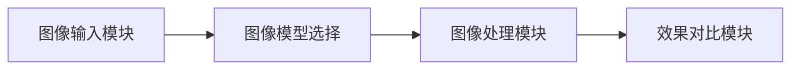

# 图像处理模块需求规格

## 模块概述

### 模块定位

图像处理模块是 AI 图像处理平台的核心处理引擎，对用户输入的图像执行 AI 图像处理任务（去雾、去雨、去雪、低光、超分、去噪、修复），并管理处理过程与结果。该模块承接图像输入和图像模型选择，输出处理结果至效果对比模块，是整个系统业务流程的关键环节。

任务语义由图像模型自身的任务标签承载（`sys_ai_model.task_tags`，如 `dehaze`/`derain`/`desnow`/`lowlight`/`super_resolution`/`denoise`/`inpaint`）。前端按 `model_type=image_edit` + 任务标签分组展示可选模型，提交时以模型标识 `model` 指定模型。见 [AI模型管理需求规格](../../基础模块/AI模型管理/需求规格.md)。

### 核心价值

| 价值维度 | 具体内容                                                                                                                             |
| -------- | ------------------------------------------------------------------------------------------------------------------------------------ |
| 高效处理 | 支持单张与批量处理，满足不同规模的处理需求                                                                                           |
| 进度可见 | 处理过程展示 5 阶段进度（预处理、模型初始化、任务处理、后处理、保存），阶段名按模型任务标签动态化，接入任务管理真实进度推送            |
| 参数可控 | 提交处理时可携带参数（记录于日志用于参数对比展示），主流图像模型按默认参数执行                                                       |
| 快速返回 | 相同模型与相同图片重复处理命中缓存直接返回结果，且缓存命中不消耗积分                                                                 |
| 结果管理 | 图像输入历史支持重新处理、删除，处理结果可保存                                                                                       |
| 按张计费 | 处理按张消耗 AI 积分（`bill_type='image'`），失败、取消、缓存命中不计费；评估免费                                                    |

### 用户角色分析

| 用户类型 | 特征                   | 使用偏好           | 功能需求                       |
| -------- | ---------------------- | ------------------ | ------------------------------ |
| 轻度用户 | 偶尔使用，对参数不了解 | 默认参数，一键处理 | 单张处理、样例图片、自动保存   |
| 中度用户 | 定期使用，有一定了解   | 参考推荐+微调参数  | 单张、批量处理、参数调节       |
| 重度用户 | 高频使用，专业需求     | 精确控制参数       | 批量处理、参数预设             |
| VIP用户  | 付费用户，更高权益     | 高效批量处理       | 更多月度赠送积分、批量上限提升 |

### 模块依赖关系

### 依赖的基础模块

| 模块       | 依赖说明                                                                                                                                         |
| ---------- | ------------------------------------------------------------------------------------------------------------------------------------------------ |
| AI模型管理 | 图像模型注册表（`sys_ai_model`，`model_type=image_edit`）与模型价格（按张计费基准）                                                              |
| AI计费管理 | 处理按张消耗 AI 积分（`bill_type='image'`、`quantity_unit='image'`）；提交前校验余额（不预扣）、成功后按张实扣；缓存、拦截器命中与失败、取消不扣费 |
| 会员管理   | 会员权益为月度积分赠送（`sys_member_benefit.vip_gift_credits` + 月度任务 `grantVipMonthlyGift`）；批量上限按会员等级校验                         |
| 文件存储   | 原图、结果图对象存储（URL 运行时拼接、不落库），结果文件 MD5 去重注册                                                                            |
| 收藏管理   | 处理结果收藏（`targetType="result"`），收藏入口由前端统一规划                                                                                    |
| 消息通知   | 消息通知不接入，处理进度经实时推送获知                                                                                                           |
| 推荐管理   | 图像模型选择页推荐（F-REC-002）一键使用，提交请求可携带 `recommendedBy` 追踪采纳率                                                               |
| 任务管理   | 整体进度聚合由任务管理模块承载                                                                                                                   |

## 功能需求

### 单张处理 (F-M04-001)

#### 功能描述

对单张图片进行图像处理。处理任务以异步方式执行，用户提交后无需等待，可随时查看处理进度和结果。

#### 处理流程

1. 上传、选择、拍照或样例选择图片
2. 选择图像模型（模型选择器，按 task_tags 分组）
3. 点击"开始处理"
4. 显示确认对话框（图片信息、模型信息、参数）
5. 用户确认处理
6. 积分校验 → 任务提交 → 立即返回 taskId 与预估积分
7. 异步执行阶段（后端经统一模型路由调用图像模型，前端展示真实进度推送）
8. 处理完成 → 跳转重叠对比页面；处理失败 → 展示错误信息与重试面板（自动与手动重试）

确认对话框展示图片文件名、模型名称、参数值，不展示预估耗时（计算密集型任务无法预估）。

#### 任务状态

| 状态   | 说明         | UI 表现                                                                                   |
| ------ | ------------ | ----------------------------------------------------------------------------------------- |
| 处理中 | 任务正在执行 | 5 阶段进度条（预处理、模型初始化、任务处理、后处理、保存，阶段名按 task_tags 动态化）+ 百分比 |
| 已完成 | 任务成功完成 | 自动跳转效果对比页面（重叠展示原图+结果图）                                               |
| 已失败 | 任务失败     | 错误提示 + 重试面板                                                                       |
| 已取消 | 用户主动取消 | 返回单图预览，未产生积分扣减                                                              |

#### 处理控制

开始处理：确认对话框展示图片信息（文件名）、模型信息（名称、参数配置）和处理提示，用户可选择取消或开始处理。前端处理前先检查积分余额，余额为 0 时弹窗引导充值、升级。

取消处理：确认对话框阶段可取消（未提交）。提交后前端提供"取消处理"按钮，调用取消接口终止任务；仅任务本人可取消。取消不产生积分扣减；取消幂等，对已完成、已失败、已取消任务重复取消直接返回当前状态，不重复终止推理。

#### 进度反馈

进度由后端真实推送（任务管理模块，5 阶段步骤条 + 百分比），阶段名按模型任务标签动态化：预处理、模型初始化、任务处理（如 dehaze→"去雾处理"、super_resolution→"超分辨率重建"）、后处理、保存。

| 事件     | 触发时机     | 前端响应                                              |
| -------- | ------------ | ----------------------------------------------------- |
| 任务完成 | 任务成功完成 | 停止进度展示，跳转重叠对比页面                        |
| 任务失败 | 任务失败     | 停止进度展示，展示错误信息，弹出重试面板              |

UI 展示规则：

- 进度由后端真实推送（任务管理模块），阶段名按任务标签动态化
- 不展示耗时计时器与预估剩余时间

失败重试机制：自动重试采用指数退避（间隔 2s → 4s → 8s），最大重试次数 3 次；超过最大次数后仅保留手动重试入口，手动重试不受次数限制。

#### 快速返回优化

对已有预计算结果的场景，系统跳过模型推理直接返回结果，将响应时延从秒级降至毫秒级，且缓存命中不消耗积分（直接写入已完成任务）。

### 批量处理 (F-M04-002)

#### 功能描述

支持一次性处理多张图片，提高处理效率（前端批量任务面板；无后端批量端点，批量 = 多次提交单张任务，由 SDK 封装）。

#### 处理流程

1. 点击"批量处理" → 弹窗选择多张图片
2. 确认添加 → 图片进入批量任务列表（每张 pending）
3. 选择统一图像模型（左侧工具栏）
4. 点击"开始批量处理"
5. 前端逐张处理：上传原图 → 提交图像任务 → 轮询结果 → 标记成功、失败
6. 展示整体进度 + 每张独立进度与状态
7. 完成 → 可查看单张结果、重试失败任务、移除、清空

#### 批量处理策略

批量处理由 SDK 封装为多次单张任务提交（`submitImageTask` 循环），前端逐张提交并按积分余额依次扣减。整体进度由任务管理模块聚合推送。

- 单张失败不影响其他图片，可单独重试

#### 失败处理

- 单张失败不影响其他图片处理，任务标记失败并记录失败原因
- 失败的图片可单独重试
- 批量处理可取消全部、移除单张、清空列表

#### 批量上限

批量数量受会员等级限制，后端接口校验超限返回业务错误；批量上限以 `sys_member_benefit` 配置（`batch_limit`）为唯一权威，三端一致，无额外硬编码上限。

### 参数调节 (F-M04-003)

#### 功能描述

为用户提供图像模型参数调节能力，实现个性化处理效果。

#### 参数调节

- 模型参数（去雾强度、色彩饱和度、对比度、锐化）随图像任务请求以 JSON 字符串提交，参数不改变模型执行推理
- 参数记录于前端状态与日志，用于效果对比模块的参数对比展示（处理参数与默认值）
- 参数仅影响本次处理展示，不支持实时预览调参效果

#### 参数预设

参数预设支持系统预设（只读）与用户自定义（仅本人可增删改），按模型标识 `model` 关联，用于快速复用历史参数组合；预设入口由前端统一规划。

### 处理结果管理 (F-M04-004)

#### 功能描述

管理处理结果，支持保存、重新处理、评估等操作。

#### 自动保存

处理完成后后端自动注册结果文件并关联图像任务日志。结果文件存储于对象存储，命名与存储策略由文件管理模块统一管理。

#### 手动保存

处理完成后前端提供"保存结果"按钮：下载结果图 → 转为 Blob 文件 → 再次上传至文件系统。保存格式为结果图原始格式，无格式、质量、元数据选项。

| 选项     | 说明                         |
| -------- | ---------------------------- |
| 保存方式 | 结果图 Blob 重新上传         |
| 保存格式 | 沿用结果图格式，无 JPG、PNG 选择 |

#### 结果导出

| 格式     | 说明               | 适用场景                       |
| -------- | ------------------ | ------------------------------ |
| 单张图片 | 结果图直接保存     | 日常使用                       |
| 对比图   | 原图与结果并排、上下 | 效果展示（由效果对比模块生成） |

### 错误处理与恢复 (F-M04-006)

#### 错误类型及处理

| 错误类型                | 处理方式                                                                         |
| ----------------------- | -------------------------------------------------------------------------------- |
| 图片文件损坏/格式不支持 | 上传前校验（仅 JPG、PNG，≤20MB），提示文件损坏                                   |
| 模型加载失败            | 提示加载失败，可重新发起（重试面板）                                             |
| 处理超时                | 单图推理超时阈值 30s，超时任务标记失败且不计费，提示建议更换模型或降低图片分辨率 |
| 网络异常                | 提示网络连接异常，失败重试                                                       |
| 积分余额不足            | 处理前校验积分，提示积分不足，引导充值、升级会员                                 |

### 图像输入历史 (F-M04-007)

#### 功能描述

记录用户的图片输入（上传、拍照、样例）并支持重新处理（前端本地历史 + 后端 `sys_input_history` 接口）。

#### 存储内容

前端本地历史（localStorage，key `clarity:image-history`）：最多保留 20 条，字段含图片 URL、缩略图、时间戳、来源（upload/camera/sample）。

后端 `sys_input_history`（同步接口）：原图 URL/缩略图、结果图 URL/缩略图、模型标识/名称、模型参数、处理耗时（毫秒，由图像任务响应的 `time`（秒）换算）、状态（1成功/2失败/3处理中）、来源、同步状态。

#### 查询与筛选

前端本地历史：按时间分组展示（今天、昨天、最近 7 天、更早），无筛选条件。

后端接口：分页查询，支持状态筛选（1成功/2失败/3处理中）与来源筛选（upload/camera/sample）。

#### 展示形式

卡片列表：每条记录展示缩略图、处理时间、来源标签，操作按钮为重新处理（按记录的模型任务标签跳转对应处理页）与删除（二次确认）。

#### 数据管理

- 前端本地历史最多保留 20 条（超出自动裁剪最早的记录），支持单条删除（二次确认）
- 后端 `sys_input_history` 支持单删、批量删除、清空，以及同步本地与云端（将本地记录上传至后端）
- 会员权益 `history_retention`（100/500/2000/10000）为配置字段，历史清理按会员等级保留条数执行

#### 重新处理

从历史记录可发起重新处理（按记录的模型任务标签跳转对应处理页，复用原图 URL），无需重新上传。

## 用户交互流程

### 单张处理完整流程

用户选择或上传图片（上传、拍照、样例、历史）→ 选择图像模型 → 可选调整参数 → 点击开始处理 → 显示确认对话框（图片、模型、参数）→ 积分校验 → 用户确认 → 展示真实进度（5 阶段，阶段名按任务标签动态化）→ 处理完成 → 自动跳转重叠对比页面 → 用户可保存结果、评估结果（评估免费）。

### 批量处理完整流程

选择多张图片 → 确认添加至批量任务列表 → 选择统一图像模型 → 点击开始批量处理 → 前端逐张处理并展示整体进度、单张进度 → 全部完成 → 查看单张结果、重试失败任务、移除、清空任务。

## 交互规范

### 页面布局

| 页面         | 布局要点                                                 |
| ------------ | -------------------------------------------------------- |
| 处理工作台   | 左侧图像选择区，右侧参数配置区，底部"开始处理"按钮       |
| 处理进度     | 5 阶段进度条，阶段名按任务标签动态化                     |
| 结果预览     | 原图与结果图重叠对比展示，提供下载按钮                   |
| 批量任务面板 | 批量任务列表，每张展示独立进度与状态，支持重试、移除、清空 |

### 关键交互行为

| 场景     | 交互行为                                                           |
| -------- | ------------------------------------------------------------------ |
| 开始处理 | 确认对话框展示图片、模型、参数，用户确认后提交                     |
| 取消处理 | 确认对话框阶段可取消；提交后提供取消按钮终止推理（不产生积分扣减） |
| 进度展示 | 按推理阶段真实推送进度，不展示预估耗时                             |
| 失败重试 | 自动重试后保留手动重试入口                                         |
| 积分不足 | 处理前检查，余额为 0 时弹窗引导充值、升级会员                      |
| 批量处理 | 单张失败不影响其他，可单独重试                                     |

### 操作反馈

| 场景     | 反馈行为                              |
| -------- | ------------------------------------- |
| 处理完成 | 自动跳转效果对比页面                  |
| 处理失败 | 展示错误信息与重试面板                |
| 积分不足 | 提示"积分余额不足"，引导充值、升级会员 |
| 缓存命中 | 直接返回结果，无需等待，不消耗积分    |
| 批量完成 | 展示整体成功率，失败项可重试          |

## 会员权益

### 等级差异

图像处理模块的会员权益由[会员管理模块](../../基础模块/会员管理/需求规格.md)统一管理，各等级差异如下：

| 权益项       | 普通用户 | VIP1   | VIP2    | SVIP     |
| ------------ | -------- | ------ | ------- | -------- |
| 月度赠送积分 | 0        | 100    | 500     | 3000     |
| 批量处理上限 | 10 张    | 50 张  | 200 张  | 1000 张  |
| 处理优先级   | 普通     | 优先   | 高优先  | 最高     |
| 历史记录保留 | 100 条   | 500 条 | 2000 条 | 10000 条 |
| 高级参数调节 | 支持     | 支持   | 支持    | 支持     |
| 高清图导出   | 支持     | 支持   | 支持    | 支持     |

权益数值与 [会员管理模块](../../基础模块/会员管理/需求规格.md) 一致，以 `sys_member_benefit` 配置为权威；高级参数、高清导出为能力开关，当前各等级均开启。月度赠送积分由月度任务 `grantVipMonthlyGift` 发放，`vip_gift_credits=0` 表示该等级不赠送。

### 积分扣减

用户每次发起图像处理，系统按图像模型价格（按张）在提交前校验积分余额（不足直接拒绝），任务成功后按张实扣：

- 计费口径：`bill_type='image'`、`quantity_unit='image'`，写 `sys_ai_billing` + 积分流水；
- 缓存命中、WPXNet 拦截器命中不计费；
- 失败、取消不计费（校验不预扣，实扣只在成功后发生）；
- 评估（PSNR、SSIM 等指标计算）为平台免费能力，不计费。

按任务类型的 8 类月度配额路径（dehaze/derain/desnow/lowlight/super_resolution/denoise/inpaint/evaluate）不作为消耗、计费口径；`sys_member.monthly_*` 与 `sys_member_quota` 列、表保留 DDL，读写通道仍在（权益配置仍可写、权益概览仍读取该类目字段），`sys_member_benefit.monthly_*_quota` 种子值置 0。

## 消息通知集成

图像处理模块不接入消息通知模块（F-MN-001）推送通知，处理完成与失败均不产生站内信，处理进度经实时推送获知。

## 收藏管理集成

处理结果收藏由[收藏管理模块](../../基础模块/收藏管理/需求规格.md)统一管理（收藏类型 `result`）。收藏入口由前端统一规划。

## 推荐管理集成

图像处理模块与[推荐管理模块](../../基础模块/推荐管理/需求规格.md)集成：

- 图像模型选择页面的"推荐"Tab 展示推荐管理模块生成的图像模型推荐（F-REC-002，`RecommendedModelVO`）
- 提交请求可携带 `recommendedBy`（推荐记录 ID）用于追踪推荐采纳率

## 任务管理对齐

图像处理采用独立异步执行（图像任务状态机：处理中→已完成、已失败、已取消），整体进度聚合由任务管理模块承载。

## 非功能需求

| 指标           | 目标值                 | 说明                                                              |
| -------------- | ---------------------- | ----------------------------------------------------------------- |
| 单图处理时延   | ≤ 30s                  | 含上传 + 推理 + 结果回写                                          |
| 并发处理能力   | 100 并发               | 单实例同时处理的图像处理任务数                                    |
| 可用性         | 99.9%                  | 模块年度可用率                                                    |
| GPU 加速与降级 | GPU 优先，失败回退 CPU | GPU 推理失败时自动回退 CPU 降级执行，保障可用性；回退事件记录日志 |
| 超时阈值       | 30s                    | 单图推理超时阈值；超时任务标记失败且不计费                        |
| 并发限流       | 按会员等级 + 实例容量  | 超过并发上限时排队等待或返回限流提示，优先保障 VIP 任务           |

## 待确认事项

1. 任务超时阈值差异化：单图推理超时阈值（当前 30s）是否需要按模型类型或图片大小差异化？
2. 失败重试策略区分：自动重试是否需要按失败原因区分（网络异常可重试，模型错误不重试）？
3. 处理结果保留期限：处理结果文件的保留期限与清理策略（当前无明确策略）？
4. 参数预设 VIP 差异化：参数预设数量上限是否需要按会员等级差异化？
5. 缓存结果标注：缓存命中的处理结果是否需要标注"缓存结果"以区分实时处理？
