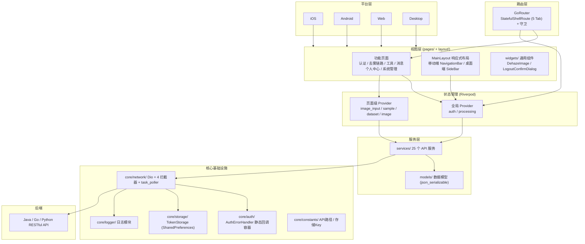
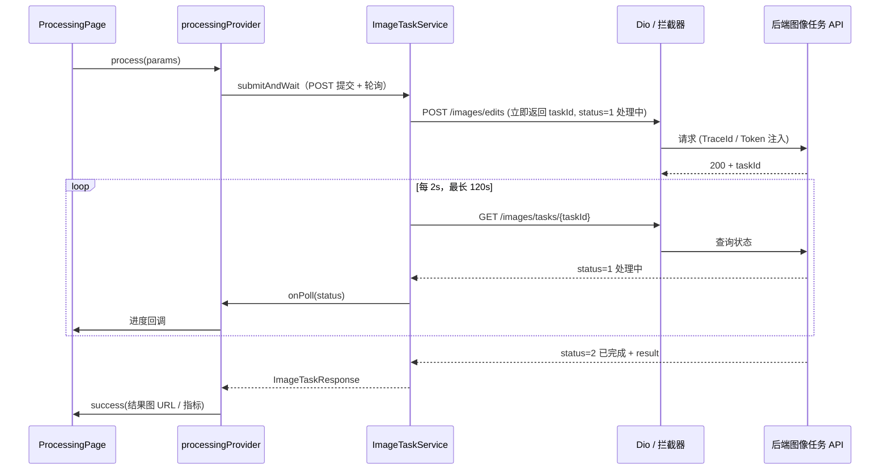
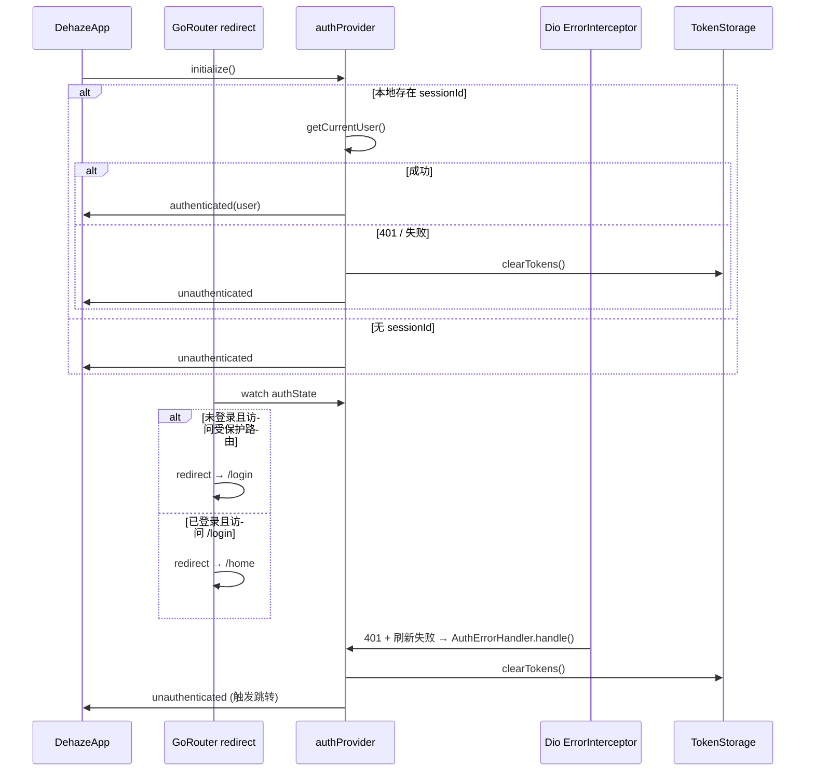

# Flutter (clarity_flutter)

AI 图像处理平台的 Flutter 客户端，提供 iOS/Android/Web/Desktop 全平台支持。

## 架构图

### 分层架构

### 去雾处理数据流

用户可在处理中取消：`ProcessingNotifier.cancel()` 置位 `PollCancellation`（轮询抛 `PollCancelledException`，不记为错误）并请求后端 `POST /images/tasks/{taskId}/cancel`；超时抛 `ApiException(B0100)`。

### 认证状态流

## 项目结构

- `lib/`
  - `main.dart` - 入口：runZonedGuarded + 崩溃捕获 + ProviderScope
  - `core/` - 核心基础设施
    - `auth/` - AuthErrorHandler 静态回调容器 + permission_match（模块前缀权限判定）
    - `constants/` - api_constants / storage_constants
    - `logger/` - Logger + transports + log_entry
    - `network/` - Dio + 4 拦截器 + task_poller + api_result/page_result
    - `state/` - paged_list_notifier（PagedListNotifier 基类 + LoadMoreListener）
    - `storage/` - TokenStorage（基于 SharedPreferences）
    - `types/` - option_type 通用类型
  - `models/` - 共享数据模型（API DTO，json_serializable 生成 .g.dart）
  - `services/` - API 服务（一行 dio 调用 / 模块）
  - `providers/` - Riverpod Providers
    - `providers.dart` - 基础设施 + 全部 service Provider
    - `auth_provider.dart` - AuthState / AuthNotifier（登录态 + 权限）
    - `processing_provider.dart` - 去雾处理流程状态（含取消）
  - `router/` - GoRouter 配置（StatefulShellRoute + 守卫）
  - `layout/` - MainLayout 响应式 + menu_config + immersive_scaffold
  - `theme/` - AppTheme（light/dark）
  - `widgets/` - 通用组件（DehazeImage / LogoutConfirmDialog）
  - `utils/` - format_utils（含 formatYuan）/ responsive_utils / ui_utils
  - `constants/` - app_constants
  - `pages/` - 功能页面
    - `home/` - 首页（hero / workflow / model / showcase / cta / tools_grid）
    - `login/` - 登录
    - `register/` - 注册
    - `image_input/` - 图像输入（upload / camera / sample / preview + 页内 service/provider）
    - `processing/` - 去雾处理（内含图像模型选择内联选择器；`/dehaze` Tab 直达本页）
    - `batch/` - 批量处理（≤ 会员权益上限张数 + 逐张图像任务 + 进度、结果）
    - `comparison/` - 效果对比（side_by_side / overlay / magnifier / filter / metrics / model_info）
    - `dataset/` - 数据集管理（providers + widgets + models/dataset_image_model 页内展示模型）
    - `metrics_manage/` - 指标评估管理
    - `messages/` - 消息中心 + 详情
    - `notify/` - 通知
    - `task_history/` - 处理历史
    - `profile/` - 个人中心入口
    - `personal/` - 个人中心子页（12 个：settings/credits/package/package_detail/order_create/orders/member/files/feedback/favorites/help/about）
    - `dev_logs/` - 日志浏览与导出（仅 debug）
    - `dashboard/` - 管理后台首页
    - `tools/` - 工具 Tab 容器
    - `system/` - 系统管理（13 个：user/role/menu/dept/dict/dataset/task/member/package/order/feedback/message/recommend）

**模型归置约定**：API DTO 与服务统一放 `lib/models`、`lib/services`、`lib/providers`；`lib/pages/<x>/models` 只放页面私有展示模型（如数据集页的 `ImageModel`/`ImageType`）。

## 核心模块说明

| 模块                           | 职责                                             | 技术要点                                                                                                                                                                                                                                                                                                                                                                                                            |
| ------------------------------ | ------------------------------------------------ | ------------------------------------------------------------------------------------------------------------------------------------------------------------------------------------------------------------------------------------------------------------------------------------------------------------------------------------------------------------------------------------------------------------------- |
| 认证 (auth_provider)           | 登录、注册、登出、Session 续期、权限判定         | AuthState 持有 user + sessionId，`hasPerm`（具体权限）与 `hasModulePerm`（模块前缀，用于入口显隐与路由守卫）供 UI 查询                                                                                                                                                                                                                                                                                                |
| 去雾处理 (processing_provider) | 选图 → 选图像模型 → 异步执行 → 结果回填、取消     | 图像模型选择**内联于本页**（`_buildModelSelector`），无独立选择页；数据源 `AiModelService.listEnabledModels('image_edit')` 即 `GET /api/v1/ai/models/enabled?modelType=image_edit`，预选取 SharedPreferences `last_image_model_id`（须仍在启用列表内）→ 否则列表首项，不使用 chat 维度的用户偏好默认模型。后端异步任务，`ImageTaskService.submitAndWait`（提交 + 轮询，2s/次，120s 超时）；处理中可取消（`PollCancellation` + 后端 `cancelTask`） |
| 批量处理 (batch/)              | 选图 → 选图像模型 → 逐张提交 → 结果列表          | 模型选择复用 `imageEditModelsProvider`（`AiModelService.listEnabledModels('image_edit')`，与去雾处理页共用，不另起加载逻辑）；逐张 `imageTaskService.submitAndWait(ImageEditRequest(model: modelId, fileId))`，结果 `ImageTaskResponse`，耗时直接取 `response.time`（**秒**）展示 `耗时: ${task.time}s`；上限取 `getProfile().benefits.batchLimit`，会员接口不可用时兜底常量 `defaultBatchLimit = 5`；无 quota 逻辑 |
| 效果对比 (comparison/)         | 5 种对比模式独立路由                             | side_by_side / overlay / magnifier / filter / metrics，ShellRoute 外沉浸页；`model-info` 为独立沉浸页不属对比模式                                                                                                                                                                                                                                                                                                   |
| 任务轮询 (task_poller)         | 图像任务与评估共用                               | `pollTask<T>` 泛型轮询器，`PollOptions` 配置间隔、超时、回调、取消信号（`PollCancellation`）；取消抛 `PollCancelledException`、超时抛 `ApiException(B0100)`                                                                                                                                                                                                                                                     |
| 收藏管理                       | 跨模块统一收藏（模型、处理结果、数据集、图片、预设） | favoriteServiceProvider；取消收藏走 `DELETE /favorites/{收藏记录ID}` 批量删除                                                                                                                                                                                                                                                                                                                                       |
| 推荐管理                       | 推荐图像模型展示与一键使用                       | recommendation_service                                                                                                                                                                                                                                                                                                                                                                                              |
| 数据集管理 (dataset/)          | 列表、详情、图片浏览、类型筛选                   | 模块内 providers/ + widgets/ 自治                                                                                                                                                                                                                                                                                                                                                                                   |
| 系统管理 (system/)             | 13 个后台管理页                                  | user/role/menu/dept/dict/dataset/task/member/package/order/feedback/message/recommend；其中 12 个分页页采用 `PagedListNotifier` 范式（`StateNotifier<AsyncValue<PagedList<T>>>`），recommend 为非分页列表                                                                                                                                                                                                           |
| 个人中心 (personal/)           | 12 个用户子页                                    | settings/credits/package/package_detail/order_create/orders/member/files/feedback/favorites/help/about；套餐购买链路为 列表 → `package/:id` 详情 → `order/create` 下单（余额支付，`POST /orders`）                                                                                                                                                                                                                  |
| 消息中心 (messages/)           | 消息列表 + 详情                                  | announcement + message + notification_settings                                                                                                                                                                                                                                                                                                                                                                      |
| 响应式布局 (MainLayout)        | 单代码库适配全平台                               | `MediaQuery.width >= 768` 切换：移动端 NavigationBar 5 Tab / 桌面端 248px 侧边栏 + 面包屑                                                                                                                                                                                                                                                                                                                           |
| 日志 (core/logger/)            | 文件 + 远程 + 控制台多 transport                 | 三种 transport 的字段 schema 与接收链路见日志模块一节                                                                                                                                                                                                                                                                                                                                                               |

## 关键技术决策

| 决策         | 选择                                  | 理由                                                                                                                                                                        |
| ------------ | ------------------------------------- | --------------------------------------------------------------------------------------------------------------------------------------------------------------------------- |
| 框架         | Flutter                               | 单代码库支持 iOS/Android/Web/Desktop 全平台                                                                                                                                 |
| 状态管理     | Riverpod (StateNotifier)              | 编译时安全，Provider 依赖注入；StateNotifier 承载可变状态；system 管理页通过 `PagedListNotifier` 基类统一分页列表状态（`StateNotifier<AsyncValue<PagedList<T>>>`）          |
| 网络层       | Dio + 4 拦截器                        | TraceInterceptor（trace_id）、AuthInterceptor（Token 注入）、ResponseInterceptor（统一拆包）、ErrorInterceptor（401 处理 + 2s 防抖窗口，避免并发 401 多次触发 onAuthError） |
| 路由         | GoRouter (StatefulShellRoute)         | 声明式路由，5 Tab 状态保持，支持深层链接与 ShellRoute 外沉浸页                                                                                                              |
| 存储         | SharedPreferences                     | Token (sessionId) 持久化，跨平台一致性，无平台特有依赖                                                                                                                      |
| 响应式布局   | 移动端 NavigationBar + 桌面端 SideBar | `MediaQuery.sizeOf` 实时切换，单 Widget 树双布局                                                                                                                            |
| 认证错误解耦 | AuthErrorHandler 静态容器             | 打破 `dioClientProvider → authProvider → authServiceProvider → dioClientProvider` 循环依赖                                                                                  |
| 数据模型     | json_serializable + .g.dart           | 编译时类型安全，避免手写 fromJson/toJson                                                                                                                                    |
| 异步任务     | 泛型轮询器 pollTask                   | 图像任务与评估共用同一轮询机制，配置化间隔、超时、取消信号；超时抛 `ApiException` 走统一错误展示                                                                             |

## 路由设计

### 路由结构

采用 GoRouter `StatefulShellRoute.indexedStack`，5 个 Tab 分支保持独立导航栈：

| 分支 | 路径        | 子页面                                                                                                                                                                                                                 |
| ---- | ----------- | ---------------------------------------------------------------------------------------------------------------------------------------------------------------------------------------------------------------------- |
| 首页 | `/home`     | -                                                                                                                                                                                                                      |
| 工具 | `/tools`    | image-input / batch / dataset (含 :id 详情) / metrics-manage                                                                                                                                                           |
| 去雾 | `/dehaze`   | 直达处理页 `ProcessingPage`；子路由 `processing` 同页（保留兼容既有跳转）                                                                                                                                              |
| 消息 | `/messages` | :id 详情                                                                                                                                                                                                               |
| 我的 | `/profile`  | task-history / files / orders / credits / member / package / package/:id 详情 / order/create 下单 / feedback / favorites / settings / help / about / notify / dashboard / admin/* (13 管理页，路径 `/profile/admin/*`) |

ShellRoute 外的沉浸页（无 Tab 框架）：`/compare/side-by-side`、`/compare/overlay`、`/compare/magnifier`、`/compare/filter`、`/compare/metrics`、`/model-info`。

### 导航守卫

`goRouterProvider` watch `authProvider`，redirect 规则：

- 未登录访问非公开路由 → 重定向 `/login`
- 已登录访问 `/login` 或 `/register` → 重定向 `/home`
- 公开路由白名单：`/login`、`/register`、`/home`
- 权限守卫：登录态检查后，按 `AppRouterConfig.adminRouteModulePerms` 映射（13 项，路径 → **权限模块前缀**，如 `/profile/admin/user-manage` → `sys:user`）校验 `authState.hasModulePerm`，已登录但无权限的用户访问管理页 → 重定向 `/home`

**权限判定口径**：后端权限来自 `sys_menu.perm`，是按钮级细粒度串（`sys:user:add`、`order:list`），多数模块没有"列表/查看"权限且对应列表接口不校验权限（仅要求登录）。因此入口显隐与路由守卫按**模块前缀**判定（命中该模块任一具体权限即可见，`matchModulePerm`）；`sys:task` 在权限种子中暂无对应串，故任务管理实际仅 ROOT 可见。需要具体权限的功能可见性（如新增按钮 `sys:user:add`）仍用 `hasPerm` 精确判定。

页面内访问控制（无权限渲染"无权限访问"）已上移至路由层统一处理；功能可见性 `hasPerm` 仍保留在页面内。

### 错误处理

`errorBuilder` 渲染 404 页，提供返回首页入口。

## 状态管理与模块间交互

### Provider 分层

| 层级              | 位置                                          | 职责                                                                                                                                                              |
| ----------------- | --------------------------------------------- | ----------------------------------------------------------------------------------------------------------------------------------------------------------------- |
| 基础设施 Provider | providers.dart                                | sharedPreferences / tokenStorage / dioClient / authErrorCallback                                                                                                  |
| 服务 Provider     | providers.dart                                | 26 个 service Provider，一行 dio 注入                                                                                                                             |
| 全局业务 Provider | auth_provider.dart / processing_provider.dart | 跨页面共享的认证态与处理流程态                                                                                                                                    |
| 页面级 Provider   | pages/{module}/providers/                     | image_input_provider / sample_provider / dataset_provider（状态类型 `AsyncValue<List<Dataset>>`，去除本地 `DatasetModel` 冗余映射）/ image_provider，仅模块内使用 |

system 管理页 Provider（14 个，均位于 `pages/system/`，基于 `PagedListNotifier` 基类）：

- 分页页（12 个）：user / role / menu / dept / dict / dataset / task / member / package / order / feedback / message——`StateNotifierProvider<XxxManageNotifier, AsyncValue<PagedList<T>>>`，构造时自动首次加载，提供 `search` / `refresh` / `loadMore`
- 非分页页（1 个）：recommend——`StateNotifierProvider<XxxManageNotifier, AsyncValue<List<T>>>`

### 模块间交互

- **后端通信**：通过 Dio 调用 Java/Go/Python 三端 RESTful API，4 拦截器统一处理 trace_id 注入、Token 注入、响应拆包、401 错误
- **认证错误传播**：`ErrorInterceptor` 检测 401 → `AuthErrorHandler.handle()` → `authProvider.onAuthError()` 清空 Token 并切换状态 → GoRouter 守卫触发跳转 `/login`。静态容器设计避免 Provider 循环依赖。`ErrorInterceptor` 内置 401 防抖（2s 窗口，避免并发 401 多次触发 `onAuthError`）
- **去雾处理流程**：UI → `processingProvider.process()` → `ImageTaskService.submitAndWait`（内部 `submit` + `waitForTask`/`pollTask`）→ POST 立即返回 taskId → 轮询 GET `/images/tasks/{taskId}` 直至 completed/failed（或取消 / 超时）→ 状态回填 UI
- **金额口径**：后端金额统一为 int（**分**），前端 `formatYuan(fen)`（`lib/utils/format_utils.dart`）单点转元展示；模型字段不再混用 double 金额
- **跨模块状态共享**：如收藏状态通过 favoriteProvider 全局共享，任意页面收藏按钮变更后自动重建

## 日志模块

Flutter 端日志实现位于 `lib/core/logger/`（`logger.dart` / `transports.dart` / `log_entry.dart`），行为契约（字段 schema、接收链路、采样限流）见 [02-系统架构/07-日志架构设计.md](../../02-系统架构/07-日志架构设计.md)，与 [08-SDK架构文档.md](./08-SDK架构文档.md) 的 JS SDK 行为对齐，共享同一后端接收 API。

Flutter 端特有决策：

- **崩溃捕获**：`main()` 包裹 `runZonedGuarded` + `FlutterError.onError` + `PlatformDispatcher.onError`，error_type=dart
- **不调用 `FlutterError.presentError`**：其默认 `dumpErrorToConsole` 输出与 Logger 的 `ConsoleTransport` 重复；Logger 的 `error_stack` 使用 `FlutterErrorDetails.toString()`（同源，含 library + widget 上下文 + RenderObject 诊断），信息不丢失
- **trace_id 透传**：`TraceInterceptor` 注入 `X-Trace-Id` 请求头，响应头回写对齐
- **API 失败上报**：`TraceInterceptor.onError` 构造 `method/path/status/duration/code` 交 Logger（error_type=api）；401 属鉴权结果，按 `INFO` 记录不上报远端
- **路由自动填充 url**：根 Widget build 时 `Logger.instance.attachRouter(goRouter)`，`log()` 自动取 `routerDelegate.currentConfiguration.last.matchedLocation`（调用点显式传 url 优先）
- **ERROR 去重**：相同 `message + errorStack` fingerprint 在 10s 窗口内只输出首条，窗口结束时补发汇总条目（`dedupCount` 标记总命中次数，message 标注 `(10s 内重复 N 次)`），防止布局错误（如 RenderFlex overflow 60fps）触发日志风暴且不丢失次数信息；不同 trace_id 的 API 错误 fingerprint 不同，不误去重
- **开发者面板**：`lib/pages/dev_logs/` 日志浏览与导出（仅 debug）
- **不暴露 user_id**：前端 SDK 不上报 user_id，由三端后端从会话统一解析注入

文件切割、保留策略、远程上报批量化等通用策略见日志架构设计文档。
