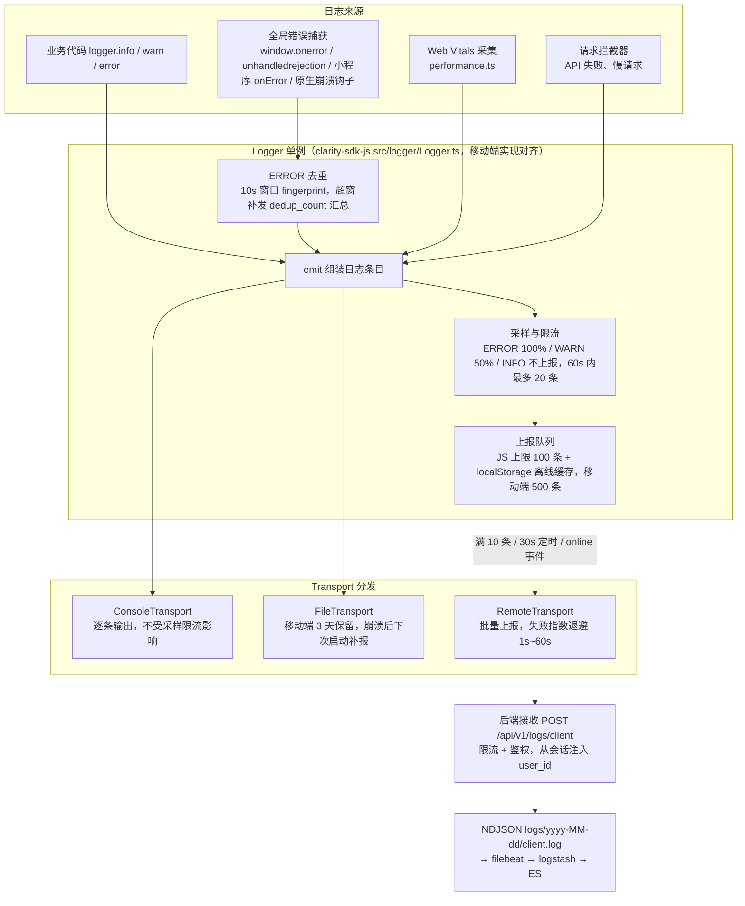

# SDK 日志实现

前端 SDK 的日志采集覆盖三个 SDK：

- **clarity-sdk-js**（Web / React / Vue / Taro / UniApp / React Native 共用）
- **clarity_flutter**（Flutter 端，`lib/core/logger/`）
- **clarity-android/sdk**（Android 端，`com.pei.clarity.sdk.logger`）

日志的架构契约（接收链路、字段 schema、采样限流、trace_id 端到端串联）由 [02-系统架构/07-日志架构设计.md](../../02-系统架构/07-日志架构设计.md) 统一定义，各 SDK 侧只写实现设计，不重复契约内容。

## 日志分层与上报链路



## 统一设计原则

三个 SDK 的日志模块共享同一行为契约，实现对齐：

| 原则             | 说明                                                                                                  |
| ---------------- | ----------------------------------------------------------------------------------------------------- |
| 多 transport     | Logger 单例按需组装 transport（Console / File / Remote），SDK 不感知 dev/prod，由应用端按构建产物组装 |
| trace_id 透传    | 请求拦截器注入 `X-Trace-Id`，响应拦截器回读对齐，与后端端到端串联                                     |
| 采样限流         | ERROR 100%、WARN 50%、INFO 不上报；单设备 60s 内最多 20 条（参数见契约）                             |
| ERROR 去重       | 相同 `message + error_stack` fingerprint 在 10s 窗口内只记录一次，防止布局/渲染错误每帧触发日志风暴   |
| 不暴露 `user_id` | 前端 SDK 不上报 `user_id`，由三端后端从会话统一解析注入（避免前端伪造身份）                           |
| 崩溃补报         | 生产环境 Remote + File 双写，崩溃后下次启动从本地文件补报                                             |


## JS SDK 日志模块（clarity-sdk-js）

### 模块结构

`clarity-sdk-js` 的日志模块位于 `src/logger/`：

| 文件               | 职责                                                                                                                                                      |
| ------------------ | --------------------------------------------------------------------------------------------------------------------------------------------------------- |
| `Logger.ts`        | Logger 单例：日志组装、采样限流、队列管理、多 transport 分发；trace_id 生成（uuid hex 32 位无连字符）与请求上下文管理（`ensureTraceId` / `alignTraceId`） |
| `transports.ts`    | ConsoleTransport / RemoteTransport 实现                                                                                                                   |
| `ErrorBoundary.ts` | React 错误边界组件（依赖宿主注入的 React 实例）                                                                                                           |
| `performance.ts`   | Web Vitals 性能采集（LCP/INP/CLS 等）                                                                                                                     |
| `types.ts`         | 日志条目与配置类型定义                                                                                                                                    |

### trace_id 透传

- 请求拦截器在发起请求前调用 `Logger.getInstance()!.ensureTraceId()` 生成/复用 trace_id，写入请求头 `X-Trace-Id`，后端 `TraceIdFilter` 透传复用，实现端到端串联。
- 响应拦截器读取响应头 `X-Trace-Id`（成功与失败路径均处理）调用 `logger.alignTraceId()` 与本地对齐，供后续日志携带同一 trace_id。

### Logger 多 transport 架构

- **ConsoleTransport**：逐条输出到 console，不落盘、不受采样/限流影响。
- **RemoteTransport**：批量 `POST /api/v1/logs/client`。
- 全局错误捕获：`window.onerror`（js / 捕获阶段资源 resource）、`unhandledrejection`（promise）、`online`（网络恢复补报）。
- 批量上报：队列满 10 条立即上报；30s 定时器；`online` 事件触发。失败指数退避重试（1s→…→最长 60s）。
- 离线缓存：`localStorage` key=`clarity_logs`，队列上限 100 条（超出丢弃最旧），刷新后 `loadQueue` 恢复。
- 采样限流与 ERROR 去重按统一原则执行（`rateLimitMax`/`rateLimitWindowMs` 可调）。

### 对外 API 契约

```ts
import { Logger, ErrorBoundary } from "clarity-sdk-js";

Logger.install({ app: "react", appVersion: "1.2.0", transports: import.meta.env.PROD ? [new ConsoleTransport(), new RemoteTransport()] : [new ConsoleTransport()], react });
// React 根组件用 <ErrorBoundary fallbackRender={...}><App /></ErrorBoundary> 包裹
```

- `Logger.install(config)` 同步返回 `Logger` 单例：`{ app, appVersion?, transports?, storage?, react?, rateLimitMax?, rateLimitWindowMs? }`。SDK 不感知环境，`transports` 缺省仅 `ConsoleTransport`。
- `ErrorBoundary` 依赖宿主注入的 React 实例（`Logger.install({ react })` 或 `bindReact(React)`），SDK 自身不声明 react 依赖；未注入 React 时直接渲染 children。
- 错误日志字段：`error_type`（js/promise/api/resource）、`error_source`、`error_stack`；API 失败日志含 `method/path/status/duration/code`。
- API 失败分级：401（未认证，如未登录冷启动探测 `/auth/me`、会话失效）是可预期的鉴权结果，按 `INFO` 记录、不上报远端；403 及以后仍按 `ERROR` 上报（见 [07-日志架构设计](../../02-系统架构/07-日志架构设计.md)）。


## 移动端 SDK 日志模块（Flutter / Android）

移动端（Flutter / Android）的原生崩溃捕获实现与 JS SDK 行为对齐，共享同一后端接收 API 与字段契约。

- **Flutter（clarity_flutter）**：`lib/core/logger/` 模块（`logger.dart` / `transports.dart` / `log_entry.dart`），崩溃捕获（`runZonedGuarded` + `FlutterError.onError` + `PlatformDispatcher.onError`）、Dio `TraceInterceptor` 透传 trace_id、`attachRouter` 自动填充 `url`、开发者面板（`lib/pages/dev_logs/`）。详见 [05-Flutter架构文档.md](./05-Flutter架构文档.md)。
- **Android（clarity-android）**：SDK `com.pei.clarity.sdk.logger` 包（`Logger.java` / `ConsoleTransport.java` / `FileTransport.java` / `RemoteTransport.java` / `TraceManager.java`），崩溃捕获（`Thread.setDefaultUncaughtExceptionHandler`）、OkHttp `TraceInterceptor` 透传 trace_id。详见 [06-Android架构文档.md](./06-Android架构文档.md)。
- **两端一致行为**：采样限流 ERROR 100% / WARN 50% / INFO 不上报；60s 内最多 20 条；队列上限 500 条（移动端）；生产环境 `RemoteTransport` + `FileTransport`（3 天保留）双写，崩溃后下次启动调用 `flushFromDisk()` 从本地文件补报；`TraceInterceptor` 的失败分级与 JS 端同口径（401 → `INFO`、其余 → `ERROR`）。
