# Python 后端架构 (clarity-python)

AI 图像处理平台的 Python 后端，基于 FastAPI + Uvicorn 构建，承担业务编排后端角色：与 Java/Go 对等的业务后端（提供用户、权限、订单、会员、数据集、图像模型等完整业务 API）+ AI 域编排（对话、知识库、Agent、计费）。深度学习推理、图像质量评估与语音引擎外置为 `clarity-service/*` 独立推理服务——`clarity-llm` 8992（chat/embedding/rerank）、`clarity-voice` 8993（ASR/TTS）、`clarity-modal` 8994（图像推理/指标）；三服务只绑内网、只被本进程内网调用，入站统一 `Authorization: Bearer ${INTERNAL_SERVICE_KEY}`，本进程零 GPU/重推理依赖（边界与协作口径见[AI 能力链路协作设计](../../02-系统架构/09-AI能力链路协作设计.md)）。

## 分层架构

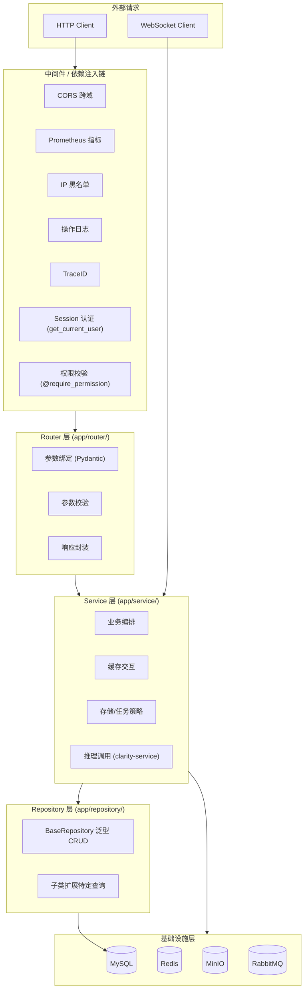

### 层级职责

| 层级            | 包路径                                          | 职责                                                                                                                                                                    |
| --------------- | ----------------------------------------------- | ----------------------------------------------------------------------------------------------------------------------------------------------------------------------- |
| 中间件/依赖注入 | `middleware/` + `dependencies/` + `decorators/` | 请求拦截、认证、鉴权、限流、防重提交、操作日志、TraceID、IP 黑名单                                                                                                      |
| Router 层       | `router/`                                       | 参数绑定与校验（Pydantic）、调用 Service、统一响应封装                                                                                                                  |
| Service 层      | `service/`                                      | 业务逻辑编排、缓存交互、存储/任务策略选择、异步任务分发                                                                                                                 |
| Repository 层   | `repository/`                                   | 数据库 CRUD 封装、分页、模糊搜索、批量操作、复杂查询                                                                                                                    |
| Models 层       | `models/`                                       | ORM 实体、Schema 定义、Enum 常量                                                                                                                                        |
| Core 层         | `core/`                                         | 统一错误码、响应封装、业务异常                                                                                                                                          |
| 基础设施层      | `infrastructure/`                               | 第三方客户端连接单例与生命周期（MySQL/Redis/Mongo/MinIO/ES/MQ）、日志、缓存、定时任务、指标采集、**AI 技术资源客户端（LLM/Embedding/语音引擎）**；不感知 FastAPI 与业务 |

### 基础设施分层规范（连接 / 注入 / 业务）

基础设施按"连接管理、依赖注入、业务服务"三层收敛，统一管理边界：

| 类别     | 位置              | 职责                                                         | 示例                                                                                                                                            |
| -------- | ----------------- | ------------------------------------------------------------ | ----------------------------------------------------------------------------------------------------------------------------------------------- |
| 连接管理 | `infrastructure/` | 第三方客户端单例与生命周期，不感知 FastAPI                   | `infrastructure/storage/minio_client.py`（`get_minio_client`/`minio_executor`）、`infrastructure/es/`（`es_client` 单例）、`infrastructure/mq/` |
| 依赖注入 | `dependencies/`   | FastAPI `Depends` 提供器，包装连接供 Router/Service 使用     | `dependencies/auth.py`、`dependencies/redis.py`、`dependencies/mongo.py`                                                                        |
| 业务服务 | `service/`        | 业务编排，通过注入或基础设施单例使用客户端，禁止自行创建连接 | `service/file_service.py`、`service/storage/`（存储策略实现）                                                                                   |

规范约束：

- 单向依赖：`service → dependencies → infrastructure`；service 可直接使用基础设施单例，但禁止在 service 中直接 `Minio(...)` 等新建第三方连接
- 客户端实例全局唯一，统一封装在 `infrastructure/` 下，供各层复用
- ES 仅在 service 层内部使用、无请求上下文依赖，采用"infrastructure 封装 + 模块级单例"模式，不经过依赖注入
- Redis/Mongo 采用"连接 + 注入一体化"（`dependencies/redis.py`、`dependencies/mongo.py`），属 FastAPI 标准实践，保持现状
- `database.py` 的引擎/会话工厂/Base 属应用级基础设施，与 `config.py` 同类放根目录；`get_db` 为依赖注入提供器
- **AI 技术资源**：LLM/Embedding/语音引擎等外部模型能力统一收敛到 `infrastructure/` 子目录（`llm/`、`embedding/`、`voice/`），service 层只做业务编排与路由决策，不直接持有协议转换、Key 轮换实现。

### 依赖注入策略

基于 FastAPI 原生依赖注入系统：

- 使用 `Depends()` 声明依赖关系，由框架自动解析
- 数据库 Session 通过 `get_db` 异步生成器注入，自动管理生命周期
- Redis 连接通过 `get_redis` 生成器注入
- 权限校验通过 `@require_permission` 装饰器实现

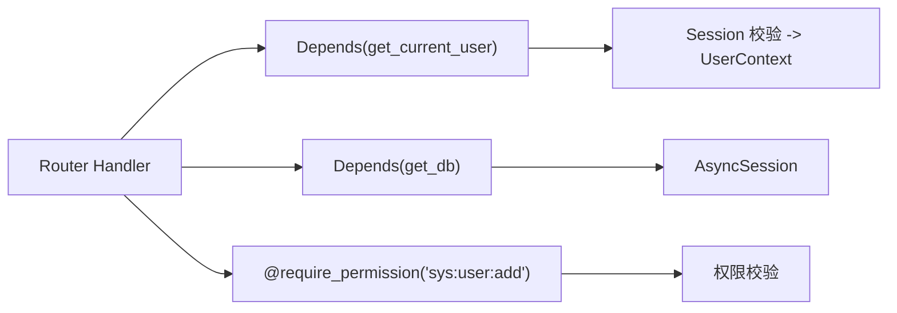

### 数据模型分层

| 模型类型 | 包路径           | 职责                                                   | 示例            |
| -------- | ---------------- | ------------------------------------------------------ | --------------- |
| Entity   | `models/entity/` | 数据库表映射，SQLAlchemy Column 定义                   | `SysUser`       |
| Schema   | `models/schema/` | API 请求/响应 Schema，Pydantic 校验 + OpenAPI 自动生成 | `UserPageQuery` |
| Enum     | `models/enum/`   | 枚举常量定义                                           | `TaskStatus`    |

## 项目目录结构

- `app/` - 主应用目录
  - `__init__.py` - 延迟导入入口
  - `main.py` - FastAPI 应用入口
  - `lifecycle.py` - Lifespan 上下文管理器
  - `config.py` - 多环境配置（Pydantic Settings）
  - `database.py` - SQLAlchemy 2.0 异步引擎 & Session 工厂
  - `core/` - 核心通用层（错误码、响应封装、异常）
  - `dependencies/` - FastAPI 依赖注入（auth、redis）
  - `decorators/` - 横切关注点装饰器（permission、rate_limit、repeat_submit）
  - `middleware/` - ASGI 中间件（trace、operation_log、ip_blacklist、non_null_response）
  - `infrastructure/` - 基础设施层（连接单例 + AI 技术资源客户端）
    - `llm/` - LLM：client/（协议工厂 + openai_compat/anthropic + langchain 适配）、call/（韧性调用 llm_client）、local/（内置数据初始化 model_seeder）
    - `provider/` - 跨模态供应商能力：model_registry（路由）、provider_key_selector（Key 轮换）、provider_health_service（健康熔断），LLM/Embedding/TTS 共用
    - `a2a/` - A2A 协议层：a2a_protocol、a2a_client、a2a_server、a2a_task_mapper，对应 router/a2a.py
    - `clients/` - 外部服务客户端：mcp_gateway_client（JSON-RPC）、web_search_client（HTTP）
    - `sandbox/` - 子进程执行沙箱：code_sandbox
    - `embedding/` - Embedding：embedding_client（端点由 sys_ai_provider.api_base_url 配置化派生，Key 走 provider/）
    - `voice/` - 语音：engine_client（内置引擎 clarity-voice 的 HTTP/WS 客户端）、provider/（默认引擎路由 + 第三方厂商适配）、seeder（播种）
    - `...` - cache（含 checkpoint_manager）、sse（含 sse_event_converter）、storage、es、mq、redis、mongo 等
  - `models/` - 数据模型（entity、schema、enum）
  - `repository/` - Repository 层（BaseRepository 泛型基类）
  - `router/` - 路由层（30+ 个业务 APIRouter + health/metrics + WebSocket）
  - `service/` - 服务层（顶层平铺单职责服务 + 按域拆分子包）
    - `ai/` - AI 对话服务，按职责分四个子包（协议、客户端实现已下沉 infrastructure）
      - `service/` - 业务编排层：推理主链路（reasoning_service）+ 领域服务（21 个模块）
      - `builders/` - 图、工具、上下文构建（deep_agent_builder/team_builder 等 5 个）
      - `middleware/` - 推理链横切：hooks、护栏、工具恢复、中断点管理（10 个）
      - `strategies/` - 策略、规则、模板（complexity/quota_recall/prompt 等 5 个）
    - `order/` - 订单域：order_service（核心 + 共享工具）、payment、refund、auto_renew 四子域
    - `member/` - 会员域：member_service（档案 + 共享工具）、growth、benefit、quota、expiry 五子域
    - `images/` - 图像任务域：image_task_service（编排）、cache、image_source、model_executor、result_storage、interceptor 链
    - `task/` - 任务域：task_service（生命周期）、task_state（状态维护）、task_executor（执行）、task_consumer（MQ 消费）、strategy+factory（策略）
  - `utils/` - 工具层（password、file、datetime、tree 等）
- `tests/` - 测试
- `pyproject.toml` - 项目依赖（uv 管理）
- `Dockerfile` - 业务后端容器化（不含 GPU/推理依赖）
- `logs/` - 运行时日志目录

## 核心模块

### 业务模块概览

Python 端实现与 Java/Go 对等的完整业务层，按领域分组如下（各模块的需求规格、API 契约与实现见 `03-模块设计` 分区）：

| 领域           | 覆盖模块                                                                     |
| -------------- | ---------------------------------------------------------------------------- |
| 认证授权       | 登录/登出、Session、API Key、验证码                                          |
| 系统管理       | 用户、角色、部门、菜单、字典                                                 |
| 去雾业务       | 图像输入、图像模型选择、图像任务、效果对比、评估指标、任务、收藏、预设、推荐 |
| 数据与模型管理 | 数据集、数据项、AI 模型管理（全模态，含图像/语音）、导入导出                 |
| 商业化         | 会员、订单、套餐、优惠券、支付、退款、通知设置                               |
| 消息通知       | 站内消息、消息模板、公告、反馈、WebSocket 推送                               |
| 文件与运维     | 文件管理、健康检查、监控指标、客户端日志                                     |

### 图像模型模块（外置 clarity-modal）

去雾、去雨、超分等图像模型（30 种）的模型结构与权重加载已外置至 `clarity-service/clarity-modal`（`algorithm/` 目录平铺，统一以 `run.py` 为入口、由 `model_loader.py` 加载）；模型清单技术事实源为该服务的 `/v1/models` 目录扫描，编排侧按 `model` 经 `OpenAiImageAdapter` 调用 `POST /v1/images/edits`，不再持有 `algorithm/` 目录与 `importPath` 配置。各模型的结构与论文依据详见[算法/学术论文文档](../算法/学术论文文档.md)。

### 图像任务管线

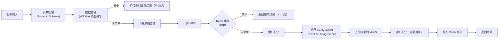

**模型调用**：图像推理经统一模型路由（`model_registry`）由 `OpenAiImageAdapter` 调用 `clarity-service/clarity-modal` 的 `POST /v1/images/edits`（OpenAI Images 兼容，同步返回 b64_json），编排侧零 GPU/PyTorch 依赖；模型标识即 `model_id`，权重由服务端目录解析。

**后台任务追踪**：图像任务（`image_task_service`）、评估（`evaluation_service`）、对比（`compare_service`）、A2A 推理（`infrastructure/a2a/a2a_server`）四个服务在提交 `asyncio.create_task` 后台任务后，均注册到 `TaskTracker`（`task_id` 形如 `image:{log_id}` / `eval:{log_id}` / `compare:{task_id}`，A2A 直接复用其全局唯一 taskId），与导出/下载任务统一纳入优雅关闭与全局任务视图。注册失败不影响主流程（降级为日志告警），与 `task_service` 行为一致。`TaskTracker.initiate_shutdown()` 在 30s 超时窗口内等待这些任务完成，避免 Worker 崩溃或重启时结果文件半写入。

### 图像任务流程插件化（拦截器链）

图像任务主流程通过责任链模式支持可插拔拦截器：

| 组件                          | 职责                                                                         |
| ----------------------------- | ---------------------------------------------------------------------------- |
| `PredictionContext`           | 请求上下文（model/file_id/image_url/origin_file/params）                     |
| `InterceptedResult`           | 拦截命中后返回的结果                                                         |
| `PredictionInterceptor` (ABC) | 拦截器抽象基类                                                               |
| `PredictionInterceptorChain`  | 责任链：按注册顺序执行，第一个命中即短路                                     |
| `WpxNetPredictionInterceptor` | WPXNet 预查询：按模型标识 `wpxnet-` 前缀识别，通过 `sys_wpx_file` 表查表短路 |

WPXNet 预查询命中后直接返回结果，跳过模型推理（经 `OpenAiImageAdapter` 调用 clarity-modal），响应时延从秒级降至毫秒级，且不计费。

### 存储抽象层

策略模式适配多存储后端：

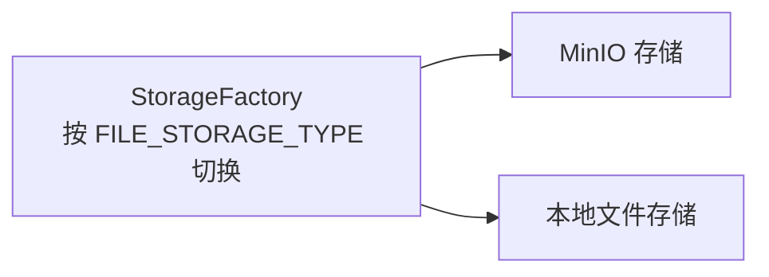

`sys_file` 表只存 `object_name` + `storage`，URL 运行时拼接不落库。

### 通用导入导出

Handler 模式 + 通用策略实现：

| 模块       | ExportHandler        | ImportHandler      |
| ---------- | -------------------- | ------------------ |
| 用户管理   | UserExportHandler    | UserImportHandler  |
| 角色管理   | RoleExportHandler    | RoleImportHandler  |
| 部门管理   | DeptExportHandler    | DeptImportHandler  |
| 菜单管理   | MenuExportHandler    | MenuImportHandler  |
| 字典管理   | DictExportHandler    | DictImportHandler  |
| 数据集管理 | DatasetExportHandler | -（仅导出）        |
| 图像模型   | ModelExportHandler   | ModelImportHandler |

### 消息队列

采用 MQ 优先 + asyncio.Task fallback 双通道架构：

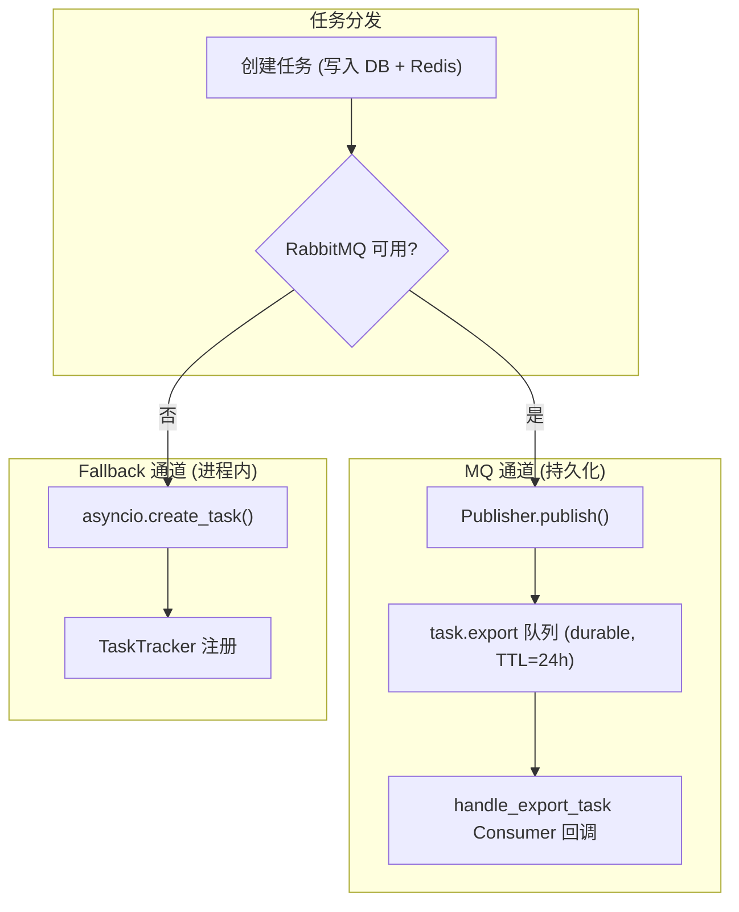

与 Java/Go 端共享 `clarity.tasks` (direct exchange) 交换机。

### 图像特征分析（确定性派生，非推理能力）

为推荐管理模块的 `POST /api/v1/recommendations/analyze` 产出 7 维特征，**实现是零模型的确定性派生**（`recommendation_service.analyze`）：以图像 URL 的 MD5 为种子，对各维合法取值集合取模选择——

| 维度                                                                       | 派生方式                                              |
| -------------------------------------------------------------------------- | ----------------------------------------------------- |
| 图像标识 imageMd5                                                          | 图像 URL 的 MD5（同时作为派生种子）                   |
| 雾霾浓度、场景类型、光照条件、图像复杂度、颜色分布、分辨率、噪声水平       | 以 MD5 整数为种子取模，从各维合法取值集合中确定性选取 |

- **不读取图像内容、不加载任何模型、不占 GPU**：同一 URL 的特征跨进程、跨重启稳定；因此该能力不属 AI 推理，也不随推理能力服务拆分外置（[AI 能力链路协作设计](../../02-系统架构/09-AI能力链路协作设计.md)）。
- **三端口径**：Java 端经图像服务 HTTP 客户端调用本端点；Go 端在 `pkg/algorithm/analysis.go` 本地复刻同一算法（与编排侧逐位对齐，不经该端点以规避用户态鉴权约束）；Python 端即本实现。

### 评估指标计算服务

为效果对比模块提供去雾效果量化评估能力，计算 5 项专业指标：

| 指标    | 说明           | 合格阈值  | 实现方式                        |
| ------- | -------------- | --------- | ------------------------------- |
| PSNR    | 峰值信噪比     | ≥ 30.0 dB | 像素级 MSE -> 峰值比            |
| SSIM    | 结构相似性     | ≥ 0.8     | 窗口滑动 + 亮度、对比度、结构三项 |
| LPIPS   | 学习感知相似度 | ≤ 0.3     | 预训练 VGG/AlexNet 特征距离     |
| NIQE    | 自然图像质量   | ≤ 5.0     | 统计模型 + MVN 距离             |
| Entropy | 信息熵         | 统计展示  | 灰度直方图 Shannon 熵           |

评估结果按 `{model}:{predMd5}:{refMd5}` 永久缓存，相同图片+相同模型的评估请求命中缓存直接返回。指标的计算执行已外置 `clarity-service/clarity-modal`（`POST /v1/metrics`，字节进字节出、逐指标隔离失败），本服务负责编排、状态机与缓存（指标元数据取自其 `/v1/models`）。评估为平台**免费**能力，不计费。Java/Go 后端经图像服务 HTTP 客户端委托调用此服务。

### 推荐生成完整管线

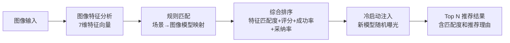

推荐引擎的规则匹配和排序逻辑在 Java/Go 后端实现，Python 端仅负责图像特征向量提取。Python 端的特征分析服务作为推荐管线的第一环节，其输出直接决定推荐候选集。

### AI 模型基础设施

LLM / Embedding / TTS / ASR 等模型能力统一作为**基础设施**管理，与业务编排解耦。核心原则：`infrastructure` 回答"如何与外部技术资源对话"（协议转换、Key 轮换），`service` 回答"业务上该用哪个模型、失败如何降级"（路由决策）。

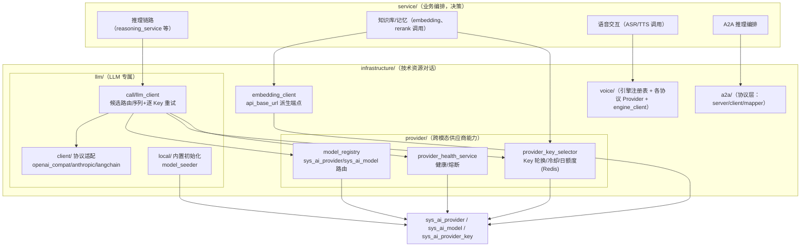

**关键组件与职责**：

| 组件                         | 位置                                                                     | 职责                                                                                                                                                                                                                                                                                                                                                                                                                                                                                                                                                                                                                                              |
| ---------------------------- | ------------------------------------------------------------------------ | ------------------------------------------------------------------------------------------------------------------------------------------------------------------------------------------------------------------------------------------------------------------------------------------------------------------------------------------------------------------------------------------------------------------------------------------------------------------------------------------------------------------------------------------------------------------------------------------------------------------------------------------------- |
| 统一模型客户端接口           | `infrastructure/llm/client/model_client.py`                              | `LlmStreamChunk`、鉴权头、`create_chat_client(protocol_type)` 按 `sys_ai_provider.protocol_type`（openai_compat / anthropic）工厂分发，屏蔽协议差异                                                                                                                                                                                                                                                                                                                                                                                                                                                                                               |
| OpenAI 兼容客户端            | `infrastructure/llm/client/openai_compat_client.py`                      | SSE 流式、tool_call 聚合、reasoning_content 思考流                                                                                                                                                                                                                                                                                                                                                                                                                                                                                                                                                                                                |
| Anthropic 客户端             | `infrastructure/llm/client/anthropic_client.py`                          | tool_use 三段式聚合、Prompt Caching、thinking 流                                                                                                                                                                                                                                                                                                                                                                                                                                                                                                                                                                                                  |
| langchain 模型适配           | `infrastructure/llm/client/dehaze_chat_model.py`                         | langchain `BaseChatModel` 适配（deepagents/langgraph 图使用的对话模型）                                                                                                                                                                                                                                                                                                                                                                                                                                                                                                                                                                           |
| 韧性调用编排                 | `infrastructure/llm/call/llm_client.py`                                  | 统一对外入口：候选路由序列 + 逐 Key 重试 + 降级链调度，屏蔽供应商、Key 失败细节                                                                                                                                                                                                                                                                                                                                                                                                                                                                                                                                                                    |
| 模型路由注册表               | `infrastructure/provider/model_registry.py`                              | `get_call_routes` 按 `sys_ai_model` 能力与状态解析降级链候选路由（能力不足时剔除并短路），路由决策完全由数据库配置驱动                                                                                                                                                                                                                                                                                                                                                                                                                                                                                                                            |
| Key 选择器                   | `infrastructure/provider/provider_key_selector.py`                       | 从 `sys_ai_provider_key` 按优先级、权重、冷却、连续失败、日额度选取 Key（Redis 状态），调用后回写成功/失败                                                                                                                                                                                                                                                                                                                                                                                                                                                                                                                                          |
| 供应商健康服务               | `infrastructure/provider/provider_health_service.py`                     | 供应商、Key 维度健康统计与熔断；`model_registry`/`provider_key_selector` 为 LLM/Embedding/TTS 跨模态共用的供应商能力，故上提至独立子包                                                                                                                                                                                                                                                                                                                                                                                                                                                                                                             |
| 内置数据初始化器             | `infrastructure/llm/local/model_seeder.py`                               | 幂等初始化 local / local-voice / local-modal provider、服务密钥、内置模型（qwen3-0.6b 对话 + qwen3-embedding-0.6b 向量 + qwen3-reranker-0.6b 重排登记）与非 token 价格；由显式命令 `python -m app.cli init-builtin` 调用，**进程启动不执行**（`lifecycle.py` 不播种）                                                                                                                                                                                                                                                                                                                                                                             |
| Embedding 客户端             | `infrastructure/embedding/embedding_client.py` + `embedding_dispatch.py` | 向量化/维度查询；端点与报文经协议分派层按 provider `protocol_type` 选适配器（`openai_compat` → `api_base_url + /embeddings`，`cohere` → `/v1/embed`），未知协议回落 `openai_compat`，新增供应商零代码；Key 选择走 `provider/provider_key_selector`                                                                                                                                                                                                                                                                                                                                                                                                |
| 推理服务调用（无子进程管理） | `infrastructure/llm/local/` 仅剩 `model_seeder.py`                       | 对话、向量、重排推理经 HTTP 调用 `clarity-service/clarity-llm`（OpenAI 兼容，`LOCAL_LLM_BASE_URL` 默认 `http://127.0.0.1:8992`，`Authorization: Bearer ${INTERNAL_SERVICE_KEY}`）；拉起、预下载、回收由 `scripts/run.py` 与服务自身承担                                                                                                                                                                                                                                                                                                                                                   |
| A2A 协议层                   | `infrastructure/a2a/`                                                    | `a2a_protocol`（协议对象）+ `a2a_client`（客户端）+ `a2a_server`（服务端）+ `a2a_task_mapper`（协议对象 ↔ clarity 对象映射），对应 `router/a2a.py`                                                                                                                                                                                                                                                                                                                                                                                                                                                                                                 |
| 外部服务客户端               | `infrastructure/clients/`                                                | `mcp_gateway_client`（MCP 网关 JSON-RPC）、`web_search_client`（Web 搜索 HTTP）                                                                                                                                                                                                                                                                                                                                                                                                                                                                                                                                                                   |
| 代码执行沙箱                 | `infrastructure/sandbox/code_sandbox.py`                                 | 子进程隔离执行用户代码，结果回传                                                                                                                                                                                                                                                                                                                                                                                                                                                                                                                                                                                                                  |
| 检查点管理器                 | `infrastructure/cache/checkpoint_manager.py`                             | langgraph RedisSaver 适配（推理图状态持久化/恢复）                                                                                                                                                                                                                                                                                                                                                                                                                                                                                                                                                                                                |
| SSE 事件转换器               | `infrastructure/sse/sse_event_converter.py`                              | 内部推理事件 → OpenAI/Anthropic SSE 协议格式转换                                                                                                                                                                                                                                                                                                                                                                                                                                                                                                                                                                                                  |
| 语音模型路由                 | `infrastructure/llm/client/openai_audio_client.py`                       | ASR、TTS 统一纳入 AI 模型管理（`sys_ai_model` 中 `model_type=asr/tts`）：`resolve_voice_model` 解析模型 → `model_registry.get_call_routes` 取供应商路由 → 语音分派层（`audio_dispatch`）按供应商 `protocol_type` 选择适配器（`openai_audio` / `dashscope_realtime` / `volc_realtime`）调用 `/v1/audio/transcriptions`、`/v1/audio/speech`（本地 `local-voice` 供应商指向外置服务 `clarity-service/clarity-voice`，`VOICE_ENGINE_BASE_URL` 供 `init-builtin` 首次写入其地址）；流式 ASR 经各协议族 WS（`local-voice` 私有扩展 `/v1/asr/stream`）；编排侧无进程内推理 |

**配置化路由与内置数据初始化边界**：

- 第三方供应商（qwen、openai、anthropic 等）：管理接口写入 `sys_ai_provider`/`sys_ai_model`/`sys_ai_provider_key`，运行时直接生效，切换、升级、新增供应商无需改代码
- 内置模型：`model_seeder` 由显式命令 `python -m app.cli init-builtin` 幂等初始化 local / local-voice / local-modal provider、服务密钥（明文 = `INTERNAL_SERVICE_KEY`）与内置模型（qwen3-0.6b 与 qwen3-embedding-0.6b，前者 `model_type=chat` 状态启用，后者 `model_type=embedding` 供知识库创建向导选择；对话模型列表按 `model_type=chat` 过滤自然排除；qwen3-reranker-0.6b 登记为 `model_type=rerank`）；权威源为 DB 种子数据（`config/sql/data/`），进程启动不写库；推理经 HTTP 调用外置服务 `clarity-service/clarity-llm`
- Embedding/Rerank 端点统一由 `sys_ai_provider.api_base_url` 派生（OpenAI 兼容 `/embeddings`、`/rerank`），与对话客户端共用同一供应商配置，不再维护独立的硬编码端点表

## 配置管理

| 组件     | 选型                      | 说明                             |
| -------- | ------------------------- | -------------------------------- |
| 配置框架 | Pydantic Settings v2      | 类型安全、自动校验、环境变量绑定 |
| 环境变量 | `.env` 文件 + `os.getenv` | 敏感信息外部化                   |
| 配置切换 | `APP_ENV` 环境变量        | 决定加载哪个配置类               |

多环境支持：

| 环境 | 配置类                | 特性差异                                         |
| ---- | --------------------- | ------------------------------------------------ |
| 开发 | `DevelopmentSettings` | DEBUG=True，Session Cookie 关闭 Secure           |
| 测试 | `TestingSettings`     | DEBUG=True，独立测试数据库 `clarity_test`         |
| 生产 | `ProductionSettings`  | 强制校验密码非空、CORS 禁止 localhost，JSON 日志 |

敏感信息按基础设施分区独立配置（`MYSQL_*`、`REDIS_*`、`ES_*` 等，见根目录 `.env`），连接串通过 `@property` 自动拼接。

## 安全认证

| 组件         | 实现                          | 说明                            |
| ------------ | ----------------------------- | ------------------------------- |
| Session 认证 | Redis `session:{sessionId}`   | TTL 7 天，剩余 < 24h 自动续期   |
| 用户上下文   | `Depends(get_current_user)`   | 自动解析 Session -> UserContext |
| 密码加密     | bcrypt（`utils/password.py`） | 专用线程池异步执行              |
| 验证码       | Redis 存储 + Pillow 生成      | 可配置长度、尺寸、字体、干扰线     |

权限校验通过 `require_permission` 装饰器实现，支持通配符匹配（`sys:user:*` 匹配 `sys:user:add`），ROOT 用户自动跳过校验。

安全防护：

| 防护类型   | 实现方式                                                                                                                                                 |
| ---------- | -------------------------------------------------------------------------------------------------------------------------------------------------------- |
| SQL 注入   | SQLAlchemy 参数化查询                                                                                                                                    |
| XSS        | `validate_no_xss` 输入校验（Pydantic Schema 层 + Service 层双重校验）                                                                                    |
| CSRF       | Session Cookie（SameSite=Lax）                                                                                                                           |
| CORS       | CORSMiddleware                                                                                                                                           |
| 暴力破解   | 验证码 + IP 黑名单自动封禁                                                                                                                               |
| 限流       | RateLimitMiddleware（Redis 固定窗口）                                                                                                                    |
| 防重复提交 | AntiRepeatMiddleware（ASGI 中间件，基于 user_id+method+uri+body_hash，Redis SET NX EX，默认 5 秒；排除文件上传、数据集、数据项等已有自身幂等机制的写接口） |

### 行级数据权限（DataScope）

与 Java（MyBatis-Plus `DataPermissionInterceptor`）、Go（GORM `dataScopeCallback`）对齐，Python 端基于 SQLAlchemy 2.0 异步 ORM 实现**显式过滤**方案：在需要数据权限的 Repository 查询中显式调用 `apply_data_scope(stmt, user, db, dept_field=..., creator_field=...)` 按当前用户 `data_scope` 追加 `WHERE` 条件。未采用 SQLAlchemy event 自动改写，因异步 Session 下 event 回调难以可靠获取当前请求的用户上下文（ContextVar 在 event 回调中不可靠）。

**data_scope 取值与过滤行为**（与 `sys_role.data_scope` 注释、Go `DataScope*` 常量一致）：

|     取值     | 含义         | 过滤条件                                                                                     |
| :----------: | ------------ | -------------------------------------------------------------------------------------------- |
| `NULL` / `0` | 全部数据     | 原样返回（ROOT 用户始终跳过过滤）                                                            |
|     `1`      | 部门及子部门 | `WHERE dept_field IN (本部门及子部门ID)`，子部门ID由 `dept_repository.get_children_ids` 查询 |
|     `2`      | 本部门       | `WHERE dept_field == user.dept_id`；用户无部门时返回空集                                     |
|     `3`      | 本人         | `WHERE creator_field == user.id`                                                             |

**调用约定**：

- Repository 查询方法新增 `current_user` 参数，由 Service 层从 `Depends(get_current_user)` 获取并透传
- `dept_field` 指向业务表的部门字段（如 `SysUser.dept_id`）；无部门字段的表（如订单、反馈）通过 JOIN `sys_user` 取 `dept_id` 实现"本部门"过滤，"本人"过滤使用 `creator_field`（如 `SysOrder.user_id`）
- 未知 `data_scope` 取值保守返回空集（`WHERE false()`）

**接入的查询清单**：用户分页（`user_repository.get_page`）、订单分页（`order_repository.get_page`）、部门列表与下拉选项（`dept_repository.get_dept_list` / `get_dept_options_tree`，`dept_field` 传主键 `SysDept.id`，对齐 Java `@DataPermission(deptIdColumnName="id")` 与 Go `sys_dept.DeptField="id"`）。部门下拉选项缓存仅对全量视图（ROOT / 全部数据权限）生效，行级过滤结果因人而异、不读写缓存。新增业务查询如涉及多租户可见性，须按同样方式接入 `apply_data_scope`。

## 数据访问层

| 组件        | 选型                              | 说明                                                             |
| ----------- | --------------------------------- | ---------------------------------------------------------------- |
| ORM         | SQLAlchemy 2.0 + 异步模式         | 声明式模型、AsyncSession                                         |
| 数据库驱动  | aiomysql（异步）+ PyMySQL（同步） | 异步为主，同步用于测试库重建（config/sql 脚本导入）              |
| Schema 管理 | config/sql 全量脚本               | 三端共享的 schema 事实来源；测试库由 tests/conftest 每次全量重建 |
| 文档数据库  | Motor（MongoDB 异步）             | 登录审计、业务操作审计（白名单驱动）                             |
| 对象存储    | MinIO Python SDK                  | 文件/图像存储                                                    |

事务边界 = 请求边界，由 `DBSessionMiddleware`（纯 ASGI 中间件，拦截 `http.response.start`）统一执行：响应发送前 commit，异常或标记回滚时 rollback（`get_db()` 仅返回 `request.state.db`，不管理提交）；非请求场景（后台任务、消息消费者）用 `get_db_session()` 上下文管理器，事务边界 = `with` 块边界。

| 提交后回调机制                                      | 说明                                                                                                                                                                                                         |
| --------------------------------------------------- | ------------------------------------------------------------------------------------------------------------------------------------------------------------------------------------------------------------ |
| `defer_after_commit` / `run_after_commit_callbacks` | 「必须基于已提交数据/提交成功后才生效」的副作用（缓存失效、ES 读模型同步、会话踢出、审计落库）统一登记到 session，由提交方在 commit 成功后、响应发出前执行；rollback 自动丢弃；单条失败记 warning 不阻塞后续 |
| `defer_conversation_sync`                           | 会话写操作（创建、改标题、归档、软删、恢复）登记会话 ES 读模型同步，复用上述提交后回调                                                                                                                       |

**约束**：Router 层持有事务边界，Service 层只编排不 commit，Repository 层只 flush；跨多 Repository 的原子提交须由同一 handler 内的单一 Session 包裹；Service 层内联新开 session 会读到当前事务未提交的数据，不得为之；亦不得跨请求持有 Session。

Repository 层引入泛型 `BaseRepository[T]`，提供标准 CRUD 操作，子类只需声明 `model` 类型即可继承全部能力。

审计字段自动填充通过 SQLAlchemy event 事件机制 + ContextVar 实现：`before_insert` 填充 `create_time`/`update_time`/`create_by`/`update_by`，`before_update` 填充 `update_time`/`update_by`。只追加日志、流水、历史表（如 `sys_ai_credit_log`、`sys_ai_agent_thought`）继承 `AppendOnlyModel` 基类，仅自动填充 `create_time`，操作人语义由业务字段表达（`operator_id`/`auditor_id`）。

存储分工：

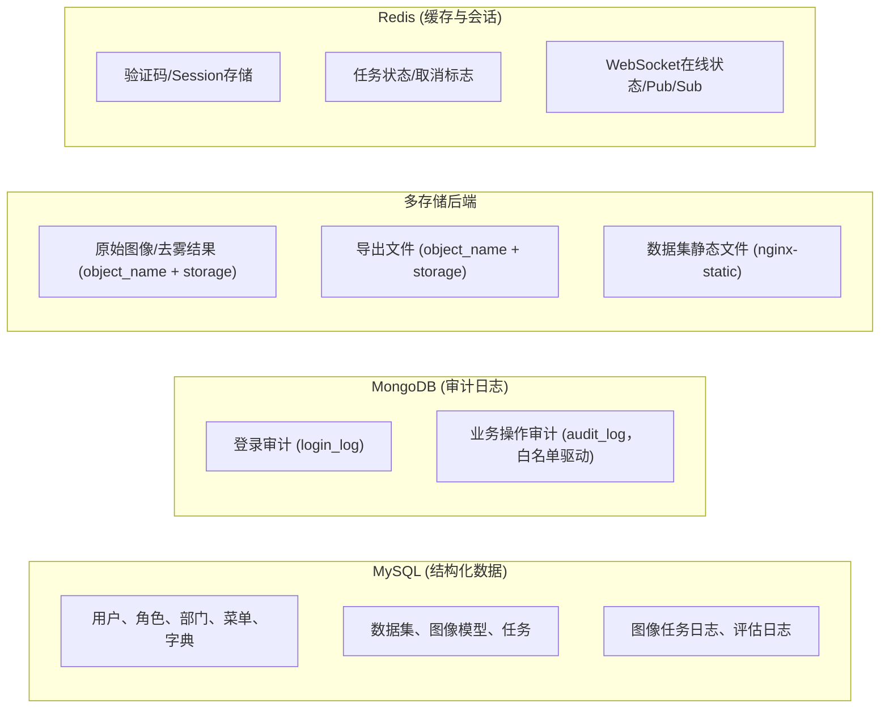

## 缓存体系

Redis 异步客户端作为缓存层，连接池管理：

| 参数                  | 默认值 | 说明         |
| --------------------- | ------ | ------------ |
| max_connections       | 100    | 最大连接数   |
| socket_timeout        | 5.0s   | 操作超时     |
| health_check_interval | 30s    | 健康检查间隔 |

Redis 弹性机制：

| 机制        | 说明                                                          |
| ----------- | ------------------------------------------------------------- |
| 优雅降级    | `redis_operation_with_fallback()` Redis 不可用时执行 fallback |
| L1 本地缓存 | `local_cache.py`（TTLCache + SingleFlight）降低 Redis 压力    |

按 pattern 批量失效（`delete_pattern` 及服务内 `scan_iter`）必须显式指定 `count=1000`：SCAN 默认 COUNT=10，远程 Redis 下按 10 key/次往返会把一次失效放大成上百次 RTT。

## 定时任务

通过 pyxxl (XXL-Job Python 执行器) 与 Java/Go 端共享调度中心，handler 命名与 Java/Go 端对齐（`autoRenew`/`grantVipMonthlyGift` 等三端统一）：

执行器配置（`app/infrastructure/job/executor.py`）与 Java/Go 同口径：注册名 `xxl-job-executor-clarity-python`、端口 `9998`（同机与 Java 9999、Go 9997 互异）；注册地址取 `XXLJOB_EXECUTOR_IP`（`scripts/run.py` 在 `host.docker.internal` 可解析时注入该域名，admin 在容器时才能回调到宿主）；显式声明注册地址时同时绑 `0.0.0.0`，未声明时由 pyxxl 以首个网卡 IP 绑定并注册。

| 任务名                       | 功能                                                             | 归属        |
| ---------------------------- | ---------------------------------------------------------------- | ----------- |
| `cleanupExpiredTasks`        | 删除过期任务，清理 Redis 缓存                                    | 三端共有    |
| `cleanupStuckTasks`          | 将超过 30min 的 processing、24h 的 pending 异常任务标记为 failed | 三端共有    |
| `cleanupStuckPredEvalLogs`   | 回收图像任务、评估僵尸任务（超 10min 未更新）                     | 三端共有    |
| `expireOrders`               | 待支付订单超时自动取消，释放锁定优惠券                           | 三端共有    |
| `completeExpiredOrders`      | 已支付订单到期归档                                               | 三端共有    |
| `expireUserCoupons`          | 用户优惠券过期失效                                               | 三端共有    |
| `retryFailedRefunds`         | 退款失败记录重试（上限 3 次）                                    | 三端共有    |
| `autoRenew`                  | 自动续费扣款（balance/wechat/alipay）                            | 三端共有    |
| `grantVipMonthlyGift`        | 每月 1 日按等级发放月度赠送积分                                  | 三端共有    |
| `processExpiredMembers`      | 会员过期降级（按成长值重算等级）                                 | 三端共有    |
| `sendExpireReminders`        | 会员到期前 7/3/1 天推送续费提醒                                  | 三端共有    |
| `sendScheduledAnnouncements` | 发送定时公告                                                     | 三端共有    |
| `cleanupExpiredMessages`     | 清理过期消息（分批 500 条）                                      | 三端共有    |
| `refreshUnreadCountCache`    | 未读数缓存全量刷新                                               | 三端共有    |
| `modelHealthCheck`           | 检查 `clarity-modal` 可用性、GPU 显存使用率、DB/Redis 连接        | Python 专属 |
| `cleanupOrphanFiles`         | 清理 MinIO 中无数据库记录关联的孤儿文件                          | Python 专属 |
| `cleanupTempFiles`           | 清理临时目录中过期的临时文件                                     | Python 专属 |

共 17 个 handler（14 个三端共有 + 3 个 Python 专属运维任务）。Java 独有的 `processDelayedPush`（DND 免打扰延迟推送）Python 端未实现，属独立架构差异（Java 端绑定 `MessagePushDispatcher` + `PushChannel` 的 DND 延迟推送架构，Go/Python 仅简单 WebSocket 推送）。

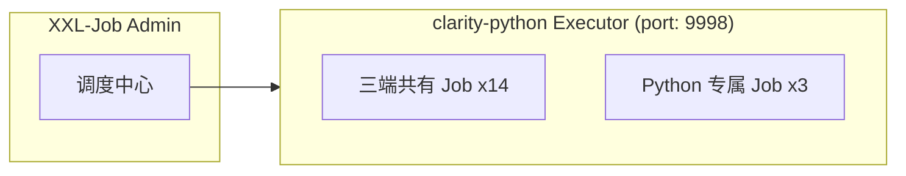

## WebSocket 实时通信

基于 FastAPI 原生 WebSocket 实现，通过 Redis Pub/Sub 实现跨 Worker 通信：

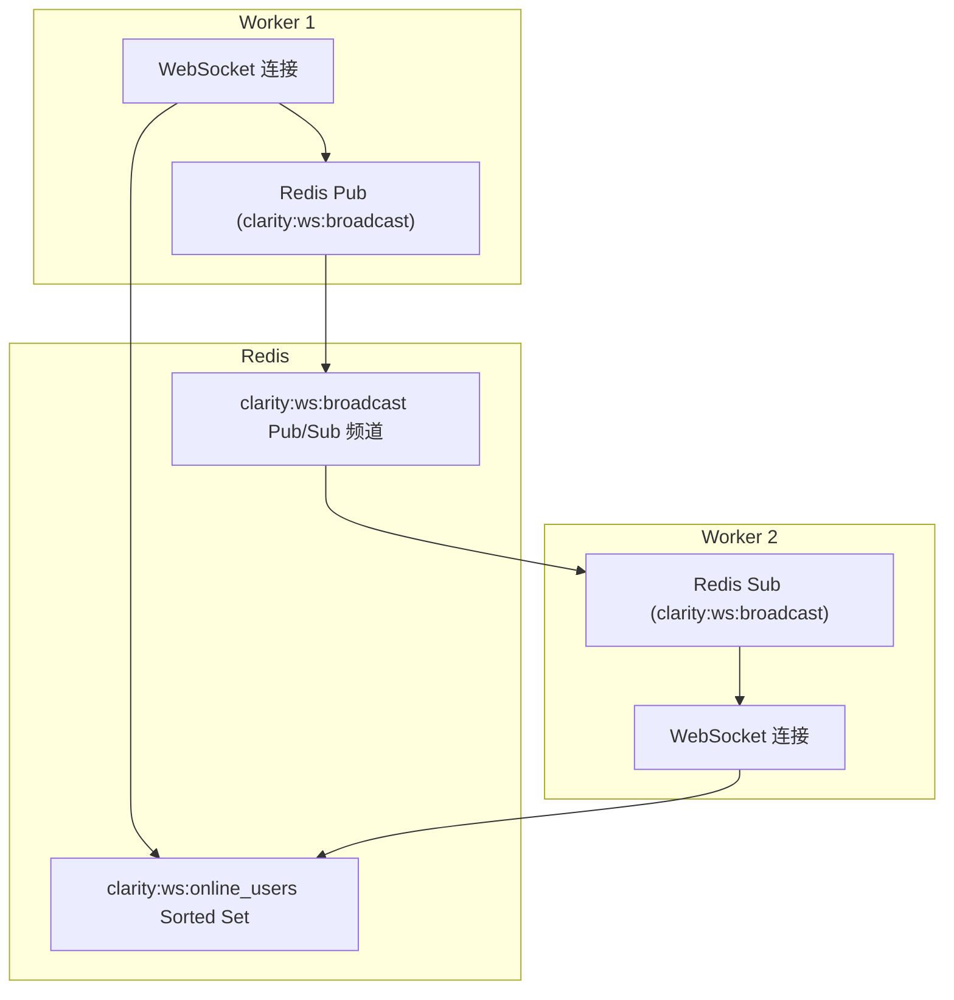

## 应用生命周期

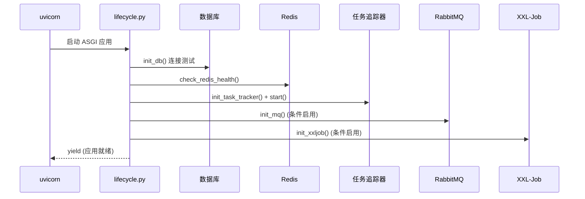

优雅关闭：TaskTracker 拒绝新任务 -> WebSocket 通知客户端 -> 等待运行中任务完成（30s 超时）-> 关闭 XXL-Job/RabbitMQ -> 关闭 Redis/数据库连接池。

本地开发统一通过项目根目录 `scripts/run.py` 管理三端后端的生命周期。

## 统一响应与错误处理

错误码采用 5 位字符串编码，与 Java/Go 端保持一致：

| 前缀 | 类别           | 示例                                                         |
| ---- | -------------- | ------------------------------------------------------------ |
| `00` | 成功           | `00000` - 一切 ok                                            |
| `A0` | 用户端错误     | `A0001` - 用户端错误，`A0200` - 登录异常，`A0400` - 参数错误 |
| `B0` | 系统执行错误   | `B0001` - 系统执行出错，`B0210` - 并发限流                   |
| `C0` | 第三方服务错误 | `C0001` - 调用第三方服务出错，`C0300` - 数据库服务出错       |

通过 `register_exception_handlers(app)` 注册全局异常处理器，统一拦截 BusinessException、RequestValidationError、Session 无效、SQLAlchemyError 等异常。

## 三端对照

| 基础设施能力 | clarity-python                             | clarity-java                                  | clarity-go                    | 一致性                       |
| ------------ | ----------------------------------------- | -------------------------------------------- | ---------------------------- | ---------------------------- |
| HTTP 框架    | FastAPI (uvicorn)                         | Spring MVC (Tomcat)                          | Gin                          | 接口语义一致                 |
| ORM          | SQLAlchemy 2.0 (异步)                     | MyBatis-Plus                                 | GORM                         | 功能对等                     |
| 缓存         | Redis + local_cache L1                    | Spring Cache + 多级 (Caffeine L1 + Redis L2) | 多级缓存 (gkit L1 + Redis)   | 多级缓存对齐                 |
| 消息队列     | aio-pika RabbitMQ (MQ优先+fallback)       | RabbitMQ                                     | RabbitMQ                     | 共享 Exchange/Queue          |
| 定时任务     | pyxxl XXL-Job (17 个任务)                 | @XxlJob (15 个)                              | XXL-Job (14 个)              | 共享 Admin，handler 命名统一 |
| 日志         | Python logging + JSON                     | Logback                                      | Zap                          | 格式/级别统一                |
| 认证         | Redis Session                             | Spring Security + Session                    | 自研中间件 + Session         | Session 机制互通             |
| 权限         | RBAC (Depends + @require_permission)      | RBAC (@PreAuthorize)                         | RBAC (中间件)                | 权限标识一致                 |
| 错误码       | 5 位字符串 (A0/B0/C0)                     | 5 位字符串 (A0/B0/C0)                        | 5 位字符串 (A0/B0/C0)        | 完全一致                     |
| 响应格式     | `{code, msg, data, traceId}`              | `{code, msg, data, traceId}`                 | `{code, msg, data, traceId}` | 完全一致                     |
| WebSocket    | FastAPI 原生 + Redis Pub/Sub              | STOMP + SockJS                               | -                            | Python 跨 Worker 支持        |
| 对象存储     | 多存储后端抽象 (minio/local/nginx-static) | MinIO / 阿里云 OSS                           | 通过 API                     | 三端统一 StorageService 抽象 |
| 限流/防重    | 装饰器 (Redis 计数)                       | 注解 + Redis                                 | 中间件                       | 功能对等                     |
| IP 黑名单    | 中间件自动封禁                            | 中间件                                       | 中间件                       | 三端对齐                     |

## 技术栈总览

| 分类        | 技术                                   | 用途                                            |
| ----------- | -------------------------------------- | ----------------------------------------------- |
| 语言        | Python >= 3.10                         | 后端开发与 AI 编排                              |
| Web 框架    | FastAPI >= 0.115                       | ASGI 异步 HTTP 路由、中间件、WebSocket          |
| ASGI 服务器 | uvicorn >= 0.32                        | 高性能异步服务器                                |
| ORM         | SQLAlchemy >= 2.0                      | 异步 ORM，声明式模型                            |
| 文档数据库  | Motor (MongoDB) >= 3.6                 | 异步 MongoDB 客户端，登录/操作审计日志          |
| 缓存        | redis-py (asyncio) >= 6.4              | 异步 Redis 客户端                               |
| 对象存储    | MinIO Python SDK >= 7.2                | 文件/图像存储                                   |
| 消息队列    | aio-pika (RabbitMQ) >= 9.4             | 异步任务分发（MQ 优先 + asyncio.Task fallback） |
| 定时任务    | pyxxl (XXL-Job) >= 0.4                 | 分布式定时任务调度                              |
| 配置管理    | pydantic-settings >= 2.0               | 环境变量绑定、多环境配置                        |
| 监控        | prometheus-client + starlette-exporter | Prometheus 指标采集                             |
| 容器        | Docker                                 | 业务后端容器化（无 GPU 依赖）                   |
| 包管理      | uv                                     | 快速 Python 包管理器                            |
| 测试        | pytest + pytest-asyncio >= 8.0         | 异步单元/集成测试                               |

## 关键技术决策

| 决策                     | 选择                                                          | 理由                                                                                                                                                                   |
| ------------------------ | ------------------------------------------------------------- | ---------------------------------------------------------------------------------------------------------------------------------------------------------------------- |
| Web 框架                 | FastAPI                                                       | ASGI 异步框架，原生 async/await，自动 OpenAPI 文档                                                                                                                     |
| AI 推理                  | HTTP 外置（clarity-modal/clarity-voice/clarity-llm）             | 编排侧零 GPU/PyTorch 依赖，图像模型与 ASR/TTS 由 clarity-service/* 承担                                                                                                 |
| 图像任务流程             | 责任链模式（拦截器链）                                        | 可插拔预查询/缓存，不修改主流程                                                                                                                                        |
| 任务分发                 | MQ 优先 + asyncio.Task fallback                               | RabbitMQ 持久化保证 + 进程内降级兜底                                                                                                                                   |
| 存储                     | 策略模式适配多后端                                            | minio/local/nginx-static 统一抽象                                                                                                                                      |
| ORM                      | SQLAlchemy 2.0 异步                                           | 与 FastAPI 异步模型一致                                                                                                                                                |
| 配置                     | Pydantic Settings v2                                          | 类型安全，启动期校验，派生地址自动计算                                                                                                                                 |
| 定时任务                 | XXL-Job (pyxxl)                                               | 与 Java/Go 端共享调度中心                                                                                                                                              |
| WebSocket                | 原生 WebSocket + Redis Pub/Sub                                | 跨 Worker 通信，无第三方依赖                                                                                                                                           |
| 日志                     | Python logging + JSON 结构化                                  | 按日期分目录，按大小分片，保留 30 天                                                                                                                                   |
| 监控                     | Prometheus（HTTP/GPU/推理/任务四大类指标）                    | 与 Java/Go 端命名统一                                                                                                                                                  |
| 图像特征分析为确定性派生 | 零模型、零 GPU，结果跨重启稳定                                | 以图像 URL 的 MD5 为种子取模生成 7 维特征，不读取图像内容、不依赖推理框架，故不属推理能力、不随服务拆分外置；Go 端本地复刻同一算法保持三端逐位一致                     |
| 业务与推理服务分离部署   | 编排侧零 GPU 依赖，推理、引擎、模型在 clarity-service/* 独立进程 | 业务重载/重启不影响模型服务可用性（模型常驻、多 Worker 共享单实例）；GPU 故障域隔离（OOM 不打业务）；代价是推理增加一跳内网 HTTP，以流式 multipart 与 30s 超时约束开销 |
