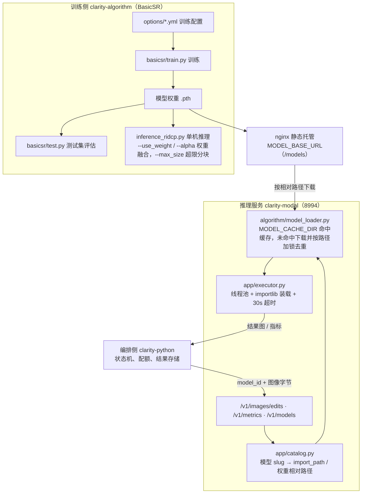

# 算法训练与推理 (clarity-algorithm)

`clarity-algorithm` 是去雾模型的训练与推理研究项目，基于 BasicSR 框架，训练产物（`.pth` 权重）由 `clarity-modal`（8994）加载推理。本页记录其安装、推理、训练与测试流程。

## 训练与推理管线



## 安装依赖

```bash
cd clarity-algorithm
pip install -e .
```

`setup.py` 会读取 `requirements.txt` 安装全部依赖。如需编译 CUDA 算子（如 DCN），设置环境变量 `BASICSR_EXT=True`。

## 推理

使用 `inference_ridcp.py` 进行单图或批量推理：

```bash
python inference_ridcp.py -i inputs -w path/to/model_weight.pth -o results --use_weight --alpha 1.0
```

参数说明：

| 参数             | 说明                                                 |
| ---------------- | ---------------------------------------------------- |
| `-i / --input`   | 输入图片或文件夹，默认 `inputs`                      |
| `-w / --weight`  | 模型权重路径                                         |
| `-o / --output`  | 输出文件夹，默认 `results`                           |
| `--use_weight`   | 启用权重融合                                         |
| `--alpha`        | 权重融合系数，默认 `1.0`                             |
| `--max_size`     | 单张图片最大尺寸，超过则启用分块推理，默认 `10000`   |

## 训练

通过 `basicsr/train.py` 启动训练，配置文件位于 `options/` 目录：

```bash
python basicsr/train.py -opt options/common/NH-HAZE-20.yml
```

## 测试

通过 `basicsr/test.py` 跑测试集评估：

```bash
python basicsr/test.py -opt options/common/NH-HAZE-20.yml
```

## 相关

- 网络结构与算法原理见[学术论文文档](./学术论文文档.md)。
- 权重落盘与推理服务边界见 `clarity-service/clarity-modal`。
