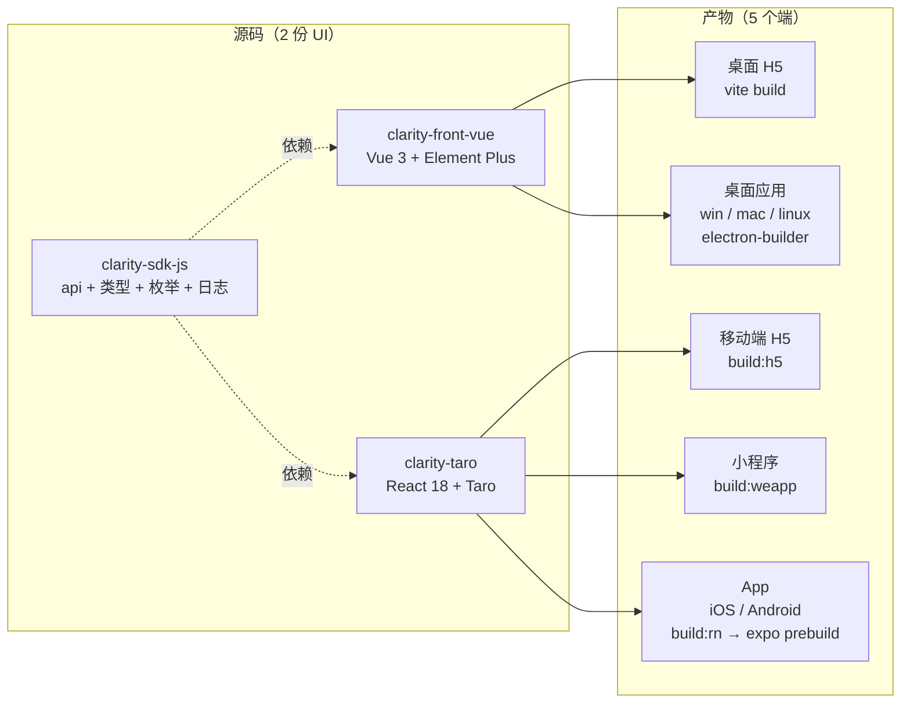
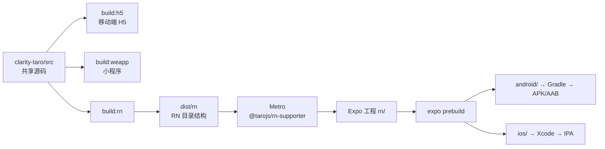

# 前端多端技术栈收敛方案

前端目前有 7 套需要分别维护的代码：桌面三套（`clarity-front-vue`、`clarity-front-react`、`clarity_flutter`），移动四套（`clarity-taro`、`clarity-react-native`、`clarity-uniapp`、`clarity-android`）。同一个需求要先判断「改哪几套、每套改到什么程度」，这份判断成本往往高于写代码本身。

本篇给出收敛结论与落地路径。各端现状见 [Taro 架构文档](../04-项目实现/前端/03-Taro架构文档.md) 与 [ReactNative 架构文档](../04-项目实现/前端/04-ReactNative架构文档.md)。

## 结论

桌面端保留 `clarity-front-vue`，移动端保留 `clarity-taro`，共享层停在 `clarity-sdk-js`。其余四套冻结后退役。

| 端                        | 代码                | 技术栈                                   |
| ------------------------- | ------------------- | ---------------------------------------- |
| 桌面应用（win/mac/linux） | `clarity-front-vue` | Vue 3 + Element Plus + Electron          |
| 桌面 H5                   | `clarity-front-vue` | 同一份 `vite build` 产物，不额外增加代码 |
| 移动端 H5                 | `clarity-taro`      | React 18 + Taro                          |
| 小程序                    | `clarity-taro`      | 同上                                     |
| App（iOS/Android）        | `clarity-taro`      | 同上，经 Taro RN 通道                    |
| 共享层                    | `clarity-sdk-js`    | api + 类型 + 枚举 + 日志                 |

7 个端落在 2 份 UI 代码上。这意味着桌面与移动各有一份 UI、一份逻辑，跨端重复是长期状态，不是过渡状态。

### 构建视图



桌面是一份源码两套产物，移动是一份源码三种产物。App 那条链最长，也是唯一还没验证过的分支。

## 为什么不是单一框架

三个候选组合都试算过，结论都是不划算。

| 候选          | 做法                                             | 否决理由                                                                                                     |
| ------------- | ------------------------------------------------ | ------------------------------------------------------------------------------------------------------------ |
| React 单栈    | 桌面改 `clarity-front-react`，与 taro、RN 同语言 | 桌面非 AI 部分要迁数千行；换来的共享只有 1,000–1,500 行 hooks/store，折合约 8% 工时，不够支付 2–4 周迁移     |
| Vue 单栈      | 桌面保留 Vue，移动端也改 Vue                     | Taro 的 RN 通道只支持 React，Vue 出不了原生 App；改用 WebView 则不满足相机、手势、动效、启动速度的体验要求   |
| 全 Taro 单 UI | 桌面也跑 Taro 的 H5 产物塞进 Electron            | 桌面要放弃 Element Plus 与 antd 的 Table、Form、DatePicker，AI 管理后台（13,930 行，表格与表单密集）无法承接 |

三条否定事实，后续讨论不必重复验证：

**Taro RN 通道只支持 React。** `@tarojs/rn-supporter` 的 babel 配置把 `babel-plugin-transform-react-jsx-to-rn-stylesheet` 写死，`rn-supporter` 与 `rn-transformer` 两个包里 `grep -i vue` 零命中，`@tarojs/rn-runner` 的 peer 也没有 Vue 框架包。

**组件不能跨 UI 体系复用。** `clarity-front-react` 是 528 个 `<div>`、219 个 `<span>` + antd 5，组件依赖浏览器能力（`Waterfall`、`LazyImg`、`Magnifier`、`DraggableLine`、`InfiniteFlowList`）。小程序与 RN 没有 DOM。即使用 React 单栈，桌面组件也进不了 taro，能复用的只有无 JSX 的 hooks 与纯函数。

**共享的逻辑层很薄。** 三端 hooks/store 合计 3,155 行，剔除 UI 相关（`useAnimation`、`useResponsive`、`useSectionScroll` 等约 508 行）与已分叉实现后，真正可共享约 1,000–1,500 行。这个量级不足以支撑语言统一。

## 桌面端：保留 clarity-front-vue

| 维度           | `clarity-front-vue`             | `clarity-front-react`                        |
| -------------- | ------------------------------- | -------------------------------------------- |
| 规模           | 260 个 vue，59,745 行           | 111 个 tsx                                   |
| 版本           | 1.10.1                          | 1.0.0                                        |
| UI 库          | Element Plus                    | antd                                         |
| AI 模块        | 10 个模块，81 个 vue，13,930 行 | 零引用                                       |
| 空壳页面       | —                               | `evaluation`、`file`、`coming-soon` 各 14 行 |
| 近 12 个月提交 | 10                              | 5                                            |

选 Vue 的三条理由：存量差一个数量级；AI 模块（唯一活跃迭代区）只在 Vue；迁移成本与主线迭代冲突。

要接受的反面：AI 越长越大，未来 React 化的成本只会更高。这个决策的前提是「桌面与移动本来就该有两份 UI」，而不是「Vue 更好」。

一个容易忽略的点：Electron 与桌面 H5 共用同一份构建产物，桌面 H5 不需要额外开发。`clarity-front-vue` 对 Electron 的耦合很浅，只有 `App.vue`、`components/TitleBar`、`typings/global.d.ts` 三个文件引用 electron 或 `ipcRenderer`，剥离 Web 版几乎没有阻力。

## 移动端：clarity-taro 承三端

### App 构建链路



`@tarojs/rn-runner` 的产物只是 RN 目录结构（自带模板仅 `index.js` 引导 `@tarojs/rn-supporter/entry-file.js`，配一份 `metro.config.js`），不含原生工程；原生工程由 `expo prebuild` 生成。【推断｜待实测】

### 版本约束

约束值来自包元数据：

| 约束项           | 值                                                                                                        | 来源                                                                 |
| ---------------- | --------------------------------------------------------------------------------------------------------- | -------------------------------------------------------------------- |
| `react`          | `^18`                                                                                                     | `npm view @tarojs/rn-runner@4.3.0 peerDependencies`                  |
| `react-native`   | `^0.73.1`                                                                                                 | 同上                                                                 |
| `expo`           | `~50.0.0`                                                                                                 | 同上                                                                 |
| 需安装的包       | `@tarojs/taro-rn` `@tarojs/components-rn` `@tarojs/rn-runner` `@tarojs/rn-supporter` `@tarojs/runtime-rn` | `clarity-taro/node_modules/@tarojs/cli/dist/presets/platforms/rn.js` |
| 插件侧 expo 依赖 | `expo-av` `expo-camera` `expo-image-picker` `expo-file-system` 等                                         | `npm view @tarojs/taro-rn@4.3.0 peerDependencies`                    |

这是本方案的主要代价：App 技术栈锁在 RN 0.73 + Expo 50，无法跟进 `clarity-react-native` 使用的 RN 0.81，且两者原生库不通用。选「一套移动端代码」付的就是这笔钱。

### 改造面基线

| 面            | 数量                    | 证据                                                                                |
| ------------- | ----------------------- | ----------------------------------------------------------------------------------- |
| 页面          | 47                      | `clarity-taro/src/app.config.ts` 的 `pages` 数组                                    |
| 文件          | 95 个 tsx，21,668 行 TS | `find src -name "*.tsx" \| wc -l`                                                   |
| 样式          | 84 个 less，12,307 行   | 含 54 处 `:active`、20 处 `:last-child`、12 处 `::after`、多处 `linear-gradient`    |
| Taroify 引用  | 66 个文件               | 见 `clarity-taro/babel.config.js:1-29` 的按需注入配置                               |
| Taro API 调用 | 459 处                  | `showToast` 295、`navigateTo` 27、`navigateBack` 23、`showModal` 20、`switchTab` 11 |
| 平台条件分支  | 1 处                    | `process.env.TARO_ENV` 全项目仅 1 处，无 `.h5.tsx` / `.weapp.tsx` 平台文件          |
| 已有占位      | RN 配置段已在           | `clarity-taro/config/index.ts:121` 的 `rn` 段（`appName: "taroDemo"`，未启用）      |

平台分支只有 1 处，说明业务代码几乎与平台无关，改造面集中在样式与组件，不在页面逻辑。

### 依赖隔离

RN 依赖树必须与小程序/H5 物理隔离，否则 Expo 50 与 RN 0.73 会和根目录 `pnpm-workspace.yaml` 的 `overrides`（`@types/react` 固定 `^19.2.3`）冲突：

```text
clarity-taro/
  src/                      # 共享源码
    platform/
      ui/                   # UI 适配层，RN 构建下替换 Taroify
      style/                # 样式基础件（间距、色板、字阶）
      api/                  # Taro API 缺口分发
  rn/                       # RN 宿主工程，独立 package.json，不进 pnpm workspace
    app.json  index.js  metro.config.js  babel.config.js
    android/  ios/          # expo prebuild 产物
  dist/rn/                  # taro build --type rn 输出
```

### 适配层

四个面各自收敛，页面代码不写平台判断。

**UI 组件：alias 替换，不改 66 个文件。** RN 构建下把 `@taroify/core`、`@taroify/icons` 指向同名的 RN 实现，内部用 RN 基础组件拼装，可直接搬 `clarity-react-native` 的现成组件。

```js
// clarity-taro/config/index.ts，追加到 alias
...(process.env.TARO_ENV === "rn"
  ? {
      "@taroify/core": path.resolve(__dirname, "../src/platform/ui/taroify"),
      "@taroify/icons": path.resolve(__dirname, "../src/platform/ui/taroify/icons"),
    }
  : {}),
```

alias 是否在 RN 构建链路生效取决于 `@tarojs/rn-transformer`，需在阶段 0 验证。【待确认】

**样式：改成 RN 可转换子集，不引入 styled 方案。**

- `:active` / `:hover` / `:focus` 改为 `Pressable` 或 `View` 的按压状态，54 处。
- `::after` / `::before` 改为真实节点或承载它的组件，12 处。
- `linear-gradient` 改为渐变组件，RN 无 CSS 渐变。
- rpx 继续用，由 Taro 的 style transformer 换算；不支持的属性会被剔除并告警，阶段 0 需拿到告警清单作为规范依据。【待确认】

**Taro API：按缺口处理。** 459 处调用里大部分 `@tarojs/taro-rn` 有实现，真正要写分支的只有：

| 能力                     | 出现位置                                  | 处理方式                                  |
| ------------------------ | ----------------------------------------- | ----------------------------------------- |
| `openDocument` ×5        | filter / magnifier / metrics / overlay 页 | RN 无文档预览，改用系统分享或内置预览组件 |
| `createSelectorQuery` ×3 | filter / magnifier / overlay 页           | 改用 `onLayout` 测量                      |
| `Canvas` ×1              | `pages/filter/index.tsx` 滤镜预览         | 改用 RN 画布方案或服务端渲染滤镜          |
| `showShareImageMenu` ×1  | `components/compare/CompareToolbar`       | 改用系统分享                              |

**路由与 TabBar：RN 端自绘。** `app.config.ts:59` 的原生 tabBar 由各端框架渲染，RN 端不保证等价，采用 `clarity-react-native/src/routes/MainTabs.tsx` 的底部导航方案。Taro 路由与 `@react-navigation` 的映射需在阶段 0 确认，避免深链与返回栈行为不一致。【待确认】

平台差异统一用文件后缀（`index.rn.tsx`），`src/platform/` 之外不写 `TARO_ENV` 判断。

### 阶段与验收

| 阶段         | 内容                                                | 验收标准（可复现）                                                                                                    |
| ------------ | --------------------------------------------------- | --------------------------------------------------------------------------------------------------------------------- |
| 0 POC        | 装 RN 依赖、打通 `build:rn`、跑通 Expo 到真机       | 微信开发者工具里首页不动；Android 真机能看到带样式的首页与登录页，登录接口返回 200；拿到样式告警清单与 alias 生效结论 |
| 1 UI 适配层  | 实现 `platform/ui`，替换 Taroify 引用，样式规范定稿 | home / dehaze / dataset / processing / profile 五页在 Android 视觉可接受，`:active` 与渐变全部替换                    |
| 2 API 缺口   | 文档预览、分享、canvas 滤镜、选图                   | 4 类缺口各有可运行用例，filter 页滤镜在 Android 生效                                                                  |
| 3 出包流水线 | prebuild、签名、iOS 证书、日志接入                  | Android APK 与 iOS 包可安装可升级；`Logger` 的 `RemoteTransport` 在真机有上报                                         |
| 4 退役       | 按下方顺序摘除旧实现                                | 每套退役前有可运行的替代验证；退役后仓库归档，CI 不再构建                                                             |

阶段 0 是硬门槛，样式过不去则排期全部作废。阶段 3 的 iOS 构建必须在 macOS 上做（当前开发机为 Linux），或改用 EAS Build。

### POC 执行方案

阶段 0 拆成两级，准入条件不同，先做 L1。

| 级别      | 验证内容                                                                                   | 准入条件                                    |
| --------- | ------------------------------------------------------------------------------------------ | ------------------------------------------- |
| L1 编译层 | `build:rn` 能否产出、alias 是否生效、less 转 RN 的支持度与告警、`defineConstants` 是否注入 | Node 20 + 一套 RN 依赖，不需要 Android 环境 |
| L2 运行层 | 真机或模拟器上的界面、相机与手势、登录接口                                                 | JDK 17 + Android SDK + 一台设备             |

L1 的判定标准不是「能否编译通过」，而是「编译之后样式还剩多少」。若大量属性被剔除，12,307 行样式的重写成本会超出本方案预算，此时应停在这里，不进入 L2。

#### 环境前置

当前开发机（Linux 云桌面）实测：

| 项          | 现状                                                                                    | 要求                    | 处理                       |
| ----------- | --------------------------------------------------------------------------------------- | ----------------------- | -------------------------- |
| Node        | 24.22.0                                                                                 | 20.x                    | `pnpm env use --global 20` |
| JDK         | 21                                                                                      | 17（AGP 8.x 不支持 21） | 需另装                     |
| Android SDK | `/root/Android/Sdk` 已有 build-tools 35/36、platforms 35/36、platform-tools、ndk、cmake | 补 `android-34`         | 用 sdkmanager 装           |
| adb         | 未进 PATH                                                                               | `platform-tools/adb`    | 路径问题，不是缺失         |
| 真机/模拟器 | 无                                                                                      | —                       | L2 在本机无法执行          |

#### L1 步骤

```bash
# 1. 切 Node 20
pnpm env use --global 20

# 2. 装 RN 依赖（版本与 Taro 4.2.1 对齐）
pnpm add @tarojs/taro-rn@4.2.1 @tarojs/components-rn@4.2.1 \
         @tarojs/rn-runner@4.2.1 @tarojs/rn-supporter@4.2.1 \
         @tarojs/runtime-rn@4.2.1 \
         react-native@^0.73.1 expo@~50.0.0 @react-native/metro-config@^0.73.2

# 3. 补 RN 工程的两个入口文件（内容取自 rn-runner 的 templates）
#    index.js：仅一行引导 @tarojs/rn-supporter/entry-file.js
#    metro.config.js：mergeConfig(getDefaultConfig, getMetroConfig)

# 4. 启用 config/index.ts:121 的 rn 段后编译
cd clarity-taro && npx taro build --type rn --watch
```

具体补丁版本由 pnpm 解析 peer 后确定，以上只锁 peer 范围。【待确认】

#### 结构取舍

POC 阶段把 RN 依赖装在 `clarity-taro` 根目录，不先做 `rn/` 子工程隔离。

原因是 `@tarojs/rn-runner` 默认把项目根当 RN 工程：`index.js`、`metro.config.js` 与依赖解析都从根走。先隔离会和它的路径假设冲突，而 POC 不该同时验证两件事。代价是根 workspace 的 `overrides`（`@types/react` 固定 `^19.2.3`）会产生 peer 警告，不影响结论。L1 通过后再决定是否把依赖树搬进 `rn/`。

#### L1 判定

| 结果   | 判据                                                                                                         |
| ------ | ------------------------------------------------------------------------------------------------------------ |
| 通过   | 产物生成；首页与登录页的样式在 Metro 产物中可解析；alias 生效；`TARO_APP_*` 注入成功；告警集中在少数局部属性 |
| 不通过 | less 转换后告警覆盖基础布局（flex、尺寸、颜色），或 alias 在 rn 链路不生效                                   |

L2 通过与否只影响「App 是否由 taro 接管」，不影响桌面端的结论：L2 不通过则 App 继续用 `clarity-react-native`，`clarity-front-react` 与 `clarity_flutter` 的退役照常进行。

## 共享层的边界

`clarity-sdk-js` 是对外发布的 SDK（独立版本号、独立测试、`files: dist/`），这条边界决定它装什么：

| 放进去                             | 不放进去                             |
| ---------------------------------- | ------------------------------------ |
| API 调用、分页封装、请求参数       | 状态管理（Pinia / zustand 各端不同） |
| 领域模型、类型、枚举、错误码       | composables / hooks（框架绑定）      |
| 与业务无关的纯函数（格式化、校验） | 路由、UI 逻辑、权限守卫              |

不往上加 store/hooks 的理由：真正能共享的只有 1,000–1,500 行，而新增一个共享包要长期维护版本、三端兼容与独立测试，管理成本会吃掉大部分收益。等出现「同一段逻辑第二个端确实要写」时再抽，不预先建包。

## 退役节奏

| 仓库                   | 动作                    | 前置条件                           |
| ---------------------- | ----------------------- | ---------------------------------- |
| `clarity-front-react`  | 冻结后归档              | 无                                 |
| `clarity_flutter`      | 冻结后归档              | 无                                 |
| `clarity-uniapp`       | 冻结（只修 bug）        | 5 个差异页面核对完                 |
| `clarity-android/app`  | 待 App 出包后退         | 商店渠道与存量用户方案确定         |
| `clarity-react-native` | 暂不退役，作为 App 兜底 | Taro RN 的 POC 通过 + 一个版本周期 |
| `clarity-android/sdk`  | 保留                    | 三端 SDK 之一，不属于 App 范畴     |

`clarity-uniapp` 与 `clarity-taro` 的页面差异已很小：8 处中 3 处是改名对应（`task-history`→`task`、`personal/credits`→`personal/quota`、`personal/favorites`→`favorite`），实际待核对 5 个（`file-manage`、`system/dict/items`、`system/member/detail`、`system/order/detail`、`system/feedback/detail`）。

`clarity-android/app` 的依赖只有 Retrofit、Glide、Navigation、Material，无 OpenCV、NDK、JNI（来源：`clarity-android/app/build.gradle`），功能上没有不可替代的能力，退役障碍在渠道与存量用户。

### 冻结纪律

比迁移速度更快见效的是冻结，顺序是先停扩散、再迁代码。

- 新功能只进 `clarity-front-vue`（桌面）与 `clarity-taro`（移动），其余四套只修 P0 缺陷与线上事故。
- 冻结后其余仓库的提交应趋近于 0；若仍有功能性提交，说明冻结没落地，迁移会被无限拖长。
- `clarity-uniapp` 的冻结不必等 5 个页面补齐。

## 重估条件

当前规模下接受两份逻辑层各自维护。出现以下任一情况时重新评估语言统一：

- `clarity-taro` 的 hooks + stores 从当前 1,234 行涨到 3,000 行以上。
- 同一条业务规则在一个月内改了两遍以上（说明重复维护成本已超过 20%）。

`clarity-react-native` 的 POC 若失败（Taro RN 无法产出可用的 App），App 退回它继续维护，桌面与移动的两份 UI 结论不受影响，只是 App 端暂时维持现状。

## 未验证项

以下来自包元数据与源码阅读，尚无实测：

- alias 与 `defineConstants` 在 RN 构建链路（Metro + rn-transformer）中的生效情况。`process.env.TARO_APP_JAVA_BASE_URL` 目前靠 `config/index.ts` 的 webpack `defineConstants` 注入，Metro 没有这一层。
- Taro 的样式转换支持哪些 CSS 属性、告警形态如何。
- Taro 路由与 `@react-navigation` 的映射代价，尤其是 `switchTab`、`reLaunch` 与返回栈。
- Expo 50 的 `prebuild` 产物能否满足国内应用商店的上架要求。
- uniapp 那 5 个差异页面在 taro 中是否已有等价实现（只按路径做了 diff，未核对功能）。
- `clarity-android/app` 与 taro 的功能对齐度（只看了依赖与结构，未逐页对照）。
- `clarity-front-react` 与 `clarity-front-vue` 在非 AI 页面上是否功能等价（只比了目录与行数，`dataset`、`system` 行数更多不代表功能更全）。
