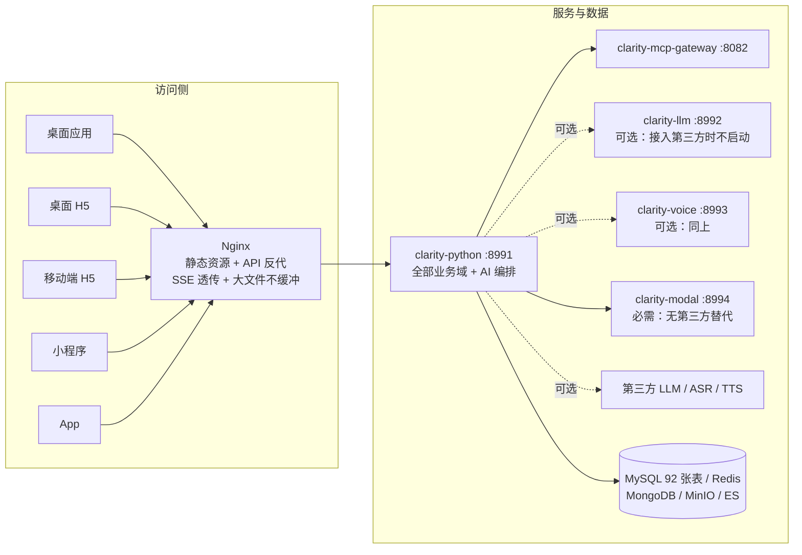
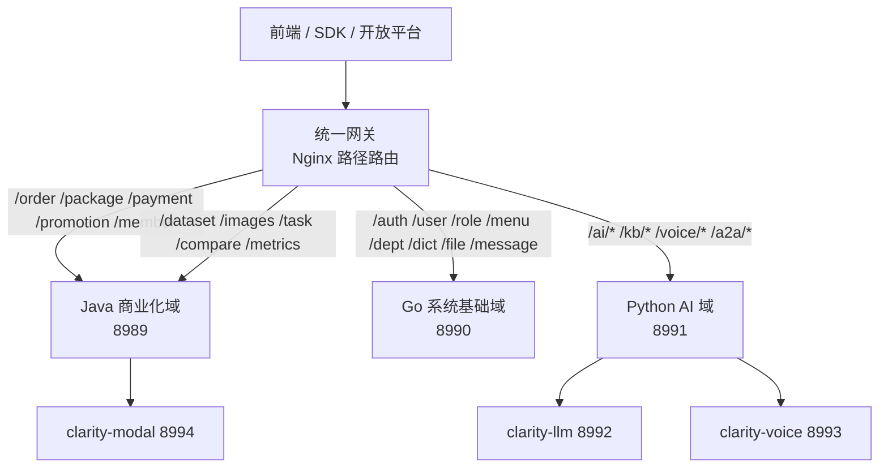

# 后端多语言技术栈收敛方案

Java、Go、Python 三套后端目前除 AI 域外全量业务各实现一遍，合计约 27 万行、469 个测试文件。任何业务改动都要三端同时实现、同时测试。本篇做架构层面比选，而不只是给一套改造方案。

## 问题定性

这不是实现事故，而是一条设计决策的直接后果。「三后端统一方案」要求「三端 API 契约完全一致，可按部署环境选择其一承载业务」。为了让任意一端都能独立承载全部业务，每个功能就必须写三遍。

| 端               | 业务代码（不含测试） | 测试文件 |
| ---------------- | -------------------- | -------- |
| `clarity-java`   | 67,429 行            | 110      |
| `clarity-go`     | 114,264 行           | 101      |
| `clarity-python` | 92,436 行（`app/`）  | 258      |

## 一个被忽略的事实：三端并不等价

「任选一端承载全部业务」这个目标从来没有实现过。AI 域 B 类只存在于 Python，Java 与 Go 走转发（Java 侧白名单 58 条）。也就是说：

- **Python 是唯一完整的端**：全量业务（`order` 2,044 行、`billing` 2,285 行、`dataset` 1,461 行、`member` 1,400 行、`task` 1,149 行）+ 完整 AI 实现。
- **Java 与 Go 是残缺的端**：没有 AI 域运行时，离开 Python 就跑不出完整 API。

现状的真实形态是「1 个完整单体 + 2 个平行实现」，而不是「3 个可互换的单体」。这个事实改变了比选的结论：如果有一天要合并成单体，唯一可行的是 Python——Java 或 Go 做单体要重写约 1.9 万行 AI 代码外加 deepagents、向量检索、推理编排的整套依赖，不现实。

## 四个方案比选

| 方案                 | 代码维护量 | 技术栈 | 需要网关 | 需要拆库           | 主要收益                                              | 主要代价                                                 |
| -------------------- | ---------- | ------ | -------- | ------------------ | ----------------------------------------------------- | -------------------------------------------------------- |
| 1 保留现状           | 3 倍       | 3 套   | 是       | 否                 | 零投入；理论上可切换部署                              | 每功能三写三测；重复随需求线性增长                       |
| 2 域分工             | 1 倍       | 3 套   | 是       | 否（逻辑归属即可） | 各端只维护自己的域，重复不再增长                      | 三套栈、三份运维与测试仍在；跨域事务与数据权限横切       |
| 3 域分工 + 物理拆库  | 1 倍       | 3 套   | 是       | 是                 | 各域独立扩容、故障隔离                                | 跨库事务、分布式一致性、92 张表迁移与同步；规模不匹配    |
| 4 收敛到 Python 单体 | 1 倍       | 1 套   | 是       | 否                 | 维护量与认知负担最小；Java/Go 的 211 个测试退出维护面 | 单点故障；支付与高并发能力需验收；Java/Go 的既有成果归档 |

判断的关键在于：**你要解决的是「重复实现」还是「三套栈」**。

- 域分工只解决前者。它把三端变成三个域服务，重复消失，但三套 Gin、Spring、FastAPI 的构建、依赖、部署、监控、测试体系仍在，一个人维护三套运维面的负担没有下降。
- 单体解决后者。它直接减到一套栈，代价是放弃多语言。

如果三端没有组织上的理由（三个团队各管一端、或需要按客户环境交付不同语言的实现），那么**域分工是次优解**——它保留了三端的成本，只砍掉了三分之一。

## 决策：收敛到 Python 单端

三端没有组织上的存在理由，这一点已从提交历史确认：按品牌改名前的目录统计，近 12 个月三端共 454 次提交，作者只有一个（`土味锌`、`earthywu`、`earthyzinc`、`earthy-zinc` 是同一人的多个 git 身份）；仓库没有 CI 流水线；`docker-compose.yml` 只起 MySQL、Redis、ES 等基础设施，不起应用服务。既然没有任何外部力量要求三端并存，它就是一个可以改的技术选择。

结论定为方案 4：`clarity-python` 作为唯一业务后端，`clarity-java` 与 `clarity-go` 冻结归档。

选它是因为它已经是唯一完整端——全量业务加完整 AI 实现都在里面，收敛是减法，不需要重写任何东西。反过来若让 Java 或 Go 当单端，等于把约 1.9 万行 AI 代码连同 deepagents、向量检索、推理编排的整套依赖重写一遍。

| 被否方案          | 原因                                                                            |
| ----------------- | ------------------------------------------------------------------------------- |
| 保留现状          | 每功能三写三测，重复随需求线性增长，且无组织理由支撑                            |
| 域分工            | 只砍掉重复实现，砍不掉三套框架、三套部署、469 个测试文件中属于另外两端的 211 个 |
| 域分工 + 物理拆库 | 92 张表、内部平台的规模，拆库代价远高于收益                                     |

域分工的详细设计保留在文末备选章节，仅在将来出现组织级需求时启用，不作为当前路线。

## 目标架构

虚线表示可替换链路：接入第三方大模型或语音服务时，`clarity-llm` 与 `clarity-voice` 不启动，8991 直连外部 API。数据层五件套并不都是必需的，处置见「数据层组件处置」。

三个能力服务的定位不同：

| 服务            | 是否必需 | 说明                                                 |
| --------------- | -------- | ---------------------------------------------------- |
| `clarity-llm`   | 可选     | 本地 chat / embedding / rerank，接第三方模型时不需要 |
| `clarity-voice` | 可选     | 本地 ASR / TTS，接第三方语音服务时不需要             |
| `clarity-modal` | 必需     | 图像推理与质量指标没有第三方替代，必须自建           |

由此带出一个风险：接入第三方时，关键能力从内网调用变成外部依赖，网络抖动、配额耗尽、数据合规都会进入主链路。8991 侧需要为这条链路准备超时、重试与降级，不能按内网服务的假设写。

## 关于网关与数据库分离

**网关不是这次改造带来的额外成本，任何方案都需要。** 系统里已经有 `clarity-llm`（8992）、`clarity-voice`（8993）、`clarity-modal`（8994）、`clarity-mcp-gateway`（8082）四个独立服务，客户端本来就需要一个统一入口。三端统一使用 `JWT_SECRET_KEY`，网关不需要做协议转换。

最小实现是现有 Nginx 加一张路径表（当前 `config/nginx/` 只做静态资源与数据集分发）。它只需承担路径前缀路由、SSE 透传、大文件上传不缓冲三件事。不必为此引入 Spring Cloud Gateway。

**数据库分离不需要做。** 92 张表、单个 MySQL、内部平台规模。拆库要付出跨库事务、分布式一致性、数据同步与迁移的代价，换来的独立扩容与故障隔离在这个规模下用不上。收敛到单端后所有业务同库同事务，连跨域一致性都不存在，更没有拆的理由。

## 数据层组件处置

目标架构图里画了五个存储，但不都是必需的。逐项判断：

| 组件          | 判断             | 依据                                                                                                                            |
| ------------- | ---------------- | ------------------------------------------------------------------------------------------------------------------------------- |
| MySQL         | 保留             | 92 张业务表，事务与关联查询的唯一载体                                                                                           |
| Redis         | 保留             | 缓存、会话、限流、任务标记                                                                                                      |
| Elasticsearch | 保留             | AI 记忆索引、会话索引、会话全文搜索（`memory_es_service`、`conversation_search_service`），同时承担应用日志                     |
| MinIO         | 按部署形态       | 图像平台必须有对象存储；云上可换 OSS，自建必须保留。当前 `infrastructure/storage/` 只有 `minio_client.py`，没有其他存储策略实现 |
| MongoDB       | 可撤，但优先级低 | 只服务日志，不承载任何业务数据                                                                                                  |

### 两条日志链路

| 链路         | 内容                    | 存储    | 采集方式                                  |
| ------------ | ----------------------- | ------- | ----------------------------------------- |
| 应用运行日志 | 三端服务的运行日志      | ES      | 文件 → filebeat → logstash → ES（NDJSON） |
| 业务操作日志 | 登录、审计、AI 调用日志 | MongoDB | 应用直写，TTL 30 天                       |

MySQL 的 92 张表里没有通用日志表（只有 `sys_ai_credit_log`、`sys_balance_log` 这类业务流水），所以 MongoDB 是当前唯一的业务日志存储，不是重复建设。

### 撤销 MongoDB 的比选

| 方案         | 做法                                                                   | 收益                                       | 代价                                                  |
| ------------ | ---------------------------------------------------------------------- | ------------------------------------------ | ----------------------------------------------------- |
| A 并入 MySQL | 建 3 张日志表，扩展字段用 JSON 列，按月分区 + 定时清理（已有 xxl-job） | 少一个组件与一套备份，日志与业务同库可联查 | 改 425 行 repository、迁移历史数据、自行实现 TTL 清理 |
| B 并入 ES    | 复用现有 ES                                                            | 少一个组件，日志可全文检索                 | ES 无事务、写入放大，审计日志可靠性不划算             |
| C 保留       | 维持现状                                                               | 零改动；日志与业务库物理隔离，不拖慢主库   | 多一套存储的运维面                                    |

推荐 A，但仅在日志量小的时候成立：日增低于 10 万条，MySQL 完全够用；超过 100 万条/天，日志会撑大主库并影响业务查询，应当保留 MongoDB。B 不推荐——把审计日志放进无事务的搜索引擎，可靠性上不成立。

### 先做零代码的减法

撤销 MongoDB 要动 425 行代码并迁数据，换来的只是少一个容器。相比之下两处零成本减法更值得先做：

1. **ELK 有一半会随 Java / Go 归档而失效。** `filebeat` 当前采集 `/logs/java/*`、`/logs/go/*`、`/logs/python/*`、`/logs/llm/*` 四个路径，前两条在归档后为空，对应的采集配置、索引模板与 Kibana 视图都应清理。
2. **logstash 这一层可能是多余的。** 日志已是 NDJSON，filebeat 可直接写 ES。能否省掉取决于 logstash pipeline 里是否做了字段加工。【待确认】

这两项减掉的组件数量多于撤销 MongoDB，且不动业务代码。

### 顺序

1. 清理 ELK 中随归档失效的采集路径，评估去掉 logstash（零代码）。
2. 决定 MinIO 换不换 OSS（看部署形态，改配置）。
3. 最后再判断 MongoDB：若确认日志量小、且希望把存储收敛到「MySQL + ES + 对象存储」三件套，那时再做。

## 备选：若将来确需多端

以下设计仅在出现组织级需求（多个团队分别维护、或需按客户环境交付不同语言实现）时启用。

### 域划分

按「业务 / 平台 / 智能」三层切分：

| 域       | 归属   | 内容                                                                                                               |
| -------- | ------ | ------------------------------------------------------------------------------------------------------------------ |
| 商业化   | Java   | 订单、套餐、支付回调、促销、会员、优惠券                                                                           |
| 图像业务 | Java   | 数据集与条目、图像输入、图像、任务、对比、指标、滤镜预设、导入导出、评测、收藏与推荐                               |
| 系统基础 | Go     | 认证、用户、角色、菜单、部门、字典、公告、消息与模板、通知设置、API Key、文件、缓存、前端日志、健康检查、WebSocket |
| AI       | Python | `ai_*` 全部端点、知识库、语音、A2A、OpenAI / Claude 兼容协议                                                       |

图像业务域是容易被漏掉的一块：`dataset`、`dataset_item`、`item_file`、`image_input`、`images`、`task`、`compare`、`metrics`、`preset`、`import_export`、`evaluation`、`favorite`、`recommendation` 共 13 个模块，既不属于商业化也不属于系统基础，必须显式归属。

归 Java 的理由：它与商业化共享数据集、任务、订单、会员权益的引用关系，同语言能直接事务与联表。若归 Python，会把 Python 推成 10 万行以上的最大单体，稀释其 AI 编排定位。

顺带回应「Java 与 Go 对调」的设想：不建议。Go 承接商业化意味着支付、退款、对账用 Go 重写，生态与经验都弱于 Java。

### 备选架构（域分工）

### 迁移顺序

| 阶段           | 内容                         | 验收                                              |
| -------------- | ---------------------------- | ------------------------------------------------- |
| 1 定归属       | 出「表 → 唯一写入端」清单    | 覆盖全部 92 张表，无遗漏；非归属端对归属表只读    |
| 2 网关上线路由 | Nginx 加路径表，三端端口不变 | 四个域各 3 个接口经网关返回 200；SSE 对话流不中断 |
| 3 裁剪非归属域 | 各端下线非归属域路由注册     | 非归属路径全部 404，不再走本地实现                |
| 4 删除重复实现 | 按域删除其余两端的实现与测试 | 测试套件与归属域匹配，全量回归通过                |

顺序不能颠倒：网关先上，再裁剪路由，否则客户端打不通非归属域接口。

## 执行路径

Python 已是完整端，所以收敛是「减法」而不是「重写」：

| 阶段   | 内容                                            | 验收                                                            |
| ------ | ----------------------------------------------- | --------------------------------------------------------------- |
| 0 冻结 | 宣布 Java / Go 只修 P0 缺陷，新功能只进 Python  | 此后新增功能的提交只出现在 `clarity-python`；旧两端提交趋近于 0 |
| 1 验证 | Python 单独承载全部业务与 AI，跑全量接口回归    | 现有前端与 SDK 的全部用例在只连 8991 时通过                     |
| 2 切流 | 网关把全部流量指向 8991，Java / Go 停止对外服务 | 无 5xx 增长，监控指标平稳                                       |
| 3 归档 | 两端冻结归档，退出构建与测试                    | CI 不再构建这两端；git 历史与最后可用版本保留                   |
| 4 补强 | 按需补 Python 的支付与并发能力                  | 支付链路验收通过；压测达到既定目标                              |

阶段 0 零成本，可以立即执行；阶段 1 必须先于切流，因为「Python 有实现」不等于「这套实现可用」。`order` 与 `billing` 合计 4,300 行，是否对接真实支付渠道尚未核实，是阶段 1 的重点。

## 代价与风险

| 风险             | 说明                                                                                                                    | 应对                                               |
| ---------------- | ----------------------------------------------------------------------------------------------------------------------- | -------------------------------------------------- |
| 故障域集中       | 全部业务在一个编排进程；推理已在 `clarity-llm` / `clarity-voice` / `clarity-modal` 独立服务，但编排进程挂掉则全站不可用 | 多实例 + 健康检查；订单等关键链路保留只读降级      |
| 契约权威源切换   | 现在 Java 是 spec 唯一权威，归档后 Python 成为唯一实现与权威                                                            | 以 Python 实现重建 spec 基线，API 规范文档同步更新 |
| 支付与并发未验证 | `order` 2,044 行、`billing` 2,285 行是否对接真实支付渠道尚未核实                                                        | 阶段 1 单独验收，不通过先补齐再切流                |
| 交付语言单一     | 将来若客户或合规要求非 Python 实现，需要重做                                                                            | 保留 spec 与接口用例作为重建依据，归档代码不删除   |
| 资产归档         | Java 与 Go 的 211 个测试退出维护面                                                                                      | 归档而非删除，保留 git 历史与最后可用版本          |

被放弃的是「任一端可承载全部业务」的能力。但这个能力从未真正成立——Java 与 Go 都缺 AI 域运行时，离开 Python 给不出完整 API。实际放弃的只是两个残缺副本，不是三份等价的备份。

## 待确认

1. **Python 的支付链路是否可用**：`order` 与 `billing` 是否对接真实支付渠道，有没有走过完整支付与退款流程。
2. **Python 的并发承载目标**：需要先定一个压测口径（并发用户数、图像处理排队长度），否则「能不能扛」无法验收。
3. **归档时机与是否保留只读部署**：归档后是否还需要保留 Java / Go 的容器镜像，供历史数据查询或应急只读。
4. **是否立即执行阶段 0 冻结**：这一步零成本，但需要对外宣布，避免其他人继续往旧两端提交。
