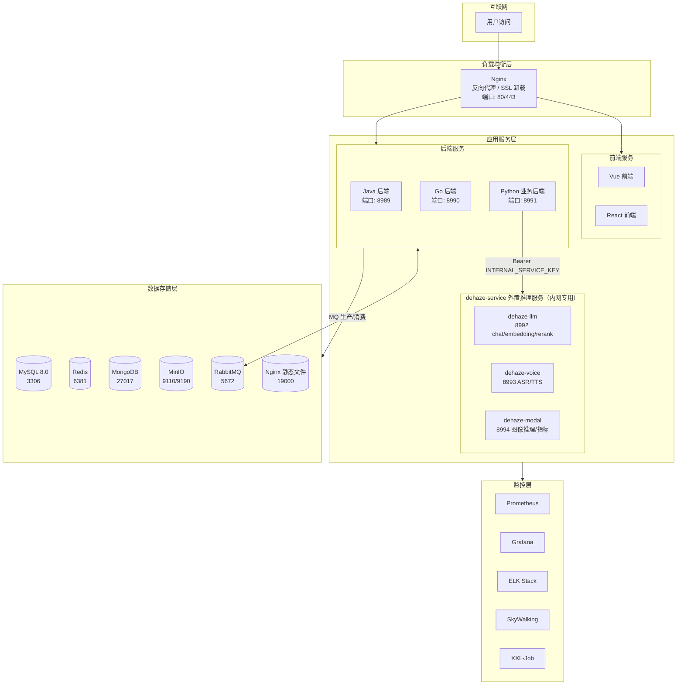

# 部署架构

## 1. 文档概述

### 1.1 文档目的

描述 AI 图像处理平台的部署架构设计，包括部署模式、环境规划、服务编排和监控体系。

### 1.2 适用范围

本文档适用于运维人员、DevOps 工程师和需要进行系统部署的开发人员。

---

## 2. 部署架构概览

### 2.1 架构图



### 2.2 部署模式

| 部署模式           | 适用场景       | 说明                         |
| ------------------ | -------------- | ---------------------------- |
| **单机部署**       | 开发/测试环境  | 所有服务部署在一台服务器     |
| **Docker Compose** | 小型生产环境   | 容器化部署，方便管理         |
| **Kubernetes**     | 中大型生产环境 | 集群部署，高可用、自动扩缩容 |

### 2.3 开发与预览环境

本项目采用 **dev / pre（preview）双环境**：dev 用于开发自测与热更新，pre 只测不开发，承载 UI 冒烟、SDK 契约集测与联调演示。两环境的部署拓扑、数据层隔离口径（库 / bucket / vhost / Redis db / ES 索引前缀）、环境变量差异与协作流程见《10-多环境部署实践》。

---

## 3. 服务组件

### 3.1 应用服务

| 服务                | 技术栈                     | 端口 | 说明                                                                                                                                                                                                            |
| ------------------- | -------------------------- | ---- | --------------------------------------------------------------------------------------------------------------------------------------------------------------------------------------------------------------- |
| **Vue 前端**        | Vue3 + Vite                | 5174 | 静态资源，由 Nginx 托管                                                                                                                                                                                         |
| **React 前端**      | React + Vite               | 5173 | 静态资源，由 Nginx 托管                                                                                                                                                                                         |
| **Java 后端**       | Spring Boot 3              | 8989 | 核心业务服务                                                                                                                                                                                                    |
| **Go 后端**         | Gin + GORM                 | 8990 | 备选业务服务                                                                                                                                                                                                    |
| **Python 业务后端** | FastAPI                    | 8991 | 业务后端（API 与 Java/Go 一致），编排 AI 域与对话 / 语音 / 图像链路，推理经内网调用 `dehaze-service/*`                                                                                                          |
| **dehaze-llm**      | FastAPI + llama-cpp-python | 8992 | chat / embedding / rerank 推理，只绑内网、不在 Nginx 暴露；由 `scripts/run.py` 独立拉起（`run.py run llm`），业务进程 reload/重启不影响其可用性。边界与契约见 [AI 能力链路协作设计](./09-AI能力链路协作设计.md) |
| **dehaze-voice**    | FastAPI                    | 8993 | ASR / TTS 引擎，只绑内网；由 `scripts/run.py` 独立拉起（`run.py run voice`）                                                                                                                                    |
| **dehaze-modal**    | FastAPI + PyTorch          | 8994 | 图像推理 / 图像质量指标计算 / GPU 指标，去雾与图像质量核心，只绑内网；由 `scripts/run.py` 独立拉起（`run.py run modal`）                                                                                        |

> `dehaze-service/*` 外置推理服务各自持有独立 venv（`uv sync` 安装）与模型缓存目录，
> 与业务后端的依赖、生命周期完全解耦。`llm`/`voice` 按需手动启动，`dehaze-modal` 为常驻核心；
> 三服务零 MySQL/Redis/ES/MinIO 依赖，只接受 `dehaze-python` 内网调用。

### 3.2 基础设施

| 服务               | 版本       | 端口             | 用途                                                  |
| ------------------ | ---------- | ---------------- | ----------------------------------------------------- |
| **Nginx**          | stable     | 80/443           | 反向代理、SSL 卸载、静态资源                          |
| **Nginx 静态文件** | stable     | 19000            | 数据集图片 / 模型权重静态服务（`nginx-dataset` 容器） |
| **MySQL**          | 8.4+       | 3306             | 关系型数据库                                          |
| **Redis**          | 7.x        | 6381             | 缓存、会话存储                                        |
| **MongoDB**        | 8.x        | 27017            | 文档存储（审计日志、算法结果）                        |
| **MinIO**          | latest     | 9110/9190        | 对象存储（API 9110 / 控制台 9190）                    |
| **RabbitMQ**       | management | 5672/15672/15692 | 消息队列（AMQP / 管理台 / Prometheus 指标）           |

> **宿主端口为何不是默认值**：办公网 → DevCloud 的链路代理按端口黑名单封禁 6379、9000 等默认服务端口（客户端表现为 HTTP 502），故 Redis 在宿主发布为 **6381**、nginx-dataset 发布为 **19000**；容器内部端口不变（Redis 6379 / Nginx 80）。

### 3.3 监控组件

| 服务              | 版本   | 端口              | 用途                                                                      |
| ----------------- | ------ | ----------------- | ------------------------------------------------------------------------- |
| **Prometheus**    | 2.50   | 9091              | 指标采集与告警规则评估                                                    |
| **Grafana**       | latest | 13001             | 监控面板（容器内 3000）                                                   |
| **AlertManager**  | 0.27   | 9093              | 告警分组/抑制/通知                                                        |
| **Elasticsearch** | 8.18   | 9200/9300         | 日志检索 + 知识库向量检索                                                 |
| **Kibana**        | 8.18   | 5601              | 日志可视化                                                                |
| **Logstash**      | 8.18   | 4560/5044         | 日志管道（5044 接收 Filebeat 数据）                                       |
| **Filebeat**      | 8.18   | -                 | 三端后端 + `dehaze-service/*` 推理服务 + 前端（client.log）结构化日志采集 |
| **SkyWalking**    | 9.7    | 11800/12800/18080 | APM 链路追踪（gRPC/HTTP/UI）                                              |
| **XXL-Job Admin** | 3.3    | 14980             | 分布式定时任务调度                                                        |

### 3.4 指标采集 Exporter

| Exporter                 | 端口  | 监控对象             | 说明                                                                       |
| ------------------------ | ----- | -------------------- | -------------------------------------------------------------------------- |
| **node-exporter**        | 9100  | 宿主机 CPU/内存/磁盘 | 常驻                                                                       |
| **mysqld-exporter**      | 9104  | MySQL                | 常驻                                                                       |
| **redis-exporter**       | 9121  | Redis                | 常驻                                                                       |
| **mongodb-exporter**     | 9216  | MongoDB              | 常驻                                                                       |
| **rabbitmq（内置插件）** | 15692 | RabbitMQ             | 通过 `config/rabbitmq/enabled_plugins` 启用                                |
| **minio（内置端点）**    | 9110  | MinIO                | `MINIO_PROMETHEUS_AUTH_TYPE=public`，路径 `/minio/v2/metrics/cluster`      |
| **dcgm-exporter**        | 9400  | GPU                  | `gpu` profile 按需启动：`docker compose --profile gpu up -d dcgm-exporter` |

### 3.5 服务间鉴权约定

`dehaze-service/*` 外置推理服务与 MCP 网关均只绑内网，调用方是各端后端；鉴权统一使用
`Authorization: Bearer <部署级静态密钥>` **单一载体**（对齐 OpenAI 兼容生态，不引入自定义请求头）：

| 被调方                                                               | 凭证                             | 说明                                                                                            |
| -------------------------------------------------------------------- | -------------------------------- | ----------------------------------------------------------------------------------------------- |
| `dehaze-llm`（8992）/ `dehaze-voice`（8993）/ `dehaze-modal`（8994） | `Bearer ${INTERNAL_SERVICE_KEY}` | 编排侧（`dehaze-python`）发起调用时携带；服务侧以 `hmac.compare_digest` 校验，缺失/错误一律 401 |
| `dehaze-mcp-gateway`（8082）                                         | `Bearer ${MCP_GATEWAY_KEY}`      | 网关侧强校验，未配置密钥时拒绝启动                                                              |

- 服务密钥代表**服务身份**（部署级静态值、env 注入、默认 `local-no-key` 保证开发零摩擦），
  与用户 API Key（代表用户身份、触发配额与模型白名单治理）严格分离，不得混用
- `/metrics` 同样需要该凭证：Prometheus job 以 `authorization.credentials` 携带（容器启动时由
  `__INTERNAL_SERVICE_KEY__` 占位符从环境变量替换）
- 当前为单机内网部署，不引入 mTLS / 服务网格；上 K8s 多租户后再评估

---

## 4. 环境规划

### 4.1 环境定义

| 环境           | 用途               | 数据库                                                 | 部署方式             |
| -------------- | ------------------ | ------------------------------------------------------ | -------------------- |
| **开发环境**   | 本地开发调试       | MySQL Docker（开发库 `dehaze` / 测试库 `dehaze_test`） | 本地启动             |
| **测试环境**   | 集成测试、E2E 测试 | MySQL Docker                                           | Docker Compose       |
| **预发布环境** | 发布前验证         | 独立测试库                                             | Docker Compose       |
| **生产环境**   | 正式运行           | 生产数据库                                             | Docker Compose / K8s |

### 4.2 服务器配置建议

| 服务类型         | CPU   | 内存   | 存储       | 说明                                        |
| ---------------- | ----- | ------ | ---------- | ------------------------------------------- |
| **Web 服务器**   | 2 核+ | 4 GB+  | 50 GB SSD  | Nginx + 前端静态资源                        |
| **业务服务器**   | 4 核+ | 8 GB+  | 100 GB SSD | Java/Go/Python 三端后端（可部署一台或多台） |
| **GPU 服务器**   | 8 核+ | 32 GB+ | 500 GB SSD | `dehaze-modal` 图像推理（显存 ≥ 8GB）       |
| **数据库服务器** | 4 核+ | 16 GB+ | 500 GB SSD | MySQL + Redis + MongoDB + RabbitMQ          |
| **检索服务器**   | 4 核+ | 8 GB+  | 200 GB SSD | Elasticsearch（日志 + 向量检索）            |
| **存储服务器**   | 2 核+ | 8 GB+  | 1 TB+      | MinIO 对象存储                              |

---

### 4.3 本地环境搭建与启动（快速开始）

> 本节是从零把系统在本机跑起来的最短路径。三端后端统一由 `scripts/run.py` 管理生命周期。

#### 4.3.1 依赖工具链

| 软件         | 版本要求 | 说明                                           |
| ------------ | -------- | ---------------------------------------------- |
| Node.js      | 18+      | 前端与 SDK                                     |
| pnpm         | 8+       | 前端 workspace 包管理                          |
| JDK          | 17+      | Java 后端（字节码 17，工具链 17~25 均可）      |
| Go           | 1.25+    | Go 后端                                        |
| Python       | 3.11+    | AI 编排 / 业务后端（uv 管理）                  |
| uv           | 最新     | Python 依赖与虚拟环境                          |
| MySQL 客户端 | -        | 执行数据库初始化脚本用                         |
| Docker       | 可选     | 基础设施容器化                                 |
| NVIDIA CUDA  | 可选     | `dehaze-modal` 推理的 GPU 加速（无则回退 CPU） |

Go 版本下限由 `dehaze-go/go.mod` 的 `go 1.25.0` 决定（1.24.x 不满足），多版本并存时用版本管理器（如 goenv）切换；Java 字节码目标为 17（`maven.compiler.release=17`），语言服务与构建可使用不同 JDK。

前端为 pnpm workspace，根目录一次装齐：

```bash
pnpm install -r
```

#### 4.3.2 初始化环境变量

```bash
cp .env.example .env
```

各连接参数（`MYSQL_*` / `REDIS_*` / `MINIO_*` …）清单见 `.env.example`。

#### 4.3.3 启动基础设施

```bash
# 核心依赖（数据库 / 缓存 / 存储 / MQ）
docker compose up -d mysql redis mongodb minio rabbitmq xxl-job-admin nginx-dataset

# 可选：ELK 日志栈 + SkyWalking 链路追踪
docker compose up -d elasticsearch kibana logstash filebeat sky-oap sky-ui

# 可选：监控栈
docker compose up -d prometheus grafana alertmanager node-exporter mysqld-exporter redis-exporter mongodb-exporter

# 可选：GPU 指标（需 NVIDIA GPU + nvidia-container-toolkit）
docker compose --profile gpu up -d dcgm-exporter
```

**数据卷口径与操作纪律**（`docker-compose.yml` 的 `volumes:` 段）：

- 基础服务的数据卷是**普通命名卷**（`mysql-data` / `redis-data` / `mongo-data` / `minio-data` / `es-data` / `rabbitmq-data` / `xxl-job-logs` / 监控栈若干），由 compose 自动创建与管理，**不是 `external: true`**；因此 `docker compose down`（不带 `-v`）会保留容器与数据卷，重建容器不丢数据。
- 随之而来的纪律：**禁止 `docker compose down -v`**（以及任何 `docker volume rm` / `docker volume prune`）——那会连卷一起删除，MySQL / Mongo / MinIO / ES 数据全部丢失，只能用 `config/sql` 种子重建库、桶内用户上传文件不可恢复。
- 若确有"卷必须由运维手工创建、与 compose 生命周期彻底解耦"的需求（例如多个 compose 项目共用同一 MySQL 实例），改造方式是：把 `volumes:` 各条改为 `external: true` + `name: <实际卷名>`，并**配套"先手工建卷"的运维步骤**（`docker volume create <卷名>`，或从旧卷改名接管），否则 `up` 会因卷不存在直接失败。**当前仓库刻意不做这个改造**：一键启动（`docker compose up -d`）依赖 compose 自动建卷，改 `external` 必须同时改运维流程与 K8s/CI 用法，不能只改 compose。

#### 4.3.4 安全初始化（首次必做）

Elasticsearch 启用 `xpack.security` 后，`kibana_system` / `logstash_system` / `beats_system` 等系统用户需手动设置密码，Alertmanager 的 Basic Auth 凭证需预生成（前置：`elasticsearch` 容器已启动）：

```bash
bash scripts/init-security.sh
```

脚本以 elastic 超级用户把三个系统用户密码设为 `${ES_PASSWORD}`，并生成 `config/alertmanager/web.yml`（bcrypt，账号 `admin` / 密码 `${ALERTMANAGER_PASSWORD}`）。修改 `ES_PASSWORD` / `ALERTMANAGER_PASSWORD` 后需重跑本脚本并重启相关服务。

#### 4.3.5 初始化数据库

docker 首启由 MySQL 入口脚本按 initdb 目录内 `*.sql` 字母序执行 `config/sql/schema/*.sql` 建表（调度中心库引导脚本 `config/sql/schema-external/xxl_job.sql` 由 docker-compose 单文件挂载进同一目录，字母序紧随其后），再由 `config/sql/schema/zz_load_data.sh` 加载 `config/sql/data/*.sql` 种子；手工重置 `dehaze` 库时按同样顺序执行（`schema/` → `data/`），例如 Windows PowerShell：

```powershell
Get-ChildItem config/sql/schema/*.sql | Sort-Object Name | ForEach-Object { Get-Content $_.FullName | mysql -u root -p dehaze }
Get-ChildItem config/sql/data/*.sql | Sort-Object Name | ForEach-Object { Get-Content $_.FullName | mysql -u root -p dehaze }
# 调度中心独立库：脚本自带 DROP/CREATE DATABASE xxl_job，故不指定库名；勿并入上面 `schema/*.sql` 通配
Get-Content config/sql/schema-external/xxl_job.sql | mysql -u root -p
```

> 种子账号口令固化在 `config/sql/data/sys_user.sql` 的 bcrypt 中（明文 `Dehaze2026`），改 `.env` 无效。

#### 4.3.6 启动后端

```bash
# 启动单个服务
python scripts/run.py run go      # Go:8990
python scripts/run.py run python  # Python:8991
python scripts/run.py run java    # Java:8989
python scripts/run.py run mcp     # MCP 网关:8082
python scripts/run.py run llm     # 内置本地推理:8992（chat/embedding/rerank）
python scripts/run.py run voice   # 内置本地语音:8993（asr/tts）
python scripts/run.py run modal   # 去雾核心算法服务:8994

# 启动全部（llm/voice/modal 未 provision 会被 skip，不中断其余服务）
python scripts/run.py run all

# 停止 / 重启 / 状态 / 日志（console.log 最近 50 行）
python scripts/run.py stop go
python scripts/run.py restart go,python,java
python scripts/run.py ps
python scripts/run.py logs go
```

- **Java 启动方式随 profile 分流**（`run.py` 按根 `.env` 的 `SPRING_PROFILES_ACTIVE` 自动选择，无需手工切换）：dev 走 `mvn spring-boot:run`（热更新），prod（含复用 prod 的 pre）走 `mvn package` + `java -jar`。原理见 §6.2。
- **推理服务**：`dehaze-service/{dehaze-llm,dehaze-voice,dehaze-modal}` 为外置独立服务，其中 `dehaze-modal` 是去雾 / 图像质量核心。未 provision 的服务会被 `run.py` skip。
- **首次启动前**：`dehaze-python` 与 `dehaze-service/*` 需分别 `uv sync`。
- **健康检查**：三端均有 `/ready`；`dehaze-python` 的 `/ready`、`/v1/*` 及推理服务均要求 `Authorization: Bearer ${INTERNAL_SERVICE_KEY}`（见 §3.5）。

#### 4.3.7 启动前端

各前端在根目录 `pnpm install -r` 后按需启动：

| 前端                  | 命令                                                                                                                                        | 端口      |
| --------------------- | ------------------------------------------------------------------------------------------------------------------------------------------- | --------- |
| dehaze-front-react    | `cd dehaze-front-react && pnpm run dev`                                                                                                     | 5173      |
| dehaze-front-vue      | `cd dehaze-front-vue && pnpm run dev`                                                                                                       | 5174      |
| dehaze-taro           | `cd dehaze-taro && pnpm dev:h5`（微信小程序 `pnpm dev:weapp`）                                                                              | 5175      |
| dehaze-uniapp         | `cd dehaze-uniapp && pnpm dev:h5`（微信小程序 `pnpm dev:mp-weixin`）                                                                        | 5176      |
| dehaze_flutter (Web)  | `cd dehaze_flutter && flutter pub get && dart run build_runner build --delete-conflicting-outputs && flutter run -d chrome --web-port 5177` | 5177      |
| dehaze-react-native   | `cd dehaze-react-native && yarn start`（`yarn android` / `yarn ios`）                                                                       | 8081      |
| dehaze-android        | `cd dehaze-android && ./gradlew build`（`installDebug` / `testDebugUnitTest` / `jacocoTestReport`）                                         | -         |
| Electron（React/Vue） | 随对应前端构建（渲染进程）                                                                                                                  | 5183/5184 |

> Android 默认连接 `http://10.0.2.2:8989`（模拟器访问本机需用 10.0.2.2），地址配置在 `DehazeApplication.java`。

#### 4.3.8 访问地址

| 类型     | 服务         | 地址                                                                     |
| -------- | ------------ | ------------------------------------------------------------------------ |
| 接口文档 | Java         | http://localhost:8989/doc.html                                           |
| 网关     | MCP 网关     | http://localhost:8082                                                    |
| 监控     | Grafana      | http://localhost:13001（`admin` / `${GRAFANA_ADMIN_PASSWORD}`）          |
| 监控     | Prometheus   | http://localhost:9091                                                    |
| 监控     | AlertManager | http://localhost:9093（Basic Auth `admin` / `${ALERTMANAGER_PASSWORD}`） |
| 日志     | Kibana       | http://localhost:5601（建 `dehaze-logs-*` 索引模式）                     |
| 链路     | SkyWalking   | http://localhost:18080                                                   |

- 日志落在各服务 `logs/{yyyy-MM-dd}/{console,info,error}.log`（按日切割、保留 30 天）。

#### 4.3.9 浏览器调试（dev / pre，可选）

dev / pre 上的 Chrome 调试实例（CDP 19222 + 网页远程桌面）由 `scripts/chrome-debug/index.mjs` 统一管理，AI 侧 chrome-devtools MCP 与人工接管共用同一实例与 profile：

```bash
node scripts/chrome-debug/index.mjs start|stop|restart|status
node scripts/chrome-debug/index.mjs view        # 人工接管（SSH 隧道 + noVNC）
node scripts/chrome-debug/index.mjs smoke       # CDP 端到端冒烟并截图
```

**不要手工另起 `google-chrome --remote-debugging-port` 实例**（无图形桌面、无法经 VNC 人工接管，profile 落在 /tmp 重启即丢）。

同一入口在工作站（macOS / Linux / Windows）直接拉起本机 Chrome（默认 CDP 9222），并把三个浏览器 CLI 绑定到该实例：

```bash
node scripts/chrome-debug/index.mjs check    # 环境检测（Chrome / Node / 三工具 / 实例 / 绑定 / shim）
node scripts/chrome-debug/index.mjs setup    # 写三工具 CDP 配置 + 装 shim + 拉起实例；--cdp-port 可换端口
```

运行时产物（profile / logs / pids / screenshots / .vncpasswd）统一在 `~/.chrome-debug/`；三个 CLI 的命令名由 `~/.local/bin` 下的 shim 遮蔽——先确保实例存活再转发真身，因此实例被关掉后调用任一 CLI 会自动恢复，并沿用同一 profile 的登录态。

**三个 CLI 的选型**：页面操作与验收（打开 / 点击 / 填写 / 截图 / 取快照）用 `agent-browser`；样式 / 性能 / 内存 / 网络细节排查用 `chrome-devtools`（`get_css_styles`、trace、heap snapshot）；要把操作沉淀成可回归用例用 `playwright-cli`（`recording-start` / `recording-stop` 录制为 Playwright 代码）。三者相互独立、可同时连同一个 Chrome，但**不要对同一页面并发操作**。

**实例归属与入口**：同一个端口号在不同机器上含义不同（9222 在办公网工作站是日常 Chrome，在 DevCloud 上是隧道代理口）。可操作的 Chrome 只有两类——本机实例（三个 CLI 裸调接管）与远端服务器上的项目实例（`scripts/chrome-debug/index.mjs` 管理、CDP 19222、noVNC 可人工接管）；跨机操作用户工作机上的 Chrome 只有"远端 → 用户 Mac"一条通道（`remote-agent-browser` / `remote-exec`），其它组合不存在。

---

### 4.4 内网测试集群环境事实

本节只记内网 K8s 测试集群的**静态事实**（命名空间、镜像仓库、六端单测 Job 的落点与配置）；构建 / 推送 / apply / 排障的**操作流程与坑**见 §6.6 与 skill `dehaze-project-knowledge` 的 `06-服务器与联调环境.md` §2、§3，本节不重复。

#### 4.4.1 调试命名空间

命名空间 **`p-cloud-dev-test-perm-resource-5aesj19quwkg`** —— 长期存在的临时部署与联调环境（跨服务联调、复现线上问题、跑一次性批量任务），**只从两台 DevCloud 机可达**；不适合长期驻留（配额累加）。

| 项             | 事实                                                                                                      |
| -------------- | --------------------------------------------------------------------------------------------------------- |
| kubectl 客户端 | `/usr/local/bin/kubectl`                                                                                  |
| kubeconfig     | `/root/.kube/config`（**未设 `KUBECONFIG`**）                                                             |
| context        | `cur-context`（cluster=`cluster`、authinfo=`sa`、已绑命名空间）                                           |
| 身份           | `system:serviceaccount:p-cloud-dev-test-perm-resource-5aesj19quwkg:sa`（命名空间内 SA，**非集群管理员**） |
| 集群 DNS       | `9.165.119.254`；命名空间内互访直接用 `服务名:端口`                                                       |

- **权限边界**：命名空间内一切资源全权（RBAC `*.* [*]`——pods/deploy/sts/jobs/cronjobs/svc/ingress/pvc/secret/cm，`exec` / `port-forward` 可用）；集群级一律禁止（`get nodes`、`get ns`（list）、`get sc|pv|crd`、`--all-namespaces`、`get --raw /api/v1/nodes/<name>` 均 `Forbidden ... at the cluster scope`，仅按名字单 `get` 自己的命名空间允许）。
- **配额**：CPU/内存生效总量为 **32C / 32G 累加**，由组织架构准入 webhook **`validate.pod.io`** 把关（**按 `limits` 计、不按 `requests`**；命名空间自带 ResourceQuota 只有 `pods: 200` 与 TKE 的 `eni-ip: 200`）。单 Pod 建议 **≤ 24C / 28G**。PVC 与空闲期的 CronJob 不占 CPU/内存配额；命名空间落在 13 节点池，**无需** `nodeSelector` / `tolerations`。
- **PVC**：StorageClass 固定 **`cbs`**（腾讯云 CBS，RWO，Immediate），容量硬约束 **`[10, 32000]` GiB**（小于 10Gi 会 `ProvisioningFailed: disk size is invalid`）。
- **集群内环境**：容器**有公网出口**（pypi / github / dl.google 可达）；docker.io 有内网加速、**不需要** `imagePullSecrets`（但只能拉不能推）；访问 `panshi.woa.com` / `dev.panshi.woa.com` 被拒（TCP 建连正常、TLS 握手 `access denied`）属**对端准入策略**，不是集群网络限制。
- **保留勿删**：`secret/default-token-r5tx4`、`secret/sa-token-cwjlk`（kubectl 访问凭据）、`configmap/kube-root-ca.crt`（集群自管）。

#### 4.4.2 内网镜像仓库

dehaze 镜像仓库 = **`csighub.tencentyun.com/earthywu/dehaze-system`**（TCR 企业版，后端存储 COS，**仅内网可达、需 UDNS 解析**）；镜像一律走该仓库（ttl.sh 已弃用）。Pod 拉取该私有仓库**必须**带凭据——命名空间内固定 docker-registry Secret **`csighub-registry`**，Pod 写 `imagePullSecrets: [{name: csighub-registry}]`。

| 用途          | tag 规则                                                                                            |
| ------------- | --------------------------------------------------------------------------------------------------- |
| 应用/测试镜像 | `<app>-<用途>-<commit sha>`（**禁 latest**），如 `{go,java,py,llm,voice,modal}-test-<commit sha>`   |
| 依赖基础镜像  | `<服务>-base-$(sha256sum <服务>/uv.lock \| cut -c1-12)` 内容指纹（lock 未变即复用，不手工升 v1/v2） |

**只为重依赖端建 base 镜像**：`dehaze-modal`（518 包，torch cu128 + nvidia + natten + pyiqa，约 20GB）、`dehaze-voice`（433 包，funasr + piper + torch cu128，约 8.4GB）；`dehaze-python`（160 包）与 `dehaze-llm`（41 包）依赖直接装在测试镜像内。

#### 4.4.3 六端单测 K8s Job

单测 Job 清单在 **`config/kube/test/`**，**每端一个 Job**，资源量按 limits 计：

| 清单                  | 覆盖                                              | 资源量（limits 合计） |
| --------------------- | ------------------------------------------------- | --------------------- |
| `job-smoke.yaml`      | 编排侧 python + 三推理服务各一最小用例集（4 Pod） | 16C / 28G             |
| `job-regression.yaml` | java / go / 编排侧 python                         | 18C / 24G             |
| `job-services.yaml`   | `dehaze-llm` / `dehaze-voice` / `dehaze-modal`    | 10C / 20G             |

- `job-regression.yaml` 与 `job-services.yaml` **不得同时 apply**（24G + 20G > 32G 必被 `validate.pod.io` 拒）；`job-smoke.yaml` 可单独或与任一同时 apply。
- 镜像：同仓库不同 tag，`csighub.tencentyun.com/earthywu/dehaze-system:{go,java,py,llm,voice,modal}-test-<commit sha>`。
- 两个固定名 Secret：`csighub-registry`（拉镜像，见 §4.4.2）、`dehaze-test-env`（`.env` 以 Secret 挂到 `/app/.env`，内容已把 `127.0.0.1` 换成 `21.6.51.87`）。
- 容器内布局：`/app/dehaze-{go,java,python}`、`/app/dehaze-service/dehaze-{llm,voice,modal}`、`/app/config`、`/app/.env`；六个测试镜像都不含 `.env`（由 Secret 注入）。

---

## 5. 请求路由

### 5.1 路由规则

**入口访问**：前端静态资源（Vue/React）与后端 API 由各前端构建产物按环境配置访问（开发环境直连各后端端口，生产环境经反向代理统一入口）。

**静态文件服务**（`nginx-dataset` 容器，端口 19000，配置见 `config/nginx/dataset.conf`）：

| 路径前缀      | 服务内容   | 说明                                                              |
| ------------- | ---------- | ----------------------------------------------------------------- |
| `/datasets/*` | 数据集图片 | 托管 `datasets/` 目录，URL：`http://{host}:19000/datasets/{path}` |
| `/models/*`   | 模型权重   | 托管 `models/` 目录，URL：`http://{host}:19000/models/{path}`     |
| `/`           | 静态文件根 | 仅精确匹配，防目录遍历                                            |

> 该静态服务配置 CORS 通配（GET/OPTIONS）、图片 7 天缓存、隐藏文件拒绝访问；后端文件上传（用户结果图等）走 MinIO（9110），二者职责分离。

### 5.2 特殊配置

| 配置项         | 值    | 说明                                                |
| -------------- | ----- | --------------------------------------------------- |
| 请求体大小限制 | 100MB | 支持大文件上传                                      |
| 算法接口超时   | 300s  | 去雾处理耗时较长                                    |
| WebSocket      | 支持  | 实时进度推送（消息通知模块）与流式 ASR（`/ws/asr`） |

> **WebSocket 反向代理要求**：流式 ASR 的 `wsUrl` 为相对路径（后端不拼绝对地址，外部 origin 由客户端解析），反向代理必须转发 `/ws` 并携带升级头，否则用户侧无法建连（后端端口未对外开放时）：
>
> ```nginx
> location /ws/ {
>   proxy_pass http://python-backend:8991;
>   proxy_http_version 1.1;
>   proxy_set_header Upgrade $http_upgrade;
>   proxy_set_header Connection "upgrade";
> }
> ```
>
> 开发环境同理：vite 代理需为 `/ws` 显式开启 `ws: true`（`dehaze-front-vue`/`dehaze-front-react` 的 `vite.config.ts` 已配置）。

### 5.3 服务间内网调用

外置推理服务只被 `dehaze-python` 内网调用（Java/Go 与前端经编排侧间接使用，不直连），入站统一 `Authorization: Bearer ${INTERNAL_SERVICE_KEY}`：

| 调用方（`dehaze-python`）                            | 被调方              | 协议                            |
| ---------------------------------------------------- | ------------------- | ------------------------------- |
| `llm_client` / `embedding_client` / `rerank_service` | `dehaze-llm` 8992   | HTTP（OpenAI 兼容，SSE）        |
| 语音引擎客户端（含 `/ws/asr` 内部代理）              | `dehaze-voice` 8993 | HTTP + WebSocket                |
| 图像任务 / 评估 / 算法探测客户端                     | `dehaze-modal` 8994 | HTTP（multipart，字节进字节出） |

三个服务零数据库依赖、可无状态重启；用户鉴权、配额扣减与积分计费只发生在编排侧。

---

## 6. CI/CD 流程

### 6.1 流程概览

```
代码提交 → 代码构建 → 自动化测试 → 打包制品 → 自动部署 → 验证测试 → 发布上线
```

### 6.2 构建产物

| 项目            | 构建命令          | 产物                                                      |
| --------------- | ----------------- | --------------------------------------------------------- |
| **Vue 前端**    | `pnpm build:prod` | `dist/` 目录                                              |
| **React 前端**  | `pnpm build`      | `dist/` 目录                                              |
| **Java 后端**   | `mvn package`     | `target/*.jar`                                            |
| **Go 后端**     | `go build`        | 二进制（Linux amd64）                                     |
| **Python 后端** | -                 | 源码 + `requirements.txt`（业务与 AI 编排，不含推理依赖） |

> **Java 启动方式按 profile 分流**（由 `scripts/run.py` 落实）：**prod**（含复用 prod 的 pre）先
> `mvn -q -DskipTests package` 构建，再从 `target/` 取 repackage 后的 fat jar 以 `java -jar` 启动；
> **dev** 仍用 `mvn spring-boot:run -DskipTests`。这样 PID 文件记录的是 JVM 本身，`run.py ps`
> 不再因跟踪 maven 启动器进程而误报 running。
>
> 原因：`spring-boot-devtools` 只写了 `<optional>true</optional>`，`optional` 仅在该依赖被打入
> fat jar 时由 `spring-boot-maven-plugin` 排除；`spring-boot:run` 直接跑 classpath，与 profile 无关，
> 于是 prod 形态下 devtools 也被加载并激活。pre 复用 prod profile 且是共享机，任何对
> `dehaze-java` 的 maven 构建都会改写 `target/classes` → devtools 热重启 → 重启上下文丢失
> `run.py` 注入的 `.env` → 绑 8080 且无 DataSource → `APPLICATION FAILED TO START` 且不自愈。
> `application-prod.yml` 另设 `spring.devtools.restart.enabled=false` 作双保险。

### 6.3 部署检查清单

- [ ] 环境变量已配置（数据库密码、密钥等）
- [ ] 数据库已初始化
- [ ] 存储目录已挂载
- [ ] ES 启动后执行 `bash scripts/init-security.sh` 初始化安全（设置 kibana_system / logstash_system / beats_system 密码 + 生成 Alertmanager 凭证）
- [ ] 端口未被占用
- [ ] 健康检查通过
- [ ] 时区已固化 Asia/Shanghai（见 6.4，策略定义见 API 规范）
- [ ] 镜像相关静态校验通过：`python scripts/check_dockerfiles.py`（见 6.5）
- [ ] 目标环境库与 `config/sql/schema/*.sql` 无漂移：`dehaze-python/.venv/bin/python scripts/check_schema_drift.py`（见 6.5）

### 6.4 时区部署要求

服务端统一 **Asia/Shanghai (UTC+8)**（API 规范），部署时需显式固化，防止容器默认 UTC 导致三端写入/展示错位：

- **应用容器/进程**：`TZ=Asia/Shanghai` 环境变量（Docker Compose `environment:` 或 K8s env）；Java 进程追加 `-Duser.timezone=Asia/Shanghai`，保证 `datetime.now()` / `time.Now()` / `LocalDateTime.now()` 语义一致
- **MySQL**：`default-time-zone='+08:00'`（my.cnf 或容器 `command: --default-time-zone=+08:00`），当前开发实例为 `SYSTEM`/CST 等价
- 三端连接层已固化（Python `init_command=SET time_zone='+08:00'`、Go DSN `loc=Asia/Shanghai`、Java `serverTimezone=Asia/Shanghai`），读回解释不再依赖服务器 SYSTEM

### 6.5 静态校验脚本（只读门禁）

两个脚本把"靠人记"的部署/测试前提变成可执行断言，**都不构建镜像、不启动服务、不写库**（只读仓库文本 / 只读 `information_schema`），退出码统一为 `0` 通过、`1` 命中问题、`2` 用法或环境错误：

| 脚本                            | 拦什么                                                                                                                                                                                    | 用法                                                                                                             |
| ------------------------------- | ----------------------------------------------------------------------------------------------------------------------------------------------------------------------------------------- | ---------------------------------------------------------------------------------------------------------------- |
| `scripts/check_dockerfiles.py`  | 测试镜像三条铁律：`uv sync` 缺 `--no-cache`（镜像层被 uv 下载缓存撑大）或缺 `--extra test`（测试依赖声明在 test extra 的项目）、测试镜像漏 COPY 仓库根 `config/`、Dockerfile 里写 heredoc | `python scripts/check_dockerfiles.py`（可传 Dockerfile 路径只查指定文件）                                        |
| `scripts/check_schema_drift.py` | 目标库与 `config/sql/schema/sys_*.sql` 的表/列漂移（缺表 / 缺列 / 多余列 / 多余 `sys_*` 表）——缺列是集成测试大面积 `1054 Unknown column` + 500/skip 的根因                                | `dehaze-python/.venv/bin/python scripts/check_schema_drift.py`（连接参数读根 `.env` 的 `MYSQL_*`，环境变量优先） |

- **漂移脚本只报告不自动改库**：改 schema 仍走 `config/sql/schema/*.sql` + `config/sql/migration/*.sql` 的人工路径；有漂移时输出 `文件:行` 级别差异清单并 exit 1。
- **注意适用范围**：目标库取自根 `.env` 的 `MYSQL_DATABASE`（当前 dev 为 `dehaze_dev`；多环境库划分见《10-多环境部署实践》§3），脚本只发 `information_schema` 的 `SELECT`，不会写入。
- 两个脚本的设计口径与铁律来源见《05-测试架构》§6.8 与各脚本头部注释。

### 6.6 K8s 调试部署（内网测试集群）

测试 / 调试镜像在内网集群上的标准流程：

1. 集群外 `docker build -f <项目>/Dockerfile --target test -t <内网仓库>/<repo>:<tag> .`（**构建上下文＝仓库根**）→ `docker push`。
2. 集群内拉取私有仓库镜像**必须**带凭据（Pod 写 `imagePullSecrets`）；拿不到凭据时才退化为"官方镜像 + 代码注入"。
3. `kubectl apply -f <manifest> -n <ns>`——写脚本**一律显式带 `-n`**，防换 context 后误操作。
4. 本地访问：`kubectl port-forward -n <ns> pod/<pod> <本地端口>:<容器端口>`（**headless Service 无 ClusterIP，必须 port-forward**）。
5. 排障：`kubectl logs -f <pod> -n <ns>`、`kubectl describe pod <pod> -n <ns>`。
6. 用完即删：`kubectl delete deploy/<name> svc/<name> -n <ns>`；**清理顺序＝先删 Pod 再删 PVC**。

坑与纪律：

- **权限一律以真实命令的报错为准**，别信 `kubectl auth can-i`（对集群级资源会误报 yes）。
- **配额按 limits 累加**：`资源使用量已超出组织架构配额` 通常是残留 Pod 占额度 ⇒ 先删无用 Pod 或联系集群扩容；"低 requests 高 limits 骗额度"行不通。
- **测试 Job 清单不得同时 apply**：多份 Job 的 limits 累加超配额会被准入校验整体拒绝。
- `kubectl get pods -A` 被拒是设计如此，只能在授权命名空间内操作。
- 多容器 Pod：只要有一个镜像未拉完，kubelet 就不发布任何容器状态，`kubectl logs` 对所有容器都报 `ContainerCreating`（其实已在跑）⇒ 每端一个 Job。
- `exec` 要求镜像自带 shell（调试镜像用 `alpine` / `busybox`）；`bash -lc` 会重置 PATH → `go` / `mvn` command not found，用 `bash -c` + 显式 `export PATH`。
- Pod → 开发机反向联调三前提：服务监听 `0.0.0.0`、开发机安全组放通端口、DB 授权含节点网段（**授权别写死单个 IP**，Pod 会被调度到不同节点）。

---

## 7. 监控与告警

### 7.1 监控体系

```
应用服务 → 指标采集(Prometheus) → 存储(TSDB) → 可视化(Grafana)
    ↓
日志输出 → 日志采集(Filebeat) → 管道(Logstash) → 存储(ES) → 分析(Kibana)
    ↓
异常检测 → 告警管理(AlertManager) → 通知(邮件/钉钉)
```

- 指标：Prometheus 抓取三端 `/metrics` 及各 Exporter，Grafana 自动加载 `config/grafana/dashboards/` 下的面板（Dehaze 文件夹）
- 日志：
  - **后端日志**：Filebeat 采集三端 `logs/{yyyy-MM-dd}/*.log`（NDJSON 解析，`fields.service: java/python/go`）→ Logstash → ES 索引 `dehaze-logs-{yyyy.MM.dd}`
  - **前端日志**：前端 SDK 批量上报 `POST /api/v1/logs/client` → 后端写 `logs/{yyyy-MM-dd}/client.log` → Filebeat 新增 filestream input（`fields.service: client`）→ Logstash 按 `fields.service` 分流 → ES 索引 `dehaze-client-logs-{yyyy.MM.dd}`
  - Kibana 分别建 `dehaze-logs-*` / `dehaze-client-logs-*` 索引模式；以 `trace_id` 可跨索引串联前后端日志
- 链路追踪：SkyWalking OAP（11800 gRPC / 12800 HTTP）采集三端 Agent 上报的调用链，UI 访问 `http://{host}:18080`，存储复用 ES（`SW_STORAGE=elasticsearch`，保留 7 天）
- 告警：Prometheus 按 `config/prometheus/rules/dehaze-alerts.yml` 评估，推送 AlertManager（`config/alertmanager/alertmanager.yml` 配置邮件通知，支持钉钉/企业微信 Webhook 扩展）

### 7.2 关键告警指标

告警规则已实现于 `config/prometheus/rules/dehaze-alerts.yml`：

| 指标            | 阈值            | 持续  | 级别     |
| --------------- | --------------- | ----- | -------- |
| CPU 使用率      | > 85%           | 5min  | warning  |
| 内存使用率      | > 90%           | 5min  | critical |
| 磁盘使用率      | > 85%           | 10min | warning  |
| 服务宕机        | up == 0         | 1min  | critical |
| Java 5xx 错误率 | > 5%            | 2min  | critical |
| P99 延迟        | > 5s            | 5min  | warning  |
| MySQL 连接数    | > 80% max       | 3min  | warning  |
| Redis 内存      | > 80% maxmemory | 5min  | warning  |

> 部署前需将 `config/alertmanager/alertmanager.yml` 中的 SMTP 占位配置替换为真实值。
>
> Alertmanager 已启用 Basic Auth（账号 `admin` / 密码 `${ALERTMANAGER_PASSWORD}`），凭证文件 `config/alertmanager/web.yml` 由 `scripts/init-security.sh` 生成（bcrypt）；Prometheus 在 `prometheus.yml` 中以 `basic_auth` 携带该凭证推送告警（密码经启动脚本从 `__ALERTMANAGER_PASSWORD__` 占位符替换，因 prometheus.yml 不支持环境变量）。

### 7.3 业务指标命名规范

三端与推理服务（`dehaze-service/*`）业务指标统一 `dehaze_` 前缀，跨端聚合面板（`Dehaze 业务监控`）基于以下命名：

| 维度               | 指标                                                                                                       | 埋点端                             |
| ------------------ | ---------------------------------------------------------------------------------------------------------- | ---------------------------------- |
| 预测               | `dehaze_prediction_total{status}`、`dehaze_prediction_duration_seconds`                                    | Java、Go                           |
| 推理（算法侧）     | `dehaze_inference_requests_total{algorithm,status}`、`dehaze_inference_duration_seconds{algorithm,status}` | dehaze-modal                       |
| 评估               | `dehaze_evaluation_total{status}`、`dehaze_evaluation_duration_seconds`                                    | Java、Go                           |
| 任务               | `dehaze_task_total{task_type,status}`、`dehaze_task_duration_seconds`                                      | Java、Go、Python                   |
| 缓存               | `dehaze_cache_hits_total{layer}`、`dehaze_cache_misses_total{layer}`、`dehaze_cache_loader_total`          | Go、Python                         |
| GPU                | `dehaze_gpu_*`（利用率/显存/温度/功耗）                                                                    | dehaze-modal（推理服务独有）       |
| 文件上传           | `dehaze_file_upload_total`                                                                                 | Java                               |
| HTTP 请求          | `http_server_requests_seconds`（Java/Go）、`http_request_duration_seconds`（Python 编排侧）                | 三端                               |
| 推理服务 HTTP      | `dehaze_http_requests_total{endpoint,status}`、`dehaze_http_request_duration_seconds{endpoint}`            | dehaze-service/*（三服务统一口径） |
| 对话/向量/重排推理 | `dehaze_inference_requests_total{type,status}`、`dehaze_inference_duration_seconds{type,status}`           | dehaze-llm                         |
| 语音引擎推理       | `dehaze_inference_duration_seconds{engine}`                                                                | dehaze-voice                       |

> 推理服务的 `/metrics` 端点同样要求 `Authorization: Bearer ${INTERNAL_SERVICE_KEY}`，Prometheus 抓取配置以 `authorization.credentials` 携带（占位符替换机制见 §7.2 Alertmanager 同款）。

### 7.4 日志规范

日志的存储/切割/保留、字段 schema、请求上下文注入、分类与内容规范统一见 [`07-日志架构设计.md`](./07-日志架构设计.md)（含前端日志 client 的接收链路与字段规范要点）。日志采集链路（Filebeat → Logstash → ES → Kibana）见 §7.1。

---

## 8. 备份策略

| 数据类型          | 备份频率          | 保留周期 | 备份方式                                     |
| ----------------- | ----------------- | -------- | -------------------------------------------- |
| **MySQL**         | 每日全量 + Binlog | 30 天    | mysqldump + 增量                             |
| **MongoDB**       | 每日全量          | 14 天    | mongodump                                    |
| **Redis**         | 每 6 小时 RDB     | 7 天     | RDB 快照                                     |
| **Elasticsearch** | 每日快照          | 14 天    | 快照仓库                                     |
| **RabbitMQ**      | 配置备份          | 永久     | 队列声明代码化（三端启动时声明），配置入 Git |
| **MinIO 文件**    | 每日增量          | 30 天    | 跨桶同步                                     |
| **配置文件**      | 每次变更          | 永久     | Git 版本控制                                 |

---

## 9. 安全加固

### 9.1 网络安全

| 措施               | 说明                                                                                                                                          |
| ------------------ | --------------------------------------------------------------------------------------------------------------------------------------------- |
| 防火墙规则         | 仅开放必要端口（80/443）                                                                                                                      |
| 内网隔离           | 数据库等服务仅内网访问                                                                                                                        |
| HTTPS              | 生产环境强制 HTTPS                                                                                                                            |
| WAF                | Web 应用防火墙防护                                                                                                                            |
| Elasticsearch 认证 | `xpack.security.enabled=true`，elastic 超级用户密码 = `${ES_PASSWORD}`，HTTP 层关闭 SSL 保持内网 http 访问                                    |
| Alertmanager 认证  | 启用 Basic Auth（账号 `admin` / 密码 `${ALERTMANAGER_PASSWORD}`），容器启动时动态生成 bcrypt 凭证；Prometheus 推送告警需同步配置 `basic_auth` |

### 9.2 部署安全检查清单

- [ ] 修改默认密码（MySQL、Redis、MinIO 等）
- [ ] 配置 HTTPS 证书
- [ ] 限制数据库远程访问
- [ ] 配置防火墙规则
- [ ] 启用日志审计
- [ ] 定期更新系统和依赖
- [ ] 容器使用非 root 用户运行

---

## 10. 配置文件参考

> **注**：以下配置文件存放在项目仓库中，此处仅列出路径，具体内容以项目实际文件为准。
>
> 构建 / 部署清单（K8s manifest、镜像构建与推送说明等）统一放 `config/`（如 `config/kube/`）——`deploy/` 目录被 `.gitignore` 忽略，放进去的文件不会入库。

| 配置类型                 | 文件路径                                                                          |
| ------------------------ | --------------------------------------------------------------------------------- |
| **Docker Compose**       | `docker-compose.yml`（生产/测试）、`docker-compose-dev.yml`（开发）               |
| **环境变量**             | `.env`                                                                            |
| **Nginx 配置**           | `config/nginx/dataset.conf`（静态文件服务）                                       |
| **Prometheus 配置**      | `config/prometheus/prometheus.yml`                                                |
| **Prometheus 告警规则**  | `config/prometheus/rules/dehaze-alerts.yml`                                       |
| **AlertManager 配置**    | `config/alertmanager/alertmanager.yml`                                            |
| **Redis 配置**           | `config/redis/redis.conf`                                                         |
| **Logstash 管道**        | `config/logstash/pipeline/dehaze.conf`                                            |
| **Filebeat 配置**        | `config/filebeat/filebeat.yml`                                                    |
| **RabbitMQ 插件**        | `config/rabbitmq/enabled_plugins`                                                 |
| **Grafana 面板与数据源** | `config/grafana/dashboards/`（面板）、`config/grafana/provisioning/`（自动装载）  |
| **SkyWalking 存储**      | 依赖 ES（docker-compose 中 `SW_STORAGE=elasticsearch`）                           |
| **XXL-Job 数据库**       | MySQL `xxl_job` 库（docker-compose 初始化；脚本见 `config/sql/schema-external/`） |
| **数据库初始化 SQL**     | `config/sql/schema/*.sql`、`config/sql/data/*.sql`                                |
| **Kubernetes 配置**      | `config/kube/config`                                                              |
| **Java Dockerfile**      | `dehaze-java/Dockerfile`                                                          |
| **Python Dockerfile**    | `dehaze-python/Dockerfile`（业务后端，不含推理依赖）                              |
| **Vue Dockerfile**       | `dehaze-front-vue/Dockerfile`                                                     |

### 10.1 路径与配置约定

**仓库根**定义为包含 `.env.example` 的目录；三端启动时各自锚定，均不依赖进程工作目录（克隆到任意位置、任意 cwd 启动均成立）。定位实现：Go 以 `go.mod` 为标记向上查找（`pkg/config/paths.go` 的 `GoRoot`/`RepoRoot`）、Python 以 `pyproject.toml` 为标记向上查找（`app/config.py` 的 `_find_python_project_root`），均不按 `__file__` 数目录层数、不依赖 `.env` 是否存在（精简部署可能缺失）；Java 走 classpath 天然规避。

| 类别                            | 相对路径               | 锚定基准                                                                           | 实现位置                                                                                |
| ------------------------------- | ---------------------- | ---------------------------------------------------------------------------------- | --------------------------------------------------------------------------------------- |
| 用户上传文件（三端共用）        | `data/upload`          | 仓库根                                                                             | Java `common/util/AppPaths`、Go `pkg/config/paths.go`、Python `app/config.py`           |
| 静态数据集 / 模型（nginx 托管） | `datasets/`、`models/` | 仓库根                                                                             | 与 `nginx-dataset` 的挂载路径一致                                                       |
| 服务运行日志                    | `logs/`                | 各服务根（`dehaze-java` / `dehaze-go` / `dehaze-python` / `dehaze-service/<svc>`） | 与 `config/filebeat/filebeat.yml` 的挂载位置一致，不可迁移                              |
| 本地模型缓存                    | `models/`              | 仓库根                                                                             | 编排侧与 `dehaze-service/*` 共用同一目录（`MODEL_CACHE_DIR`），模型文件由服务侧下载落盘 |
| Go SQLite 数据文件              | `data/dehaze.db`       | `dehaze-go` 服务根                                                                 | `pkg/config/paths.go`                                                                   |

约定：

1. 配置文件与代码中一律使用相对路径，禁止出现机器相关路径（盘符、`/mnt/x/...`、他人工作目录）；绝对路径只在部署方通过 `.env` 显式覆盖时出现。
2. 无法相对化的项（HOST / 端口 / 口令 / 密钥）统一放根 `.env`，三端按同名变量读取，变量分区与清单见 `.env.example`。
3. 有合理默认值的项（如 `UPLOAD_DIR` 默认 `<仓库根>/data/upload`）不写进 `.env`——默认值即"本机单实例"拓扑，需要指向其他机器时再在 `.env` 中覆盖。
4. 部署拓扑信息由 `scripts/run.py` 启动时注入，不落业务配置：`XXLJOB_EXECUTOR_IP`（三端执行器共用，admin 在容器、后端在宿主时须为 `host.docker.internal`，否则容器无法回调执行器）。该域名仅装有 Docker 的 Windows/macOS 可解析，脚本注入前先做解析校验，解析不到则留空（避免 xxl-job 初始化因地址解析失败直接抛 NPE 导致启动失败）。
5. 种子账号口令属数据库初始化数据，固化在 `config/sql/data/sys_user.sql` 的 bcrypt 中（明文 `Dehaze2026`），不是运行时配置，改 `.env` 无效。
6. 三端配置项命名须一致：同一环境变量名在三端映射到同一语义（如 Redis 逻辑库统一为 `REDIS_DATABASE`），不得一端可配、另一端写死。

### 10.2 XXL-Job 三端执行器契约

三端执行器同开同关（dev/prod 开启、test 关闭），共享同一个 admin 与 access token，仅"服务身份"不同：

| 项             | Java                                          | Go                                              | Python                           | 说明                                                                                                 |
| -------------- | --------------------------------------------- | ----------------------------------------------- | -------------------------------- | ---------------------------------------------------------------------------------------------------- |
| 开关           | `xxl.job.enabled: true`                       | `xxljob.enabled: true`                          | `XXLJOB_ENABLED=True`            | 由各端环境配置表达；`application-test.yml` / `config.test.yaml` / `TestingSettings` 关闭             |
| 执行器注册名   | `xxl-job-executor-dehaze-java`                | `xxl-job-executor-dehaze-go`                    | `xxl-job-executor-dehaze-python` | 调度中心按注册名派发任务，三端必须互异                                                               |
| 执行器端口     | 9999                                          | 9997                                            | 9998                             | 同机部署必须互异，故不做共享变量                                                                     |
| admin 地址     | `${XXLJOB_HOST}:${XXLJOB_PORT}/xxl-job-admin` | 同左                                            | 同左 + `/api/` 后缀              | 路径后缀由各端 SDK 决定，变量来源统一                                                                |
| access token   | `${XXLJOB_ACCESS_TOKEN}`                      | 同左                                            | 同左                             |                                                                                                      |
| 注册地址       | `${XXLJOB_EXECUTOR_IP:}`                      | `${XXLJOB_EXECUTOR_IP}`                         | `XXLJOB_EXECUTOR_IP`             | 留空=自动探测本机 IP；`scripts/run.py` 启动三端时注入 `host.docker.internal`（仅该域名可解析时注入） |
| 执行器任务日志 | `logs/xxl-job`（服务根）                      | 不落盘（执行器库未使用 LogDir，任务日志走 zap） | `logs/xxljob-tasks`（服务根）    |                                                                                                      |

任务种子位于 `config/sql/schema-external/xxl_job.sql`：与三端代码注册的 handler 一一对应（Java 15 / Go 14 / Python 30），`trigger_status` 初始即为运行；三端同名任务 CRON 完全一致，取值依据各模块「后端实现.md」的定时任务表。
