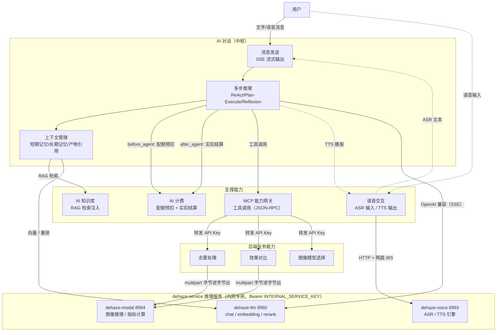
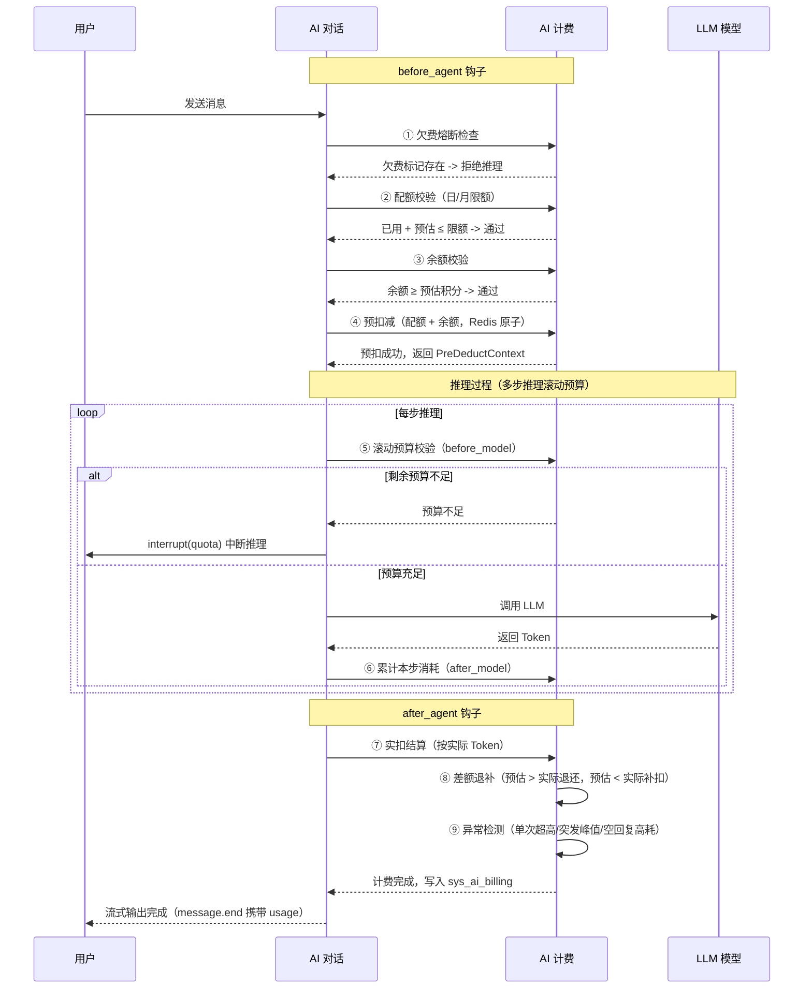
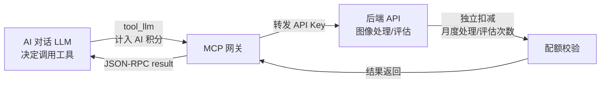
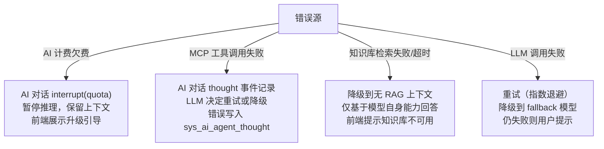
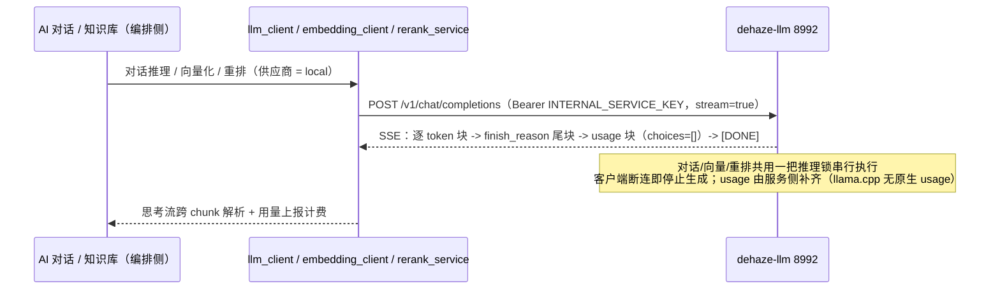
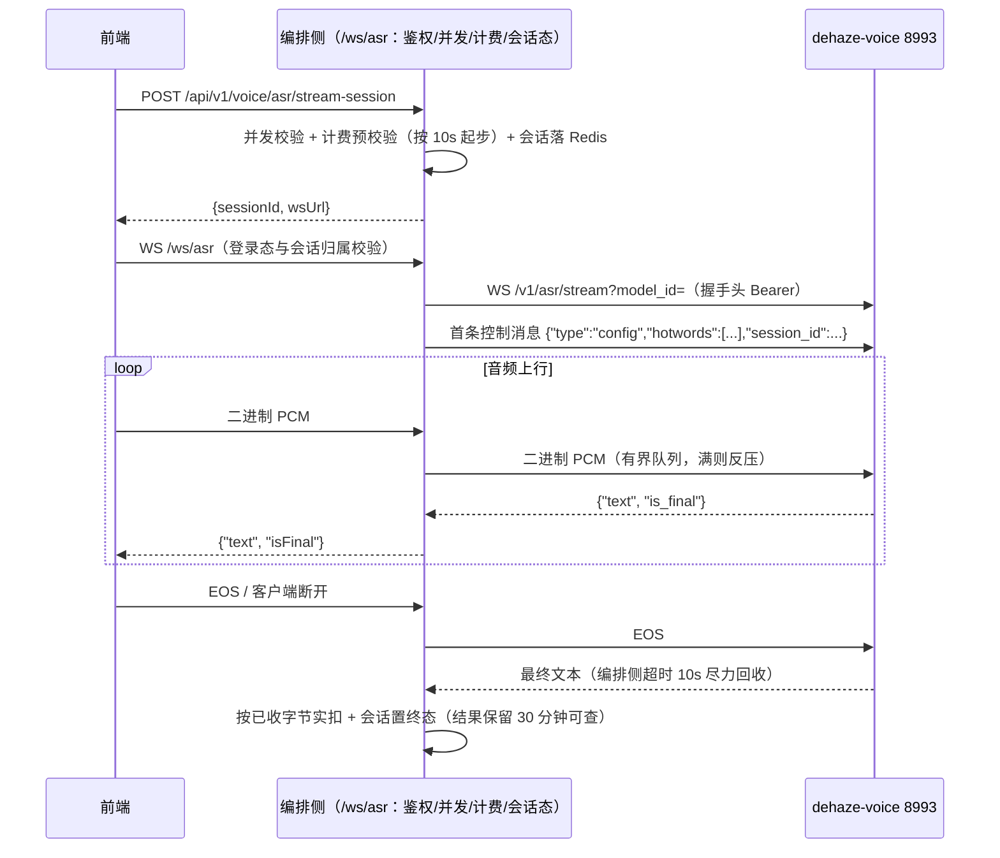
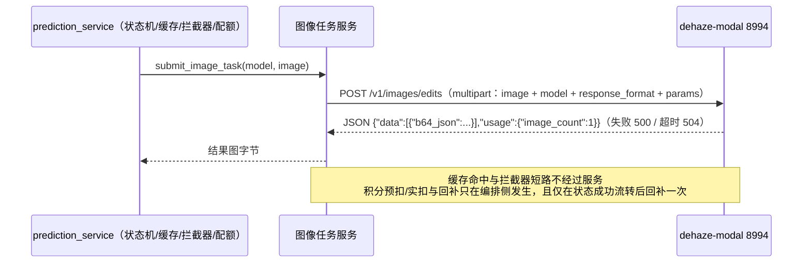

# AI 能力链路协作设计

## 1. 文档概述

### 1.1 文档目的

本文档描述 AI 工作平台核心业务链路--以 AI 对话为中枢，AI 计费、MCP 能力网关、AI 知识库、语音交互为支撑的跨模块协作机制，涵盖配额扣减时序、流式协议统一视图、工具调用计费规则与跨模块错误传播，为 AI 能力链路的协作提供统一架构指导。

### 1.2 业务价值

| 维度              | 说明                                                                                                                        |
| ----------------- | --------------------------------------------------------------------------------------------------------------------------- |
| **AI 对话为核心** | 以通用 LLM 为底座，通过对话式统一入口调度图像处理、指标评估、图像模型选择等系统能力，将平台从"工具集合"升级为"智能工作平台" |
| **计费为基石**    | 积分余额账户 + 配额限额双控模式，预扣实扣确保原子性，支撑 AI 对话/知识库/语音/MCP 工具的统一计量                            |
| **MCP 为桥梁**    | 自动发现后端 API 并转换为 MCP tool，AI 对话通过工具调用间接调度系统能力，零配置接入                                         |
| **知识库为增强**  | RAG 检索注入提升响应专业性与准确性，检索失败可降级不影响主流程                                                              |
| **语音为延伸**    | ASR 文本进入对话消息管道，由 LLM 统一理解意图，不单独维护语音指令解析                                                       |

---

## 2. AI 能力链路协作图

### 2.1 协作总览

### 2.2 协作要点

| 协作关系                              | 触发时机                       | 交互方式                                                      | 说明                                                                 |
| ------------------------------------- | ------------------------------ | ------------------------------------------------------------- | -------------------------------------------------------------------- |
| AI 对话 -> AI 计费                    | 推理开始前 / 推理结束后        | 生命周期钩子（before_agent / after_agent）                    | 预扣配额 + 余额，实扣差额退补                                        |
| AI 对话 -> 内部 MCP 能力网关          | LLM 决定调用工具时             | JSON-RPC 2.0 over HTTP                                        | 网关透传用户 API Key 调用后端 API                                    |
| AI 对话 -> AI 知识库                  | 每次消息发送前                 | 内部检索注入 / MCP tool（kb_search）                          | RAG 检索 Top-K 片段注入 LLM prompt                                   |
| AI 对话 -> 语音交互                   | 用户语音输入 / 回复播报        | WebSocket（ASR）/ HTTP 流式（TTS）                            | ASR 文本进入消息管道，TTS 合成回复                                   |
| 内部 MCP 能力网关 -> 后端 API         | tools/call 调用时              | HTTP + API Key                                                | 网关不校验权限和配额，由底层 API 负责                                |
| AI 对话 / 知识库 -> `dehaze-llm`      | 对话推理 / 向量化 / 重排       | HTTP（OpenAI 兼容，SSE），`Bearer INTERNAL_SERVICE_KEY`       | 服务侧只做推理；供应商路由、Key 熔断、降级链、计费留编排侧（§8.1）   |
| 语音交互 -> `dehaze-voice`            | ASR 流式/离线识别、TTS 合成    | WS（编排侧两跳）+ HTTP，`Bearer INTERNAL_SERVICE_KEY`         | 前端契约不变；会话态、并发、热词合并、计费、TTS 缓存留编排侧（§8.1） |
| 去雾处理 / 效果对比 -> `dehaze-modal` | 图像推理执行、图像质量指标计算 | HTTP multipart（字节进字节出），`Bearer INTERNAL_SERVICE_KEY` | 状态机、缓存与拦截器、配额扣减与回滚、结果落库留编排侧（§8.1）       |

> AI 对话通过内部 MCP 能力网关（系统能力出口，自建 MCP Server）间接调用图像处理、效果对比、图像模型选择等后端能力，不直接依赖这些业务模块。外部 MCP 服务（GitHub/数据库等第三方）则经 MCP Server 管理注册接入（外部能力进口），概念界定见 [MCP/需求规格](../03-模块设计/核心模块/MCP/需求规格.md)。

> 三处推理能力（对话/向量/重排、语音引擎、图像推理与指标）已外置为 `dehaze-service/*`，编排侧经
> HTTP/WS 内部调用、不再自管推理进程；跨服务协作视图、时序图与就绪聚合口径见 §8。

---

## 3. 配额扣减时序

### 3.1 配额扣减全流程

### 3.2 预扣实扣核心规则

| 阶段     | 规则                                           | 说明                                               |
| -------- | ---------------------------------------------- | -------------------------------------------------- |
| 欠费熔断 | 读取 `ai:arrears:{userId}`                     | 标记存在直接拒绝，避免欠费累积                     |
| 配额校验 | 日已用 + 预估 ≤ 日限额；月已用 + 预估 ≤ 月限额 | Redis 原子读取，不足则拒绝                         |
| 余额校验 | 余额 ≥ 预估积分                                | 不足提示充值                                       |
| 预扣减   | Redis DECR 日/月配额 + 余额                    | 原子操作，任一返回负数则回滚全部                   |
| 滚动预算 | 每步 before_model 校验 remainingBudget         | 不足时 interrupt(type=quota) 中止，保留上下文      |
| 实扣结算 | 按实际 Token 换算积分                          | 差额 > 0 退还多扣；差额 < 0 补扣，余额不足标记欠费 |

> 预扣减值 = 计费预估算法输出值。预估输入 Token = 历史上下文均值 × 0.8 + 当前消息 × 1.2 + 记忆 200 + 工具定义 500；预估输出 = max_output_tokens × 0.3。

### 3.3 子 Agent 计费（父预扣 + 子实报实销）

主图持有预扣-结算链路；子智能体（含 Team 多子图协作）不独立预扣配额/余额：

- 主 Agent 预扣总预算（预估自身消耗），滚动预算护栏仅在主图生效
- 每个子智能体完成后按实际 token 用量实报实销，独立写入 `sys_ai_billing`（bill_type=chat_subagent，归属主会话用户/消息）
- 子智能体直接扣减配额与余额，不参与主图预扣记录的差额退补（不重复结算）
- 统计侧 chat_subagent 与 chat 同口径聚合，统计与实际扣减一致

详见 [AI计费管理 后端实现](../03-模块设计/基础模块/AI计费管理/后端实现.md)。

---

## 4. 流式协议统一视图

### 4.1 协议矩阵

| 能力通道                   | 协议                        | 传输方式            | 路径/端点                                                                        | 适用场景                                                                        |
| -------------------------- | --------------------------- | ------------------- | -------------------------------------------------------------------------------- | ------------------------------------------------------------------------------- |
| AI 对话（内部）            | SSE 自定义事件              | HTTP 长连接         | `POST /api/v1/ai/conversations/{id}/messages`                                    | 本系统前端，完整功能                                                            |
| AI 对话（OpenAI 兼容）     | SSE OpenAI 格式             | HTTP 长连接         | `POST /api/v1/chat/completions`                                                  | 第三方 OpenAI SDK 接入                                                          |
| AI 对话（Claude 兼容）     | SSE Claude 格式             | HTTP 长连接         | `POST /api/v1/messages`                                                          | Claude SDK 接入                                                                 |
| MCP 工具调用               | JSON-RPC 2.0                | Streamable HTTP     | `POST /api/v1/mcp`                                                               | LLM 工具发现与调用                                                              |
| 语音识别（ASR）            | WebSocket                   | 双向长连接          | `/ws/asr`                                                                        | 流式音频推送与识别返回                                                          |
| 语音合成（TTS）            | HTTP 流式                   | HTTP 响应流         | `POST /api/v1/voice/tts`                                                         | 流式合成音频返回                                                                |
| 模型推理（对话/向量/重排） | OpenAI 兼容（SSE）          | HTTP 长连接（内网） | `POST ${LOCAL_LLM_BASE_URL}/v1/chat/completions`、`/v1/embeddings`、`/v1/rerank` | 编排侧 -> `dehaze-llm` 8992                                                     |
| 语音识别服务（ASR 流式）   | WebSocket                   | 双向长连接（内网）  | `WS /v1/asr/stream?model_id=`                                                    | 编排侧两跳代理前端 `/ws/asr` -> `dehaze-voice` 8993（`local-voice` 协议族扩展） |
| 语音识别服务（ASR 离线）   | HTTP multipart              | HTTP（内网）        | `POST /v1/audio/transcriptions`                                                  | `dehaze-voice` 8993（OpenAI Audio 兼容）                                        |
| 语音合成服务（TTS）        | HTTP（音频字节）            | HTTP 响应流（内网） | `POST /v1/audio/speech`                                                          | `dehaze-voice` 8993，缓存与计费在编排侧                                         |
| 图像推理 / 指标计算服务    | HTTP（JSON/b64）/ multipart | HTTP（内网）        | `POST /v1/images/edits`、`POST /v1/metrics`                                      | 编排侧图像任务 / 评估服务 -> `dehaze-modal` 8994（OpenAI Images 兼容）          |

### 4.2 内部 SSE 事件类型

| 事件                             | 说明           | 触发时机                                       |
| -------------------------------- | -------------- | ---------------------------------------------- |
| `message.start`                  | 消息开始       | Agent 推理启动                                 |
| `content_block.start/delta/stop` | 内容块生命周期 | 文本/思考/工具参数流式输出                     |
| `thought`                        | 推理步骤完成   | 每步 Thought -> Action -> Observation 循环结束 |
| `interrupt`                      | 推理中断       | 确认/配额不足/异步任务等待                     |
| `ping`                           | 心跳保活       | 每 15 秒                                       |
| `error`                          | 错误事件       | 推理异常                                       |
| `message.end`                    | 消息结束       | 携带 usage（Token 用量 + 积分消耗）            |

> 断线重连：客户端携带 `Last-Event-ID` 从 Redis token 缓存重放断点后事件，5 分钟窗口内可恢复。

### 4.3 MCP 异步调用与回调

MCP 工具调用分为同步与异步两种模式：

| 模式     | 判断依据              | 行为                                                                                                  |
| -------- | --------------------- | ----------------------------------------------------------------------------------------------------- |
| 同步调用 | 后端 API 直接返回结果 | 立即返回 JSON-RPC result                                                                              |
| 异步调用 | 后端返回 task_id      | AI 对话持久化 checkpoint（task_id -> 会话映射），Agent 进入 `async_wait` 中断，任务完成后回调恢复推理 |

> 网关无状态，不维护 task_id -> 会话映射，仅透传 task_id。映射由 AI 对话模块维护。

---

## 5. 工具调用计费规则

### 5.1 计费类型分离

不同 AI 能力的 LLM 调用按 `bill_type` 区分记录，各自创建独立计费记录：

| bill_type   | 场景                                            | 计费单元                     | 计入 AI 积分 |
| ----------- | ----------------------------------------------- | ---------------------------- | :----------: |
| `chat`      | AI 对话消息的 LLM 回复                          | 输入/输出 Token              |      ✅      |
| `tool_llm`  | MCP 工具推理步骤的 LLM 调用（如 ReAct observe） | LLM Token                    |      ✅      |
| `kb_inject` | 知识库 RAG 检索注入的 Top-K 片段                | 注入 Token（随对话输入计量） |      ✅      |
| `asr`       | 语音识别                                        | 按音频时长（秒）             |      ✅      |
| `tts`       | 语音合成                                        | 按字符数                     |      ✅      |

### 5.2 底层 API 配额独立扣减

MCP 工具调用转发的第三方 API（如图像处理次数、评估次数）由底层 API 独立扣减其配额，**不重复计入 AI 积分**：

> AI 计费仅记录工具推理的 LLM 调用（`tool_llm`），底层 API 的图像处理/评估次数配额走会员管理的月度配额，两套配额独立扣减、互不干扰。

### 5.3 模型降级计费

模型路由降级（主模型不可用时自动切换 fallback）时，按实际使用的降级模型计费比例换算积分，用户不为服务降级多付积分。计费记录中 `model` 为降级模型，`actual_model` 为用户原选模型。

---

## 6. 跨模块错误传播

### 6.1 错误传播流程

### 6.2 错误处理策略

| 错误源                 | 传播方式                         | 处理策略                                         | 用户感知                                 |
| ---------------------- | -------------------------------- | ------------------------------------------------ | ---------------------------------------- |
| AI 计费欠费            | `interrupt(type=quota)`          | 暂停 Agent 保留上下文                            | "积分不足"卡片 + 升级引导，升级后可恢复  |
| 配额不足（推理中途）   | `interrupt(type=quota)`          | 停止后续步骤，已生成结果以摘要返回               | "配额不足，部分结果未完成"               |
| MCP 工具调用失败       | `thought` 事件 + `isError: true` | LLM 分析错误原因，决定重试/降级/跳过             | 推理面板展示工具调用失败与 LLM 决策      |
| 后端业务错误（4xx）    | `content + isError: true`        | LLM 据错误信息调整策略                           | 推理面板展示错误，LLM 尝试替代方案       |
| 后端不可用（5xx/超时） | JSON-RPC error(-32005)           | GET 方法可重试 1 次                              | LLM 提示服务暂时不可用                   |
| 知识库检索失败         | 降级标志                         | 不注入知识片段，仅基于模型能力回答               | "知识库检索暂不可用，回复未引用专业知识" |
| LLM 调用失败           | 重试/降级链                      | 指数退避重试 -> 降级到 fallback 模型 -> 用户提示 | 首次重试无感，最终失败提示重试           |
| TTS 不可用             | 降级为纯文本                     | 重试 1 次后降级                                  | 展示纯文本回复，无语音播报               |
| ASR 失败               | 降级为文字输入                   | 语音识别失败提示                                 | 自动退化为文字输入，不影响核心流程       |

### 6.3 配额不足中止策略

| 场景             | 处理方式                                                               |
| ---------------- | ---------------------------------------------------------------------- |
| 单步预扣失败     | 立即暂停推理，已完成步骤保留；展示"积分不足"卡片，升级后从当前步骤继续 |
| 推理中途累计超额 | 停止后续步骤，已生成部分结果以摘要形式返回                             |
| 子智能体并行超额 | 主 Agent 召回未启动的子智能体，已完成子智能体结果保留并参与汇总        |
| 降级继续         | 用户可选择跳过非关键步骤、切换更便宜的模型或减少并行度                 |

---

## 7. 生命周期钩子与计费集成

AI 对话通过 AgentHooks 在推理全生命周期注入横切逻辑，计费模块通过钩子集成而非硬编码。deepagents 中间件实际只暴露 `abefore_agent` / `awrap_model_call` / `awrap_tool_call` / `aafter_agent` 四个入口，dehaze 的六点注册口径（`before_agent` / `before_model` / `after_model` / `before_tool` / `after_tool` / `after_agent`）由 `DehazeHooksMiddleware` 桥接到上述入口执行。钩子链路与映射详见 [AI 对话 后端实现-架构与公共](../03-模块设计/核心模块/AI对话/后端实现-架构与公共.md)。

| 钩子           | 计费集成                                   | 说明                                                                                                                                                             |
| -------------- | ------------------------------------------ | ---------------------------------------------------------------------------------------------------------------------------------------------------------------- |
| `before_agent` | 欠费熔断 -> 配额校验 -> 余额校验 -> 预扣减 | 任一失败拒绝推理                                                                                                                                                 |
| `before_model` | 滚动预算校验 + 工具命名空间预筛选          | remainingBudget 不足时 interrupt(quota)；按用户意图仅展开匹配的工具分组                                                                                          |
| `after_model`  | 累计本步 Token 消耗                        | 滚动扣减预算池                                                                                                                                                   |
| `before_tool`  | 无计费集成                                 | 并行子 Agent 写冲突仲裁（资源占用登记/让行/失败重试/覆盖确认），实现见 [智能体管理](../03-模块设计/核心模块/AI对话/智能体管理/后端实现.md#531-多-agent-协作治理) |
| `after_agent`  | 实扣结算 + 差额退补 + 异常检测             | 写入 sys_ai_billing，更新消息积分                                                                                                                                |

> 钩子通过配置注册，新增横切逻辑不改推理代码。计费模块的集成全部通过钩子完成，不硬编码到 LangGraph 推理流程中。`before_model` 钩子同时负责 MCP 工具命名空间预筛选，通过三层压缩（命名空间摘要 -> 意图匹配预过滤 -> tools/search 按需发现）将工具定义上下文开销从 50,000 tokens 降至最低 80 tokens。

---

## 8. 推理能力跨服务协作（dehaze-service）

编排侧（`dehaze-python`）不自管推理进程：对话/向量/重排、语音引擎、图像推理与指标计算分别外置为
`dehaze-service/dehaze-llm`（8992）、`dehaze-voice`（8993）、`dehaze-modal`（8994）。三个服务**只被编排侧
内部调用**（不直面 java/go 与前端），零 MySQL/Redis/ES/MinIO 依赖，入站统一
`Authorization: Bearer ${INTERNAL_SERVICE_KEY}`。

### 8.1 三服务职责与编排侧保留职责

| 服务                | 承担                                                | 编排侧调用点                                                                          | 编排侧保留                                                                     |
| ------------------- | --------------------------------------------------- | ------------------------------------------------------------------------------------- | ------------------------------------------------------------------------------ |
| `dehaze-llm` 8992   | chat / embedding / rerank 推理（OpenAI 兼容 + SSE） | `llm_client`、`embedding_client`、`service/kb/rerank_service`                         | 供应商与模型注册表、Key 选择与健康熔断、候选路由与降级链、用量计量与计费       |
| `dehaze-voice` 8993 | ASR 流式/离线识别、TTS 合成、状态                   | `infrastructure/llm/client/openai_audio_client`（统一模型路由，`local-voice` 供应商） | 默认模型解析与缓存、会话态、并发上限、热词合并、鉴权、计费、TTS 缓存与加密存储 |
| `dehaze-modal` 8994 | 图像编辑推理、图像质量指标计算、权重缓存、GPU 指标  | `service/images`（图像任务）、`evaluation_service`、模型清单 `/v1/models` 探测        | 状态机、拦截器链、结果缓存、积分预扣/实扣与回补、结果落库与命名、任务追踪      |

### 8.2 模型调用链路（dehaze-llm）

local provider 的 `api_base_url` 由 `LOCAL_LLM_BASE_URL` 派生（默认 `http://127.0.0.1:8992/v1`），
占位 Key 明文取 `INTERNAL_SERVICE_KEY`，与第三方供应商走**同一条** Key 选择 / 候选路由 / 健康统计代码路径；
编排侧不再有 `local_llm_manager` 与 llama-cpp-python 依赖。唯一本地特例：**本端 provider 不做 Key 冷却**——
本地服务只有这一把部署级密钥、没有备用 Key 可切，传输错误多为瞬时（推理满载、模型预热中、服务重启），
冷却会让冷却期内全部本地推理请求因"无可用 API Key"直接失败，故失败只记录不冷却（流式中断已下发内容时仍直接抛出）。

### 8.3 语音链路（dehaze-voice，两跳）

前端契约零改动：`POST /api/v1/voice/asr/stream-session` 与 `WS /ws/asr?sessionId=&sid=` 仍由编排侧提供，
编排侧作为客户端连接 `dehaze-voice`，热词经首条 `config` 消息按会话下发（引擎无全局热词状态）。

- **热词**：合并（全局 + 用户级、去重、上限）与存储仍在编排侧，合并结果随会话下发，多用户并发互不串扰。
- **超时归属**：空闲 60s / 最长 60s / 下行收尾 10s 三个超时全在编排侧（属前端契约）；引擎侧仅"无输入 30s 自动收尾"兜底。
- **模型与音色来源**：模型标识与音色参数不落库，由 dehaze-voice `/v1/models` 目录按 `model` 服务端解析（DB 行只承载启停/展示/计费/归因）；引擎不查库、不做业务缓存。离线识别走 `POST /v1/audio/transcriptions`（multipart），合成走 `POST /v1/audio/speech`（返回音频字节，TTS 缓存在编排侧），流式识别走协议族扩展 `WS /v1/asr/stream`。

### 8.4 推理执行链路（dehaze-modal，字节进字节出）

取图（存储 SDK 下载 / 外部 HTTP + SSRF 内网拦截 / MD5 计算）留在编排侧，引擎侧只接收原图字节、回结果图字节；
30s 超时与"超时即失败"语义留在编排侧，终态由 `sys_pred_log` 状态机裁决。

- 评估指标计算同走该服务（`POST /v1/metrics`，单一指标失败进 `failed` 不整体失败）；图像模型清单与权重解析改查 `GET /v1/models`（服务端按 `model` 解析 import_path/权重）。
- GPU 指标由服务侧采集并经 `/metrics` 暴露（`dehaze_gpu_*`），编排侧 `model_health_check` 改为读服务指标，不再在业务进程持有 CUDA 上下文。

### 8.5 就绪聚合口径（编排侧 /ready）

三个服务按"**启用才检查 + 分级**"接入编排侧 `/ready`，探针纪律与 §3.3 一致（`/health` 恒 200 且只读，
`/ready` 只读判定、禁止触发下载或加载）：

| 组件                      | 口径                                                                                                                                                                                                          | 取值                 |
| ------------------------- | ------------------------------------------------------------------------------------------------------------------------------------------------------------------------------------------------------------- | -------------------- |
| `local_llm`               | **非必选**：始终只读探测 `dehaze-llm` `/ready`（超时 2s）并展示状态；仅 `LOCAL_LLM_REQUIRED=true`（默认 `false`，本地 LLM 为非必选依赖）时其失败才使整体 503                                                  | `UP` / `DOWN`        |
| `voice_asr` / `voice_tts` | 只读附带：取默认 ASR/TTS 模型所属供应商的运行时探测结果（本地 `local-voice` 探测 `dehaze-voice` 的 `/v1/status`，云厂商按其协议探活），模型懒加载；未配置默认模型或供应商不可达按 offline，**不阻断整体就绪** | `online` / `offline` |
| `modal_inference`         | 只读附带：探测 `dehaze-modal` `/ready`，**不触发权重下载**，不阻断整体就绪                                                                                                                                    | `online` / `offline` |

> 编排侧 `/ready` 不再拉起任何子进程或触发模型下载；推理服务未就绪时按 `LOCAL_LLM_REQUIRED` 语义返回
> 503，但业务进程不被拖死（探测超时 2s）。

### 8.6 默认对话模型解析链与评测口径

默认对话模型由**单一解析链**决定，三端全等：**请求显式 `model` > 会话已存 `sys_ai_conversation.model`

> 用户偏好 `sys_ai_user_preference.default_model` > Agent 配置模型 > 平台默认 `sys_dict`
> `ai_model.default_model`**；全部未配置报 `A0500`，**不回退代码常量**。用户偏好 / Agent 模型 / 平台默认
> 只在"未指定模型"时参与解析。

| 层级        | 取值来源                                                     | 说明                                                    |
| ----------- | ------------------------------------------------------------ | ------------------------------------------------------- |
| 请求 / 会话 | 请求体 `model`；未传则用会话已存 `sys_ai_conversation.model` | 显式指定优先；会话 `model` 创建时冻结                   |
| 用户偏好    | `sys_ai_user_preference.default_model`                       | 模型停用 / 删除 / 非 chat 视同未设置，静默回落下一级    |
| Agent 配置  | 会话锚定 Agent 的**已发布版本快照 `model_id`**               | 无已发布版本回退主表可编辑态 `model_id`；不做启用性判断 |
| 平台默认    | `sys_dict` `ai_model.default_model` 启用项                   | 缺项 / 空值 / 停用视同未配置，报 `A0500`                |

- **Agent 级**：取会话锚定 Agent 的**已发布版本快照 `model_id`**（运行面、版本化口径；无已发布版本回退主表
  可编辑态），优先级**排在用户偏好之后**——用户显式偏好优先于系统预置的 Agent 配置。切换 Agent 且未显式
  指定模型时，`sys_ai_conversation.model` 按新 Agent 重解析。
- **后台派生推理**：标题生成、建议生成、记忆抽取等无请求 / 会话上下文，直接取平台默认，不读用户偏好与
  Agent 配置。
- **评测口径**：评测按**被评测版本的 Agent 模型**执行（即解析链中 Agent 级取值，评测无请求 / 会话 / 用户
  上下文）。与生产的剩余差异仅"用户偏好 / 会话覆盖"两层，属评测无该上下文的固有限制。
- **存量会话**：`sys_ai_conversation.model` 创建时冻结，平台默认或 Agent 模型的后续变更**不回流**旧会话
  （存量会话为测试数据，不迁移）。

> **Why**：Agent 主表 / 版本快照的 `model_id` 此前在生产链路完全不被读取（只用于版本快照、回滚、详情展示），
> 与"每个 Agent 拥有独立模型配置"的需求冲突；表现为"切 Agent 不切模型"，且评测按 Agent 模型、线上按会话 /
> 平台模型 → 评测结论与生产对不上。

**三端同步点**（改默认模型相关行为须三端同步）：python `model_defaults.resolve_default_chat_model`、
Go `UserPreferenceService.ResolveChatModel`、Java `AiDefaultModelResolver.resolveForUser`。另有专供"仅平台
默认"场景的解析器——python `resolve_platform_default_model`、Go `PlatformDefaultChatModel`（Java 侧同为
`AiDefaultModelResolver.resolvePlatformDefaultModelId`）：**默认 Agent 自举必须用它**，若走完整解析链会解析
到自身 Agent 配置、形成自引用。
