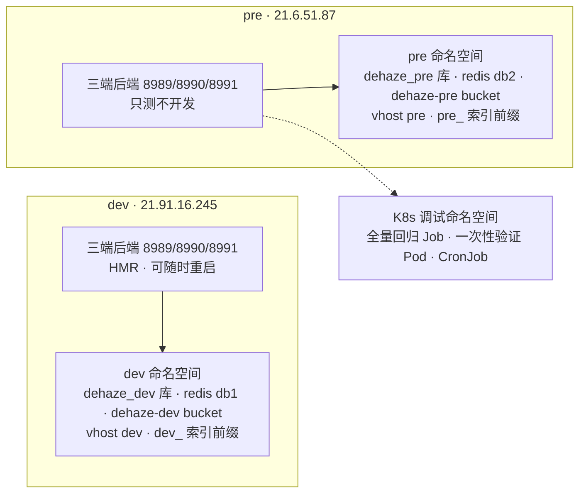

# 多环境部署实践

## 1. 文档概述

### 1.1 文档目的

定义 AI 图像处理平台的**多环境部署与数据隔离实践**：环境职责划分、命名空间口径、代码侧环境接入约定、环境模板、测试与协作流程，以及环境验收与生产预留。用于消除"测试/联调污染开发数据"与"开发与测试互相打断"两类高频损耗，并为生产环境预留干净的名称空间。

### 1.2 适用范围

适用于在 dev / pre 环境中部署、切换与联调的开发、测试与运维场景。中间件版本与服务器规格见《06-部署架构》。

### 1.3 术语

| 术语             | 含义                                                                                                                                                                      |
| ---------------- | ------------------------------------------------------------------------------------------------------------------------------------------------------------------------- |
| **dev**          | 开发环境：开发自测、热更新（HMR）、端上调试，允许随时重启                                                                                                                 |
| **pre**          | 预览环境：**只测不开发**，承载 UI 冒烟、SDK 契约集测与联调演示                                                                                                            |
| **临时验证**     | K8s 调试命名空间内的一次性环境，用完即删                                                                                                                                  |
| **生产（预留）** | 不带环境后缀的名称（库 `dehaze`、执行器 `xxl-job-executor-dehaze-*`、bucket `dehaze`、vhost `%2F`、索引无前缀）保留给后续生产环境；dev 与 pre 一律带 `_dev` / `_pre` 后缀 |

> 环境命名统一为 **dev / pre**：pre 指 preview，不使用其他别名。

---

## 2. 环境规划

### 2.1 职责与宿主

| 环境    | 宿主                                                      | 职责                                                              | 约束                                   |
| ------- | --------------------------------------------------------- | ----------------------------------------------------------------- | -------------------------------------- |
| **dev** | 21.91.16.245（earthywu，配额 32 核 / 64G，无 Docker）     | 开发自测、HMR、端上调试（Chrome DevTools 19222 / adb 5037 / VNC） | 负载已偏高，不承载测试任务             |
| **pre** | 21.6.51.87（earthyzinc，32 vCPU / 61Gi，唯一具备 Docker） | UI 冒烟、SDK 契约集测、联调演示                                   | 只测不开发；同时是中间件宿主，多人共用 |

**人工作业与 agent 宿主**（不属于 dev/pre 双轨，分属三种网络）：

| 机器            | 网络                                                  | 职责与备注                                                                                                |
| --------------- | ----------------------------------------------------- | --------------------------------------------------------------------------------------------------------- |
| Windows 云桌面  | **云桌面网络**（独立网段 + 入站封禁，**不是办公网**） | 人工作业与 UI 走查；出站受限（Windows 版仅 80/8080/8081/443 放通，其余需在 imate 申请网关策略）、入站封禁 |
| Mac             | **办公网**                                            | 人工作业；agent 浏览器宿主——隧道 `local-proxy` 把 Mac 上的 Chrome 透传到 dev/pre 的 9222                  |
| AI agent 服务器 | 私有网 `25.2.2.157`（标准内网段之外的 VPC 段；办公网 / DevCloud 均不能直连，只能经工蜂代理域名 `*.ssh-proxy.devcloud.woa.com` 访问）                                   | 常驻 agent（Hermes）                                                                                      |
| 私人设备        | **公网（个人网络，非腾讯内网）**                      | 用户私人 Windows 设备（含 WSL）；**IP 不固定**，按外网可达性对待，不可作为内网跳板                        |

三端后端在 dev 与 pre **各自独立运行**（端口相同：java 8989 / go 8990 / python 8991 / MCP 网关 8082），只能靠域名区分；代码副本相互独立，需按 §5 流程同步。

两机的**浏览器调试设施**（Chrome DevTools 19222 + 网页远程桌面 5900/6080）由 `scripts/chrome-debug/index.mjs` 统一管理（start/stop/status/view/smoke/vnc-check），运行时产物在 `~/.chrome-debug/`；AI 侧 chrome-devtools MCP 与人工 noVNC 接管共用同一实例与 profile。同一入口在工作站侧负责拉起本机实例，并把三个浏览器 CLI 绑定到该实例。

**"本机"的口径**：本文与 agent 会话中的"本机 / 本地"指**用户当前正在操作（或 agent 当前运行）的那一台**，随人走，不绑定任何固定机器；指认机器一律用固定标识（IP / 域名），不要用 hostname——同一 hostname 可能出现在多台机器上（`earthywu` 同时是 Windows 云桌面主机名与 DevCloud 开发机域名）。判断"是否跨机"要分清「用户操作位置」与「会话进程位置」两件事。

### 2.2 拓扑

---

## 3. 数据层隔离方案

同一组中间件实例内按命名空间隔离；**带后缀的归 dev / pre，不带后缀的留给后续生产**：

| 组件                            | 环境变量                                                                         | dev                                           | pre                                           | 生产（预留）                          |
| ------------------------------- | -------------------------------------------------------------------------------- | --------------------------------------------- | --------------------------------------------- | ------------------------------------- |
| MySQL                           | `MYSQL_DATABASE`                                                                 | `dehaze_dev`                                  | `dehaze_pre`                                  | `dehaze`                              |
| MongoDB                         | `MONGODB_DATABASE`                                                               | `dehaze_dev`                                  | `dehaze_pre`                                  | `dehaze`                              |
| Redis                           | `REDIS_DATABASE`                                                                 | `1`                                           | `2`                                           | `0`                                   |
| MinIO                           | `MINIO_BUCKET`                                                                   | `dehaze-dev`                                  | `dehaze-pre`                                  | `dehaze`                              |
| RabbitMQ                        | `RABBITMQ_VHOST`（URL 中写作 `/{vhost}`）                                        | `dev`                                         | `pre`                                         | `%2F`（默认 vhost `/`）               |
| Elasticsearch                   | `ES_INDEX_PREFIX`                                                                | `dev_`                                        | `pre_`                                        | 空                                    |
| XXL-Job                         | `XXLJOB_ENV_SUFFIX`（java / go 拼接）· `XXLJOB_EXECUTOR_APP_NAME`（python 全名） | `-dev` · `xxl-job-executor-dehaze-python-dev` | `-pre` · `xxl-job-executor-dehaze-python-pre` | 空 · `xxl-job-executor-dehaze-python` |
| Nginx 静态（datasets / models） | —                                                                                | 共用                                          | 共用                                          | 共用                                  |

- **隔离依据**：MySQL / Mongo 的库、MinIO 的 bucket、RabbitMQ 的 vhost 是硬边界（对应变量均已参数化，种子脚本 `config/sql/schema/zz_load_data.sh` 同用库名变量）；Redis 用 db 编号隔离，**SDK 集测仅按前缀 `keys + del` 清理、无 FLUSHALL**，db 级已足够；ES 索引名不含环境标识（`kb_chunks_{kb_id}` / `ai_conversation` / `ai_memory`），必须加前缀；Nginx 静态为只读资源，不需隔离。
- **后端 profile**：dev 用 `dev`，pre 复用 `prod`（行为贴近生产，不新增 profile）。三端 profile 由根 `.env` 的 `SPRING_PROFILES_ACTIVE`（Java）/ `GIN_MODE`（Go：`debug`→`config.yaml`、`release`→`config.prod.yaml`）/ `APP_ENV`（Python）决定，**必须在进程启动那一刻可见**（各端自己读 `.env` 的时刻都晚于启动），因此由 `scripts/run.py` 启动前把根 `.env` 注入子进程环境；Java 端口用 `JAVA_SERVER_PORT` 覆盖（prod profile 默认 80，变量名避开 Python 同名配置项 `SERVER_PORT`）。
- **pre 对 prod 行为的必要覆盖**（只写在 `.env.pre.example`，生产模板不设这几项，各自取配置里的生产默认）：
  - `SESSION_COOKIE_SECURE=false`、`SESSION_COOKIE_PATH=/`：pre 走 HTTP，且与 dev 一样经前端 Vite 代理前缀（`/java-api`、`/py-api`）访问，否则浏览器丢弃 Cookie。
  - 限流放宽（**三个变量的读取方不同**）：`RATE_LIMIT_MAX_REQUESTS`（仅 Python 读）、`COUPON_RECEIVE_RATE_LIMIT`（Python 与 Go 共读）、`LOGIN_IP_LIMIT_COUNT`（仅 Go 读）——UI 冒烟与 SDK 契约集测会短时高并发，生产默认（60 / 5 / 10）必触发限流。
  - IP 黑名单放宽：`IP_BLACKLIST_THRESHOLD`（仅 Python 读，prod 默认 100）——SDK 契约集测的负向用例会在约 1 分钟内产生上百个 4xx，默认阈值会让 pre 自封 `127.0.0.1`（封 1h），整套集测随即不可用；`ip_blacklist` 中间件仅在 `DEBUG` 下豁免内网/回环，prod 形态的 pre 不豁免，故只能靠放宽阈值。
  - `SSL_CERT_FILE=/etc/pki/tls/certs/ca-bundle.crt`：容器 `/etc/ssl/certs` 缺少哈希软链、无 `cert.pem`，python 默认 SSL 上下文（`websockets` 走第三方 HTTPS/WSS，如火山语音）会 `CERTIFICATE_VERIFY_FAILED`；`httpx` 用 certifi 不受影响，故仅 websockets 链路暴露。指向系统 CA bundle 即可修复。
  - `LOG_IN_CONSOLE=true`：pre 保留 Go 控制台输出，便于 `run.py logs` 查看。
  - `SERVER_WORKERS=1`：prod 默认 4，但本应用的 XXL 执行器（9998）与本地 LLM 子进程是单实例设计，多 worker 下会出现 worker 槽位「启动即退」的重启循环。
  - `CORS_ALLOWED_ORIGINS` 写 pre 主机域名（**三端同名**：Java `cors.allowed-origins` / Go `cors.allowed-origins` / Python 同名配置项）：Python 的 prod 配置类禁止 `localhost` / `127.0.0.1`，留空或写 localhost 会启动即报错；Go 侧该变量无默认值、缺失直接拒绝启动；UI 冒烟经 Vite 代理属同源，不受白名单约束。
- **profile 带来的行为差异须知**：Java 验证码类型随 profile 变（dev `captcha.code.type=random` / prod `=math`），pre 上的登录工具需按算式作答；Go / Python 的日志级别、连接池、SQL 日志等按各自 prod 配置取值。
- **`.env` 不入库**（`.gitignore` 已忽略 `**/.env*`）：模板以 `.env.dev.example` / `.env.pre.example` 入库，实际 `.env` 在各机器就地落地。
- **切换属破坏性变更**：无后缀命名空间（`dehaze` 库 / bucket `dehaze` / vhost `/`）中的数据不迁移、直接重置清空，该名称留作生产预留；dev 数据由 `config/sql` 种子重建。

### 3.1 每机本地的私密种子（`config/sql/data/zz_private_*.sql`）

`config/sql/data/` 下的 `zz_private_*.sql` 是**每机各自生成、不入库**的私密种子，用于在 DB 重置 / docker 首启时自动回灌那些无法随仓库分发的密文种子行（当前为 `sys_ai_provider_key` 的供应商 API Key 密文），免去每次重置后到管理端重填密钥。

- **不入库**：由 `.gitignore` 的 `config/sql/data/zz_private_*.sql` 规则排除，`git status` 中不可见，禁止 `git add`。
- **只含密文**：仅承载 `key_cipher`（AES 加密后的密文），全程不出现明文密钥；明文只存于管理端、运行时解密使用。
- **依赖主密钥**：密文由 `AI_PROVIDER_KEY_ENCRYPTION_KEY` 加密，**该主密钥一旦变更，本文件立即作废，须在机上重新生成**；同时**三端后端必须重启**以载入新值——若有端进程仍持旧值，其写入的密文与其它端（新值）互解不开（表现为解密 `Invalid padding`）。
- **加载顺序**：`zz_` 前缀保证按字母序排在 `sys_ai_*.sql` 之后（docker 首启由 `config/sql/schema/zz_load_data.sh` 按 `*.sql` 字母序加载；手工重置为 `for f in config/sql/data/*.sql`），因此其关联的 `sys_ai_provider` 行已先就位。
- **幂等且不写死 ID**：`INSERT ... SELECT` 按 `provider_code` 关联 `sys_ai_provider` 解析 `provider_id`，并以 `(provider_id, key_hash)` 的 `NOT EXISTS` 判定，重复加载不产生新行。
- **生成方式**：在存有密文的机器上由 SQL 直接导出后落盘（密文不经手、不打印）。当前该文件位于 pre（21.6.51.87）与 dev（21.91.16.245）两机的 `config/sql/data/`。

### 3.2 需人工执行的迁移（`config/sql/migration/`）

`config/sql/migration/` **不在 compose 初始化挂载里**（`dehaze_test` 由 schema+data 全量重建、也不跑 migration），DDL/数据迁移须在目标环境手工 `mysql <` 执行，分两类：

- **一次性 DDL 迁移**：结构演进用，各环境各执行一次、不可重跑（顺序与前置见文件头，如 `2026-09-11_uk_deleted_aware.sql`）。
- **OPT-IN 数据/种子迁移**：默认不执行，须在业务/密钥就位后人工执行，幂等可重跑：

| 迁移文件                                             | 用途                                           |
| ---------------------------------------------------- | ---------------------------------------------- |
| `2026-10-01_switch_default_model_volc.sql`           | 平台默认模型切第三方（前置：供应商密钥已就位） |
| `2026-10-02_switch_memory_embedding_siliconflow.sql` | 记忆 embedding 切硅基流动 BGE-M3               |
| `2026-10-02_add_deepseek_v4_flash_siliconflow.sql`   | 登记更强模型 DeepSeek-V4-Flash                 |
| `2026-10-02_qwen3_8b_price.sql`                      | Qwen3-8B 登记非免费售价                        |
| `2026-10-02_seed_harness_eval_dataset.sql`           | 默认 Agent 评测开发集起步种子                  |

> `2026-10-02_seed_harness_eval_dataset.sql` 的执行前置：目标环境须**已启动过一次 python 服务**（默认 Agent 由 `ensure_default_agent` 运行时创建）。未满足时种子不生效——迁移末尾的校验 SELECT 会打印 `default_agent_exists=0`。

---

## 4. 代码侧环境接入

命名空间相关的连接参数全部由**环境变量驱动**，且**身份类变量一律无默认值**（缺失即启动失败并指名变量），以避免静默落到"生产预留"的无后缀命名空间。三端各自的 fail-fast 机制：Python 由 pydantic 必填字段、Go 由 `pkg/config` 的 `expandEnv`、Java 由 Spring 占位符解析。

| 端       | 落点                                                                              | 要点                                                                                                                                                              |
| -------- | --------------------------------------------------------------------------------- | ----------------------------------------------------------------------------------------------------------------------------------------------------------------- |
| Java     | `application-{dev,prod}.yml`                                                      | Mongo 库名、RabbitMQ vhost、xxl 执行器 appname 均由环境变量占位；`prod` 需含 `rabbitmq` 段（pre 复用 prod，依赖它）                                               |
| Java     | `application-prod.yml`                                                            | 开启 `springdoc.api-docs`（MCP 网关启动时读 `/v3/api-docs` 解析全部后端 API，关闭则元工具不可用），Swagger UI 与 knife4j 保持关闭；前置代理对该路径只放行回环访问 |
| Java     | `service/impl/AiKbIndexClient.java`                                               | ES 索引前缀由 `@Value("${ES_INDEX_PREFIX:}")` 注入（生产要求为空，故保留空默认）                                                                                  |
| Java     | `pom.xml`                                                                         | springdoc 覆盖到 2.8.9：knife4j 4.3.0 传递引入的 2.0.4 与 Spring Boot 3.5 不兼容，会在 `/v3/api-docs` 抛 `NoSuchMethodError`                                      |
| Java     | 启动方式（`scripts/run.py`）                                                      | dev 走 `spring-boot:run`；prod（含 pre）走 `mvn package` + `java -jar` 并关 `spring.devtools.restart.enabled`（理由见《06-部署架构》）                            |
| Go       | `config/config{,.prod,.test}.yaml`                                                | RabbitMQ vhost、xxl `registry-key`、`cache.redis.db`、`es.index-prefix` 均取环境变量                                                                              |
| Go       | `pkg/config/viper.go`                                                             | 无默认值的占位符视为必填、缺失时一次报全变量名；首启与热重载统一走 `expandEnv`                                                                                    |
| Go       | `pkg/config/options/cors.go`、`pkg/server/gin/middleware/cors.go`                 | CORS 白名单以 `allowed-origins`（逗号分隔）参数化，取值 `${CORS_ALLOWED_ORIGINS}`（必填）；方法 / 头 / 凭证为全局配置                                             |
| Go       | `config/config{,.prod}.yaml`                                                      | 限流阈值 `login-ip-limit-count`、`coupon-receive-rate-limit` 参数化（YAML 值为兜底默认，实际由环境变量覆盖）                                                      |
| Go       | `internal/service/aidomain/memory_service.go`                                     | 记忆 ES 索引名带前缀                                                                                                                                              |
| Python   | `app/config.py`                                                                   | 新增 `RABBITMQ_VHOST`、`ES_INDEX_PREFIX`（均必填）；`RABBITMQ_URL` 使用该 vhost                                                                                   |
| Python   | `app/config.py`                                                                   | `MYSQL_DATABASE` / `MONGODB_DATABASE` / `MINIO_BUCKET` / `RABBITMQ_VHOST` / `REDIS_DATABASE` / `ES_INDEX_PREFIX` 无默认值 ⇒ 缺失即启动失败                        |
| Python   | `app/infrastructure/es/{kb_chunk_index,ai_conversation_index,ai_memory_index}.py` | 索引名前缀由 `ES_INDEX_PREFIX` 注入                                                                                                                               |
| Python   | `app/config.py`、`app/middleware/__init__.py`                                     | CORS 白名单变量名与另两端统一为 `CORS_ALLOWED_ORIGINS`（三端同名，`.env` 只写一份）                                                                               |
| 通用     | `config/sql/schema-external/xxl_job.sql`                                          | 执行器分组含生产与 dev / pre 三套（各三端），否则带后缀的执行器注册后无归属分组                                                                                   |
| 通用     | `scripts/run.py`                                                                  | 启动前把根 `.env` 注入子进程环境（profile 变量须进程启动时可见）；MCP 网关的 `uv run` 加 `--native-tls`（企业代理替换 TLS 证书链时 uv 内置根证书校验不过）        |
| 通用     | `.env{,.dev,.pre}.example`                                                        | 生产基线 + dev / pre 覆盖模板；`CORS_ALLOWED_ORIGINS` 必填，模板中标注三个限流变量的实际读取方                                                                    |
| 测试工具 | `dehaze-test/utils/config.py`、`dehaze-sdk-js/test/config/constant.ts`            | 连接与凭据类环境变量必填（缺失即报错并指向模板），不回落到 `127.0.0.1` / `dehaze` / db0                                                                           |
| 测试工具 | `dehaze-test/utils/auth.py`、`dehaze-sdk-js/test/utils/auth.ts`                   | 登录前按算式作答 Redis 中的验证码：prod profile 用 `captcha.code.type=math`，Redis 存算式本身，直接回填原文必 400                                                 |

**占位符语义**：Java 与 Go 的占位符均支持 `${VAR:default}`（Go 由 `pkg/config` 的 `expandEnv` 实现，首启与热重载统一走它；`os.ExpandEnv` 既不支持默认值也无必填语义，故 xxl 执行器名用"后缀变量拼接"）。**无默认值的占位符一律为必填**；**刻意可留空的配置**显式写 `${VAR:}` 与必填区分。Java 侧 Spring 无法区分"未设置"与"设为空"，故生产要求为空的 `ES_INDEX_PREFIX` 保留空默认。

**profile 变量例外**：`SPRING_PROFILES_ACTIVE` / `GIN_MODE` / `APP_ENV` 不能只写进 `.env` 交给各端自读（读取时机晚于进程启动），必须由 `run.py` 启动前注入为真实环境变量。

**环境模板**：`.env.example`（生产基线，含环境取值对照）、`.env.dev.example`、`.env.pre.example`（可直接复制为 `.env`，差异只在标 `[env]` 的变量）。

---

## 5. 测试与协作流程

三端单元测试统一依赖**真实中间件**：Java `application-test.yml` 与 Go `config.test.yaml` 均指向 MySQL 测试库，库名由 `DEHAZE_TEST_DB` 指定（默认 `dehaze_test`），且每次运行幂等全量重建；Go 的 Mongo 库名同样跟随 `DEHAZE_TEST_DB`。测试库与 dev 库、pre 库相互隔离，因此**测试执行地必须能访问中间件**，这决定了如下分工：

| 活动                            | 执行地                      | 说明                                                                           |
| ------------------------------- | --------------------------- | ------------------------------------------------------------------------------ |
| 开发自测、HMR 调试              | **dev**                     | 内循环，允许随时重启                                                           |
| 单测（增量，改一处跑一处）      | **windows 云桌面 / dev**    | 反馈优先；依赖 Redis 的单测只能在这两处跑（工作站跨区访问 6381 被代理拦）      |
| 单测（全量回归）                | **K8s 调试命名空间（Job）** | 指向 `dehaze_test*` 库；可并行三端、跑完即删，不抢 dev / pre 资源              |
| SDK 契约集测、UI 冒烟、联调演示 | **pre**                     | 需要运行中的三端与真实数据；测试客户端可来自工作站或 K8s Pod，后端一律指向 pre |
| 一次性批量、问题复现、数据核验  | **K8s 临时 Pod**            | 用完即删；CronJob 空闲期不占配额                                               |

- **K8s 执行测试的前置条件**：① 自建含工具链的测试镜像（JDK/Maven、Node/pnpm、Python venv、Go）并推正式镜像仓库（`ttl.sh` 仅 2 小时有效）；② Pod 能访问所用中间件（连同实例的新库，或把中间件模板一起部署进命名空间）；③ 报告 / 截图需回传留存。**含 GPU 的算法与 LLM 测试不在 K8s 执行**（集群无 GPU）。
- **同步流程**：dev 修复 → 提交 → pre `git pull` → 重建/重启 → 回归。未提交的改动不会进入 pre。
- **Go 测试配置边界**：`config.test.yaml` 只供 `internal/testutil` 在**测试进程内**使用（测试库名由 `DEHAZE_TEST_DB` 提供、未设置时 testutil 补默认值 `dehaze_test`；端口 8998 与 dev 的 8990 错开），**不是整机启动档**——`GIN_MODE=test` 直启服务会 fail-fast（缺 `DEHAZE_TEST_DB`；补上后因该文件无存储段，仍在存储初始化阶段失败）。整机启动走 dev 的 `debug` 与 pre 的 `release`；需要真实监听端口的测试请在测试进程内 `httptest.NewServer` 起 server。
- **时间窗纪律**：跑集测与重启环境前先在群内报备，避免与他人验证并行。
- **测试账号**：统一使用 `qa_bot` 等专用账号，admin 空间不存放测试资产（知识库等测试数据会占用配额）。
- **边界规则**：UI 冒烟与契约集测走 pre；纯开发迭代留在 dev 热更新，**不让 pre 成为逐行改动的关卡**。

---

## 6. 环境搭建与验收

新建环境按此顺序落地：在中间件宿主建库并导入种子（跳过 `xxl_job.sql`——它已移出 `config/sql/schema/`，位于 `config/sql/schema-external/`，仅由 docker-compose 初始化调度中心库时执行）、建 MinIO bucket 与 RabbitMQ vhost、在调度中心建对应执行器分组；应用侧按对应 `.env.*.example` 落地 `.env`（各 `*HOST` 指向中间件宿主），再由 `run.py` 拉起三端。

### 6.1 验收判据

- 两个环境三端均能启动，日志无 MySQL / MongoDB / Redis / RabbitMQ / ES 连接异常。
- 跑一轮 SDK 契约集测（指向 pre），**dev 侧的 MySQL / Redis 数据零变化**。
- XXL-Job 调度中心出现 `xxl-job-executor-dehaze-java-dev` 与 `-pre`、`-go-dev` 与 `-go-pre` 等分组，任务不跨环境串组。

### 6.2 回滚

环境隔离本身只需改 `.env` 并重启即可回滚。**例外**：以下属代码级、不向后兼容的改动，回滚需一并回退代码——CORS 变量统一为 `CORS_ALLOWED_ORIGINS`（Go 由硬编码白名单改为必填变量、Python 改名）、springdoc 版本覆盖与 prod 开启 `api-docs`。

---

## 7. 生产环境预留

不带环境后缀的名称（库 `dehaze`、bucket `dehaze`、vhost `%2F`、Redis db0、ES 无前缀、执行器无后缀）保留给生产环境。

生产形态的部署口径：

| 项        | 取值                                                                          | 说明                                                                  |
| --------- | ----------------------------------------------------------------------------- | --------------------------------------------------------------------- |
| profile   | Java `prod` / Go `release` / Python `production`                              | 三端生产 profile 由根 `.env` 对应变量选择（见 §3）                    |
| 命名空间  | 库 `dehaze`、bucket `dehaze`、vhost `%2F`、Redis db0、ES 无前缀、执行器无后缀 | 即 §3 命名空间表的"生产（预留）"列                                    |
| Java 端口 | 前置代理下用默认 80；需直连时由 `JAVA_SERVER_PORT` 覆盖                       | 变量名避开 Python 同名配置项 `SERVER_PORT`                            |
| Cookie    | `SESSION_COOKIE_SECURE=true`（默认）                                          | 生产走 HTTPS                                                          |
| CORS      | `CORS_ALLOWED_ORIGINS` 须写实际域名，禁 localhost                             | Python prod 配置类禁止 `localhost` / `127.0.0.1`；Go 缺该变量拒绝启动 |

**已知限制（跨网络域部署）**：XXL-Job 执行器需能被调度中心 admin 回连；当应用与 admin 分处不同网络域时，执行器注册地址对 admin 不可达、定时任务不可用。这属网络域限制而非配置问题——生产部署时应用与 admin 同网即可消除。
