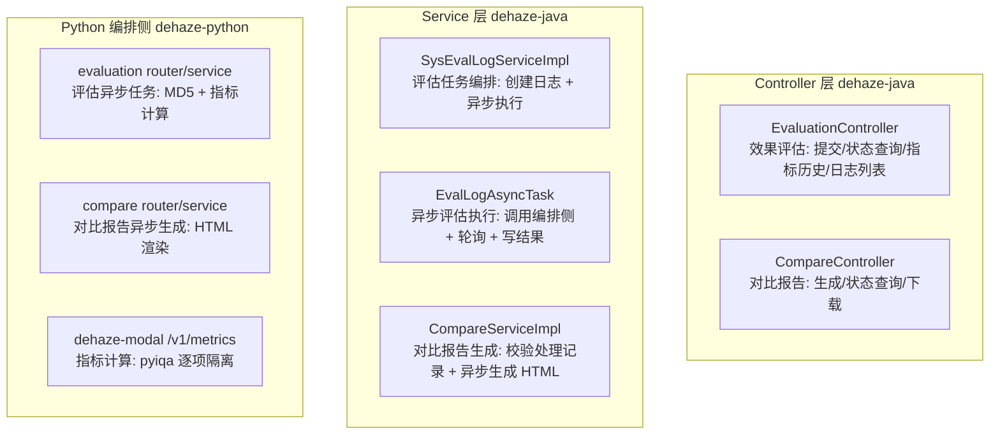

# 效果对比模块 - 后端实现设计

## 1. 文档概述

### 1.1 文档目的

本文档描述效果对比模块的后端实现方案，包括服务层设计、核心业务流程（效果评估、对比报告生成）、评估指标计算、异步任务设计与模块间协作。该模块在 dehaze-java、dehaze-python、dehaze-go 三端实现：dehaze-go 复用与 dehaze-java 相同的编排链路（评估/报告异步任务 + 轮询编排侧），指标计算统一收敛在外置推理服务 `dehaze-service/dehaze-modal`（编排侧只下发指标清单与图片字节并按 label 落库）。

---

## 2. 架构设计

### 2.1 模块分层架构

### 2.2 核心组件职责

| 组件                        | 职责描述     | 关键能力                                                              |
| --------------------------- | ------------ | --------------------------------------------------------------------- |
| SysEvalLogServiceImpl       | 评估任务编排 | 校验模型、解析图片 URL、创建 sys_eval_log、触发异步执行               |
| EvalLogAsyncTask            | 异步评估执行 | 调用 Python 评估、轮询 Python 任务（2s/300s）、回写指标结果、监控埋点 |
| CompareServiceImpl          | 对比报告生成 | 校验处理记录完成态、创建报告任务（复用 sys_eval_log）、异步生成 HTML  |
| evaluation_service (Python) | 评估执行     | 并行下载图片、MD5 计算、指标计算、任务状态流转                        |
| compare_service (Python)    | 报告生成     | 校验处理记录、异步渲染 HTML 报告、任务状态流转                        |

---

## 3. 核心业务流程

### 3.1 效果评估流程

效果评估为计算密集型任务，采用异步任务模式避免长耗时请求超时。

#### 3.1.1 Java 端编排（SysEvalLogServiceImpl.evaluate）

| 步骤         | 说明                               |
| ------------ | ---------------------------------- |
| 校验模型     | 确认 model 对应模型存在            |
| 解析图片 URL | 支持 predFileId/gtFileId 转 URL    |
| 创建日志     | 写入 sys_eval_log，status=1 处理中 |
| 触发异步执行 | 交由 EvalLogAsyncTask 异步处理     |
| 立即返回     | { logId, status=1 }                |

#### 3.1.2 Java 端异步执行（EvalLogAsyncTask.execute）

| 步骤             | 说明                                              |
| ---------------- | ------------------------------------------------- |
| 调用 Python 评估 | 异步调用 /evaluation 接口                         |
| 轮询任务状态     | 2s 间隔，300s 超时                                |
| 完成回写         | 从 Python 获取 metrics 写入 result 字段，status=2 |
| 失败回写         | 写入 errorMessage，status=3                       |
| 监控埋点         | 上报 dehaze_evaluation_total{status}              |

#### 3.1.3 Python 端评估执行（evaluation_service）

| 步骤         | 说明                                                                                                                                                                                           |
| ------------ | ---------------------------------------------------------------------------------------------------------------------------------------------------------------------------------------------- |
| 免费能力     | 评估为平台免费能力，不计费（不走 `check_and_deduct_quota("evaluate")` 配额路径）                                                                                                           |
| 并行下载图片 | 下载图像任务图/参考图并计算**内容** MD5（编排侧是这两个 MD5 的唯一计算方），随任务响应返回给调用方；调用方业务服务（Java/Go 各自的行）用返回值落 `pred_md5` / `gt_md5`，禁止用 URL 的 MD5 冒充 |
| 后台执行     | asyncio.create_task 异步执行                                                                                                                                                                   |
| 指标计算     | 指标名清单取自 `dehaze-modal` 的 `/v1/models`，经 `POST /v1/metrics` 远端计算（multipart 字节，逐指标隔离失败），编排侧按 `label` 归一后落库                                                   |
| 任务状态流转 | 维护 Python 侧任务状态（completed/failed），供 Java 端轮询                                                                                                                                     |

#### 3.1.4 日志归属与失败回写

sys_eval_log 由 Java 端统一管理，评估日志与状态回写的分工如下：

| 关注点   | 设计决策                                                                                                        |
| -------- | --------------------------------------------------------------------------------------------------------------- |
| 日志归属 | sys_eval_log 由 Java 端创建（status=1）并统一回写终态；Python 端不写 sys_eval_log，仅维护任务状态供 Java 端轮询 |
| 计费     | 评估不计费（免费能力），无配额扣减/回补路径                                                                     |
| 失败回写 | Java 端轮询到 failed 状态后回写 sys_eval_log status=3 并写入 errorMessage                                       |
| 超时处理 | Java 端轮询 300s 超时未获终态时回写 status=3，避免 processing 状态残留                                          |

### 3.2 对比报告生成流程

对比报告为耗时操作，通过异步任务实现。

#### 3.2.1 报告任务创建（CompareServiceImpl.generateReport）

| 步骤         | 说明                                                                                                                                                                                                                                                       |
| ------------ | ---------------------------------------------------------------------------------------------------------------------------------------------------------------------------------------------------------------------------------------------------------- |
| 校验处理记录 | 查询 sys_pred_log，确认存在且已完成                                                                                                                                                                                                                        |
| 创建报告任务 | 复用 sys_eval_log 表，status=1 处理中，task_type='report'（区分效果评估任务）；pred_url=处理结果图 URL，gt_url=原图 URL（三端同口径，不得写反）；pred_md5/gt_md5 不落（仅评估任务在图片下载阶段记录，用于评估缓存键）；result 字段存请求元数据（logId 等） |
| 触发异步生成 | 交由 generateReportAsync 异步执行                                                                                                                                                                                                                          |
| 立即返回     | { taskId, status=1 }                                                                                                                                                                                                                                       |

#### 3.2.2 异步生成 HTML（generateReportAsync）

| 步骤         | 说明                                                                             |
| ------------ | -------------------------------------------------------------------------------- |
| 查询模型名称 | 用于报告头部展示                                                                 |
| 渲染 HTML    | 原图+结果图并排、模型名称/ID、生成时间（动态字段 HTML 转义，防报告页存储型 XSS） |
| 完成回写     | status=2，result 写入报告 HTML 与生成时间（JSON 结构见 §5.3）                    |
| 失败回写     | status=3，写入 errorMessage                                                      |

> 报告当前仅含头部/图片对比区/处理信息区，评估指标区与处理参数区为规划中（见[需求规格.md](./需求规格.md)）。

### 3.3 报告下载与查询

报告状态查询与下载接口契约（含 `?download=true` 返回 HTML 文件流）以 [API接口.md](./API接口.md) 为准。实现侧：`download=true` 且任务已完成时，后端读取 `result.reportHtml` 并以 `Content-Type: text/html` 返回 HTML 文件流。

---

## 4. 评估指标计算

### 4.1 指标体系

评估指标体系（PSNR/SSIM/LPIPS/NIQE/NIMA/BRISQUE 的定义、是否需参考图、方向、合格阈值、计算规则）详见[需求规格.md](./需求规格.md)。

指标集由外置推理服务 `dehaze-service/dehaze-modal` 提供（pyiqa 计算，模型按需延迟加载）；编排侧（dehaze-python）不内置指标配置，指标名、展示标签（`label`）、方向（`better`）与是否需参考图（`requires_clear`）均取自该服务 `/v1/models` 能力发现。

### 4.2 计算流程

| 步骤       | 说明                                                                                                                                                                                           |
| ---------- | ---------------------------------------------------------------------------------------------------------------------------------------------------------------------------------------------- |
| 下载图片   | Python 端并行下载图像任务图/参考图                                                                                                                                                             |
| 指标清单   | 编排侧查 `dehaze-modal` 的 `/v1/models`（`type=metrics`）取指标名清单与 `requires_clear`；任一指标需参考图则随请求携带 `reference`                                                             |
| 指标计算   | 编排侧经 `POST /v1/metrics`（multipart 字节，上限 120s）调用 `dehaze-modal`；服务侧逐指标隔离失败（单项失败进 `failed`，不整体失败，与前端"展示已完成部分"一致），全部失败时编排侧将任务置失败 |
| 边界口径   | pred/gt 尺寸不一致直接失败；全同图 PSNR=inf 钳制为 100 dB；其余非有限指标值视为该指标失败（详见[需求规格.md](./需求规格.md) 计算规则）                                                  |
| 返回指标   | 服务侧返回 `{metrics: {指标名: 值}, failed: [指标名], meta: {...}}`；编排侧按 `label` 归一为落库结构                                                                                           |
| 写入日志   | 写入 sys_eval_log.result（JSON 类型列，以 `label` 为 key，如 `{"PSNR": 32.5}`；ORM 自动序列化，禁止手动 json.dumps 双重编码），status=2                                                        |
| 读取归一化 | result 读取统一经 parse_eval_result：dict 直返、JSON 字符串（存量双重编码行/Java 写入路径）解析为 dict，解析失败按空处理                                                                       |

### 4.3 评估缓存（规划中）

评估计算结果按 `{model}:{predMd5}:{refMd5}` 缓存，相同图对重复评估命中缓存直接返回（≤ 2s），对齐[需求规格.md](./需求规格.md) 评估 SLA。

| 项目         | 说明                                                                        |
| ------------ | --------------------------------------------------------------------------- |
| 缓存对象     | 评估指标计算结果                                                            |
| 缓存 Key     | {model}:{predMd5}:{refMd5}                                                  |
| Key 数据来源 | pred_md5 / gt_md5 在 Python 端图片下载阶段计算并记录                        |
| 命中处理     | 服务层命中缓存直接返回（≤ 2s），跳过指标计算，回写 sys_eval_log 为 status=2 |

> **状态**：规划中，当前版本未实现评估缓存，重复评估会重新计算（评估免费，无重复计费）。

---

## 5. 对比报告

### 5.1 报告内容

报告为服务端渲染的 HTML，内容模块（报告头部、图片对比区、处理信息区、评估指标区、处理参数区）详见[需求规格.md](./需求规格.md)。报告 HTML 直接存于 `sys_eval_log.result` JSON 字段。

### 5.2 异步生成

| 配置项   | 说明                                                                               |
| -------- | ---------------------------------------------------------------------------------- |
| 任务载体 | sys_eval_log 表（taskId 即评估日志 ID，task_type='report' 与效果评估任务同表隔离） |
| 执行模式 | Java：@Async("datasetTaskExecutor")；Python：asyncio.create_task                   |
| 状态流转 | 1 处理中 → 2 已完成 / 3 失败                                                       |
| 报告保留 | 无固定保留时长，随 sys_eval_log 记录保留                                           |

### 5.3 结果存储与访问安全

| 项目     | 说明                                                                     |
| -------- | ------------------------------------------------------------------------ |
| 存储位置 | sys_eval_log.result（JSON：{"reportHtml": "...", "generatedAt": "..."}） |
| 下载方式 | GET /api/v1/compare/report/{taskId}?download=true 返回 HTML 文件流       |
| 用户隔离 | 报告查询/下载按 userId 校验归属，仅报告归属用户可访问，防越权下载        |

---

## 6. 模块间协作

### 6.1 与AI模型管理模块的集成

| 调用场景     | 调用接口     | 说明                                                |
| ------------ | ------------ | --------------------------------------------------- |
| 校验模型存在 | 模型查询接口 | 评估与报告生成前校验模型                            |
| 获取模型信息 | 模型详情接口 | 展示模型名称/类型/权重/参数量，报告头部展示模型名称 |

### 6.2 与会员管理模块的集成

| 集成点       | 实现方式                                                                                             |
| ------------ | ---------------------------------------------------------------------------------------------------- |
| 评估免费     | 评估为平台免费能力，不消耗 AI 积分，无配额扣减/回补路径                                              |
| 报告导出开关 | 权益表 `report_export` 各等级均开启，接口层不按等级差异化校验（见[需求规格.md](./需求规格.md)） |

> **说明**：评估为免费能力，三端均无配额扣减路径（原 `evaluate` 任务配额路径随会员月度配额体系一并退役）。

### 6.3 与收藏管理模块的集成

对比页面不集成收藏入口，收藏能力通过收藏管理模块独立使用（见[需求规格.md](./需求规格.md)）。

### 6.4 与消息通知模块的集成

报告生成完成、评估完成均无消息通知，前端通过轮询获取结果（见[需求规格.md](./需求规格.md)）。

### 6.5 与任务管理模块的集成

对比报告不经过任务管理模块，报告任务直接复用 `sys_eval_log` 表（见[需求规格.md](./需求规格.md)）。

---

## 7. 缓存策略（规划中）

| 缓存对象 | 缓存 Key                     | TTL    | 更新策略       |
| -------- | ---------------------------- | ------ | -------------- |
| 评估结果 | `eval:result:{evaluationId}` | 1 小时 | 评估完成时写入 |
| 任务状态 | `eval:status:{taskId}`       | 5 分钟 | 状态变更时更新 |

> 以上缓存均未实现，规划中。当前评估结果持久化于 sys_eval_log.result，任务状态经 GET 接口实时查询。

---

## 8. 安全设计

### 8.1 数据隔离

- 评估任务与对比报告仅返回当前用户记录，所有操作校验资源归属
- 归属校验口径：评估任务状态查询、评估日志列表、报告状态查询/下载按 `create_by == 当前用户` 过滤或校验；报告生成按处理记录 `create_by` 校验，非本人资源一律按不存在处理（A0401），不泄露资源存在性
- 报告查询/下载按 userId 校验归属，仅报告归属用户可访问（见 §5.3）

### 8.2 任务状态机约束

评估与报告任务状态遵循三态状态机：1 处理中 -> 2 已完成 / 3 已失败。状态流转校验拒绝非法跳跃，终态任务不可重复执行。

### 8.3 权限与计费

| 校验项   | 规则                                         |
| -------- | -------------------------------------------- |
| 评估权限 | 登录用户即可提交评估（`evaluation:execute`） |
| 评估计费 | 免费能力，不消耗 AI 积分                     |
| 报告导出 | 当前无限制（各等级均开启 `report_export`）   |

### 8.4 资源回收

| 场景     | 回收策略                                     |
| -------- | -------------------------------------------- |
| 失败任务 | 清理评估过程产生的临时文件，保留失败日志记录 |
| 超时任务 | 轮询超时（300s）后标记失败，触发资源回收流程 |

---

## 9. 常量

以下均为代码常量，不可配置：

| 常量                              | 说明                                                     | 实际值                 |
| --------------------------------- | -------------------------------------------------------- | ---------------------- |
| EvalLogAsyncTask.POLL_INTERVAL_MS | Python 评估任务轮询间隔                                  | 2000ms                 |
| EvalLogAsyncTask.POLL_TIMEOUT_MS  | Python 评估任务轮询超时                                  | 300000ms               |
| QUALIFIED_THRESHOLDS              | 评估合格阈值（psnr/ssim/lpips/niqe），随模型版本演进调整 | 30.0 / 0.8 / 0.3 / 5.0 |
| 评估线程池                        | Java 异步执行线程池                                      | datasetTaskExecutor    |

> 轮询间隔/超时、线程池为纯技术参数，无运营调整动机，固化为代码常量；评估合格阈值属模型质量标准，随模型版本演进在代码中调整。
