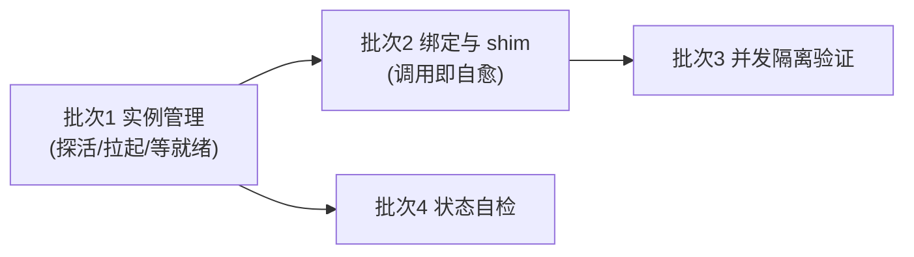

# 浏览器工具常驻与自愈改造计划

> 本文档规划开发工作站（macOS / Linux / Windows）与服务器上三个浏览器自动化 CLI —— agent-browser、playwright-cli、chrome-devtools —— 对**常驻 Chrome 调试实例**的统一接管、自愈兜底与多 agent 并发隔离。工具入口为 `scripts/chrome-debug/index.mjs`，落地后的机制见 [部署架构](../02-系统架构/06-部署架构.md) 与 [多环境部署实践](../02-系统架构/10-多环境部署实践.md)。

## 一、现状问题总览

| #   | 问题                                                                        | 现状证据                                                                                                                                    | 类别     | 优先级 | 落地位置                                     |
| --- | --------------------------------------------------------------------------- | ------------------------------------------------------------------------------------------------------------------------------------------- | -------- | :----: | -------------------------------------------- |
| 1   | 三个 CLI 只声明目标 CDP 端口，实例不在时直接报连接错误，无恢复路径           | `~/.agent-browser/config.json` 的 `cdp`、`~/.playwright/cli.config.json` 的 `browser.cdpEndpoint`、chrome-devtools daemon 的 `--browser-url` 均为端口声明 | 可用性   |   P0   | 自包含 shim（lib/shim.mjs）与实例拉起（lib/instance.mjs） |
| 2   | 实例拉起依赖人工执行完整启动命令，且命令随平台而异                           | macOS 直接执行 Chrome 二进制；Windows 与 Linux 工作站的等价命令无沉淀                                                                        | 可用性   |   P0   | 跨平台拉起（lib/instance.mjs）               |
| 3   | chrome-devtools daemon 未带 `--browser-url` 启动时会自起隔离 Chrome 实例     | daemon 以单例 socket 提供服务，连接目标仅由启动参数决定；参数缺失时不回退到既有实例                                                           | 正确性   |   P0   | daemon 参数校验（lib/tools.mjs）             |
| 4   | 多 agent 共享实例时互相干扰：活动 tab 被覆盖、页面引用失效、同页操作穿插     | agent-browser 默认会话以活动 tab 为目标；chrome-devtools 按 daemon 维护的 pageId / uid 操作，属全局状态                                       | 协作     |   P1   | 使用纪律（见 §2.5，验证项见 §三批次 3）      |
| 5   | 三工具绑定状态无统一校验入口                                                 | 配置分散在各工具的用户级目录，新机器接入需逐个核对                                                                                           | 可维护性 |   P2   | `check` / `status`（lib/diagnose.mjs）       |

## 二、方案

### 2.1 核心原则

- **单一入口**：`scripts/chrome-debug/index.mjs` 是实例状态的唯一判定与恢复入口（探活 → 拉起 → 等 CDP 就绪）。
- **调用即自愈**：三个 CLI 的命令名由 shim 遮蔽；shim 自包含（安装时写入端口、profile、Chrome 路径与启动参数），实例不在时就地拉起再转发真身，恢复动作不依赖使用方记忆、也不依赖本工具与仓库。
- **产物单点**：配置、profile、日志、pid、截图、VNC 密码统一在 `~/.chrome-debug/`（三平台同构）。
- **最小依赖**：脚本用 Node 实现（三个 CLI 本身是 Node 包，目标机器必然具备 Node），不引入额外运行时。

### 2.2 端口与实例约定

| 场景               | CDP 端口 | profile                      | 管理入口    |
| ------------------ | -------- | ---------------------------- | ----------- |
| 工作站主实例        | 9222     | `~/.chrome-debug/profile`    | 本文档入口  |
| 工作站隔离实例      | 9223 起  | 按 `--user-dir` 指定         | 本文档入口  |
| 服务器实例（dev/pre） | 19222  | `~/.chrome-debug/profile`    | 本文档入口  |

- 端口默认 9222；服务器上 9222 已被磐石 MCP 的 local-proxy 占用，故首次 `setup` 显式指定 `--cdp-port=19222`，该值记入状态文件后无需重复传。
- 启动参数按平台区分：工作站 `--auto-open-devtools-for-tabs --start-fullscreen`；服务器另加 `--no-sandbox --disable-dev-shm-usage` 与 `--window-size`（取 `--screen`，默认 1920x1080，无桌面环境）。
- 实例是否存活以 CDP 端点探测为准，不以进程名为准；pid 与日志文件名带 CDP 端口，同机多实例互不覆盖。

### 2.3 工具接口

| 子命令                    | 行为                                                                        |
| ------------------------- | --------------------------------------------------------------------------- |
| `setup`                   | 一条龙：`check` → 写三工具 CDP 配置 → 装 shim → 拉起实例                     |
| `check`                   | 环境检测（Node / Chrome / 三工具 / 实例 / 绑定 / shim / PATH 优先级）        |
| `install` / `uninstall`   | 写配置与装 shim；或移除 shim 与 PATH 前置（POSIX 写 shell rc，Windows 改注册表用户级 Path） |
| `start` / `stop` / `restart` | 实例生命周期；`stop` 对有 pid 记录的自杀进程，对无记录的经 CDP `Browser.close` |
| `status` / `view`         | 运行态（端口、profile、页面、daemon、远程桌面）与人工接管入口说明            |
| `logs` / `smoke` / `vnc-check` | 日志跟踪、CDP 端到端冒烟、VNC 链路自检                                  |

选项：`--cdp-port`（默认 9222，`setup` 指定的值记入状态文件）、`--user-dir`、`--shim-dir`、`--vnc-port` / `--web-port` / `--display` / `--screen` / `--no-remote-desktop`（仅服务器）。

默认值与固定参数（超时、启动参数、屏幕尺寸、回环地址）集中在 `lib/defaults.mjs`，其它模块只引用；需要按环境变化的值一律走选项或环境变量，不做隐藏开关。

### 2.4 跨平台落点

| 维度        | macOS                                                          | Linux 工作站                                                 | Windows                                                                             |
| ----------- | -------------------------------------------------------------- | ------------------------------------------------------------ | ----------------------------------------------------------------------------------- |
| Chrome 定位 | `/Applications/Google Chrome.app/Contents/MacOS/Google Chrome` | PATH 中的 `google-chrome` / `google-chrome-stable` / `chromium` | `%PROGRAMFILES%\Google\Chrome\Application\chrome.exe`（回退 `%LOCALAPPDATA%`）       |
| shim 形式   | 无扩展名可执行（Node shebang）                                 | 同 macOS                                                     | `agent-browser.cmd` / `playwright-cli.cmd` / `chrome-devtools.cmd`                   |
| shim 落点   | `~/.local/bin`                                                 | `~/.local/bin`                                               | `%USERPROFILE%\bin`                                                                 |
| PATH 前置   | `~/.zshrc` 末尾追加（`.zshenv` 中的前置会被后续 nvm 加载覆盖） | shell rc 末尾追加                                            | 注册表 `HKCU\Environment` 的 Path 自动置顶（须排在 `%APPDATA%\npm` 之前，`uninstall` 移除） |

Windows 的用户级 Path 由 `install` / `uninstall` 直接改写注册表，按原样读回再写回以保留 `REG_EXPAND_SZ` 类型（`setx` 会在 1024 字符处截断，不可用）；读回值含替换字符时视为代码页不匹配，放弃改写并提示手工处理。改动对新进程生效需重新登录或新开终端。

shim 由 `lib/shim-*.tmpl` 渲染生成：实例不在就地拉起，随后以真身绝对路径转发；真身定位在安装时完成（跳过 shim 目录，避免递归），且一律基于**持久 PATH**——Windows 取注册表的机器级 + 用户级 Path——否则会把版本管理器（fnm 等）注入的会话级临时目录烘进 shim，会话结束即失效；运行时不解析 PATH。服务器模式（`remoteDesktop`）下 shim 不做拉起，实例由 `start` 管理。

### 2.5 多 agent 并发隔离

| 冲突面         | 机制                                                                                     | 隔离手段                                                     |
| -------------- | ---------------------------------------------------------------------------------------- | ------------------------------------------------------------ |
| 活动 tab 被覆盖 | agent-browser 默认会话以活动 tab 为目标，`open` 直接替换其内容                             | 每 agent 一个 `--session <name>`；需要独立 tab 时加 `--pin-tab` |
| 会话隔离       | playwright-cli 的 `-s=<name>` 各自持有页面；agent-browser 会话各自持有 tab 与恢复状态       | 同一 agent 固定同一 session 名，不跨 agent 复用               |
| 页面引用失效   | chrome-devtools daemon 单例，pageId / uid 由其维护；任一 agent 导航或关页会使他人引用失效   | 不在 agent 之间传递 pageId / uid；长链路调试独占实例          |
| 同页操作穿插   | 三个 CLI 操作同一浏览器进程与 profile                                                      | 同一页面同一时刻只允许一个 agent 操作                         |
| 登录态相互影响 | 同 profile 共享 Cookie / Storage（复用登录态是目的）                                        | 需隔离登录态时用独立实例（`--cdp-port` + `--user-dir`）       |

隔离分两级：**tab 级**（同实例，session + pin-tab）用于日常并行；**实例级**（不同端口 + 独立 profile）用于互斥操作或需要独立登录态的场合。

### 2.6 代码结构

根目录只保留入口与依赖目录：

| 文件                                          | 职责                                                              |
| --------------------------------------------- | ----------------------------------------------------------------- |
| `index.mjs`                                   | 入口：选项解析与命令分发                                          |
| `lib/*.txt`                                   | 面向使用者的文本：`usage.txt`（`--help` 输出）、`view-*.txt`（接管说明） |
| `lib/shim-*.tmpl`                             | shim 脚本模板（POSIX / Windows），安装时渲染成 `~/.local/bin` 下的三个 shim |
| `lib/text.mjs`                                | 模板渲染（`{{key}}` 替换），shim 与 view 共用                     |
| `lib/defaults.mjs`                            | 集中配置：默认端口 / 屏幕、超时、启动参数与回环地址，其它模块只引用 |
| `lib/config.mjs`                              | 运行时目录与状态文件、三工具 CDP 配置写入、旧 profile 迁移         |
| `lib/tools.mjs`                               | 三个 CLI 真身定位、Chrome 定位与版本、chrome-devtools daemon 校验  |
| `lib/shim.mjs`                                | shim 安装 / 卸载、PATH 优先级、shell rc 前置                       |
| `lib/instance.mjs`                            | 实例生命周期（Chrome / Xvfb / x11vnc / websockify）                |
| `lib/diagnose.mjs`                            | `check` / `status` / `view`                                       |
| `lib/smoke.mjs` / `lib/vnc-check.mjs` / `lib/probe.html` | CDP 端到端冒烟、VNC 链路自检与冒烟夹具                  |

## 三、分阶段实施计划

| 优先级 | 批次                    | 内容                                                                       | 验收标准                                                          | 状态   |
| ------ | ----------------------- | -------------------------------------------------------------------------- | ----------------------------------------------------------------- | ------ |
| P0     | 批次 1：实例管理落地    | 跨平台 Chrome 定位与分离拉起、就绪轮询、Xvfb / x11vnc / websockify 幂等接管 | 临时端口 + 临时 profile 拉起成功；运行中的实例不被扰动             | 已完成 |
| P0     | 批次 2：绑定与 shim     | 三工具 CDP 配置写入、shim 安装与 PATH 前置、daemon 连接目标校验             | 新 shell 中命令解析命中 shim；实例关闭后直接调用 CLI 可自愈成功     | 已完成 |
| P1     | 批次 3：并发隔离验证    | 两个命名 session 并行操作验证互不干扰；双端口实例级隔离验证                   | 并发用例无交叉污染，验证过程与结论补齐 §2.5                        | 待实施 |
| P2     | 批次 4：状态自检入口    | `check` / `status` 汇总端点、daemon、绑定、shim 与 PATH 一致性              | 新机器执行 `check` 即可判定绑定是否完整                            | 已完成 |

## 四、文档同步清单

| 批次     | 同步文档                                                                                       |
| -------- | ---------------------------------------------------------------------------------------------- |
| 批次 2   | [部署架构](../02-系统架构/06-部署架构.md) 浏览器调试小节（服务器侧与工作站侧入口）              |
| 批次 2   | [多环境部署实践](../02-系统架构/10-多环境部署实践.md) 浏览器调试设施的管理入口与产物路径         |
| 批次 2   | 三个 CLI 的操作知识与并发纪律沉淀至程序性知识库（skill `dehaze-project-knowledge`）              |
| 批次 3 后 | 验证结论并入 §2.5，本文档随改造收口删除（结论以 02 与 skill 为准）                              |

## 五、不纳入本计划的事项

- **服务器实例的桌面设施选型**（Xvfb、noVNC、5900/6080 端口约定）：沿用现有机制，见 [多环境部署实践](../02-系统架构/10-多环境部署实践.md)
- **Chrome 的安装与升级**：由发行版软件包管理，工具只做检测与提示
- **三个 CLI 的功能选型与页面操作用法**：属程序性知识，不进设计文档
- **实例的系统级开机自启与崩溃守护**：本计划只保证「调用时自愈」
